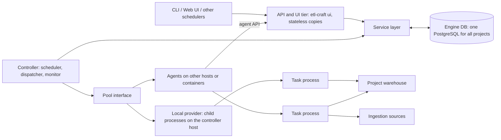
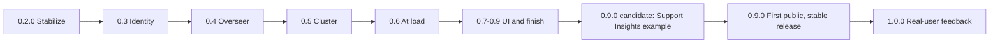

# Road to 1.0.0

This is the build plan from 0.1.0 to 1.0.0. It is written so that an engineer who has not worked on
etl-craft before can pick up any work item, find the code it touches, make the change, write the
tests that prove it, and know when it is done.

It combines two code reviews of 0.1.0 plus the merged pause, backfill, consumption-log and
catalog-history work: a three-pass review that reproduced 65 defects on SQLite, PostgreSQL, DuckDB,
DuckDB over Iceberg and Trino, and an independent review that contributed the gate-provenance,
release-gate, reserved-step-name and hidden-file findings and the worker-pool contract. Every defect
is listed with its fix in [Appendix A](#appendix-a-defect-traceability).

## How to use this plan

**Read first.** `AGENTS.md` (design rules, architecture, engineering standards, when to stop and
ask, definition of done), `CONTRIBUTING.md` (branches and commits) and
[the rewrite plan](rewrite-plan.md) (how the codebase is organised and tested). The
sections [Target architecture](#target-architecture) and
[The run and attempt state machine](#the-run-and-attempt-state-machine) define the vocabulary used
everywhere below.

**Work items.** Each release is split into workstreams (for example `S2.A`), and each workstream into
items (`S2.A.3`). Every item has the same parts:

- **Problem**: what is wrong or missing, with the defect ids it closes (`B23`, `W11`).
- **Where**: the files and functions involved. Line numbers drift; search for the function name.
- **Change**: what to build, specific enough to implement. Code shown is a sketch of the shape, not
  copy-paste-ready code: follow the module's existing style.
- **Tests**: the tests to add. Each must fail before the change and pass after it.
- **Done when**: the observable acceptance criteria.

**Branches.** One branch per workstream, or per item when an item is large, named
`<type>/<area>-<topic>` as `CONTRIBUTING.md` requires (for example `fix/execution-run-admission`).
Squash-merge by pull request. After 0.3.0 the next release is 0.9.0: each later milestone ends
when its workstreams are merged and its gate passes on `main`, with no tag, version or evidence
files (see [Release overview](#release-overview)).

**Definition of done for every item** (the full list is in `AGENTS.md`):

1. The tests named in the item exist, carry their suite marker, and fail on the old code.
2. `make static docs` and the tests the item touches pass locally against the local services
   (`make services-up`), and CI passes the complete suite.
3. User-facing behaviour changes are reflected in `docs/` (guides and reference) in the same pull
   request, and in `CHANGELOG.md` under `[Unreleased]`.
4. Engine DB changes ship as a migration in both `dialects/engine/postgres/migrations/` and
   `dialects/engine/sqlite/migrations/`, the fresh `schema.sql` files are updated to match, and the
   upgrade test passes from every released schema in `tests/fixtures/schemas/`.
5. New error classes get the next free `ExitCode`; a test enforces that no two classes share one.
6. Every failure the item introduces names the object, the value found, what was expected and the
   remedy, and is recorded on the run or attempt it belongs to.
7. Replacement work deletes the superseded path in the same item. Do not add an interface, factory,
   compatibility branch or dependency for a single implementation or caller; record the concrete
   second use first. Prefer the standard library and an existing repository helper.

**CI cost policy.** Validate each pull-request revision without repeating the test workflow after
merge. Keep ordinary regression coverage in PR checks. Repeated chaos, sustained-load benchmarks
and full example-stack acceptance belong to release validation or deliberate manual runs;
post-merge workflows publish documentation and deploy approved changes. Before opening a PR, run
the fast checks and the tests the change touches locally; CI runs the complete required suite in
under ten minutes and is its authority.

**Severity words.** *High*: possible wrong data, wrong run state or a security exposure under normal
use. *Medium*: a feature fails or behaves surprisingly in a realistic case. *Low*: an edge case or a
diagnostics problem.

## Progress

Update this table in the pull request that finishes a workstream, and record in
[Handover notes](#handover-notes) anything a later item must know: a choice that differs from the
item's text, or work done early under another item.

| Workstream | Status | Pull request | Closes |
| --- | --- | --- | --- |
| S2.A Run admission and finalization | Done | #78 | B2, B4, B7, B10, B13, B15, B23 to B32 |
| S2.B Signals and the task process | Done | #79 | B3, B53, B54 |
| S2.C Real transactions on SQLite | Done | #77 | B18 |
| S2.D SQL action guards | Done | #80 | B5, B12, B17, B21, B34, B41, B42, B44, B45, B46; B57 for SQL actions and rules |
| S2.E The Python script contract | Done | #82 | B19, B60 |
| S2.F Alerts and SMTP | Done | #83 | B20, B50, B61 |
| S2.G Configuration and secrets | Done | #84 | B48, B49, B55, B56, B58, B59 |
| S2.H Export and publishing | Done | #85 | B47, B64, B65 |
| S2.I A release gate that checks completeness | Done | #86 | B63 |
| S2.J Business rules at size | Done | #87 | B51; B57 done in S2.D |
| S2.K Migrations and small fixes | Done | #88 | B33; S2.K.5 done in S2.A |
| S2.L Regression suite and release | Done | #90, #91, #92, #93 | 48 stabilization defects; 0.2.0 released |
| S3.A Identity schema | Done | #95 | Run identities, attempt history and gate-decision schema |
| S3.I Actors and engine-only writes | Done | #98 | W15 |
| S3.B Centralized transitions | Done | #99 | Guarded lifecycle writes and immutable live attempts; ownership/reconciliation completes in S3.D |
| S3.C Explicit run selection | Done | #100 | B11, B16, W11 |
| S3.D Leases and reconciliation | Done | #101 | B1, B8, B16, B24, B26, W1 |
| S3.E Recorded gate decisions and repairs | Done | #102 | B14, B62 |
| S3.F Atomic endings | Done | #103 | B6, B9; Engine DB portion of W4 |
| S3.G.1 Canonical change hash | Done | #104 | B22, B35 |
| S3.G.2 Set-based write strategies | Done | #105 | B36 |
| S3.G.3 Safe table replacement | Done | #106 | B37, W5 |
| S3.G.4 ALTER-based schema evolution | Done | #107 | B39, B40 |
| S3.G.5 Concurrent ROW_ID allocation | Done | #108 | B38 |
| S3.G.6 One table format per target | Done | #109 | B43 |
| S3.G.7 Retry-safe appends | Done | #110 | W4 |
| S3.H Chaos suite | Done | #111 | |
| S4.A Service layer | Done | #113 | Actor-scoped operations, frozen views and CLI JSON parity |
| S4.B Overseer core | Done | #114 | Leadership, active-run recovery, notifications and shutdown |
| S4.C Schedules | Done | #115 | UTC tick identities, timezone dates, bounded catch-up and overlap policy |
| S4.D Ready-set dispatch | Done | #116 | Shared cooperative scheduling and durable gate waits without worker slots |
| S4.I.1 Delete code only tests call | Done | #118 | Removed unused helpers, lifecycle shortcuts and gate consumption wrappers |
| S4.I.2 Service operations surface | Done | #119 | Direct views, pipeline codes and one audit path per request |
| S4.I.3 Write each helper once | Done | #120 | Shared UTC, enum, cron, credential, warehouse and migration helpers |
| S4.I.4 Thinner engine and execution plumbing | Done | #121 | Shared counts, run selection, graph loading and direct row mappings |
| S4.E Retries | Done | #122 | Persisted due times, fenced claims and retryability |
| S4.F Status and explain | Done | #123 | Read-only snapshots, shared JSON and explicit unfinished outcomes |
| S4.G HTTP API | Done | #124 | Bearer roles, exact run identities and shared operation documents |
| S4.H Versioned YAML and Airflow factory | Done | #125 | Validated version 1 exports and isolated Airflow contracts |
| S4.I.5 Configuration shapes 1.0 does not need | Done | #126, #127 | Selected profiles stored directly, `tls_mode` only, unsupported warehouses refused, appends require `TASK_RUN_ID` |
| S4.I.6 Platform and dependency surface | Done | #131 | POSIX-only process control, no `packaging` dependency, DuckDB recorded as the core dialect |
| S5.A The pool interface | Done | #133 | `AttemptSpec`, `Pool` and the pool rules |
| S5.B The local provider | Done | #133 | Attempts run through the local pool, with slots per kind |
| SQL views | Done | #139 | `CREATE_VIEW`, a ninth SQL action, with secure views where the warehouse has them |
| Configuration files | Done | #140 | `etl-craft config plan`, `apply` and `export`: one CSV file per `CFG_` table, merged by key |
| SQL checks with sqlglot | Done | #141 | Parse-tree checks of SELECTs and rule SQL in the warehouse's dialect; `validate` warns on SQL sqlglot cannot read |
| S5.K Row-level rejects | Done | #143 | `REJECT_LIMIT` sets aside rows the target cannot take in `<target>__rejects`; `REJECT_COUNT` in the run logs |
| Configuration history | Done | #144 | A typed SCD type 4 history table per `CFG_` table, `AUD_METADATA_CHANGES` a view over them, and `config export --as-of` |
| 0.4 gate | Done | | The 0.3.0 wheel passed an owner-accepted 5.9-day soak with 88 server kills; 0.3.0 is the soaked release; `main`'s later changes ship in the next release without another soak |
| S5.L SQL watermarks | Done | #145 | Typed source positions, atomic success offsets, attempt/run ranges and audited resets |
| S5.M Event waits | Done | #146 | Durable file/query waits, indefinite deadlines, native file hints, evidence and downstream file tokens |
| S5.N Source definitions and schema-aware lineage | Done | #147 | Offline star/join tracing, audited source definitions, seeding and documented/deployed schema comparison |
| S5.O.1 SCD lifecycle invariants | Done | #148 | Common SCD flags, current-row soft deletes and legacy active-state upgrades |
| S5.O.2a Common config contract | Done | #149 | Mandatory core/custom CFG audit fields and keys, safe token lifecycle history and lossless upgrades |
| S5.O.2b Normalized object contracts | Done | #150, #151, #152, #153, #154, #160, #162, #181 | Merge column lists retain parameter storage; lineage versions use component endpoints; target state, view statements and rule results are keyed by components, and target locks use the resolved identity |
| S5.P Project documentation gap UI | Done | #165 | Structured schema/lineage gaps, accessible column/graph warnings and read-only comparison API |
| S5.R Consolidate before the cluster | Done | #179, #185, #188 to #193, #195, #201 | Items 1 to 8 complete: the execution core and configuration loader are split by responsibility; the moved execution functions are shortened with shared run records and unchanged transactions and retries |
| S5.S Accounts, login and roles | Done | #203, #204, #205, #206, #207 | Account identities, local and server sign-in with refresh tokens, one service-role policy, explicit actors with an `etl-craft` writer on every run, and a local installation operating a server over HTTPS; every action has one implementation that the CLI, the API and later the UI call |
| S5.O.3 SCD human override protection | Done | #208 | Native PostgreSQL/DuckDB protection, admin edits/unlocks and column provenance; cloud acceptance unavailable on its try |
| S5.Q Scoped operator controls | Done | #209, #210, #211 | Isolated manual selections, scoped holds/stop/abort, durable recovery/restart preparation, one-run pause permission, selected bulk outcomes and shared capabilities |
| S5.T Resource discovery and deployment profiles | Done | #212 | `core/resources.py` measures affinity, cgroup v1/v2 quotas and memory limits; `Deployment.Profile` sizes `run` and `server` slots, server threads and the Engine DB pool within written ceilings; doctor/setup report measurements, sizes, fallbacks and the PostgreSQL connection budget |
| S5.V Team-owned config tables | Done | #213 | Fixed package ownership, unrestricted team config, retained read-only team history and collision preflight; Databricks acceptance unavailable on its try |
| S5.U Robustness before the cluster | Done | #176, #182, #183, #184 | Engine DB restarts ridden out; SLA breach writes retried; no single-writer guess; timing tests verified under load; subprocess code measured by coverage |
| S5.W Retry only what can succeed | Done | #215 | Failure classification, retry policies and immutable attempt evidence; local and Snowflake acceptance passed, unavailable Databricks live acceptance waived by the owner |
| S5.Z Controller and agent names | Done | #216 | Controller command/package/history, agent terminology and consistent deployment profiles; lossless Engine DB upgrades |
| S5.Y A standalone orchestrator | Done | #219, #220 | Airflow export and remote mode removed; the controller always schedules; stale pipeline parameters migrated away and refused |
| S5.AA One source for every action | Done | #221 | One action table for roles, audit, placement and routes; one request per action; kebab-case flags, Capitalized_snake keys, upper-case values; typed statuses; no dialect branches or enum literals |
| S5.AB Pipeline tags and filters | Done | #222 | `TAGS` labels pipelines; one tag filter on list, status, history, catalog and UI views, and tag-selected bulk actions |
| S5.AC Pipeline trigger tasks | Done | #223 | Durable child admission, controller-held WAIT outcomes, DETACH at QUEUED admission and linked run inspection |
| S5.AD Pipeline permission groups | Done | #225 | Admin-managed groups, audited direct/tag grants, effective pipeline roles, retained SSO group IDs and child-start permission checks |
| S5.AE One gateway | In progress | #227 | Slice 1: stateless PostgreSQL `ui`, headless health-only controller, package schema checks, `ui`/`all` extras and `--api`; agent API and deployment layouts remain with S5.C/S7.F |
| S5.AF Indexes for every query | Done | #229 | Selective history indexes, bounded catalog reads and a PostgreSQL full-scan guard |
| S5.X Unmanaged SQL tasks | Done | #230 | `SQL_SCRIPT` runs any SQL as an ordinary dependent task with per-statement audit; pre- and post-SQL are upstream and downstream tasks |
| S5.C The PostgreSQL queue and the agent | Done | #231 | API-only agents with claims, renewals, fenced reports, shared log chunks and durable drain/resume/stop; durable resource locks that pass only after the expired holder's warehouse statements are confirmed stopped |
| S5.AI Event waits on signal rows | Done | #233 | Keyed SQL waits consume each signal once with the wait's success, like files; bounded probes; always-true queries are refused |
| S5.AH Partitioned offsets for streams | Done | #234 | Per-partition script offsets that never move backwards, an audited offset reset and the bounded micro-batch pattern for Kafka, Kinesis and Event Hubs |
| S5.AJ Fewer warehouse round trips | Done | #235 | Task-scoped warehouse engines, DDL-aware metadata, combined queries and exact action/attempt budgets; parallel cloud suites under 15 minutes |
| S5.D Cancellation across the cluster | Done | #236 | Prompt scoped cancellation, confirmed warehouse query endings and API-only agent acknowledgements |
| S5.E Slots, limits and priorities | Done | #237 | Active pools, priority and fair atomic claims, pipeline/warehouse limits and resource placement without over-reservation |
| S5.AK Item fan-out inside Python tasks | Done | #238 | Durable item execution, retries, controls and shared progress; interactive graph/grid visuals follow in S7.A |
| S5.F Pinned project bundles | Done | #239 | Immutable project publications and admitted metadata shared by local tasks, API-only agents, retries and controller recovery |
| S5.G Projects in one Engine DB | Done | #245 | Project-scoped metadata, bundles, grants, lineage, migrations and admission |
| S5.H | Done | #246 | Deployment-wide connection reservations and shared local child limits. |
| S5.I | Done | #247 | Managed PostgreSQL tokens, required TLS and cloning refusal; cloud acceptance procedure. |
| S5.J | Done | #248 | Shared local/queue contracts and a ten-project demo. |
| S6.A Retention | Done | #249, #250, #251, #252 | Project history/log archives, scoped reject lifetimes and supported Iceberg maintenance; current mirrors follow retained source state. |
| S6.B Logs outside the Engine DB | Done | #254 | Full external logs, byte tails, stored/live streams and retention |
| S6.C Catalog at scale | Done | #168 | Bulk catalog reads, bounded indexed history, incremental page manifest and separate logical-run KPIs |
| S6.D Business rules that don't re-check everything | Done | #256 | Complete scoped SELECTs, one check per rule, serialized unique flags and per-project upgrades |
| S6.E Cloning that keeps up | Done | #258 | Scheduled incremental audit mirrors, exact-version recovery and bounded coalesced locking |
| S6.F Metrics | Done | #259 | Shared bounded Prometheus exposition, controller events and recorded agent pressure |
| S6.G Backup, restore, upgrade and the load benchmark | Done | #260 | Restore recovery, coordinated upgrade procedure and manual load harness; reference gate deferred until after S8 |
| S7.K Organization-hosted catalog | Done | #166 | Organization URLs and prefixes, explicit proxy trust, coordinated regeneration and service examples |
| S7.A.0 Wireframes | Done | #253 | Approved by merging; the capability matrix in the design records coverage the wireframes do not show. |
| S7.Y Command-managed pipeline access | Done | #261, #263, #264 | Project isolation complete; owner moved catalog sign-in to S7.A.7. |
| S7.X Bounded timestamp windows | Planned | | Extend S5.L using the existing offset tracker; prerequisite for S8 SI_DM. |
| S7.Z Environments, governance and admin-managed projects | Done | #266 | Admin environment/governance fields, shared intervention policy, PostgreSQL direct-edit history and complete guard checks; product-audit skill. |
| S7.AA Pipeline refresh | Done | #267 | Refresh records findings; runs use the last passing version unless blocked; parallel CI and local affected-test selection |
| S7.AB Standing task controls | Done | #268 | Versioned task pauses, admitted outcomes and explicit scheduled resume choices |
| S7.AJ Required CI under ten minutes | In progress | #269 | Remove duplicated complete-suite runs; retain fail-closed accounting and measure wall time including queues |
| S7.AC Table-level business rules | Planned | | `BUSINESS_RULE_LEVEL` TABLE rules return one PASSED/OBSERVED row per run on the run log, never per-row results |
| S7.AD Python script kinds | Planned | | Required `SCRIPT_KIND` INGESTION/UTILITY; utility scripts get no offset and may report no row count |
| S7.AE Pipeline samples | Planned | | Optional whole-pipeline CI sample cases; business rules remain the correctness check on real data |
| S7.AF Config files are helpers | Done | #262 | Engine DB truth; partial, non-destructive config upserts; owner-approved plan/risk/release text accompanies code |
| S7.AG Project migrations stay in their project | Planned | | Guard project rows, admin/audit data and owned team-table DDL |
| S7.AH Renames keep identity | Planned | | Rename command preserves IDs, offsets and consumed events |
| S7.AI Fixes from the 2026-10-27 audit | Done | #264 | Pool/attempt credentials, bounded SSO, publishing, sign-in, dependency bounds, setup and first-ending metrics. |
| S7.M Stewardship uploads | Planned | | `STEWARDABLE_FLAG` pipelines run only from uploads; one pipe-delimited CSV/TXT or XLSX file; a mandatory `FILE_VALIDATION` task runs the team's script first; blanket and per-pipeline size limits |
| S7.S Seed tables | Planned | | Folder-addressed seed files replace their table on change until stewardship takes it over |
| S7.T Business calendars | Planned | | Shared holiday and weekend calendars for schedules, run dates, backfill and catch-up |
| S7.U Personal-data erasure | Planned | | A standing erasure register and ERASURE tasks remove subjects after loads, outside managed writes |
| S7.V Empty replacements | Planned | | ALLOW_EMPTY can refuse an empty CREATE_TABLE or OVERWRITE_TABLE before changing its target |
| S7.W Docs toolchain after MkDocs 1.x | Planned | | Evaluate Zensical against the API pages, navigation and published versions; migrate only when every requirement works |
| S7.O Package and demo repositories | Planned | | A very small demo stays in package CI; Support Insights holds its project and supplies release evidence the package gate validates |
| S7.P Obvious failures do not stop 1.0.0 | In progress | #173, #178 | Audit done (#173); the log-folder and port checks close their catalog rows (#178); item 4 keeps the catalog current |
| S7.Q A generic ANSI SQL warehouse | Planned | | A `generic` dialect over SQLAlchemy for rare databases: ANSI SQL only, NULL-safe column comparison for merges, refusals for anything without an ANSI form |
| S7.R Complete the test suite | In progress | #228 | Slice 1: recursive secret masking, merge crash windows and full-column/catalog upgrade guards; six-skill coverage audit remains after S7.A |
| S7.N Faster complete pull-request CI | Done | #170 | Fail-closed collection/shard accounting, isolated schema templates and shared demo workers; complete checks in 6m33s-8m15s (owner-approved ten-minute target) |
| S8.H Support Insights scenario coverage | Planned | | Deterministic mixed-quality generators, every-feature demonstrations, business-rule and stewardship cases, and runnable README coverage |

### Handover notes

What a person picking up the work needs that the code and the item texts do not say.

**S5.Q completes in three approved slices:** #209 isolates manual selections; #210 adds
holds/stop/abort and physical completion evidence; #211 adds recovery/restart preparation,
one-run permission under definition pause, selected bulk results and shared capabilities.
S5.O.3 cloud acceptance remains recorded below; probe provider availability rather than
waiting for a human quota reset. S5.T is done (#212), which also split `cancel` into `stop` and
`abort` and scoped `pause`/`resume` into `hold`/`release` at the owner's request. S5.V (#213)
implements team-owned config; Databricks acceptance was unavailable on its try. S5.W (#215) implements failure-aware retries; the owner approved merging with unavailable
Databricks live acceptance recorded as non-blocking.

Item 2 includes the approved move of account administration, interactive first-admin bootstrap,
the no-active-admin doctor check and scrypt password hashing from item 1. Sessions reuse
account-owned `CFG_API_TOKENS` with mandatory expiry for users; service-token creation refuses
USER accounts. The CLI resolves the credential and configuration once. Account/token management
and local provisioning use the shared services role policy from item 3. Actor-kind/system
fallback changes remain item 4, and remote transports/sign-in endpoints remain item 5.
The approved local recovery boundary is interactive `setup` with Engine DB writer credentials
when no active admin remains, never an HTTP route. Remote Airflow exports require the approved
`Auth.Airflow_connection_id`; pipeline action reasons carry the triggering user URL-encoded,
while the service account remains the actor.

**Plan, 2026-10-26 (owner).** Business stewardship corrects ODS, the operational store, through
the client chain; DM takes corrections only through SI_DM. S7.A.7 adds account lockout (not a
growing delay) and server-side personal settings; personal subscriptions stay out. The
deployment is usually internal: weigh security choices against that, not public exposure.


**Owner decisions, 2026-10-26/27 — config helpers, risks and release.** The owner explicitly
requests this plan text together with S7.AF's code; only S7.AF is implemented in that PR.

Owner clarification for S7.AF: disabling a parent preserves unchanged existing children.
New or changed active children require active parents. Columns must still retire before their table.

Run order is S7.AF, S7.Y B, S7.AI, S7.Z, S7.AA, S7.AB, S7.AJ. S7.Y stays In progress until B merges.

- S7.Z: Engine DB truth replaces file drift reporting; direct edits need no drift report.
  Reuse S7.AG's project/admin/team-table guards for direct edits; its bullets remain unchanged.
- S7.Y B: CI may apply changed files only; whole folders are not required and unchanged files
  are no-ops. Project code comes from the folder's explicit Orchestration.Project, never its
  name; a conflicting --project fails naming both. Keep one configured folder per project, no
  multi-project apply or git-aware option; CI chooses folders/files. Deleted folders apply
  nothing; project disable remains explicit. Config apply, project migrations, bundle publish
  and generate-docs require project CAN_MANAGE. Cross-project dependencies require upstream
  project CAN_VIEW at apply time; upstream pages list cross-project dependents. Local logs move
  to <Log_dir>/project-<id>/<PIPELINE>/run-<id>/...; existing locations stay readable. Served
  catalog uses API/UI sign-in and project filtering; static organization catalogs are one site
  per project under host access control. Stop if further public surface is needed.
- S7.AE: start sample Engine DBs from an export of the target Engine DB, then apply the change's
  files; the repository may not contain all rows. This supersedes the config-only bootstrap.
- Trust boundary: projects in one instance trust each other's executable code; separate
  security domains require separate instances.
- S7.AD: SQL_SCRIPT and UTILITY Python default RETRY_ON=NONE; explicit task parameters override.
  Repeating arbitrary SQL/side effects after disconnect is unsafe. Existing implicit defaults
  change and must be called out in CHANGELOG when implemented.
- S7.A.7: recovery treats locked admins as unavailable; refuse locking/disabling the last
  unlocked active admin and name the recovery remedy.
- Release gate: read every item's 1.0.0 gate as 0.9.0. 0.9.0 is the first public stable release
  (PyPI, images, announcement), with no alpha. 1.0.0 follows real-user feedback. Keep this file's
  name and the `(road to 1.0.0, <id>)` commit convention. Breaking changes remain allowed before
  0.9.0; the compatibility guarantee begins with it.
- S7.G: every later 0.x/1.x reads 0.9.0 Engine DBs, YAML, CSVs, CLI invocations, JSON and /api/v1.
  Removal waits for 2.0 after one minor of warnings. Mixed-version controller/UI/agent/CLI
  rolling upgrades replace S7.F's same-release rule: same-major compatible ranges and additive
  API changes replace exact-version checks. Post-0.9 migrations add tables, nullable columns or
  indexes only, so previous binaries run on upgraded DBs and rollback is a reinstall. Older
  versions refuse newer-only settings/columns/parameters naming their required release, never
  silently ignore them. test-upgrades adds old/new agent-controller combinations and the
  previous suite on upgraded DBs as release gates, never PR CI. S6.G's non-rolling procedure
  remains for pre-0.9 releases. Item bullets remain unchanged.

**UI plan, 2026-10-25 (owner).** S7.Y, S7.Z, S7.AA and S7.AB come before S7.A page code, after
S6 completes. `GOVERNANCE` (`STRICT`/`RELAXED`) is the single switch for relaxed rules; the
owner asked for one setting covering config edits, reasons and confirmations, and production
cannot be relaxed. Admin settings (projects, pools, environments, access) never live in config
files.

S5.R is complete; execution shares `run_types.PipelineRun` and frozen `run_start.StartOptions`,
and loader helpers live in `config/loader_helpers.py`.

Traps these refactors hit, with what works:

- **The baseline is compared file by file.** Moving a function that carries debt into a new
  module reads as growth even when the total falls. Lower the debt in the same pull request
  or stop and ask the owner; never apply `quality-exception` yourself.
- **Status writes stay in `engine/transitions.py`.** `test_no_direct_status_writes` fails
  otherwise. That module is exactly at its 950-line baseline: any line added there needs a
  line removed.
- **mypy refuses implicit re-exports.** After moving a name, repoint every importer in
  `src/` and `tests/` (`git grep`). Also repoint each `monkeypatch.setattr(module, ...)`
  target, the string paths passed to `tests/fixtures/races.py`, and `fault=` names, to the
  module where the name is now looked up.
- **The query catalog.** Every dialect must expose the same query names, so a
  dialect-specific query needs a file in both `sqlite/queries/` and `postgres/queries/`.
  Every selected column needs a lower-case alias, so `SELECT *` is refused. SQL built from
  table names belongs in `EngineDialect` methods.
- **Renaming a private function to public** can collide with a local variable of that name
  (`paused` became `paused_outcome`).
- **Moving code with a script** drops module-level assignments (`logger`, `TypeVar`s,
  constants). Run `ruff check` and `mypy --strict` on `src/etl_craft` after each move.
- **Before calling a refactor done:** `make static docs`, the unit tests, and the
  integration tests of every touched package on both Engine DBs with
  `ETL_CRAFT_REQUIRE_SERVICES=1`. The pre-PR skill lists the environment failures (Iceberg
  REST after a reboot) to rule out first.

**The 0.4 gate and 0.4.0.** The soak ran the 0.3.0 wheel (`release/0.3.0` at bbf2bdc, the same
`src/` and lock file as `v0.3.0`) from 10 October 08:01 UTC until a reboot on 16 October at about
05:09 UTC, 5 days 21 hours. Its last check passed: every due tick made one run (563, 564 and 564),
12,945 attempts succeeded beside one expected flaky-feed failure, and all 88 server kills were
recovered with nothing lost or doubled. The owner accepted it without a restart, so it meets the
0.4 gate for the code it ran, which is 0.3.0. Only soaked code is released: no 0.4.0 is cut from
it, and `main`'s changes since 0.3.0 stay under `[Unreleased]` for the next release, which needs
no further soak.

**Priority correction after S5.N.** Build S5.O, S5.P and S5.Q before S5.C. The
[metadata and pipeline UI design](metadata-and-ui.md) records the schema gaps, normalized
table/column contracts with separate catalog/schema/name components, migration scope, common config/audit rules, SCD1/SCD2
lifecycle semantics, per-column warning states and built-in operational dashboard panels.
S5.N's merged dotted-name source table is an intermediate implementation to replace, not the
final metadata model. S7.A.1 delivers Pipeline Insights without team-specific dashboards.
S5.O.1 completes SCD lifecycle rules; S5.O.2a delivers the common config contract, followed by
S5.O.2b for object normalization and then the UI items. The frozen 0.4
soak is unchanged.
S5.R and then S5.S come after S5.O.2b and before S5.O.3: S5.O.3's human-only locks and S5.Q's
operator controls need proven people and roles, and S5.C's workers are service accounts.
S5.O.2b finishes with the three slices in
[S5.O.2b Remaining object identities](#s5o2b-remaining-object-identities). Merge column lists
stay task parameters rather than becoming child rows. The order is slice 2 (versioned lineage),
then S5.P (project documentation gap UI) while the soak runs, then S5.R item 3 (data-driven
migration markers) once the soak ends, then slice 3, whose conversion registers as data instead
of a new branch in the migration runner, then the rest of S5.R. S5.P needs no S5.R, S5.S or
S5.O.3 work, and builds on the catalog pages slice 2 changed. After S5.S, S5.O.3 and S5.Q, take
S5.T (resource discovery and deployment profiles), then S5.C. S5.T supplies the single-machine foundation that workers reuse; it
does not move worker work ahead of the metadata, account or operator-control corrections.

**Direction after S7.N (owner, 15 October 2026).**
- **Two repositories.** This package and the Support Insights repository. Support Insights
  holds the demo code, its deployment and the etl-craft project in `project/`: `craft-connector.yml`,
  `config/`, `sql_scripts/`, `python_scripts/`, `validation_scripts/`, `migrations/` and `seeds/`.
- **The package's CI tests the package only.** A very small demo stays in the package for its
  tests. Package CI does not run or prove the Support Insights demo; it validates the result
  evidence the demo publishes for a candidate (S7.O and the revised S8.G).
- **Distribution.** The demo installs etl-craft from this repository's GitHub releases.
  etl-craft goes to PyPI only when 1.0.0 is released and everything is done.
- **Stewardship is chosen by pipeline** (the revised S7.M).
  - `CFG_PIPELINES.STEWARDABLE_FLAG` marks a stewardable pipeline. It has no schedule, cannot
    be run by hand, and runs only from an upload of one file: pipe-delimited CSV or TXT, or
    XLSX. A steward picks the pipeline from a drop-down.
  - Its first task is an explicit `FILE_VALIDATION` step running the dev team's own script,
    which takes input parameters and returns nothing. The handler is allowed only in
    stewardable pipelines.
  - `craft-connector.yml` sets a blanket upload size limit for the project, and each
    pipeline's `FILE_VALIDATION` task may set a lower one.
  - Demo stewardship covers the normalized ODS (business data) and the `ds` reference tables
    (S8.H item 3); the mart takes business corrections only through its normal ODS load.
- **The UI never edits metadata.** It is for pipeline operations. Its actions follow
  Informatica PowerCenter's Workflow Monitor (S5.Q, S7.A.2), not Airflow's narrower
  constraints. It adds run views, the generated catalog documentation and run-health
  dashboards.
  Metadata changes only through config files.
- **1.0.0 does not fail for obvious reasons** ([What 1.0.0 is](#what-100-is), S7.P).
  - Ordinary outages are ridden out without an operator.
  - Ordinary mistakes are caught before a run, with the remedy.
- **Teams own their extra `CFG_` tables** (S5.V). Teams maintain and use their own `CFG_` tables
  with their own scripts; etl-craft keeps no restrictions on them.
- **Order.**
  - The quality and robustness review that same day added S5.R items 7 and 8 and S5.U.
  - S5.U comes after S5.R and before S5.T and S5.C.
  - S5.V comes after S5.R item 3 and before S7.M.
  - S7.O starts after the frozen 0.4 soak ends.
  - S5.W (retrying only failures that can succeed) follows S5.U item 5 and comes before
    S5.C.
  - S5.Z (controller and agent names) comes before S5.C. S7.Q (generic ANSI warehouse)
    follows S5.X.
  - S5.Y (standalone: no Airflow, no remote mode) and then S5.AA (one source for every action)
    come after S5.Z and before S5.X, S5.C and S7.A (owner, 19 October 2026). etl-craft is a
    standalone orchestrator from 1.0.0; the agent commands, the UI actions and S5.X's handler
    are built on S5.AA's action table.
  - S5.AB (pipeline tags), S5.AC (pipeline trigger tasks) and S5.AD (pipeline permission
    groups) follow S5.AA in that order and come before S5.X and S5.C (owner, 19 October 2026).
    All three use the action table; S5.AC's controller-held wait must exist before agents, and
    S5.AD's grants come before S7.A and S7.M, which use them.
  - S5.AE (one gateway: the controller, `ui` and agent roles) follows S5.AD and comes before
    S5.C and S7.A (owner, 20 October 2026). Only the controller and the `ui` copies hold Engine
    DB credentials; agents, the UI and remote CLI calls go through the API. S5.C builds the
    agent API on it.
  - S5.AF (indexes for every query) follows S5.AE and comes before S5.C (owner,
    20 October 2026), because the `ui` copies and agents multiply query load.
  - S7.R.1 (known test gaps) follows S5.AE and comes before S5.AF (owner,
    20 October 2026). S7.R.2 (the six-skill audit) follows S7.A and comes before the first
    1.0.0 release candidate (owner, 20 October 2026).
  - None of these moves S5.S, S5.O.3 or S5.Q.
  - S5.V and S7.M add `validation_scripts/` and `uploads/` to the project directory, and the
    implementing pull requests update `AGENTS.md`'s design rules to match.

**Acceptance availability.**

S7.AB (#268) exercised standing outcomes, holds, expiry, replacement, schedule resume,
permission refusals and released-schema upgrades on SQLite and PostgreSQL. Admission and
replacement visibility races passed twenty local rounds. Warehouse SQL and cloud dialects
are unchanged; cloud acceptance was not needed. Complete matrix and wheel demos remain CI gates.

S7.Z validates admin/role boundaries, strict and relaxed interventions, direct-edit attribution,
missing guards and real-row upgrades on SQLite and PostgreSQL, plus real SCD edit/unlock checks
on DuckDB and PostgreSQL warehouses. Environment-change races pass twenty rounds per Engine DB.
Static checks, strict docs and skill validation pass. No warehouse SQL changed; cloud acceptance
is not required. Console tests remain S7.A's work; the product-audit release workflow is added,
not executed against a release candidate here.

S7.AI validates pool/attempt credentials, lease expiry and renewal, credential-free child
processes (including pinned config secret names), SSO age, concurrent sign-in, OIDC TLS/cache,
publishing, setup and first-ending catalog numbers. Both Engine DBs upgrade real token rows
from every released schema. Grant/claim/sign-in/ending races run twenty rounds; security and
Semgrep dispositions are in #264. Browser catalog sign-in is explicitly S7.A.7; one-project
IP-restricted publishing is the interim contract. Warehouse SQL is unchanged, so cloud SQL
acceptance is not required. Complete coverage and installed-wheel demos remain CI gates.

S7.Y B validates project boundaries, permission precedence, explicit selection, full exports,
per-project catalog artifacts and log paths on both Engine DBs. Real grants and history upgrade
from every released schema without changing effective access; negative controls reject the old
source and a missing compatibility backfill. Grant/revoke and claim races pass twenty local
rounds. Static/strict docs, Semgrep and the security/code reviews run; discovered metadata
leaks are corrected with regressions. Warehouse SQL is unchanged, so cloud acceptance is not
required. Owner decision, 2026-10-27: signed-in catalog serving moves to S7.A.7; #263
merged and S7.Y is Done. S7.AI verifies the interim publisher serves one configured project.

S7.AF passes static/strict docs, partial-config and project-preservation checks on both Engine
DBs, existing source/target upgrade callers, all four local warehouse source-contract cases,
permission/action checks and the ten-project CLI demo. Its new regressions fail on the old
source. Semgrep and the security self-review report no findings. No warehouse SQL or schema
changed; cloud acceptance and new schema migrations are not required. Full matrix coverage and
installed-wheel demos remain CI gates. S7.AG/AH/AI and the release changes here are plan only.

S7.Y A exercises both Engine DBs, permission delegation, atomic bulk changes, the generated
HTTP/CLI actions and upgrade conversion from every released schema. Same-identity grant/grant
and grant/revoke races pass twenty local rounds. Semgrep scans the permission, CLI and generated
API boundary; warehouse SQL and cloud dialects are unchanged. Project-isolation acceptance is B.

S6.G covers PostgreSQL container-matched dump/restore recovery, committed-task preservation,
agent registration/claim/renewal version refusals and controller tick measurements. A two-project
smoke run validates the manual harness and reports a queue-age budget failure; its measurements
belong in PR #260, not release evidence. Owner decision, 2026-10-26: the 24-hour reference run
and similar long-running validation are deferred until the S8 Support Insights demo completes
without failures. No reference-cluster performance gate is claimed by this item.

S6.F covers both Engine DBs, both HTTP listeners, transaction/savepoint rollback, live queue
and agent state, constant scrape statement counts and released-schema upgrades. Scrapes during
admission, lease expiry and metrics activation run twenty local rounds. Semgrep scans the
changed API files; the built-in security-review tool is unavailable, so manual security review covers the HTTP, actor,
label and connection boundaries. No warehouse SQL changes require cloud acceptance. Full
platform coverage and installed-wheel demos remain CI gates.

S6.E acceptance runs incremental insert/update/purge equality and changed-row copy volume on all
four local warehouses, real controller-loss recovery on both Engine DBs, every released-schema
upgrade with real rows, and twenty rounds of lock/coalescing races. Databricks and Snowflake each
run one live incremental cloning acceptance; any provider unavailability is recorded in PR #258.

S6.D validates complete-query shapes, scoped/forced clearing, output-key errors and counts on
all four local warehouses, plus live Databricks and Snowflake. Both Engine DBs cover real-row
upgrades from every released schema, mixed-project dialect conversion, duplicate refusals and
transaction rollback. Same-rule publication, independent rules, agent ownership checks and
six-rule DuckDB Iceberg waves pass twenty local rounds. The built-in security-review tool was
unavailable; manual security review and Semgrep cover the changed SQL/input paths. Semgrep's
constructed-SQL audit finding is reviewed against the read-only guard, quoted identifiers and
bound execution IDs. Full platform coverage and installed-wheel demos remain CI gates.

S6.B validates full local/agent logs, live-to-stored byte continuity, configured UTF-8 tails,
file/MinIO storage, exact identity and role/path refusals, pending/removed/inaccessible reports,
and bounded file/chunk memory. Terminal guards refuse no-op rewrites, and the complete query
plan gate verifies bounded reads without additional scan exemptions. Both Engine DBs cover
publication/retention crash recovery and
real-row upgrades from every released schema, preserving oversized legacy text. Real PostgreSQL
agents cover upload interruption and controller restart; publication/retention and duplicate
endings run twenty local race rounds. The built-in security-review tool was unavailable;
manual security review, attacker-shaped checks and Semgrep supply the recorded review evidence.
No warehouse SQL changed, so cloud acceptance is not required; the complete platform matrix,
coverage and installed-wheel demos remain CI gates.

S6.A slice 3 validates old/new/foreign reject boundaries and real merge exclusion on all four
local warehouses, plus real process-loss recovery on both Engine DBs. Released-schema upgrades,
config/history round trips, doctor/setup behavior and administrator API/archive regressions pass.
Execution snapshots include complete table-policy rows in both dialects, and discovered source
exports initialize all optional policies. Real execution and installed-wheel demo checks cover
those shared metadata consumers.
Trino snapshot/orphan procedures execute without changing current data; unsupported adapters
refuse configured file-maintenance policies. Native Databricks and Snowflake reject checks pass.
Snapshot/orphan counts are planned/executed operations, not estimated deleted files. The complete
platform matrix and installed-wheel demos remain CI checks.

S6.A slice 2 validates immutable archive delivery, complete-value verification and added-column
schema evolution on DuckDB, PostgreSQL, Trino/Iceberg and DuckDB/Iceberg. Databricks native/UniForm and
Snowflake native archive checks pass; Snowflake Iceberg storage is not configured for this acceptance.
Both Engine DBs pass process-loss recovery at every archive commit boundary, reference-safe
retention, log/file protection, administrator HTTP access and released-schema upgrades.
Concurrent archive purges are repeated locally. The full platform matrix and installed-wheel
demos remain CI checks; slice 3 completes the auxiliary retention behavior.

S6.A slice 1 validates project history/log retention and released-schema upgrades on SQLite
and PostgreSQL, CLI process death at each new commit boundary, administrator API access and
reference protection. Populated query-plan checks cover indexed deletion/reference probes,
with complete-category dry-run counts identified explicitly as maintenance reads. Its manual PostgreSQL volume gate removes one million attempts within
the five-minute budget while a concurrent real pipeline finishes. Static/docs and unit checks
pass; concurrent purge callers are repeated locally. No warehouse SQL changes in this slice;
slice 3 completes the warehouse auxiliary behavior.

S5.J validates shared local/queue contracts on PostgreSQL, including process death, claim
acknowledgement loss, cancellation, controller recovery and capacity. Both providers and the
existing atomic limit cases pass twenty successive local rounds. The ten-project demo,
existing real-agent/protocol checks, managed acceptance harness, unit suite and static/docs
checks pass. No warehouse SQL changed; installed-wheel demos and the full platform matrix
remain CI gates. S5.I native-password cloud results are recorded below.

S5.I exercises initialization, migration, execution, reservation loss and a child exit after
committed success through real CLI processes on local PostgreSQL, live Lakebase and live
Snowflake Postgres with native password credentials. Unit checks cover both provider exchanges, fresh tokens, TLS, cloning,
bound Snowflake arguments and secret-safe refusals. End-to-end automatic token issuance remains
unverified because issuer credentials are not configured. Managed cloud setup uses a
bounded deadline suited to WAN schema/catalog round trips; local command limits are unchanged.
The cloud cases do not add work to pull-request CI.

S5.H validates both Engine DB migrations, PostgreSQL live-session accounting, startup admission,
shared UI task limits, ownership recovery and process death. Static/docs and unit checks pass;
controller, API, gate and local execution checks pass. Admission and local child races run
twenty rounds. Warehouse SQL is unchanged, so cloud acceptance is not required; installed-wheel
demos remain the required CI gate.

S5.G validates project metadata, same-code pipelines, cross-project dependency files, scoped
hash/lineage/audit state, grants, bundle approvals, project pools/quotas, project migrations
and docs publication on both Engine DBs. Released-schema upgrades compare fresh schema and
retained rows; local claim and agent completion/limit races pass twenty rounds. Static/docs,
API/CLI, controller, retained-bundle execution and local service checks pass. Security review
covers the changed source, with regression checks for scoped clones, profile selection,
serialized approvals and dependency visibility. Cloud acceptance is unavailable because no
cloud usage budget was made available; installed-wheel demos remain the required CI gate.

S5.F (#239) validates immutable file/S3-compatible publications, real API-only agent execution,
run-pinned metadata, retries/recovery and controller restart on both Engine DBs. Released-schema
upgrades, actor/immutability guards, catalog query plans and attempt budgets pass; admission,
lease, lock, fencing and download checks pass twenty rounds. Credential-redirection and
secret-safe parsing regressions pass. Cloud warehouse acceptance is not required: warehouse
SQL generation and authentication behavior are unchanged; S3 access is exercised against MinIO.

S5.AK (#238) validates bounded thread/process execution, durable item retries and operator
controls on both Engine DBs. Released-schema upgrades, actor/append-only guards, catalog query
plans, shared reporting and unchanged S5.AJ budgets pass; concurrency checks pass twenty rounds.
Old-source and deliberate-guard-break runs fail as expected. Cloud acceptance is not required:
warehouse SQL generation and dialect behavior are unchanged. The owner deferred the interactive
item strip and runs grid to S7.A; this item supplies their recorded data and operations.

S5.E (#237) validates pool configuration and history, individual resource placement,
local process ceilings, pipeline/warehouse limits, priority and fairness on both Engine DBs
where applicable; agent claims use PostgreSQL. Released-schema upgrades and the unchanged
S5.AJ action/attempt budgets pass. Lock, lease, fencing, claim and transition checks pass twenty
rounds. Cloud acceptance is not required because warehouse SQL is unchanged.

S5.AJ (#235) ran the unit, action, merge, crash, released-schema upgrade and API checks on
both Engine DBs where applicable and all four local warehouses. Lock, lease, fencing,
transition and ROW_ID checks passed twenty rounds. Both clouds were available: six-worker
Snowflake passed 33 tests in 12m25.92s, and Databricks passed 32 in 7m50.98s; the Snowflake
native every-action test took 2m35.893s. Earlier serial observations were 61m16s and 44m06s
respectively; their failing/incomplete runs and the scope comparison are detailed in the PR.
A paired serial/parallel Databricks run retained identical evidence apart from times.
After tightening the Databricks capability-refusal guard, its rerun passed 25 tests and failed
seven because Unity Catalog refused new tables (559 against a limit of 500). A subsequent
quota query and allocation probe still refused creation at 552/500; this is a failed acceptance
run, not an unavailable-cloud waiver. The owner accepted the prior passing run plus the new
refusal-path regressions (23 October 2026): comparing every runtime file with that wheel showed
only the stricter temporary-table capability-error classifier changed. The source review found
no security issue, and all 2,698 unit tests pass.

S5.X (#230) exercises ordered unmanaged statements, bind inputs, partial failures and attempt
logs on all four local warehouses. Dependency chains, retry policies and process loss are
checked on both Engine DBs, with released-schema upgrades retaining rows and constraints.
Native Databricks and Snowflake acceptance passed. Managed SQL guards remain in place.

S5.AF (#229) covers the resolved PostgreSQL query catalog with a growing-table scan guard
and full-volume plans for 10,000 pipelines of 20 tasks with a year of daily history. Index
plans and attempt write costs were measured. Catalog, run-inspection, trigger-link and
controller-schedule behavior passed on both Engine DBs. Upgrades from every released SQLite and PostgreSQL schema retain rows and match fresh
indexes and constraints. Only Engine DB SQL changes; warehouse/cloud acceptance does not apply.

S7.R.1 (#228) covers nested secret and URL masking through audits, logs, CLI JSON and HTTP
on both Engine DBs; real process loss at seven merge boundaries on all four local warehouses
and both Engine DBs; and full-column retention plus catalog equivalence from every released
schema. The warehouse SQL is unchanged; cloud acceptance does not apply to the shared
insert refactor exercised by the four local warehouses.

S5.AE slice 1 (#227) covers two PostgreSQL UI processes sharing sign-in, refresh, run reads
and revocation, including the loss of one copy. Database/schema readiness recovers without
restarting a UI copy; shutdown draining and trusted forwarding metadata are covered. Health-only controller supervision excludes
web dependencies, and SQLite UI, missing-extra and package-schema mismatch refusals are
covered on the affected Engine DBs. No Engine DB schema or warehouse SQL changes; cloud
acceptance does not apply.

S5.AD (#225) covers open/restricted pipeline reads, direct and tag grants, viewer elevation,
CLI/API refusals, filtered history and private dependency/lineage/catalog details on SQLite
and PostgreSQL. Group/grant histories, atomic config refusal, flat OIDC claims, group rename
and name reuse, refresh expiry, retained run claims, child/grandchild propagation and queued
child permission withdrawal are covered locally. Upgrades from every released schema and
fresh/upgraded schema equivalence pass. No warehouse SQL or cloud authentication changes;
cloud acceptance does not apply.

S5.AC (#223) covers WAIT/DETACH admission and real controller execution with one agent slot,
restart recovery, every child ending, deadline recovery, explicit reruns, ownership refusals,
interventions and captured dependency consumption on SQLite and PostgreSQL. Repeated
admission/control races and upgrades from every released schema pass, including fresh/upgraded
catalog equivalence. CLI/API/catalog links, parameter validation and reference documentation
are covered locally. No warehouse SQL or cloud authentication changes; cloud acceptance does
not apply.

S5.AB (#222) covers tag metadata and atomic config-file refusals, AND filtering through the
CLI and generated HTTP routes on both Engine DBs, bounded cross-pipeline history, explicit
definition-control batches and immutable audit selections. Catalog labels and linked filters
are checked with cached-page invalidation. No warehouse SQL or schema changes; cloud
acceptance does not apply.

S5.Y.1 (#219) covers the controller's catalog ticks and immutable request/completion audit
on both Engine DBs, preserved leadership and service roles, removal refusals, documentation,
and complete remaining CI matrix accounting. No warehouse SQL or authentication changes;
cloud acceptance does not apply. Remote execution remains for S5.Y.2.

S5.Y.2 (#220) covers the stale-key refusals in the loader, `validate` and `config apply`, and
the `0043` upgrade from every released schema on SQLite and PostgreSQL with remote-era audit
rows read back. No warehouse SQL changes; cloud acceptance does not apply.

S5.AA (#221) runs the unit suite and every integration directory locally on SQLite and
PostgreSQL: the action table, generated routes and the remote CLI, every renamed
`craft-connector.yml` key and value, and the connection matrix against local PostgreSQL (TLS),
DuckDB, Iceberg REST, Trino and a TLS SMTP relay. Warehouse SQL is unchanged; the Trino catalog
query moved into its dialect as written. Cloud acceptance does not apply.

S5.Z (#216) validates the controller command, both Engine DBs, preserved process history from
released schemas, fresh/upgraded catalog equivalence, scheduling, leadership and local/API
startup. Warehouse SQL and cloud authentication are unchanged; cloud acceptance does not apply.

S5.W (#215): all four local warehouses passed the real syntax-error and interrupted-connection
retry contracts. Snowflake passed the same live pair. A fresh Databricks SELECT probe returned
HTTP 400 before execution and the warehouse reported STOPPED, so its live pair remains unverified;
the owner explicitly approved treating unavailable cloud acceptance as non-blocking for merging
#215. This is provider availability, not a request for a human quota reset.

S5.V (#213) has SQLite/PostgreSQL acceptance for plain team writes, package guards, config
exports, preserved team triggers, frozen typed history, lossless legacy JSON history and
migration-name collisions. Local cloning covers the four warehouses; the affected Snowflake
cloud cloning test passed. A fresh Databricks statement request failed before SQL execution
with HTTP 400 and the warehouse reported STOPPED, so Databricks cloning acceptance is
unavailable; under the one-try cloud rule (`AGENTS.md`, "Validation") it did not hold the
merge. Databricks cloning is unverified on a live warehouse until release evidence runs it.

S5.T (#212) runs discovery and sizing from supplied measurements in unit tests, and role
startup, the sized Engine DB pool, a zero-slot pool and the connection budget on both Engine
DBs. No warehouse SQL changed; no cloud acceptance applies. Real containers (Docker cgroup v2
limits) were not exercised beyond this workstation's cgroup; S5.C's worker tests run them.

S5.Q slice 3 (#211) uses both Engine DBs for populated/released-schema upgrades, recovery and
checkpoint preservation, durable restart identity, one-run definition-pause permissions,
capability policy, selected bulk results and local/server CLI contracts. Run creation and
control races are repeated locally. Warehouse SQL/authentication are unchanged; no cloud
acceptance is required for this slice. The earlier server-query adapter limitations remain.

S5.Q slice 2 (#210) uses SQLite/PostgreSQL Engine DB migrations and local worker, CLI/API,
process-identity, event-fence and concurrency acceptance. Warehouse SQL and cloud authentication
are unchanged; server-side aborts without a query acknowledgement adapter explicitly refuse,
while supported graceful stops wait for normal completion. Server-side Python scripts need a
query adapter for scoped stop; definition pause remains available. Cloud acceptance is not required for the
embedded-query capability declaration, which changes no emitted SQL.

S5.Q slice 1 changes Engine DB admission and execution scope, with SQLite/PostgreSQL
upgrades and local CLI/API/concurrency acceptance. Databricks availability is a timed provider
limit, not a new owner-budget approval: the fresh query probe failed before SQL execution
and the warehouse reported STOPPED without a reset timestamp. Re-query availability in a later
session rather than requiring a human quota reset.

S5.O.3 (#208) implements transactional protection on native PostgreSQL and DuckDB, with
explicit refusals on non-atomic warehouses. Local validation includes SCD1/SCD2 effective
values, provenance, authenticated API roles on both Engine DBs, rollback and repeated ETL/edit/
unlock races. The owner merged #208 after the fresh Databricks probe could not start compute. That
availability limit is timed and must be checked against the provider, not treated as waiting
for a human quota reset. A fixed-checkout Snowflake acceptance run is being completed separately.

S5.S item 5 (#207) passed `make static docs` and the complete unit suite (1,897). Against a real
HTTP server on both Engine DBs it passed password and SSO sign-in, renewal, refresh expiry,
logout, account disabling, matching local and remote output, the role boundary with recorded
refusals, refused metadata commands, HTTPS enforcement and attempt logs (20). The API, account,
sign-in, explicit-actor, inspection and catalog-upgrade tests passed (164), including
fresh-versus-upgraded catalogs from 0.1.0, 0.2.0 and 0.3.0. The integration tests of every
command now routed through an operation passed (1,027). The new tests and the import contract
fail on the old source. No warehouse SQL, run creation, lease, lock or gate code changed, so
cloud acceptance and repeated races were not required; the installed-wheel demos and Airflow
contracts run in CI. Databricks was not used.

S5.S item 3 (#205) passed the complete unit suite, the shared policy and real CLI/HTTP/service
role cases on both Engine DBs, existing account/API/audit callers, configuration/inspection/
lineage/overseer callers and all four local warehouse CLI/watermark callers. The installed-wheel
local and orchestrated demo matrix, package/quick-start checks, static checks and strict docs
passed. Shared-policy branch coverage is complete. Old-source command/migration regressions
fail behaviorally; the new policy/error APIs are absent from that source. Cloud acceptance,
Airflow/actionlint and repeated races are not required: warehouse SQL, YAML generation,
workflows and concurrency algorithms are unchanged. Databricks was not used.

S5.S item 2 (#204) passed the unit, account/session, API/CLI caller, execution and local
warehouse CLI checks, installed-wheel demos and packaging checks. Local caller validation
also covers script-process signals and schedule exports with explicit fixture credentials.
Credential-file and account
revocation/recovery races passed twenty consecutive rounds. Airflow contracts passed on both
supported versions; static checks, strict docs and actionlint passed. New account APIs are
absent from the old source; command authentication and Airflow credential regressions also fail
against the old source. No cloud acceptance is required for this item; Databricks was not used.

S5.S item 1 (#203) passed `make static docs`, 1,811 unit tests, 1,080 Engine DB/API tests,
20 cloning tests across all four local warehouses and 50 final account/upgrade/catalog checks.
All 32 new account cases fail with the old source. Snowflake cloning passed, including omission
of account password hashes. Databricks native and Iceberg acceptance is unavailable: opening
a SQL session fails with the provider's `BAD_REQUEST: Cannot create the resource`, before SQL
executes. The owner merged #203 with that environment limitation; do not rerun Databricks
until the owner makes usage budget available.
Local wheel demos, Airflow, actionlint and repeated races were not needed for this slice.

S5.R item 7, shortening the moved execution functions (#201), passed `make static docs`,
all 1,807 unit tests, all 517 execution integration tests and 101 API/overseer caller tests.
Twenty consecutive rounds of 32 admission, lease, retry, cancellation and atomic-ending tests
passed on both Engine DBs (640 executions), with services required and no skips.
Cloud acceptance, local wheel demos, Airflow and actionlint were not needed for this refactor.

S5.R item 8, configuration loader (#195), passed `make static docs`, all 1,807 unit tests,
and 157 connection, run-connection, validation, catalog and lineage integration tests,
including both Engine DBs and all four local warehouses, with services required and no skips.
Cloud acceptance, wheel demos, Airflow and repeated races were not needed for this refactor.

S5.U item 4 (#183): `test_what_a_script_printed_is_kept_when_it_is_stopped` and
`test_a_task_process_that_ends_without_an_outcome_is_recorded_failed` passed 50 of 50 rounds with
every CPU of a 12-CPU workstation busy, at about 47 seconds per round.

S5.O.2b slice 3 (#181) passed:
- the new upgrade, refusal, lock and schema tests on both Engine DBs;
- the unit, Engine DB, business-rule, hash-contract, view, event-wait and intervention suites.

S7.P item 3 (#178) passed its unit tests, a runner test of a full log disk, an API server test of
a port in use, and the touched execution, overseer and API suites.

S5.U item 5 passed the new outage, leadership and connection tests. Its PostgreSQL outage tests
cut off the test's own database, which is safe beside other CI workers.

S7.P's audit passed `make regressions` (11 of 19 rows with collected tests) and the new
PostgreSQL dropped-connection test. Its other mapped tests run in their existing suites.

S7.N passed the full local gate, strict docs, Python 3.12/3.13 unit suites and the complete
installed-wheel/sdist matrix without skips. Schema-template isolation and audit guards passed
on both Engine DBs; collection comparison retained every existing case. Shared demo workers
passed the installed Trino cases, and twenty worker-dispatch/namespace-isolation rounds passed.
Old-code regression checks and the real CI service runner were exercised. Three consecutive
cold-cache runs (7m37s, 8m15s, 7m16s) and three warm-cache runs (6m39s, 7m25s, 6m33s) of the
complete CI and Docs checks passed on standard GitHub-hosted runners, measured from the first job
start along the dependency path with runner queue excluded; before, the service job alone took
33m51s. Runner cost averaged 135.7 minutes per run against 126.35 before (+7%). The installed
Iceberg demo jobs remain the critical path. The frozen soak and old stash remain untouched.

S6.C passed the full local gate, strict docs, Python 3.12/3.13 unit suites, and focused catalog,
lineage, publication and released-schema upgrade checks on both Engine DBs. Explicit cold and
incremental load acceptance passed on SQLite/PostgreSQL; twenty SQL-file/publication race rounds
and the complete installed-wheel/sdist matrix passed without skips. Workflow actionlint and
catalog JavaScript syntax checks passed. Warehouse writes and Airflow exports are unchanged;
their additional suites were not needed. The frozen soak and old stash remain untouched.

S7.K passed the full local gate, strict docs, Python 3.12/3.13 unit suites, twenty consecutive
publication/shared-lock race rounds, and the complete installed-wheel/sdist matrix without skips.
Explicit manual acceptance passed the real ngrok adapter and documented NGINX configuration at
root/prefixed URLs on both Engine DBs, using synthetic content only. Final catalog/refusal and
nested navigation checks passed after review. No new CI job or live service requirement was added.
Warehouse SQL, Airflow and workflows are unchanged; their additional suites were not needed.
The frozen soak and old stash remain untouched.

S5.P passed the full local gate, strict docs, Python 3.12/3.13 unit suites, focused catalog/API
and SCD contract checks on both Engine DBs and all four local warehouses, and the complete
installed-wheel/sdist matrix without skips. Browser checks covered filtering, keyboard navigation
and accessible graph warnings. Warehouse write SQL is unchanged; the Snowflake Iceberg edit is a
behaviour-preserving helper extraction exercised locally, so cloud acceptance was not needed.
Airflow, workflows and concurrency are unchanged. The frozen soak and old stash remain untouched.

S5.O.2b slice 2 passed the full local gate, strict docs, Python 3.12/3.13 unit suites,
twenty consecutive lineage publication race rounds on both Engine DBs, released-schema and
pre-slice upgrades, and the installed-wheel/sdist matrix on all four local warehouses.
Warehouse SQL generation, cloud dialects, Airflow and workflows are unchanged; their additional
suites were not needed. The frozen 0.4 soak and the old stash remain untouched.

S5.O.2b stable identities passed the full local gate: 3,599 passed, 96 expected skips,
94.22% coverage in 27m59s; strict docs built in 8.13s. Python 3.12/3.13 each passed
1,611 unit tests (24.39s / 23.73s). Final focused identity/object checks passed 54 cases
in 15.49s, including both Engine DBs and preflight before any pending migration on released
0.1.0/0.2.0 schemas. The actual tagged 0.3.0 upgrade passed on SQLite/PostgreSQL (2 cases).
The wheel and source distribution built together; installed-package validation passed all
27 cases without skips across the four local warehouses and both Engine DBs in 18m04s. Warehouse SQL generation,
cloud dialects, Airflow and workflows are unchanged; no additional cloud suite was needed.
The separate frozen 0.4 soak deployment is unchanged.

S5.O.2b readiness passed the full local gate: 3,567 passed, 96 expected skips, 94.22% coverage
in 27m40s; strict documentation built in 8.44s. Python 3.12 and 3.13 each passed 1,611 unit
tests (24.92s / 24.69s). The current wheel and source distribution built together; installed
package validation passed 27 cases without skips across all four local warehouses in 18m03s.
The focused identity/config/source checks passed 102 cases in 25.11s. Warehouse SQL generation,
cloud dialects, Airflow and workflows are unchanged, so their additional suites were not needed.
Use disk-backed scratch/TMPDIR on this workstation: its 7.5GB `/tmp` tmpfs filled during an
earlier run. Keep `PYTEST_ADDOPTS` unset: release-evidence tests reject environment overrides.

S4.G passed the full local checks, installed-wheel matrix and all Databricks and Snowflake
acceptance tests.
S4.H passed the full local checks, installed-wheel matrix and factory contracts on Airflow
2.11.0 and 3.3.2. Cloud warehouse execution is unchanged by S4.H.
S4.I.5 passed the full local checks, the installed-wheel matrix and all Databricks acceptance
tests. The Snowflake run stopped after 17 of 22 tests, all passing, when the workstation ran out
of memory; S4.I.5 changes no Snowflake code, and the four local warehouses run every path it
touches. Its `APPEND_TABLE` change (#127) passed the full local checks, the installed-wheel matrix
and the cloud append and `ROW_ID` tests on Databricks and Snowflake.
S4.I.6 passed the full local checks and the installed-wheel matrix; it changes no warehouse code,
so no cloud suite ran.
S5.A and S5.B passed the full local checks, the installed-wheel matrix, ten consecutive runs of
the pool and dispatch tests and three of the chaos and retry tests; no warehouse code changed, so
no cloud suite ran.
SQL views passed the full local checks, the installed-wheel matrix and, on Databricks and
Snowflake, the view tests: a view granted to a role, replaced, and its grant listed again, and a
secure view on Snowflake.
Configuration files passed the full local checks and the installed-wheel matrix; they change no
warehouse code, so no cloud suite ran.
SQL checks with sqlglot passed the full local checks, the installed-wheel matrix and the
every-action tests on Databricks and Snowflake.
S5.K passed the full local checks, the installed-wheel matrix and the reject tests on
Databricks and Snowflake, native and Iceberg.
Configuration history passed the full local checks and the installed-wheel matrix; it changes no
warehouse code, so no cloud suite ran.
S5.L passed the full local checks, installed-wheel matrix, Python 3.12/3.13 unit suites,
twenty consecutive runs of the fencing/reset guards and tagged 0.3.0 upgrades on both Engine
DBs. Its watermark batch/retry and TEXT/TIMESTAMP literal tests passed on Databricks and
Snowflake, native and Iceberg. The 0.4 soak continues on its separate frozen deployment.
S5.M passed the full local checks (3,454 tests, 88 expected skips, 94% coverage), strict docs,
384 focused tests, the 27-case installed-wheel matrix, Python 3.12/3.13 unit suites (1,567 each),
and tagged 0.3.0 upgrades on both Engine DBs. Twenty consecutive rounds of concurrency, rollback,
cancellation, idle notification and orphan-probe guards passed (200 cases). Warehouse-row events
and file literals passed on Databricks and Snowflake, native and Iceberg (four cases), including
indefinite deadlines. The separate frozen 0.4 soak is unchanged.
S5.N passed the full local checks (3,498 tests, 92 expected skips, 94% coverage), strict docs,
the 27-case installed-wheel/sdist matrix, Python 3.12/3.13 unit suites (1,593 each), and tagged
0.3.0 upgrades on SQLite/PostgreSQL. Source definitions, star expansion, joins, cache changes,
reordering and historical export passed on both Engine DBs. The complete demo traces without a
warehouse connection. Added, missing and retyped source columns, export/apply round trips, and
catalog SQL-target gaps passed on every local warehouse. Databricks and Snowflake, native and
Iceberg, passed live source seeding, type aliases and deployment comparisons (four cases).
The separate frozen 0.4 soak is unchanged.

S5.O.1 passed the full local gate (3,523 tests, 96 expected skips, 94.19% coverage; 25m47s),
strict docs, Python 3.12/3.13 unit suites (1,594 each), and the 27-case installed-wheel/sdist
matrix (17m54s, no skips). Final lifecycle/upgrade cases passed on all four local warehouse
variants (24 cases), and the merge-conflict query passed on SQLite/PostgreSQL (two additional
cases). Databricks and Snowflake, native and Iceberg, passed lifecycle and legacy upgrades:
three cases in the main cloud run and the corrected Snowflake Iceberg case in a focused rerun.
The separate frozen 0.4 soak remains unchanged and healthy.

S5.O.2a passed the full local gate (3,543 tests, 96 expected skips, 94.21% coverage; 27m15s),
strict docs, Python 3.12/3.13 unit suites (1,594 each), tagged 0.3.0 schema upgrades on both
Engine DBs, and the 27-case installed-wheel/sdist matrix (17m47s, no skips). Contract, token
rotation/provenance, migration rollback, identity counters and full fresh/upgraded catalog
checks passed on SQLite/PostgreSQL. Warehouse SQL is unchanged; no cloud suite was needed.
The separate frozen 0.4 soak deployment is unchanged.

S5.C (#231) ran the agent API, queue, lock, fencing and agent-process tests on PostgreSQL (the
SQLite cases are refused, as cluster execution requires PostgreSQL), lock and transition tests on
both Engine DBs, and released-schema upgrades on both. Lock races ran 20 times. Takeover fencing
ran against PostgreSQL and Trino over Iceberg locally. Full cloud acceptance passed on
Snowflake (39 tests, including takeover fencing) and Databricks (38 tests).

S5.AI (#233) ran its signal, event-wait and event-query tests on every local warehouse and both
Engine DBs, the released-schema upgrades on both, and the event-wait cloud tests on Snowflake and
Databricks (4 passed, native and Iceberg).

S5.AH (#234) ran the scripting unit tests, the Python script tests on both Engine DBs (including
the task process and `mark --offset` on the CLI) and the released-schema upgrades on both.
Warehouse SQL is unchanged; no cloud suite was needed.

S5.D (#236) exercised long SQL, Python and event-probe cancellation on every local warehouse
and both Engine DBs, with real agent notification and renewal fallback checks. Lock, lease,
fencing and transition cases passed 20 rounds; API fencing and probe recovery passed another
20 rounds. The S5.AJ action/attempt statement budgets are unchanged. Targeted cloud cancellation
passed on Snowflake (two cases) and Databricks (one case); the first Databricks run exposed an
empty-history-page handling defect, which was corrected and verified. No cloud was unavailable.

**Choices that differ from the item text.**

- S7.AJ owner decisions, 2026-10-28: plan text and CI implementation ship in one PR.
  etl-craft is built for ETL/ELT data movement, not as a general-purpose orchestrator.
  Scheduling and run control serve data movement. Python tasks may call external tools
  (for example, start an Informatica job), but moving data is why a pipeline exists.
  Refuse orchestrator features such as passing values between tasks (XCom), generic operators
  or arbitrary workflows, unless the S8 demo shows that data movement needs them.


- S7.AB owner decisions, 2026-10-28: one task pause with an optional SUCCESS, FAILED or
  SKIPPED outcome replaces the item's separate controls. No outcome holds. Task resume removes
  both and creates no runs; it refuses `--then` because tasks have no schedule ticks. Scheduled
  pipeline resume requires run-now, catch-up or wait; unscheduled resume refuses that choice.
  Extend AUD_PIPELINE_PAUSES with TASK_ID, OUTCOME and EXPIRES_AT, retaining version history.
  Runs admitted before a pause or replacement hold and never inherit its new outcome. Later
  admissions retain their exact pause version. Expiry is an unpause without a write. FAILED
  produces no retry or alert; SUCCESS produces no data or fresh output. An already-paused task
  refuses another pause unless `--replace` atomically closes and opens its version. Expiry
  timestamps require an offset and must be in the future. The owner includes S7.AJ plan text
  in this PR; it follows S7.AB. Required CI at about twelve minutes is accepted until S7.AJ.
  Pause versions are captured when the run record is created, including queued runs, alongside
  its pinned metadata; promotion to IN-PROGRESS does not recapture. Existing intervention rows
  record admission and application. Existing pause retention protects referenced pause
  versions. Console pages remain S7.A work; shared metadata, graph and run reads expose controls.

- S7.AA owner decision, 2026-10-28: S5.F pins metadata and a bundle per run, but does not
  retain a pre-admission last-good version. Add one additive `AUD_PIPELINE_REFRESHES` table,
  reusing that snapshot format. Store snapshot JSON only when its hash differs from the
  pipeline's latest stored snapshot; other refresh records reference that row. A pipeline
  with no passing refresh cannot admit, regardless of `BLOCK_ON_REFRESH_ERROR`; its refusal
  names the findings and says no version has passed yet. Seed existing pipelines from their
  latest successful run's snapshot and bundle; pipelines without one receive no seed.
  Keep the latest result and latest successful snapshot and bundle while the pipeline exists;
  apply `Retention.Config_history_days` to older records, protecting referenced snapshot rows
  and every bundle referenced by a retained run or refresh. Both Engine DBs need upgrade and
  retention tests. The additive table follows the 0.9.0 rollback rule. Refresh validates
  Engine DB state, not S7.AF's partial helper files; direct-edit detection uses `sql:` config
  history and applies only to PostgreSQL, following S7.Z.
  For released schemas without historical artifacts, seed only a successful run that has
  both a snapshot and a bundle. Setup or the first controller start automatically refreshes
  every unseeded pipeline: passing refreshes establish its baseline; failing ones remain
  listed by setup, doctor and the upgrade notes, and admission names their findings and
  `etl-craft pipelines refresh`. Other pipelines and the upgrade itself remain unaffected.
  Existing seeds are preserved. Test passing, failing and seeded cases from released 0.3.0
  on both Engine DBs.
  With a SQLite Engine DB and no `Artifacts.Store`, use the durable S5.F file store at
  `<project_dir>/.etl-craft/artifacts`; add `.etl-craft/` to shipped ignore files and report
  the resolved store in doctor's INFO output. Back it up with the SQLite file, and retain
  its bundles according to refresh retention. PostgreSQL keeps an explicit `Artifacts.Store`
  requirement: refresh, setup and doctor fail without it, naming the setting and remedy.
  Upgrade notes identify that configuration as the one manual step for PostgreSQL deployments
  without a store. Engine dialect determines this rule; agents, pools and hosts do not.
  The owner includes parallel CI and local affected-test selection in the same PR. A draft
  diagnostic stage may precede implementation: three branch-only pushes of ten isolated demo
  copies plus twenty CPU-limited local runs bound the Iceberg investigation. If neither
  reported defect reproduces, retain failure artifacts, record both as open S7.P risks and
  finish refresh and CI work. Remove the temporary workflow before readiness; installed-demo
  failures permanently retain attempt logs, catalog metadata and available native stacks.
  Unchanged metadata and bundle contents still record a cheap refresh and retain findings;
  text names the preceding refresh time/result and JSON returns `changed: false`. Changed
  refreshes report tables, tasks and files. DuckDB is explicitly bounded to `>=1.5.5,<2`:
  duckdb-engine's own version cap does not bound its DuckDB dependency. No new library ships;
  the owner approved only that dependency-list addition in the quality baseline.
  Owner, 2026-10-28: managed SELECTs must parse with sqlglot in the warehouse dialect. Refresh
  and validate share the parse check and fail with file, line, column, dialect, parser message
  and the remedy to fix SQL or use SQL_SCRIPT for unsupported vendor syntax. The lexical
  fallback remains only a read-only check; pinned admitted execution is unchanged. SQL_SCRIPT
  remains exempt. Unseeded upgrade parse failures are listed without aborting the upgrade.
  Every run now executes a materialized bundle. Locally supervised tasks keep the host project
  directory as their working directory, as runs without a bundle did, so relative writes by
  scripts or warehouse drivers never change the shared bundle cache that later tasks verify.
  Owner, 2026-10-28: S7.AA merges with required CI at about 12 minutes (from 28). The
  single-shard Python/OS jobs and the 20-concurrent-job limit set the wall time; reaching
  10 minutes is follow-up CI work.

- S7.Z owner decisions, 2026-10-27: direct SQL edits are PostgreSQL only. SQLite attribution
  and DML/history guards stay unchanged; ordinary SQLite clients fail with "no such function".
  SQLite file access is the trust boundary: file writers can bypass Engine DB protections.
  Initialized etl-craft connections refuse unattributed DDL on package objects; PostgreSQL
  retains the owner/writer privilege split. Startup and doctor share missing-guard detection;
  setup repairs guards, and SQLite RELAXED projects report INFO about PostgreSQL direct edits.
- S7.Z environment/governance fields are deployment-admin actions with a mandatory reason,
  including in RELAXED projects; project CAN_MANAGE, files, YAML and direct SQL cannot set them.
  S7.Y A already removed admin CSVs and added project/pool commands; S7.Y B scoped access.
  S7.AF supersedes file-drift reporting: the Engine DB is truth, and absent rows stay unchanged.
  No typed confirmations currently exist to relax; no confirmation flag is introduced. Console
  tests remain S7.A's work; this item tests CLI and API. The owner includes the exact
  product-audit skill and its Claude link in this implementation PR.
  S7.AG can reuse dialect guard table sets and PostgreSQL `etl_craft_config_project` row
  ownership resolution; this PR does not confine project migrations. Existing CSV/YAML unknown
  fields already prevent configuration from setting governance; that contract is retained.

- S7.Y B owner addition, 2026-10-27: no pipeline folders; tags remain the only pipeline
  grouping. Config plan/apply report each existing grant that starts or stops matching after
  submitted tag edits (principal, tag and level), plus open/restricted switches. Restriction
  removes project-level fallback except project CAN_MANAGE; reopening restores project level.
  Report grants, not accounts: external SSO group membership cannot be enumerated at plan time.
  This is text/JSON reporting only, with no flag or refusal. Ungranted tag edits report no
  access change. Project repository folders remain deployment layout, not pipeline groups.

- S7.Y B retains the existing permission query and action admission path. Public metrics
  aggregate across projects rather than exposing project labels through unsigned scrapes.
  Per-project static catalogs include foreign dependency names, but not foreign run/task IDs;
  deployment-admin API snapshots retain their cross-project trigger links. Lineage refresh
  keeps its deployment developer requirement and checks pipeline visibility separately.

- S7.Y B owner decision, 2026-10-27: catalog-sign-in acceptance moves to S7.A.7.
  API-hosted catalogs reuse the UI browser session, cookie/CSRF/SameSite, Session_hours expiry
  and logout, built once there. Until then the separate publisher serves one configured project
  per process behind its IP allow list. S7.Y's shared acceptance is complete in #263.

- S7.A.7 owner decision, 2026-10-27: build the browser session once for UI sign-in/sign-out
  (HTTP-only cookie, CSRF, SameSite, expiry within Auth.Session_hours and logout), then serve
  project-filtered catalogs from the API through that same session. Until then publish-docs
  remains one configured project per process, protected only by its IP allow list.

- S7.AI owner decision, 2026-10-27: OIDC receives ID tokens only from its own direct TLS token
  endpoint response; Core 3.1.3.7 permits that validation without signature checking. No JWT
  dependency or signing-key refresh is added. test_oidc_clock_leeway_and_discovery_cache covers
  leeway/cache; non-HTTPS discovery endpoints are refused. Future client-supplied tokens need
  signature verification. SQLGlot uses a next-minor cap because minor releases may break APIs.
  Sign-in currently has no lockout counter; S7.A.7 adds it, retaining write serialization.

- S7.Y B owner decision, 2026-10-27: there is no `etl-craft init` command. Do not add
  scaffolding; shipped templates/examples explicitly set Orchestration.Project. A project-owned
  command with neither that setting nor --project names its file, missing setting and both
  remedies. Deployment-wide commands need no project.

- S7.Y B owner decision, 2026-10-27: pipeline/tag grants no longer only raise the project
  level. Deployment admins have CAN_MANAGE everywhere; without a project grant an account
  sees nothing, including through pipeline/tag grants. Project CAN_MANAGE covers every pipeline.
  Open pipelines use project level; restricted pipelines use the highest matching pipeline/tag
  grant, or are hidden exactly like missing pipelines. Upgrade adds viewer/CAN_VIEW and
  operator/CAN_RUN project grants only, never project CAN_MANAGE, preserving existing restricted
  access. Owner decision, 2026-10-27: no new migration marker. Every account has a closed-set,
  non-null deployment role; viewer role grants cover all higher roles. Service tokens and SSO
  sessions resolve through that account role, and groups supplement authenticated accounts.
  Agent credentials had no pipeline access. Preservation tests cover every role, group and tag
  grants, service tokens and retained SSO groups on both Engine DBs.

- S7.AF follows the owner's exception combining its implementation with the new risk items,
  release decision and S7.AI plan text; only S7.AF has code. Key-based merging, ID preservation,
  explicit flags, transactional validation, export and the migration lock already existed and
  are reused. Files no longer own the complete row set. The owner chose to preserve unchanged
  children of disabled parents, while new/changed active children need active references;
  columns must retire before their table. Source identity resolution writes only submitted
  table keys and supplied fields, so normalization cannot change an absent row. Bootstrap
  examples contain active inserts; full exports still retain inactive state.

- S7.Y A intentionally audits access/project/pool lists even though they use GET; ordinary
  read actions remain unaudited. The reference generator follows rebuilds and column renames,
  so it describes the actual migrated permission schema.
- S7.Y A follows the owner's 2026-10-26 expanded scope and two-PR decision: projects/pools move
  from S7.Z to admin commands now; group/account/deployment-role principals and three permission
  levels replace the old group role. Existing rows and history convert. The owner explicitly
  replaces the original obsolete-file refusal with ordinary unknown-file handling; S7.AF will
  subsequently refuse unknown CSVs as part of the helper model. Bulk submits content for locked
  server-side validation and diff, without a digest flag. Project isolation and shared acceptance
  remain PR B, after the owner's intervening S7.AF. S7.Y stays In progress.

- S6.G derives Done when from its three parts: coordinated database/store backup and documented
  restore order with a bounded real restore regression; supported non-rolling upgrade steps and
  version refusals; ordinary generated projects, a manual runner and tested budget evaluation.
  The owner requests one combined PR and defers the 24-hour reference gate until after S8.
- Agent registration, claim and renewal already share `check_agent`; controller/UI already
  check package/schema compatibility. S6.G tests those existing guards rather than rebuilding
  them. Tick duration was not recorded, so the existing registry gains the named histogram.
- The restore test uses a small two-task deployment and container client tools, preserving a
  committed task while retrying the interrupted attempt under the same logical run. A command
  manifest supports local/SSH launchers and explicit host probes without a new package setting,
  dependency, handler or scheduler. Config files apply and bundles publish through existing CLI
  commands; the workload uses existing `INPUT_PARAMS`. Reports fail missing measurements and
  disclose sampled gauges and conservative histogram bounds.

- S6.F derives its Done when from the three bullets: both controller listeners expose one
  Prometheus operation with the listed controller and recorded agent series; agent slots,
  children and heartbeat ages require no agent listener; documented starting rules cover queue
  age, LOST attempts and missing controller heartbeat.
- S6.F keeps agents as API clients and exposes their recorded state centrally. Existing agent
  registry, ownership and capacity reads are shared; health has no existing queue aggregate to
  reuse. Pipeline Insights continues to use service calculations rather than process counters.
- The owner approved the finite catalog `query` label (or `unknown`) solely for Engine DB
  statement latency, as the exception to the dimension list. No SQL text or bind values are
  labels. Counters and latency buckets are process observations that reset on restart; cluster
  gauges are current indexed reads served only by the leader. SQLite snapshot reads use WAL
  read transactions so a scrape does not reserve the writer lock. Listener registration happens
  at module import; enabling a registry never changes SQLAlchemy listener lists in use by
  another thread. The demo end alert explicitly waits for its parallel quality branch.

- S6.E's derived Done when is: cloning runs only on its independent controller schedule with
  coalesced requests and a bounded recorded lock skip; the first post-upgrade copy is full and
  later audit copies are proportional to transactional changed keys, including late commits and
  retention deletions; fresh and every released upgrade match in both Engine DBs; managed Engine
  DB cloning remains refused. The owner approved `AUD_CLONE_STATE` and `AUD_CLONE_CHANGES` after
  the implementation stopped with the required design note. They store per-destination/table
  baselines and exact pending key versions, and are excluded from mirrors.
- S6.E records changes transactionally instead of using a finite timestamp overlap. A mirror
  commit acknowledges only the exact version copied, so a transaction that commits late remains
  pending and a concurrent replacement cannot be erased by an older acknowledgement. Mutable
  audit rows receive database-maintained `UPDATED_AT` stamps on both Engine DBs; this covers
  transition and non-transition writers consistently. Append-only rows use their primary keys
  through the same dirty-key ledger. Config tables retain their existing full scoped refresh.
  Gate waits reuse their existing unique run/task/kind identity rather than adding a key column;
  nullable pipeline-level task identities participate in incremental updates and deletions.
- At the owner's request, this implementation PR also records the plan-only S7.AE Pipeline
  samples decision, its Planned Progress row and the Appendix B replacement. It adds no S7.AE
  runtime code.

- S6.D reuses the merged marker registry and both check timings, existing per-rule/task-run
  rows, retry/sequence handling, explicit force path, empty-task refusal and 1,000-key Engine DB
  clearing batches. Config export already writes stored SQL; conversion changes its output
  without a second export implementation. No setting, column, table, action or route is added.
  The owner approved repeatable `migrate --project-config PATH` and the matching shared
  `MigrateInput.project_configs` input for per-project warehouse dialects in shared Engine DBs.
  Configs resolve on the executing host, must name distinct projects and the same Engine DB
  address/schema, and are checked before pending upgrade writes. Host-only placement stays.
- S6.D moves the existing SQL analysis module into `dialects` so runtime validation and Engine DB
  conversion share the same read-only check without an upward import. The named marker's SQL
  header and `STEPS` entry supply its check/conversion; the migration runner is unchanged.
  Conversion preserves rule IDs, metadata stamps, recorded results and earlier history, closing
  current config versions through the existing capture helpers. The actual Warehouse dialect
  is required for identifier quoting rather than assuming ANSI names.
- S6.D counts returned/dropped output rows before deduplication, newly flagged unique keys and
  cleared active flags in `BUSINESS_RULE_<id>` reported values and the log. Successful retry
  skips do not manufacture new query counts. A zero-row metadata probe resolves wildcard or
  unparsed output columns; explicit projections stay static. Schema-only validation reads do
  not reserve the Engine DB while config apply holds its transaction.
- S6.D uses the existing renewable per-rule resource lock with its bounded wait, including
  pinned-rule authorization on the agent API. Publication renews ownership in the flag
  transaction so the ownership row stays locked through commit. BR warehouse connections use
  a queue pool sized to their worker limit; a thread-bound pool can evict active connections
  beyond five concurrent rules. Generated CTE names avoid names in the team's SQL.

- S6.B reuses local attempt files, the existing `LOG_PATH` column, ordered/fenced agent chunks,
  byte-offset LOGS operation and S6.A removal/cleanup records. External keys include the existing
  Engine DB identity, project, run, task-run and attempt IDs. Migration 0059 changes terminal
  guards for one-time log acknowledgment and indexes pending uploads, without changing committed
  outcomes or legacy text. Retention cleans unacknowledged destination/staging files as well.
  Existing oversized `TASK_LOG` values stay in their original rows until retention; only new
  output tails use the configured cap. Local attempts already keep reported values separately
  from the supervisor's task-summary tail; agent endings commit both together.
- The owner approved `Logs.Profile` to select an S5.F `Object_stores` profile explicitly. Logs
  are host-owned settings, kept out of project bundle overrides. An omitted `Logs.Store` uses
  `file://<Log_dir>/agents` for upgrade compatibility. API/controller copies share that prefix
  or configure S3; agents upload through HTTP without storage credentials or supplied paths.
- The API publishes complete acknowledged chunks after the independent outcome commit. A failed
  upload is a separate `AUD_ACTIONS` agent-log failure; identical ending retries and controller
  maintenance resume publication even with daily purge disabled. Chunks remain the durable
  source until log retention. A lost agent's available chunks form its partial log after LOST
  reconciliation; unacknowledged host bytes are not asserted complete.
- The four S6.B bullets supply the derived Done when: full local/agent stored logs with exact
  identities; configured byte tails plus reported values; bounded stored/live API streams;
  retention of files and uploaded chunks with distinct pending/removed/inaccessible reports.
  Source selection stays fixed during a download; a later request switches by the same byte
  offset. Control handoffs record their empty source in the handoff transaction and publish it
  without changing their immutable outcome or child wait. Run-log synthesis and zip/manifest
  routes remain S7.A.3, as the approved wireframes say.

- Owner decisions, 2026-10-25 (#253, one combined docs(plan) PR): Alpha/Beta retain
  15-minute SKIP schedules, Beta uses one ingestion slot and partition fan-out (2 readers,
  4-item cap), Gamma uses a keyed signal-row wait with a 55-minute SKIP deadline and one slot.
  Three ingestion plus nine warehouse agents preserve twelve 256 MiB agents and the RAM estimate.
  Gamma uses the documented bucket pattern (MinIO bucket notification -> signal row ->
  keyed `EVENT_SQL`), since S5.M does not list buckets; no filesystem copy of client objects.
- Owner decision, 2026-10-25: clients finish at ODS; SI_DM is independent every six hours.
  The detailed bounded timestamp-window decision supersedes the preliminary run-ID offset
  sketch; IDs remain provenance. S7.X extends the existing offset tracker without new tables,
  and plans a common Engine DB clock/fence because current merge stamps use the agent clock.
  Managed writes stamp the attempt's Engine DB start time and windows are half-open. Completed
  write attempts rather than whole-run completion prevent stranded timestamps.
- Owner decision, 2026-10-25: S7.A.0 wireframes are reviewed during S6, before log/metrics read
  contracts settle. No S7.A page code precedes owner approval; merging the wireframe PR is
  that approval. Missing read actions are documented gaps, never invented API capabilities.
  UI/api changes run installed Semgrep during security self-review, not in CI.
- Owner decision, 2026-10-25: the wireframes take Databricks as the whole template (Jobs,
  job runs, Catalog Explorer), start at the sign-in page, use a shaded light theme and a dark
  theme, and replace the command center's generated forms with a command console that runs
  `etl-craft` command lines through the API. Pages are generated from one throwaway script;
  the committed HTML is the design record.
- Owner decision, 2026-10-25: S7.Y removes grants.csv before S7.A, keeps grant rows/history and
  introduces admin access grant/revoke/list with atomic bulk command input and dry-run.
  S7.B extends those command names to bindings. All other accepted metadata files remain;
  pipeline/task dependency files stay. No src/runtime changes ship in this plan PR.

- S6.A slice 3 adds nullable `REJECT_RETENTION_DAYS`, `SNAPSHOT_RETENTION_DAYS` and
  `ORPHAN_RETENTION_DAYS` to `CFG_TABLES`, its history and optional CSV columns. Empty values keep
  forever; rejects accept 1–36500 whole days and file maintenance 7–36500. Setup shows
  recommendations without rewriting team-owned files. Reject age uses ingestion `CREATE_DATE`,
  and project pipeline ownership restricts deletion. Policies remain on retired metadata until cleared.
- Cloning already replaces the complete mirror; business-rule findings are Engine DB history,
  with active flags protected by existing retention. There is no independent accumulating
  mirror ledger to age out. Retained source state governs the next clone refresh, so no separate
  mirror-row lifetime is added and current metadata/findings are preserved. Business-row
  retention and immutable archive-row deletion remain outside S6.A.
- File maintenance is implemented for Trino Iceberg, through the existing dialect/target-lock
  boundary, retaining provider safety floors. Other adapters refuse configured snapshot/orphan
  policies rather than silently skipping them. Registered business-object collisions are refused;
  reject cleanup holds both target and ledger locks and rechecks ownership before writes.
- Warehouse admission counts/periods are audited before remote writes; acknowledged commits
  get a separate success record. Process loss can leave an unacknowledged request, and retry
  repeats idempotent cleanup without inventing a completion count. Dry runs report reject rows
  and maintenance-operation counts without warehouse writes. S6.B follows completed S6.A.

- S6.A slice 2 keeps immutable content versions under source keys, deployment identity and
  schema version: repaired runs and retired logs may legitimately change an existing key.
  Three archive provenance columns distinguish those versions; exact-value verification refuses
  duplicates or altered copies. Unconstrained numerics, JSON and binary data use lossless text.
- Migration 0057 adds one Engine identity and one pending snapshot per project. Source rows and
  owning run context are captured before remote writes, then locked and revalidated before
  source mutation. A changed row is retained and counted; deletion and batch audit commit together.
  Archive snapshots target at most 100 source rows and adapt to an 8 MiB per-table capture budget, allowing
  one oversized row. Existing bounded plain purge remains unchanged.
- Pending work binds to its original warehouse/catalog/storage definition and dedicated schema;
  retries wait out resource leases and reuse verified content. Archive target locks cover source
  commit, and cloning refuses archive tables. Manual `--archive-to` selects this behavior; daily
  maintenance remains plain purge and refuses to bypass pending archive work. Tail/chunk data is
  copied before retirement; full local file bytes are not exported.

- S6.A slice 1 keeps retention policy on the host, so developer-published bundles cannot shorten
  another project's history. Manual purge selects one project; daily maintenance uses the host
  policy with each project's own time zone, including inactive projects. Periods accept 1 to
  36500 whole days; omitted periods preserve their category. Setup shows recommendations without
  rewriting team-owned YAML, as required by AGENTS.md's configuration ownership rule.
- A dry run counts currently removable rows without simulating writes. Parents still blocked
  by children are absent from that snapshot; committed purge makes repeated bounded passes.
  Existing event-consumption state, active BR results, bundles and the last scheduled run cursor
  remain protected. Attempt logs retain their attempts until the separate log period expires.
- Slice 1's migration adds a removal timestamp, pending canonical-file cleanup and a per-project
  completed-day cursor. Files follow committed log retirement, and cleanup resumes even after
  periods are disabled. Shared agent chunks use their existing Engine DB transport; S6.B later
  applies the same lifecycle to external log stores. Warehouse archives are not exposed yet.

- S6.A is split into three ordered implementation pull requests: Engine DB/log retention,
  crash-safe warehouse archiving, and warehouse auxiliary-data retention. The owner authorized
  the recommended approach to conflicts. Separate deletion and recovery boundaries keep each
  change reviewable; no original acceptance criterion is removed. The million-attempt timing
  benchmark runs in manual/release validation rather than adding minutes to every PR's CI.

- S5.J shares submission, cancellation, resource admission, worker loss, stale completion and
  controller restart checks across local and queue providers. Agent registration/version and
  drain commands are queue-specific; claim-acknowledgement loss maps to the local owner dying
  after binding and to one of two API copies dying after the queue claim commits.
- S5.J extends coverage of existing implementations. Existing-correct behavior is checked by
  mutation proofs rather than inventing product changes to make every test fail on old source.
  The shared foreign-handle check exposed a queue status/cancellation defect and fails before
  that fix. The internal agent.after_claim fault point makes lost acknowledgements reproducible.
- The ten-project demo is a separate optional example, keeping normal installed-wheel demo
  scenarios unchanged. Its automated test runs once in CI; the twenty-round contract gate runs
  locally. No new CI job or repeated CI suite is added.
- At the owner's request, S5.J carries S5.I's live native-password acceptance results and its
  cloud-only deadline correction. Local command deadlines remain unchanged; automatic provider
  token issuance still requires issuer credentials for end-to-end acceptance.

- S5.I derives completion from its bullets: provider-specific database credential issuance,
  TLS, pooled recycling, cloning policy and managed Engine DB acceptance scenarios.
- With owner approval, Managed_provider selects NONE (default), SNOWFLAKE or DATABRICKS.
  Snowflake adds Account/Instance, Lakebase adds Workspace_url/Endpoint, and both reuse the
  existing OAuth fields. Ordinary PostgreSQL/SQLite settings remain valid; no core dependency
  or Engine DB migration is needed.
- With owner approval, enabled cloning fails before work rather than warning or silently
  switching it off. Retained bundles are checked against the host's managed Engine DB policy.
- Provider database tokens are not ordinary platform OAuth tokens: Lakebase needs its database
  credential API; Snowflake needs GENERATE_POSTGRES_ACCESS_TOKEN_FOR_USER through the existing
  optional driver. Both feed the existing PostgreSQL connection creator and ten-minute recycle
  ceiling; no second SQLAlchemy engine is created. Credential requests refuse redirects.
- Managed acceptance uses a disposable schema and the common CLI procedure, including process
  loss after reservation and a child exit after committing success. The same procedure runs on
  local PostgreSQL so cloud unavailability cannot leave its harness untested.

- S5.H derives completion from its bullets: shared deployment accounting, one engine per process,
  bounded local child connections, doctor reporting and documented PgBouncer session affinity.
- With owner approval, startup and doctor fail above 80% rather than warn. Migration 0055 adds
  AUD_CONNECTION_RESERVATIONS with process identity, role, footprint and ownership timestamps.
  Runtime reservations renew every 15 seconds with the configured outage allowance plus 60 seconds;
  expired or stopped rows remain charged while tagged PostgreSQL sessions are alive.
- With owner approval, synchronous HTTP task selections remain local. UI callers share a child
  allowance; excess attempts stay queued. Controller and UI reserve pool + 4 + local slots;
  local run reserves pool + 2 + local slots. These totals include bounded gate probes and the
  UI readiness probe as well as ownership, leadership and notification sessions. Agents add zero.
- Local task NullPool uses six sequential physical opens instead of one retained connection in
  the attempt budget; peak simultaneous connections stays one, with the same 84 SQL statements
  and 22 transactions. Static docs serving releases its idle Engine DB pool before waiting.

- S5.G derives completion from its Change and Tests: project selection on CLI/API, distinct
  warehouses and same-code pipelines, cross-project dependencies, pause/default pools/quotas,
  approved bundle connections and lossless upgrades on both Engine DBs.
- S5.G uses the owner-approved one-warehouse-per-project rule. `--project` selects a code;
  directory options become `--project-dir`, without a compatibility alias. Roles remain
  deployment-wide until S7.B; pipeline grants retain project scope.
- With owner approval, PROJECT_ID also scopes CFG_TABLES, CFG_PIPELINE_GRANTS, target hash/view
  state, AUD_ACTIONS, AUD_PROJECT_BUNDLES, AUD_LINEAGE_VERSIONS, project SCHEMA_MIGRATIONS and
  AUD_DOCS_PUBLICATION. Existing rows belong to default; ENGINE migrations remain deployment-wide.
- Bundle connection hashes and approval flags require an admin to publish changed Warehouse,
  Email or Cloning definitions. Developers may publish only the exact approved contract;
  each bundle also records MAX_WAREHOUSE_QUERIES. Infrastructure credentials remain host-local.
- `projects.csv` contains exactly the selected row. Apply/export preserve other projects;
  pools remain deployment-wide. Both dependency files accept DEPENDS_ON_PROJECT_CODE.
  Project and pipeline codes reserve inactive identities, matching the other config keys.
- Admitted images without project fields are read as default-project images without rewriting
  immutable history. Pre-project lineage upgrade comparisons use captured query shapes for
  their before-upgrade oracle; the after-upgrade side uses the current package.

- S5.F has no separate Done when: completion is derived from its Change and Tests—local/API
  publication, verified agent/local execution, retained files and graphs across retries and
  restart, static agent diagnostics, version reporting and lossless schema upgrades.
- S5.F defers `AUD_PROJECT_BUNDLES.PROJECT_ID` until S5.G introduces `CFG_PROJECTS`,
  with owner approval. Publications are deployment-scoped, without a fabricated project ID.
- S5.F persists the owner-approved `METADATA_SNAPSHOT` JSON text beside `METADATA_VERSION`.
  Logical run creation pins the execution graph, definitions and latest publication together,
  including queued runs. Recovery, explicit reruns and controller restart keep that image;
  account/grant checks, pool availability, resource ceilings and other writers' protection
  evidence remain current. A trigger checks its admitted edge against current child edges.
- S5.F's `Artifacts.Profile` names an `Object_stores` profile for an S3 store. Uploads are
  bounded to 10,000 regular files and 64 MiB of decoded content, with canonical paths,
  content-addressed objects and a private, atomically published, hash-verified cache.
  HTTP upload bodies are bounded before JSON parsing; profiles keep credential names until
  a store operation, so an agent need not possess store credentials. Agents obtain only their
  assigned files through the fenced API; file contents are omitted from action audit arguments. `doctor --agent` uses the calling interpreter's static-import
  observations and never imports project code.
- S5.F keeps Warehouse, Email and Cloning connections host-local until S5.G, with owner
  approval. Uploaded configuration cannot redirect host credentials; parsing diagnostics
  withhold resolved host values. Files and project execution settings remain pinned.
- S5.F's upgrade backfills the current definition of active and queued pre-bundle runs.
  Completed pre-bundle runs have no recoverable historical definition: start a new run
  rather than reopening them. Runtime project settings come from the publication; host
  credentials, deployment roles and resource ceilings remain on the serving host.

- S5.AK uses the owner-approved cancellation boundary: a queued item never starts after
  cancellation; a running thread stays CANCEL_REQUESTED until its function ends. Whole-task
  cancellation retains S5.D's process/query acknowledgement. Unknown cancellation on a LOST
  owner remains pending, and an override cannot pretend that live item work has ended.
- S5.AK's interactive node strip, bucketed display, proportional runs-grid cells, item-action
  UI and their accessibility/browser checks move to S7.A with the owner's approval. The
  execution, audit, API/CLI controls, run/status/explain and catalog reporting ship here.
- S5.AK keeps item execution under `run --rerun --item-key` or `--all-failed`; `items` only
  inspects, marks or requests cancellation. Item reruns reuse the task-rerun operation and
  an exact run id, preserving unselected outcomes. New discovery keys during an item-scoped
  rerun are refused rather than silently changing its work or advancing an incomplete offset.
- S5.AK uses stable text keys and the existing ScriptResult contract. Default thread width is
  the smaller of 16 and the admitted memory bound (2 MB per worker, ceiling 256); spawned
  processes use 64 MB per worker and are also bounded by admitted CPU. Registration/retained
  successes are batched, item results are fenced and appended as they finish, and catalog
  progress is read in one bounded batch. These fixed allowances add no setting or dependency.

- S5.E keeps the existing `python` / `warehouse` SlotKind names and attempt PRIORITY/index;
  pipeline priority is copied when queuing. The deployment default remains the seeded
  `default` pool. `CFG_PROJECTS` does not exist: project MAX_RUNNING_TASKS and project
  DEFAULT_POOL stay in S5.G, with no unused fields or new default-pool setting here.
- S5.E enforces limits and reservations atomically at claim, across owners, instead of only
  checking controller memory when queuing. Ineligible pipelines are skipped. Pool totals are
  visibility only; placement always fits one advertised allocation. The derived done criteria
  also cover the 1,000-attempt burst, priority/oldest ordering, fairness and unchanged budgets.
- S5.E uses the owner-approved explicit move (23 October 2026) for the YAML-only
  Max_parallel_tasks value: copy it to pipelines.csv MAX_PARALLEL_TASKS where needed, then
  remove the old key. Loading, validate, doctor, migrate and upgrade-targets refuse that key
  with its file, value and remedy. The migration cannot read a team's YAML; upgraded pipelines
  default to 8, checked against DEFAULT_MAX_PARALLEL_TASKS. Local execution retains its
  measured machine-wide process bound and configured per-kind slot ceilings independently
  of pipeline limits; no new machine-wide setting or migration marker is introduced.

- S5.D reuses S5.C's session tags instead of `AUD_ATTEMPT_QUERIES` (owner, 23 October
  2026): stop tagged statements, then confirm none remain. Existing cancellation columns need
  no migration, and no per-statement Engine DB writes are added. Both scoped STOP and ABORT
  signal live work; ordinary supervisor interruption retains its previous failure outcome.
  Cancelled children have at most one second of signal grace before forced termination;
  the supervisor independently confirms server queries afterwards. Unknown confirmations
  remain pending and keep their reason, and active attempts cannot complete a control merely
  by reporting a query acknowledgement.
- S5.D's Databricks adapter uses session query tags, every active Query History page and the
  Statement Execution cancel API with the connector's existing authentication. A cancel
  receipt is not acknowledgement; incomplete history or missing permissions fail closed.
  The optional extra requires SQL connector 4.5.0 or newer for its query-tag argument.
  Tagged cancellation works without a Databricks-only identity table, so cluster execution
  can use the adapter. SQL event probes carry short run/task-bound holder identities.
- S5.D keeps all nine HTTP-library logger names, including both httpx/httpcore generations.
  The regression checks suppression independently of URL redaction and was broken deliberately
  for each library. Capability inspection remains read-only. The done criteria are derived
  from the item: prompt local/agent cancellation, confirmed query endings, pending failures
  and capability refusals only for unsupported adapters.


- S5.D also carries the owner's plan-only S5.AK item fan-out addition (23 October 2026),
  placed after S5.E. Its helper, item audit, controls and UI remain future work.

- S5.D carries the owner's S5.E resource-based placement addition (23 October 2026): keep
  agents, reserve CPU and memory atomically with claims, and expose measured or declared
  capacity. This is plan text only; container launchers are excluded from 1.0.

- S5.AJ uses the owner's targets (22 October 2026): warehouse statements at most CREATE 4,
  SETUP 3, OVERWRITE 5, APPEND 5, SCD1 5, SCD2 7, DELETE 5, VIEW 2 and DROP 2, and three
  Engine DB statements inside the handler. Exact budgets cover all local warehouses and
  record statements, transactions and connections. Remaining dialect costs are explained in
  the PR: sequences, stage indexes/statistics, Iceberg hydration, persistent mutable stages,
  protection/generator evidence and atomic publication stay. SETUP retains a fourth Engine DB
  statement to publish its hash version after the warehouse commit; fences are never cached.
- S5.AJ's whole-attempt budget includes the supervisor and fresh child: 85 Engine DB statements
  in 22 transactions, one new Engine DB connection, five warehouse statements and one warehouse
  connection. The scheduler polls active runs at most once per second while acting immediately
  on local completions and completed event checks. SQL actions already opened one engine per
  invocation; repeated Python warehouse calls now share their task engine too. Parallel
  business-rule waves retain their concurrent connections.
- S5.AJ keeps exact driver descriptions only where they retain source properties; inherited
  collations and unsupported types retain CTAS. Trino computes ROW_ID in its allocating
  statement under the target lock. The process tests pause at that statement, and an actual
  invalid allocation tests cleanup; a deliberately constant allocation breaks both tests.
- S5.AJ uses dev-only pytest-xdist 3.8.0 (owner-approved, 22 October 2026), six workers per
  cloud, module worlds where isolation permits, and controller-only evidence aggregation.
  Dev-only httpx2 2.13.1 replaces the deprecated TestClient dependency. Snowflake reads the
  authenticated session schema while retaining its version probe and rollback cleanup.
  Databricks immutable stages use session tables; documented capability refusals retain
  persistent stages. Its JSON omits identity definitions, so generator checks still use DDL.
- S5.AJ removes cloud append retry, input-identity, Python upgrade, repeated-watermark and
  business-rule identity cases: their local equivalents are respectively
  `test_append_retries_replace_only_their_task_run`, `test_sql_input_identities_match_target_provenance`,
  `test_upgrade_includes_ingestion_targets_without_a_sql_row_id`, `test_watermark_batches_and_retry`
  and `test_rules_receive_pipeline_and_task_run_identities`. The removed cloud demo is covered
  by installed-wheel `test_the_demo_runs_locally`; its removal is flagged in the PR. Vendor
  composite merges, lifecycle/upgrades, rejects, literals, event waits and source checks remain.
- S5.AJ acceptance uses the previous full Databricks pass plus the stricter capability-error
  classifier regressions (owner-approved, 23 October 2026). A later run failed on the provider's
  table quota, still confirmed by an allocation probe. The successful SQL paths match the
  passing wheel; the failed run is retained in the PR rather than treated as unavailable.
- S5.AJ's CI follow-up renders each documentation version once through mike with a temporary
  strict configuration. Release-specific dependencies, YAML tags and exported-content checks
  remain; the 120-second test timeout is unchanged.
- S5.AJ also carries the owner's S7.W plan addition (22 October 2026): evaluate the complete
  documentation toolchain after MkDocs 1.x. The existing pin and warning remain unchanged.

- S5.AH builds a partition offset with `Offset.partitions({...})` (or
  `Offset(mapping, "PARTITIONS")`), with no `PartitionOffsets` type. Positions are whole numbers
  of any size, which holds Kafka offsets and Kinesis sequence numbers; decimals are refused. The
  offset reset holds no target lock, as a script offset has no target: it relies on the
  active-attempt check in the same transaction. The guide's Kafka example runs against a broker
  with the demo's checks in S8.H, as the item says.
- Plan additions with S5.AH (owner, 22 October 2026): S7.A's command center, and S7.B's custom
  roles and access bindings managed by commands like IAM. S7.Y now removes S5.AD's
  grants.csv before the UI; S7.B later extends those commands and replaces the account role column.

- S5.AI looks up consumed keys only among the keys a probe returned (at most `EVENT_MAX_ROWS`,
  through the unique index), not the task's whole history, so a probe's cost stays with its
  window. Keys are recorded with `ON CONFLICT DO NOTHING`; when another outcome recorded one
  first, the whole outcome rolls back and the wait checks again at once. Two runs cannot
  normally race for a key (one pipeline has one exclusive run in progress, and event waits are
  refused for independent selections), so the race test records one key from two transactions
  at once rather than fabricating two runs.
- S8.B's layers follow the owner (22 October 2026): LND, PRS SCD2, CDC, PRE_ODS (one shared
  table, each client deleting then appending its rows), business rules, a normalized SCD1 ODS
  and a flattened SCD2 DM. S7.M queues uploads that arrive during a run and runs them together,
  validated per file, later uploads winning, each row attributed to its own uploader.

- S5.C includes the query fencing S5.D's cancellation would otherwise supply (owner, 21 October
  2026); S5.D keeps operator cancellation acknowledged within seconds. A lock whose holder ended or
  expired passes only after the next holder stops that holder's tagged warehouse statements and
  confirms none still run; it then takes the row in one statement, only while the row still names
  the confirmed holder. The holder taking over confirms, because a cut-off agent may reach
  nothing: locally the task process, on the cluster the agent, which holds the warehouse
  credentials the API tier does not need. Sessions carry the holder through connect arguments
  (`application_name`, Trino `source`, Snowflake `QUERY_TAG`). Embedded DuckDB needs no server
  stop. Databricks cannot yet list and stop another session's statements here, so
  `CONTROLLER_AGENTS` refuses it at controller and agent startup and in doctor, naming local execution as
  the remedy; local execution keeps its earlier behaviour there.
- Attempt endings no longer delete their lock rows. Successful work releases its locks; failed
  work confirms its statements stopped before unlocking. An unconfirmed error, killed, timed-out
  or lost attempt leaves its row until a successor confirms the stop. This replaces "reconciling an attempt as LOST releases its locks".
- Until S5.F, an agent runs from its own copy of the project (`--project`), with project-relative
  paths, instead of a materialized bundle.
- Agent lifecycle writes, including queued-attempt claims, live in `engine/agent_transitions.py`;
  attempt transitions remain in `engine/transitions.py`, so lifecycle SQL keeps owning modules. PostgreSQL-only agent queries
  sit in the shared query catalog, as the controller's leadership query does; cluster execution
  refuses SQLite before any of them runs.
- Agent registration and deregistration are audited. Claims, renewals and log uploads repeat
  every few seconds and are recorded where they take effect (the attempt row, the agent registry
  and the log chunks), not in `AUD_ACTIONS`. Agent routes are authorized by attempt ownership,
  not pipeline grants.

- S5.X names both handlers' files scripts (owner, 21 October 2026): `python_scripts/` and
  `sql_scripts/`, with the latter holding managed SELECTs and unmanaged scripts. Python tasks
  use `SCRIPT_FILE`; `Local_python_slots` replaces `Local_ingestion_slots`. Existing Engine DB
  task-parameter rows migrate; projects move their folders and update config, with no aliases.
  Current plan references use the same names. One parameter names every file a task runs:
  `SCRIPT_FILE` for `PYTHON`, `SQL_SCRIPT` and the SQL actions (replacing `SOURCE_SQL_FILE`),
  and a managed action's inline SELECT is `SELECT_QUERY` (replacing `SOURCE_SQL`). File paths
  are full paths from the project directory (`python_scripts/load.py`,
  `sql_scripts/orders.sql`), like `EVENT_FILE` and the paths in `craft-connector.yml`; 0047
  adds the folder to existing values and renames the rows.

- S5.X uses native autocommit by default, with file-controlled transactions where supported
  (owner, 21 October 2026). Earlier commits survive a later failure; retries restart at statement
  1. Full per-statement records use the existing attempt log, linked by `LOG_PATH`, rather than
  a new audit column. Unknown driver row counts are recorded as unknown. Bound values and SQL
  literals are omitted from audit text; procedure effects remain explicitly unmanaged.

- S5.AF reuses the existing schedule-key index for `MAX(RUN_KEY)` and the existing
  `(TASK_RUN_ID, ATTEMPT_NUMBER)` index for the attempt purge prefix. Neither needs a duplicate.
  The guard explains each effective PostgreSQL query, including dialect overrides; migration-only
  queries use their historical column shapes. `LISTEN`, `UNLISTEN`, `DROP VIEW` and `DROP TABLE`
  have no `EXPLAIN` plan and carry explicit utility reasons in the fixture.

- S7.R.1 found that unreleased SQLite migration 0035 reset AUD_TASK_ATTEMPTS.RETRYABLE to TRUE.
  It was corrected in place, with no marker, because no tag contains it. Development Engine DBs
  that applied the old file must be recreated (`migrate` refuses an edited applied file).
  No released installation is affected. The same sweep corrected SQLite migration 0044,
  whose run-log rebuild omitted CONFIG_SHA256; development databases that applied it also
  need recreation. Both dialects' unreleased migrations 0019–0045 were checked; no other
  unintended omissions were found.
- S7.R.1 reuses the existing full-catalog snapshot guard inside the strengthened released-schema
  upgrade test, rather than adding a second comparison. Every released table's columns get
  historical sentinels, with explicit projections for renamed/normalized fields and the deliberate
  lineage-cache invalidation in 0031. The shared masker and existing Databricks URL sanitizer move to `core.text` for audit,
  logging and configuration callers. Merge statement boundaries and the outer committed boundary are faulted;
  a shared insert step keeps the existing SQL unchanged. Refresh-token behaviour is unchanged.

- S5.AE slice 1: acceptance is the standalone PostgreSQL UI, standard-library health-only
  controller, durable cross-copy session sequence, renamed extras/address and package-schema
  startup refusals. The package check uses the existing applied migration names/checksums;
  no version column is added. Existing task-scoped HTTP actions retain their synchronous
  behaviour; whole-pipeline submissions are admitted for the controller. Sessions were
  already Engine DB-backed, so no session-state migration was needed. Agent delivery remains
  in S5.C and deployment layouts in S7.F; S7.R.1 follows this standalone slice before S5.AF.
  The owner also added readiness, graceful shutdown, explicit proxy trust and short load-balancer
  examples to slice 1. HTTP origin is stored in existing audit arguments, with no new column.
  A shared shutdown signal is exercised with an early-empty test poll; S5.C connects its agent
  claim handler to that signal when the route is built.

- S7.R: refresh tokens stay unrotated until they expire (owner, 20 October 2026).
  Signing out the session revokes them. The security guide documents that a stolen refresh
  token works until expiry or sign-out, and recommends short refresh lifetimes and
  `etl-craft logout` for a lost device.

- S5.AD: the owner approved flat, optional `Auth.Oidc_groups_claim` beside
  `Auth.Oidc_issuer` and `Auth.Oidc_client_id`, rather than `Auth.<provider>` blocks.
  Admitted runs retain claims in JSON-text `SSO_GROUP_IDS` on `CFG_API_TOKENS` and
  `AUD_PIPELINES_RUN_LOG`, storing group IDs rather than names. Each child start rechecks
  the active account, the kept groups' `ACTIVE_FLAG='Y'` and current grants. Children copy
  the parent's `SSO_GROUP_IDS`, so grandchildren use the same set. The guides explain that
  identity-provider group removal applies from the next SSO sign-in; refreshed access tokens
  retain the last sign-in's groups until the refresh token expires. S7.M already assigns
  stewards through grants, so its plan needs no replacement assignment design.

- S5.AC: the owner approved retaining the existing task-run identity on explicit reruns,
  advancing `AUD_TASK_RUN_LOG.TRIGGER_GENERATION` instead. The child key is
  `trigger:<task_run_id>:<generation>`; automatic retries retain the generation and child.
  The owner clarified that WAIT mirrors every child final status, including CANCELLED,
  with failure details but no aggregated child row counts. DETACH succeeds at durable
  QUEUED admission, leaves subsequent monitoring to the controller and does not propagate
  later child failures. Its worker slot is released immediately.

- S5.AB: `pipelines` is the list command after S5.AA. The existing filtered reads are
  `pipelines`, `status`, `history`, `audit`, `validate` and `catalog gaps`; no route or action
  is added. Direct run-id, task, graph and lineage reads keep their explicit scope. Without a
  pipeline, status returns all non-terminal runs and history pages across current active
  tagged definitions. Existing single-pipeline results stay intact. Definition controls extend
  the existing explicit bulk request without weakening run/task identity requirements; the
  CLI resolves the entire selection before confirmation and sends batches of at most 100.
  JSON previews go to stderr. Historical audits are filtered using current and captured task
  ownership, without changing any stored row.

- S5.Y.1: the owner approved one REQUESTED row and one SUCCESS/FAILURE completion row per
  catalog build, using the existing audit table. The rows share request time and arguments;
  no historical row is updated. The existing operation context exposes its request for that
  correlation, without changing permission or request-recording policy. A single background
  worker preserves supervision/lease renewal and is joined before releasing leadership.
  A first start with no request waits for the next tick; elapsed ticks are not replayed.
  Deleted export references are removed from B47/B64; B47 now names the retained invalid-code
  upgrade guard and B64 keeps the database guard, preserving the required defect coverage.
  The unused simulated-orchestrator fixture is removed with its sole export-based caller;
  remote-mode execution itself stays in slice 2. The now-unused jsonschema dependency is
  removed with its consumer.

- S5.Y.2: `Orchestration.Retries` (automatic retries) and `Email_recipients` (alerts) stay,
  because runs read them. The owner asked for this slice, the `Allow_schedule` and `TAGS`
  changes to its text, and the S5.AB, S5.AC, S5.AD and S7.A.4 plans to ship in one pull request. `ExitCode.REMOTE_UNSUPPORTED`
  (18) stays as a number so recorded exit codes keep their meaning; its error class is deleted.
  Explicit task reruns shared a reopening helper with orchestrated finalization; the helper
  stays for reruns with unchanged behaviour.

- S5.AA: the owner asked for all four slices and the S5.AA.4 and S5.D plan additions in one
  pull request.
  - A `reason` is accepted on any request. A malformed or unknown request field answers 400
    naming the field. `GET /runs/{run_id}` and the attempt routes keep their path id.
  - Reads are not audited: `lineage` without refresh and `setup --print-grants` record no
    row, and `lineage refresh` is its own action. Pause and resume are recorded as `control`.
  - `capabilities` and `control-request` are commands of their own, in place of `status`
    flags, because each is one action.
  - The `Request` base class carries the HTTP parser's `extra="forbid"` setting, so requests
    stay plain dataclasses. `craft-connector.yml` keys convert to field names once, at the
    YAML boundary.
  - Actor kinds stay strings in the views, because history holds retired kinds (`HUMAN`,
    `WORKER`); nothing converts them, so every released row reads. Statuses, trigger kinds,
    SLA states and failure classes are enums.
  - Gate decisions and wait kinds were string sets with schema `CHECK`s; they are now
    `GateOutcome` and `WaitKind`.
  - Doctor's file checks are named by their `craft-connector.yml` key (`Engine DB Key_file`).
  - The per-module coverage gate adds the Engine DB service shards' coverage of the four
    supervision modules to each Python/platform combination, because only PostgreSQL reaches
    `controller/leadership.py`'s session lock. Those shards measure only those modules.
  - The baseline comparison carries a renamed module's allowance to its new path, as git
    detects the rename, so a rename is not growth.

- S5.Z: the owner approved consistent pre-1.0 names without aliases, including configuration:
  deployment profiles are `laptop`, `controller` and `controller-agents`. The table's key is
  `CONTROLLER_ID`; the package is `controller`, with the loop in `supervisor.py`. Stop the old
  process before upgrading. Historical `WORKER` actor values and old migrations remain intact;
  they are audit evidence, not current process names. The HTTP `server` extra and `--server`
  address option continue to name HTTP server functionality. Existing SQL is moved into the
  query catalog, leadership lock-path selection into the dialects, and schedule cursor
  validation into a helper so the package move reduces the quality baseline.

- S5.W: the owner approved an additional `AUD_TASK_ATTEMPTS.RETRY_ON` column so each decision
  retains its effective policy after configuration edits. Historical attempts keep an unrecorded
  policy; queued attempts from an older schema capture it when admitted after upgrade. Lost
  leases and supervisor timeouts retain transient retry semantics; unexplained process exits
  are unknown. Trino internal errors are unknown, while external/resource errors are transient.
  The Trino interruption test uses a real refused HTTP connection; embedded DuckDB closes its
  live driver connection. The existing SQL session already stopped some DB-API permanent errors;
  classification now handles the remaining drivers consistently and retains original evidence.
  S7.P's existing manifest row is closed in `release/regressions.toml`, following its recorded
  handover convention rather than editing the item's table.

- S5.V: config CSVs and generated catalog pages already selected package metadata explicitly;
  preserve that scope instead of adding a second file format or discovering team tables.
  The schema-side ownership list includes current config names and the retired source-column
  name only during upgrades before its replacement registry exists. Migration `0040` uses the
  existing trigger-refresh path, without
  a new migration marker or filename-specific Python branch. Only recognized generated
  triggers are removed; team triggers remain. Retained typed team history is frozen, omitted
  from current metadata views, and legacy JSON team records are converted before log removal.
  Missing definitions needed for that conversion fail with a remedy. Cloning and doctor grant
  checks exclude team config. Package-name collision checks run before pending migration
  writes; namespace violations in project DDL roll back that project file.

- S5.T: `Deployment` is a flat section without profile blocks, because a profiled section's
  `Profile` key already selects a block; a per-environment value comes from a variable. The
  recommendation is always `laptop` with the reason, since no measurement shows whether a host
  is shared. The controller (overseer and HTTP server, one process here) is counted once at
  0.5 CPU and 256 MB; per-kind estimates are 0.25 CPU/128 MB (SQL, rules, alerts) and
  1 CPU/512 MB (ingestion). Measurements are logged at role startup and shown by doctor, not
  stored in the Engine DB, since the item names no table. `run` with no slot that fits refuses
  instead of queueing, because a foreground run would wait forever; `server` starts with zero
  slots and queues. The Engine DB pool keeps SQLAlchemy's overflow of 10; only its size is
  derived. Doctor's 80% `max_connections` warning comes forward from S5.H for the single-machine
  roles. Item 8's container check applies the same rule to the single process: it refuses
  below 256 MB, and `run` refuses when no task fits.
- Owner request in the S5.T pull request: `cancel` is replaced by `stop` and `abort`, scoped
  `pause`/`resume` by `hold`/`release`; `pause`/`resume` act only on definitions. The cancel
  HTTP routes and `runs.cancel_run` are removed in favour of `/controls`.

- S5.Q slice 3: the owner chose recovery in the selected run and restart in a new run retaining
  current checkpoints; reset/replay is separate. Both are durable preparations, with an
  `execution_run_id` separate from the source run and actual execution status. The local CLI
  explicitly drives that identity; the server picks up eligible whole-pipeline contexts.
  Recovery keeps SUCCESS/SKIPPED and recorded consumption; restart repeats handler writes
  without truncating data or releasing human locks. A task-only recovery cannot reopen a
  terminal whole-pipeline context and silently admit its siblings; whole recovery, isolated
  restart or explicit rerun are actionable alternatives. Task restarts use the existing
  standalone target/checkpoint/dependency isolation policy. Paused definitions allow an
  explicitly keyed whole-pipeline or supported isolated-task context, or permission for an
  existing exact run; the automatic definition pause stays open. Bulk requests need explicit
  identities and unique keys, commit per object and return individual refusals. Capabilities
  share acceptance checks and data-effect descriptions; snapshots never reserve permission.

- S5.Q slice 2: scoped pause/resume selects an exact run/task; unselected pause/resume keeps
  definition-wide behavior. `cancel --stop` drains; ordinary cancel requests an abort. Both
  return durable acceptance/acknowledgement/completion separately from actual run status.
  Append-only worker/query evidence preserves terminal attempts. Native abort is supported
  where process exit ends embedded queries; server-side cancellation adapters and legacy
  orchestrator ownership remain explicit capability limitations. Server-side Python scripts
  require a query adapter for scoped stop. Reconciliation revisits pending terminal and
  already-LOST workers, preserving outcomes and unreadable identities as unknown. Active event probes refuse
  control until their lock is available; server-side event-query controls need an adapter.
  Recovery/restart, bulk operations, shared capabilities and paused-definition one-run
  permissions are completed in the approved third PR (#211).

- S5.Q: the owner approved the three-PR split above and an exception to one active run per
  pipeline when manual target, checkpoint and consumption isolation is enforceable. Slice 1
  persists task ids and bypass intent; SQL selections retain exclusive admission, while
  email-only selections can overlap. Shared checkpoints, business-rule flags and legacy
  orchestrator workers remain explicit refusals. Manual results are excluded from upstream
  publications and consumption. Paused-definition overrides remain for later control work.

- S5.O.3 uses the owner-approved initial admin boundary: human admins edit and unlock;
  authenticated admin service integrations write without creating or releasing human locks.
  Scoped stewardship remains S7.M. The owner selected warehouse-side protection/provenance
  committed with business writes; native PostgreSQL and DuckDB are supported, while other
  warehouses refuse protected edits. Two per-target warehouse evidence tables store hashes,
  locks and actual writers, with no Engine DB migration or business-value mirror. Outside
  writes are unsupported and detected against physical-version fingerprints; historical
  attribution begins explicitly unknown. Ordinary tables already support omitted actors and
  keep that behavior. Replacement/append/drop/rehash cannot bypass an enabled contract.

- **S5.S item 5 (#207), a local installation operating a server, with owner-directed scope.**
  - The owner chose how `login --server` signs in: the CLI sends the password once over HTTPS to
    the server's password route, and for SSO the server runs the issuer's device flow while the
    CLI shows the code and polls the server. The server verifies the ID token itself, because the
    token is trusted only from the issuer's own TLS endpoint. The UI will start the same
    operations from its own pages.
  - The owner chose two `CFG_API_TOKENS` columns (migration 0036): `TOKEN_KIND` (`SERVICE`,
    `ACCESS`, `REFRESH`) and `REFRESH_TOKEN_ID` on access tokens renewed from a refresh token.
    Refresh tokens cannot call the API; revoking one revokes its access tokens. Existing user
    sessions become access tokens.
  - A server session's access token lasts one hour with no setting; the item's "default 1 hour"
    needs no second value yet. `Auth.Refresh_days` (default 30) sets the refresh lifetime, and a
    local `login` keeps one `Auth.Session_hours` token with no refresh.
  - `etl-craft logs --attempt-id N [--offset]` prints an attempt's log locally or from a server;
    the item names attempt logs, and no command showed them. `upload` and `uploads` remain S7.M.
  - Against a server, `run` starts a run, a backfill or a rerun; `--force`, `--skip`,
    `--ignore-dependencies`, `--init-only`, `--finalize-only` and a foreground `--task_code` run
    are refused there, naming the host as the place for them.
  - Commands with sub-verbs (`config`, `account`, `token`) take global options, `--server`
    included, before the command name, as they already did for `--config`.
  - `GET /api/v1/pipelines/{code}/runs` returns the `history` document the CLI prints
    (`entries`, `changes`, `before`) instead of `runs/1`; one implementation serves both.
  - The password route has no rate limit; scrypt slows each guess, refusals are recorded in
    `AUD_ACTIONS`, and the server is expected behind a proxy that limits requests.
  - At the owner's request the pull request also applies rule 10 of
    [Rules that hold in 1.0.0](#rules-that-hold-in-100): clone, rehash, upgrade-targets, init-db,
    migrate, setup, generate-docs, docs-version and generate-yml now call operations; the API's
    second run listing and the CLI's copies of history, mark and reconcile checks are removed;
    sign-out attributes itself to the token's account for every interface; the local
    provisioning rule moved from the CLI into the account operations; and a `lint-imports`
    contract refuses interfaces that import another service module. It also records the
    owner's decision to release 1.0.0 next, without 0.x releases.

- **S5.S item 4 (#206), explicit actors and the run writer.**
  - `ActorKind` holds only `USER`, `SERVICE` and `SYSTEM`, as the owner asked: schedules,
    orchestrators and workers act through service accounts, and the execution source is already
    recorded separately. The audit CHECK constraints still accept the retired kinds, so upgraded
    history keeps its original values.
  - Local task processes act as the system account. S5.C's workers take their own service
    accounts with S5.C.
  - `core.actor.scoped_actor()` returns the actor or `None`, so the connection hooks leave the
    actor empty for unauthenticated reads. The Engine DB triggers then refuse any write.
  - Every run's `WRITER` is `etl-craft` until S7.M. S7.M sets it to the uploader's account name
    for a run that processes an upload, so every row that run writes carries the uploader in
    `CREATED_BY` and `UPDATED_BY`; the SQL actions already stamp the run's `WRITER`.
  - `etl-craft server` refuses a non-SERVICE account, naming the account and its kind.

- **S5.S item 3 (#205), shared role policy and owner-approved maintenance defaults.**
  - The owner chose admin for clone, rehash, server startup, documentation publishing and
    documentation-version writes; developer for documentation generation and lineage refresh;
    viewer for read-only checks and exports. These roles include all lower roles.
  - CLI and HTTP/UI adapters call the same services policy. Existing service operations enforce
    it directly as well; no HTTP server is required for local CLI commands. The old independent
    API ordering/admin checks are removed. Direct Python callers supply the proven role in
    `OperationContext`; a missing role is refused rather than receiving implicit privileges.
  - Project migrations need developer only while no packaged engine migration is pending;
    packaged migrations need admin. Existing local bootstrap/recovery and diagnostic doctor
    entry points, plus login/logout, keep their approved explicit exceptions.
  - Refusals append `REFUSED` with exit code 26 (`PermissionDeniedError`), returning HTTP 403.
    Existing audit columns accept these outcomes; no schema migration is needed. Audit queries
    now live in the dialect query catalog, reducing the quality baseline.
  - Item 3's derived acceptance checklist is one shared role map, inherited roles, service/CLI/HTTP
    enforcement, named account/current-role/required-role/remedy errors, recorded refusals before
    action effects, viewer reads, and unchanged bootstrap exceptions. Items 4 and 5 still own
    actor-kind/system fallback removal and remote transports/sign-in endpoints.

- **S5.S item 2 (#204), owner-approved login and administration scope.**
  - Account administration, bootstrap, doctor and scrypt hashing complete the deferred part
    of item 1. Account-owned API token storage also holds expiring USER sessions; no new
    Engine DB schema, migration marker or core dependency is needed.
  - The owner approved `Auth.Airflow_connection_id` and interactive local writer-credential
    recovery when no active admin remains, including databases that already contain accounts.
    Recovery creates a distinct admin and never restores revoked credentials or runs over HTTP.
    Remote `run --reason` is action context, matching API triggers; local intervention validation
    is unchanged. The main command audit retains it, outside the execution request.
  - OIDC accepts RS256 ID tokens only directly from the issuer's validated HTTPS token
    endpoint, using OIDC Core 3.1.3.7's TLS validation option. It validates issuer, client,
    nonce and lifetime; registered subjects only, no automatic signup or stored provider tokens.
  - Item 2's derived acceptance checklist is password/SSO sign-in, registered active users,
    private per-person/per-DB credentials, expiry/logout, token precedence, removal of actor
    overrides, admin account/token controls, local bootstrap/recovery and Airflow credentials.
    The workstream's full "Done when" remains for items 3–5. Doctor and pre-account local
    provisioning remain explicit writer-credential entry points so initialization and recovery work.
  - General operation-role enforcement remains item 3; actor kinds and the library's system
    fallback remain item 4. Remote CLI access and HTTP sign-in endpoints remain item 5.

- **S5.S item 1 (#203), owner-approved schema slice.**
  - Account administration, interactive bootstrap and the corresponding doctor check move to
    item 2 alongside login; checking the current self-claimed CLI actor would not prove an admin.
    Password hashing ships with login; the account schema restricts password hashes to users.
  - The owner approved `check-account-token-identities`: reject every duplicate legacy token
    name before pending migration writes, including revoked/inactive tokens and equal roles.
    The same preflight refuses invalid audit-actor names. Resolve names explicitly with the
    old installed version before upgrading; never coalesce
    accounts or choose privileges. The marker also records the conversion in existing histories.
  - `token create` keeps its existing command/API shape: a new name creates a service account;
    repeated names share its current role, and a conflicting role or inactive account is refused.
    Credential hashes stay out of general metadata history and warehouse mirrors.
  - Item 1's acceptance checklist is derived from its approved schema scope: mandatory common
    fields, unique retained identities, role ordering, required token ownership, inherited roles,
    immediate account disabling, secret-free history/mirroring and atomic released-schema upgrades.
    The workstream's full "Done when" remains for its later items.

- **S5.U item 3 (#184)** measures coverage in subprocesses (`patch = ["subprocess"]`).
  - **Results.** `overseer/server.py` reaches 87-92% and `execution/child.py` 89%. New
    `stop_process` tests cover the reused-PID refusal and the killing of recorded descendants.
  - **Owner-accepted exceptions:**
    - CI runner time rises about 18% (from about 136 to 161 runner-minutes), with the critical
      path still about 8 minutes.
    - `overseer/leadership.py` stays below 90%, because its PostgreSQL paths run only in the
      service jobs, which collect no coverage; they are tested there. `api/server.py` is not
      measured separately.

- **S5.U item 4 (#183)** needed no code change.
  - **Why no clock seam.** Both tests already allow 10 seconds for interpreter start-up. A test
    clock would have to replace the operating system's process wait used for every task, which
    is a product change for a test.
  - **What met "Done when".** 50 consecutive runs of both tests with all 12 CPUs busy passed.

- **S5.U items 1 and 2 (#182)** come before S5.R items 7 and 8, at the owner's request.
  - **The SLA watcher** moved from `execution/pipeline.py` to `execution/sla.py`, together with
    `SlaLapse`, so the retry fits the quality limits. It retries a refused breach write every
    15 seconds until it lands or the run ends, rather than on a supervisor tick.
  - **`is_in_memory`** keeps its "False on a configuration error" behaviour, because only
    `is_single_writer` is named in S5.U.

- **S5.O.2b slice 3 (#181).**
  - **Where the split happens.** The conversion splits names in each dialect's SQL, so large
    rule-result tables never pass through Python.
  - **The marker's check.** The `convert-target-state` marker has a Python check and no
    conversion step: it refuses any recorded name that cannot be split, before any change. It
    reads only the tables that already exist with their combined column, because an upgrade
    from 0.2.0 creates them in the same run. The marker is registered in
    `engine/migration_steps.py`, and `engine/migrations.py` is unchanged.
  - **What the recorded names are.** Hash versions and view statements were always recorded as
    `catalog.schema.table`. Rule results keep their contract's spelling: `schema.table`
    converts with no catalog.
  - **Locks.** `locks.target` resolves the identity from the object reference and the active
    catalog, keeping today's lock keys. The event-wait lock that reused it is now
    `locks.event`.
  - **Plan edits in the same PR (owner-approved, 2026-10-16):**
    - two install versions (`etl-craft` and `etl-craft[ui]`) and image tags;
    - Kubernetes example manifests (S7.F);
    - the new S5.Z (controller and agent names) and S7.Q (generic ANSI warehouse);
    - S5.X's bound inputs for stored procedures;
    - the Engine DB export recipe (S7.J);
    - S5.T's container check;
    - S8.A's agent sizing.

- **S5.R item 3 (#179)** starts while the frozen 0.4 soak runs, at the owner's request. The
  soak tests the 0.3.0 wheel from its own release branch, so work on `main` does not touch it.
  - **Registry.** Markers are a registry (`engine/migration_steps.py` `STEPS`) of a check and
    a conversion per marker. It is kept apart from the runner, so a new marker leaves
    `engine/migrations.py` unchanged. Conversion positions moved from Python slicing into
    `migration-markers.toml` `[convert-at.<dialect>]`, and file-name markers into its
    `[markers]` table.
  - **Check timing.** The `check-metadata-codes` check now also runs inside its file's
    transaction, like the other checks; its result is unchanged.
  - **Plan edits in the same PR.** At the owner's request, it also records business rules as
    complete queries (S6.D item 1) and the new S5.X `SQL_SCRIPT` item.

- **S5.R item 7, execution follow-up (#201)** shortens `start_steps`, `finalize`,
  `pipeline_steps`, `rerun_task`, `run_task` and `_start_and_record` below 80 lines, with no
  execution module over 800 lines. Run selection, gate waiting and admission are separate;
  scheduler driving and stop checks, outcome judgement and messages, downstream reruns and
  durable retry execution each have their own function. Process startup takes `AttemptSpec`.
  - **Decisions.** Caller-facing keyword signatures stay compatible; repeated internal
    parameters are grouped in frozen records. The selection/reopen, admission/decision and
    finalization/consumption transactions, lease scopes, interrupted cleanup, retry outcome
    fields, messages and post-commit hooks are unchanged. The unrelated long `backfill`
    function remains outside this follow-up's named functions.

- **S5.R item 7 (#193)** splits `execution/pipeline.py` into `run_types.py` (outcome, hooks,
  step driver), `run_start.py` (admission and start), `run_finish.py` (finalization and SLA),
  `reruns.py` and the wave stepping and backfills left in `pipeline.py`. It also splits
  `execution/runner.py` into `attempt_types.py`, `attempt_records.py` and `readiness.py`.
  Every module is under 800 lines.
  - **Choices that differ from the item text.** Functions moved whole. The long functions
    (`start_steps`, `finalize`, `pipeline_steps`, `rerun_task`, `run_task`) and their
    parameter lists are not yet shortened or grouped into dataclasses, so their debt moved
    with them, under the owner's `quality-exception` label. Shortening them is follow-up work.
    No behaviour, retry rule or transaction boundary changed.

- **S5.R item 8, configuration loader (#195)** keeps `load_config`, `parse_config` and
  `settings_by_section` in `config/loader.py`, with section parsers beside it and shared
  profile, connection, path and scalar helpers in `loader_helpers.py`.
  - **Choices that differ from the item text.** Raw settings use `dict[str, object]` until
    validated; bounded numbers and flags preserve their default's optional type. One `Any`
    remains on PyYAML's mapping-node override to retain its malformed-node diagnostic.
    Email's sendmail constructor is extracted to keep the moved parser under 80 lines.
    No accepted setting, resolution order, message or runtime behaviour changes.

- **S5.R item 8, site writer (#192)** moves the page builders of `services/catalog_site.py`
  into `services/catalog_pages.py` (`Pages`, which `_Writer` extends). The configuration
  loader split, item 8's other bullet, follows in its own pull request: it moves private
  helpers across modules, which must become public names.

- **S5.R item 1 (#191)** moves the Engine DB SQL of `source_contracts.py`,
  `target_contracts.py` and `config_history.py` into the query catalog, and their dialect
  branches and table-name-built SQL into `EngineDialect` methods (`stored_name`,
  `table_triggers`, `table_indexes`, `index_names`, `drop_trigger`, the id high-water pair,
  `record_config_conversion`, `record_config_baseline`, `table_rows`, `column_names`,
  `write_table`).
  - **Choices that differ from the item text.** A conversion's dependent-object check reads
    indexes before triggers on both Engine DBs, so a refusal can list them in another order.
    Both Engine DBs now accept the same etl-craft trigger prefixes. The other
    `dialect.name` branches (`engine/audit.py`, `connection.py`, `normalization.py`,
    `source_columns.py`, `leadership.py`, `doctor.py`, `validate.py`) are outside the
    item's modules and remain.

- **S5.R item 2 (#190)** replaces `rule_targets.py` and `task_targets.py` with
  `engine/repository/target_contracts.py`: one check, read and conversion path, and a
  `TargetContract` record each for rules and tasks. Its SQL text and dialect branches move to
  the query catalog and `dialects/` with item 1.

- **S5.R item 5 (#189)** splits `create_app`, `upgrade_targets`, `config_as_of` and
  `_check_event` by responsibility, with no transaction moved.
  - **Choices that differ from the item text.** `services/lineage.py` `collect` is already
    18 lines, so it is unchanged. `config_as_of`'s rule and task target rebuilds share one
    find-or-add table helper in place of two copies of the same query.

- **S5.R item 4 (#188)** adds `AttemptStatus`, `TriggerKind` and `ApiRole`, and compares
  statuses against the enums.
  - **Choices that differ from the item text.**
    - Only `config_files`' cell parser changes its `ValueError` to `MetadataFileError`. The
      other built-in raises are caught in the same function and re-raised as `core.errors`
      classes, so no user sees them. `object_identity`'s `ValueError` has ten callers that
      catch it, and changing them is left to item 2's shared target-contract module.
    - Messages, the expected-state descriptions passed to `_guard`, and dependency-type keys
      keep their strings; a few such literals remain in `scheduler.py`, `catalog.py` and
      `transitions.py`.

- **S5.R item 6 (#185)** writes each helper once: `core.text.quote_identifier`,
  `core.time.elapsed_seconds` and the `YesNo` enum (renamed from `ActiveFlag`, with
  `YesNo.of(bool)`); `RUN_CONDITION` comparisons use `RunCondition.N`.
  - **Choices that differ from the item text.**
    - JDBC URL parsing needed no change: `parse_warehouse_url` and `parse_postgres_url`
      already delegate to `core.text.parse_jdbc_url` and only add their vendor's rules.
    - Durations take the catalog's rule. `etl-craft status` now reads naive timestamps as
      UTC and shows an end before its start (clock skew between hosts) as 0 seconds rather
      than a negative number.
    - Other status and trigger-kind strings (`"SKIPPED"`, `"BACKFILL"`) stay for item 4.

- S7.P item 3 (#178) checks the log folder, not an uploads folder, because uploads arrive with
  S7.M.
  - **Log folder.** The check runs after the attempt is claimed and before its task process
    starts. A refusal is then recorded on the attempt (`FAILED`, with the folder, the free space
    found and the remedy), rather than lost at admission, and the task does no work.
  - **Error class.** It uses `ConfigurationError`: an unwritable or full `Orchestration.Log_dir`
    is a deployment setting to fix, so no new exit code is needed.
  - **Free-space floor.** The 64 MiB floor is a constant.
  - **Busy port.** A port in use refuses `server` with `RunRefusedError` (exit 10) before it
    takes leadership. Two servers on one Engine DB were already refused by leadership.
  - **S7.F and S5.C.** The same pull request records the owner's container-image decision in
    S7.F, and adds S5.C's worker communication through the Engine DB: `NOTIFY` wake-ups,
    audited worker commands and the worker list.

- S5.U item 5 came first, before S5.R items 7 and 8, at the owner's request.
  - **Engine DB outage handling.**
    - Connections: the PostgreSQL connection factory retries refused connections within
      `Orchestration.Engine_db_outage_seconds`, but only once the process has reached the
      Engine DB, so wrong settings still fail at once.
    - Scheduler and heartbeats: the scheduler step (`Scheduler.step_riding_outages`) and the
      lease heartbeat repeat a statement whose connection dropped.
    - Server loop: `serve` moved into a `_Supervisor` class to stay within the quality limits,
      and its loop rides out dropped statements.
    - Leadership: `Leadership.hold` takes the session lock again before every pass, and stops
      the server if another took it.
  - **Leases are unchanged, as the design rule requires.** An outage longer than an attempt's
    remaining lease (60s, renewed every 15s) cannot be renewed through. That attempt is
    reconciled `LOST` and retried, so "the running attempts continue" holds for outages
    shorter than that.
  - **Task processes.** A task process whose supervisor reached the Engine DB builds its
    engine with `supervised=True`, so an outage before its first connection is waited out
    too.
  - **The S3.H chaos test.** The PostgreSQL outage test now sets a 2-second lease, so its
    5-second outage still outlasts the lease and still proves the fencing and the recovery.
  - **What still abandons a run.** A dropped statement while a run is starting or finalizing,
    outside the scheduler step, abandons the run in that server as before. Reconciliation
    adopts it again.
  - **How the outage is simulated.** The tests refuse connections to their own database
    (`ALLOW_CONNECTIONS false`) and end its sessions, rather than `docker restart`. CI workers
    share one PostgreSQL service, and only this cuts off a single test's database.
  - **Positioning.** The same pull request adds the "What it is modelled on" paragraph to
    [What 1.0.0 is](#what-100-is), at the owner's request: PowerCenter's operating model,
    neither IICS nor an Airflow-plus-dbt stack.

- S7.P's audit (item 2) records each row's tests in `release/regressions.toml`
  `[obvious_failures]`, not in the item's table. `make regressions` already runs in
  `make check`, and it now refuses a row without collected tests unless the row is
  `open: <item>`. The audit split three catalog rows so that each row has one owner:
  - task or overseer kills, and worker kills (S5.C);
  - hung tasks, and failed SLA writes (S5.U);
  - port in use (S7.P). A second server is already covered by the two-overseers row.

  That makes 19 manifest rows. Items 3 and 4 (the disk and port checks) follow the 0.4 soak.
  The audit tests describe behaviour that already exists. Only the checker's own tests fail
  on the old code.

- S7.N's complete-CI target is ten minutes, as approved by the owner: each installed Iceberg
  demo case (`test_the_demo_runs_locally`, DuckDB/Trino Iceberg on both Engine DBs) runs one
  end-to-end demo for 290-326 seconds, so no sharding reaches five minutes without weakening
  that contract. The measurement, cache conditions, three-run requirement, cost rule and
  fail-closed accounting are unchanged. Profiling the Iceberg demo run is separate work.

- S6.D stays one implementation PR after S5.R item 3, as approved by the owner. Its active-flag
  uniqueness migration needs a preflight marker for actionable legacy-duplicate diagnostics;
  register that marker as data instead of adding another branch to the current runner. The
  frozen soak still gates S5.R. Teams own reconciliation pipelines and schedules through the
  existing BR configuration; add no automatic periodic rechecks, per-rule schedule column or
  new execution mode. Independent S7.N CI work can proceed meanwhile.
  - The implementation converts fragments once in migration 0060 and installs the active-flag
    unique index in both dialects. Normal checks evaluate each complete SELECT once, intersect
    its keys with the run's active rows, and clear only those scoped flags. Deleted/out-of-run
    flags wait for explicit force. The guide shows returning every key of a breaking group;
    NULL output keys fail, repeated keys produce one flag, and extra output columns are ignored.
  - Duplicate legacy flags refuse before any pending file and inside the migration transaction,
    naming rule/key/result IDs and an explicit history-preserving repair. Checks group the
    active flags once; the two checks plus index build are not per-key warehouse work.


- S6.C proceeds as independent catalog work while the frozen soak continues; no blocked S5
  prerequisite is moved. Its derived Done when is: bulk reads, indexed last-N pipeline/task
  history, consumption/interventions touching shown runs, manifest-based incremental pages,
  separate scheduled/backfill/repair KPIs, constant cached-collection statement counts for
  100 versus 1,000 SQL tasks, and the manual/release 300 × 10 × 50 build under 60 seconds.
  Changed lineage still publishes through the existing history recorder; the constant-count
  regression measures confirmed unchanged SQL cache entries, and load acceptance covers cold
  and incremental builds. A repair is the logical run's current group, with precedence over
  backfill and schedule; task summaries inherit it. Other triggers remain visible separately.
  Verified unchanged pages retain their timestamps; aggregates refresh. The internal manifest
  holds input/content hashes, with no config setting or new Engine DB table. A missing manifest
  gets a full build; corrupt derived state fails with a remove-only-manifest remedy. Migration
  `0032` adds recent-history indexes in both dialects and replaces the redundant pipeline prefix
  index. The owner's approved manual/release benchmark separation remains unchanged.

- S6.C's large timing benchmark runs manually and before releases, following S3.H's repeated
  chaos checks, as approved by the owner. Query-count and incremental-build correctness remain
  ordinary PR regressions; this does not reduce their coverage. S7.N separately targets the
  complete required-check critical path before 1.0.0 without omitting existing tests.

- At the owner's request to continue independent work while the soak runs, S7.K proceeds
  before the later release work. Catalog hosting uses the existing server and needs no worker,
  account or target-state changes; the S5.R/slice 3 soak gate and other prerequisites remain.
  Optional `Docs_site.External_url` selects organization hosting and `Trusted_proxies` identifies
  forwarding peers. Team authentication stays at the organization proxy. Generation and serving
  share stable sibling lock files; old read-only deployments regenerate before publication so
  their server can read the sidecar. No Engine DB migration or new dependency is introduced.

- S5.O.2b slice 2 history reads currently load all version headers; catalog builds also load
  all recorded edges, and historical graphs fetch edges per valid version. S6.A retention and
  bounded-catalog work should filter/bulk-read retained versions without changing their validity
  or per-table numbering semantics.
- S5.O.2b slice 2 adds `lineage --table schema.table --version NUMBER` at the owner's request,
  alongside `--as-of`. Versions are local to each target table; selecting one reads the graph
  at that version's opening time. The two selectors are mutually exclusive, and history reads
  cannot refresh computation. Displayed writer labels use current metadata names while stored
  writer IDs remain stable. The migration discards the derived cache without a conversion
  marker or Python step; history begins at the first post-upgrade computation. Slice 3 remains
  pending until S5.R item 3 after the frozen soak ends.

- S5.O.2b slice 1 (`feat/sql-merge-columns`, #160) refuses repeated key/compare names through
  the SQL task reader and `validate`, using case-insensitive comparison without changing order
  or stored parameter values. Corrected legacy compare contracts use the existing `rehash`
  command before merges resume; unchanged input then preserves rows and SCD2 versions.
  No table, CSV column, task parameter, migration or dependency was added. Slices 2 and 3 remain
  pending; this does not complete S5.O.2b. No deviations from the approved slice.
  Acceptance availability: the full local gate and strict docs passed; Python 3.12/3.13 unit
  suites and the installed-wheel/sdist matrix passed. Duplicate-list validation passed on both
  Engine DBs; hash-preserving correction/rehash passed for both SCD actions on all four local
  warehouses. Databricks and Snowflake typed rehash/unchanged-merge acceptance passed.
  No Airflow, concurrency or workflow changes; the separate frozen soak remains unchanged.

- S5.O.2b starts with read-only readiness diagnostics and an explicit persisted-identity
  inventory. The legacy indexes allow active/inactive duplicates; deployment validation now
  reports their IDs and resolved source aliases before enforcing all-row identities. The
  relational schema, reference conversion and historical migration remain unfinished; this
  diagnostic must not be counted as completing S5.O.2b.
  The next schema slice on `feat/metadata-normalization-schema` enforces all-row identities
  for pipelines, tasks, parameters, dependencies and rules through migration 0027. Its guard
  reports every conflicting ID before any pending migration and repeats inside 0027 before
  index changes, leaving rows/history untouched when legacy identities need repair.
  Source object identities remain pending with the table/column conversion. The legacy
  retire-and-reuse example is retained byte-for-byte in `docs/examples/legacy-migrations/`;
  the current example reactivates the same task and dependency IDs. Applied project migration
  files must never be renamed or replaced. Continue table/column and reference conversion
  from `main` on `feat/metadata-object-contracts`; retain both prior branches after merge. Child identities are scoped
  by stable parent IDs, and the query reads only identity fields so unrelated inactive
  settings cannot break the diagnostic.

- Source contract conversion continues S5.O.2b on `feat/metadata-object-contracts` (#152):
  `CFG_TABLES` and `CFG_COLUMNS` replace the flat writable source table; exports use
  `tables.csv`/`columns.csv`. Migration 0028 preserves source IDs/stamps, legacy typed versions
  and immutable conversion snapshots, refusing conflicts and project schema objects before any
  pending upgrade. Active ordinals are unique; inactive column names still reserve their IDs,
  but retirement releases an ordinal because position is an attribute, not identity.
  Historical reconstruction uses original evidence with no current-catalog inference. Legacy
  source CSVs need explicit export/edit conversion, and pending project SQL must use the new
  tables. Already-applied project migration files remain unchanged. Source consumers keep their
  unquoted-name boundary. Task/rule target FKs, ordered merge terms and recorded endpoint
  conversion remain pending: this source slice does not finish S5.O.2b. Continue those from
  `main` on `feat/metadata-target-contracts`; keep the source branch after merge.
  Acceptance availability: full `make check docs` passed (3,631 tests, 96 expected skips,
  94.19% coverage, 29m30s); Python 3.12/3.13 each passed 1,613 unit tests. Databricks and
  Snowflake native/Iceberg source-contract acceptance passed all four cases (5m08s, no skips).
  The installed-wheel/sdist matrix passed all 27 cases (19m15s, no skips), covering four
  local warehouses on both Engine DBs, pip/uv installs and the server extra. Focused
  contract/history/counter/rollback and deployed drift checks passed (64 cases).
  No Airflow or workflow code changed. The frozen 0.4 soak remains untouched.

- Rule target conversion continues S5.O.2b on `feat/metadata-target-contracts` (#153):
  `CFG_BUSINESS_RULES.TARGET_TABLE_ID` references the existing scoped table registry; rule
  CSVs name separate catalog/schema/table components. Conversion retains IDs, stamps,
  counters and earlier target evidence, with transactional refusal of unsupported legacy
  names/custom data. Current targets resolve once; historical exports use original names.
  New tutorial files use the FK and original applied SQL remains archived unchanged.
  Task target FKs, ordered merge terms and recorded audit endpoints remain pending; this
  slice does not finish S5.O.2b. Continue task target conversion from `main` on
  `feat/metadata-task-targets`; retain this branch after merge.
  Acceptance availability: full `make check docs` passed (3,655 tests, 96 expected skips,
  94.20% coverage, 29m50s); strict docs built in 8.15s. Python 3.12/3.13 each passed
  1,613 unit tests (24.82s / 23.96s). Databricks native/UniForm and Snowflake native/Iceberg
  every-action acceptance passed all four cases (53m06s, no skips). The rebuilt wheel/sdist
  matrix passed all 27 cases (18m29s, no skips), across four local warehouses on both
  Engine DBs, pip/uv installs and the server extra. Final focused contract/catalog/schema
  reference checks passed 239 cases; released upgrade checks passed four more.
  No Airflow or workflow files changed.
  The frozen 0.4 deployment remains untouched.

- Task target conversion continues S5.O.2b on `feat/metadata-task-targets` (#154):
  `CFG_TASKS.TARGET_TABLE_ID` reuses the scoped registry; task CSVs hold separate target
  components and `TARGET_ACTIVE_FLAG` preserves disabled target intent. `TARGET_OBJECT` is
  derived for handlers/scripts and refused as a writable parameter. Conversion retains
  task IDs/stamps, parameter deletion evidence, counters and historical exports. Writer
  conflicts compare FKs; rehash uses the shared parameter reader. Original applied tutorial
  SQL remains archived unchanged under its original filename, with fresh target-aware uploads.
  Ordered merge terms, recorded audit endpoints and wider quoting remain pending; this
  slice does not finish S5.O.2b. Retain the branch after merge.
  Acceptance availability: full `make check docs` passed (3,685 tests, 96 expected skips,
  94.21% coverage, 30m24s); strict docs built in 8.42s. Python 3.12/3.13 each passed
  1,619 unit tests (27.77s / 27.18s). Databricks native/UniForm and Snowflake native/Iceberg
  source-definition/config round-trip/deployed-drift acceptance passed all four cases
  (5m01s, no skips). The rebuilt wheel/sdist matrix passed all 27 cases (18m43s, no skips),
  across four local warehouses on both Engine DBs, pip/uv installs and the server extra.
  Focused caller/schema-catalog checks passed 113 cases; corrected source-lineage and
  same-target alias checks passed 14 cases. No Airflow or workflow files changed.
  The frozen 0.4 deployment remains untouched; the read-only soak check is healthy
  after 41 injected kills and 6,006 successful attempts, with only the expected flaky-feed
  failure. Its seven-day gate remains due on 17 October at 1:31 pm IST.


- S5.O.2a completes the mandatory base fields and single non-null key for core and custom
  Engine DB config tables, with safe token history; S5.O.2b retains object/FK normalization
  and natural-identity invariants. Missing historical attribution is labelled rather than
  guessed, existing values and unchanged history remain intact, and custom config tables
  must meet the contract before upgrade. Token JSON retains `created_at` while storage uses
  `CREATE_DATE`. The two migrations commit independently; a refused base-contract migration
  resumes after the safe token date rename. No information-schema mirror was added.
- Ordinary warehouse business tables may omit actor fields; protected SCD tables retain
  accurate actors and independent column provenance. S5.O.3 plans automatic human-insert
  row locks and human-update value locks. System writes create no locks and respect existing
  human locks; authorized human edits retain protection until explicit unlock.
- S5.Q and S7.A.2 plan PowerCenter-style scoped operator controls and a refusal audit, rather
  than limiting the UI to current API routes or Airflow-shaped operations. These controls and
  human data locks are planned, not implemented by S5.O.2a.

- S5.O ships in independently validated slices: S5.O.1 corrects SCD lifecycle behaviour;
  S5.O.2a handles common config constraints and safe token lifecycle history; S5.O.2b handles
  relational metadata and identity constraints. S5.O.1 adds no Engine DB
  tables or migrations. The existing locked `upgrade-targets` command backfills SCD1 active
  flags and deactivates legacy active/deleted SCD2 versions without changing their stamps.
  Unknown SCD1 deletion state refuses the upgrade. Snowflake Iceberg column additions use the
  existing dialect type conversion. Historical damage from earlier soft deletes requires
  independent evidence; future soft deletes preserve closed history. Opposite merge writers
  are refused across active pipelines and qualified aliases before warehouse writes.

- S5.N continues while the frozen 0.4 soak runs; that deployment is unchanged. Older projects
  may omit `source_columns.csv`; applying their other files preserves source definitions.
  A header-only source file retires its active definitions. Source names are unquoted SQL
  identifiers, and table names include a schema. Export normalizes warehouse column ordering
  to positive positions even when a driver reports zero-based ordinals. Standalone validation
  compares source definitions with the warehouse; config plan/apply keep transaction validation
  offline. Historical exports also remain metadata-only. Inferred SQL schemas use traced output
  column names rather than querying deployed targets. Self-reading mutations use established
  creation tasks rather than waiting on later writers of the same table. Cached edges retain
  projection order, and ordered source columns/types participate in cache keys.
  As requested, `generate-docs --with-warehouse` also finds documented/deployed gaps, retains
  declared types alongside deployed types, and reports missing tables or unavailable comparisons
  while keeping the metadata catalog. Source types and SQL target column names are compared;
  undeclared target types are not guessed. Engine audit columns are allowed on SQL targets.
  `--strict` continues to govern unresolved lineage, and `validate` fails source drift. SQL type
  aliases are normalized; lengths and timestamp precisions are asserted only when declared.
  Snowflake's generic timestamp alias does not assert an account-dependent timezone mapping.

- S5.M continues while the frozen 0.4 soak runs; its deployment is unchanged. Event waits run
  cooperatively in local mode; remote validation and DAG generation refuse them because a
  remote deferrable sensor is outside this item. A task command checks once and returns WAITING,
  while the pipeline runner and overseer resume the durable wait. File consumption is scoped
  to the event task's TASK_ID and canonical path; overwriting a consumed filename does not
  create another delivery. Settling observes unchanged size and modification time for a full
  interval, including files already old at the first check. SQL receives escaped file literals;
  scripts receive `task.event_files` or a top-level `INPUT_PARAMS` token. A completed event keeps
  its original evidence on an explicit rerun rather than claiming another delivery under the
  same task-run identity. Timeout/probe failures do not reset their budget through automatic
  retries. SQL probes use fresh, cancellable interpreters outside the cooperative scheduler,
  capped at thirty seconds or the remaining event budget. A stopped probe leaves the event
  waiting until its original deadline; a zero budget allows no SQL connection wait. Query rows
  are evidence only, not consumed; authors scope their probe to new work.
  `EVENT_TIMEOUT_MINUTES=NONE` persists an indefinite wait. File notification hints bring
  forward checks; settling timers and configurable `EVENT_POLL_SECONDS` (default 60 seconds)
  recover missed hints and control SQL query frequency. Neither uses task worker slots; existing
  supervisor health/cancellation checks still run. Notification receivers are outside this item.

- S5.L proceeds while the frozen 0.4 candidate's seven-day soak runs, as requested; that
  deployment is unchanged and does not contain S5.L. Watermarks apply to `APPEND_TABLE`,
  `SCD1_MERGE`, `SCD2_MERGE` and `DELETE_ROWS`; replacing a target with an incremental batch
  would discard its earlier rows. The staged maximum is measured before rejects and
  deduplication, in the warehouse's ordering, and never moves backwards. Backfills read
  `WATERMARK_START` without changing the scheduled position. Resetting uses the existing `MARK`
  intervention, records both typed positions and requires a reason; it refuses active attempts
  and leaves run status and historical ranges alone. Start a new run or rerun to reload.

- Configuration history is not a roadmap item. Each `CFG_` table has a typed history table in
  the SCD type 4 pattern, with `VALID_FROM`, `VALID_TO` and `CURRENT_FLAG` (not `ACTIVE_FLAG`,
  which the `CFG_` tables have already). A version changes only when the next one closes it,
  the one exception to append-only audit history. `AUD_METADATA_CHANGES`, which held the same
  changes as JSON, is now a view over them; the upgrade moves its rows across. `rehash`, which
  recorded nothing in `AUD_ACTIONS`, now does, and a test keeps every command either audited or
  read-only. A row created before 0.2.0 recorded changes
  keeps no values from before its first recorded change. Retention (S6.A) keeps every kind of
  row forever unless its period is set.

- S5.K, without `MERGE_DEDUPE_ORDER`, sets aside every row of a merge key returned more than
  once, since which one should win is the author's call; with it, the order keeps one row per key
  and none is set aside. A duplicate is counted among the rows that pass the other checks, so a
  key whose other copy has a bad value still loads. The rejects table holds the SELECT's columns
  as text and the run's audit columns. Over the limit the target is not written, but the rows
  are still set aside, committed although the task fails; `SKIP_REJECTS_OVER_LIMIT` writes
  nothing instead. Besides the cast, the check measures text against a declared length, since
  some warehouses' casts truncate, and refuses a NULL in a `NOT NULL` column.

- SQL checks with sqlglot fall back to the word-level check for SQL sqlglot cannot parse, and
  `validate` warns about such SQL rather than failing: the warehouse decides what is valid.

- Configuration files are not a roadmap item: the project keeps one CSV file per `CFG_` table,
  and `etl-craft config apply` merges them by key, with `ACTIVE_FLAG` switching rows off and on and
  ids kept. The files hold the whole configuration, so an active row they no longer hold is
  retired. Graph errors now name tasks by code.

- SQL views keep a replaced view's grants: `COPY GRANTS` on Snowflake and `ALTER VIEW` on
  Databricks, whose `CREATE OR REPLACE` drops them. `SECURE_VIEW` is refused where the warehouse
  has no secure views rather than creating an ordinary view, and DuckDB over an Iceberg catalog
  refuses `CREATE_VIEW`. A view is replaced only when the hash of the statement that makes it
  changes, recorded per target in `AUD_TARGET_VIEW_STATEMENT` after the warehouse commits, like
  hash versions; config timestamps would miss edits to SQL files and `$$` tokens. A view changed
  by hand is not detected; one dropped by hand is created again.

- 0.3.0 was cut from #132, after S4.I.6, rather than at the end of S3: it carries the S3
  identity work and the S4 overseer items, which the release overview places in 0.4. Pools (S5.A,
  S5.B) are not in it. 0.4.0 follows the seven-day soak, the 0.4 gate, from `main`. Before the
  release, warehouse tests that skipped themselves where they do not apply now run only on the
  warehouses they apply to, since the release gate refuses skipped tests.

- S5.A and S5.B land together, so the interface arrives with its first implementation.
  `AttemptSpec` carries what the local pool uses, plus `attempt_number`, `force` and `rerun`,
  which the task process needs; `project_code`, `bundle_id` and `config_sha256` arrive with S5.G,
  S5.F and S5.C, which use them. The pool claims each admitted attempt, as S5.C's workers will.
  `run --task_code` runs its one attempt in the foreground through `execute_attempt`, the function
  the local pool runs on its threads. `LocalPool.cancel` stops a task process with the grace its
  `ChildOptions` set at submit. `Local_python_slots` and `Local_warehouse_slots` default to
  `Max_parallel_tasks`, so nothing changes unless they are set.

- S4.I.6 also removes the non-POSIX branch of `execution/reconcile.stop_process` and the Windows
  virtual-environment paths in test helpers; the release gate keeps `win32` as an evidence
  platform key. DuckDB stays a core dependency, recorded in Appendix B, rather than moving to an
  extra. `generate-yml --airflow-version` accepts numeric releases only.

- S4.I.4 uses SQLAlchemy Boolean result conversion on shared queries so SQLite returns Python
  booleans rather than integers in operation JSON. Nested catalog records retain their explicit
  assembly; date, time and numeric normalization remain at the reader boundary. Handler results
  inherit the frozen count record and recompute write totals when copied with changed counts.
  Remote DAG generation validates task codes before querying newer capability fields, retaining
  the rename diagnostic on legacy schemas. Test connection configurations use `parse_config`.

- S4.I.3 keeps existing migration SQL bytes immutable so stored checksums remain valid.
  `dialects/engine/migration-markers.toml` supplies their policy markers; new ENGINE migrations
  declare markers in SQL headers. PROJECT migrations cannot request these internal policies.
  Live Databricks acceptance also requires recognizing inherited column collations in current
  SHOW CREATE output; identity replacements preserve the table default and still refuse overrides.
  Snowflake acceptance also fixes renames to retain the fully qualified destination instead of
  publishing Iceberg replacements in the connection's default schema.

- S4.B supervises CLI-initialized IN-PROGRESS runs through the existing local wave runner.
  S4.C creates schedules and admits the oldest QUEUED run through the existing blocking gates
  when there is no active sibling. S4.D shares cooperative ready-set scheduling between the foreground CLI and server,
  with persisted nonblocking gate admission; S4.E adds automatic retries. Shutdown interrupts current gate sleeps
  without starting a task or inventing an attempt. Graph revisions include the latest
  metadata-change id alongside timestamp maxima so deletions also invalidate the cache.
  Hard-killed overseer history remains unclosed; leadership comes from the held session lock,
  and recovery fences expired attempts before reusing their exact task-run identities.

- S4.A returns an `OperationResult` envelope around stored `RunView`, `TaskRunView` and
  pipeline snapshots. The envelope's outcome is distinct from the stored status: a successful
  mark of FAILED reports SUCCESS for the operation and FAILED for its run. Backfills retain
  every per-date result, including a stopped outcome with no invented execution identity.
  CLI output uses the single `--format json` option. Existing execution functions own all
  lifecycle behavior; automatic system transitions keep their actor, and API/CLI requests
  are recorded once without updating action rows. Explanation views arrive with S4.F.
  Snapshot reads are consistent across related rows on SQLite and PostgreSQL.

- S3.G.5 reuses the qualified target mutation lock introduced by S3.G.1; it already covers the
  computed MAX read, inserts and warehouse commit. Native identity allocation skips MAX and
  does not acquire an additional allocation lock. The existing mutation lock remains necessary
  for replacement/hash coordination and Databricks identity tables' single-writer restriction.
  New Databricks Delta/UniForm and native Snowflake targets declare identity columns before
  insertion. CREATE_TABLE populates an independent identity candidate and publishes an atomic
  deep clone on Databricks or clone with COPY GRANTS on Snowflake. Existing table properties
  survive; unsupported business-column metadata is refused before publication. Ordinary writes
  inspect the actual generator and continue allocating computed keys for older targets, without
  rebuilding them. Trino append regressions run in separate processes against both Engine DB
  lock backends and verify the second process cannot read MAX until the first commits.

- S3.G.4 appends nullable columns with full warehouse types and keeps the target definition.
  Type comparison is strict when SCHEMA_EVOLUTION is enabled; ordinary writes keep their
  warehouse conversion behavior. Metadata is read in bulk; full_column_type exposes the
  individual-column contract. Snowflake DESCRIBE retains timestamp precision as well as string
  lengths and numeric modifiers. Snowflake Iceberg string comparisons ignore native-stage
  VARCHAR limits and emits unbounded VARCHAR additions because Iceberg stores unbounded strings. DuckDB Iceberg cannot ALTER-add
  nested types, so a batch
  containing them is refused before any additions; use Trino on the same catalog for those
  columns. DuckDB and Iceberg normalize unsupported string bounds to their stored string type.
  Partial non-transactional additions remain nullable and a retry completes the current column
  set. Trino overwrite preserves target column order when publishing its replacement snapshot.
- S3.G.3 retains original objects for fallback CREATE_TABLE recovery so failed promotion
  preserves their complete definition. Persistent candidates are qualified with the target's
  catalog and schema, even when the connection's default schema differs. Fallback overwrite
  keeps durable row copies and restores
  into the existing object. Snowflake Iceberg uses compensation because atomic replacement is
  not guaranteed across its catalog modes. Native replacements carry table comments; atomic
  CTAS carries warehouse-provided table properties and refuses column metadata it cannot retain.
  DuckDB Iceberg transfers table properties but refuses partitioning, sorting and column metadata
  for CREATE_TABLE. Cleanup after committed non-transactional publication is a warning; native
  transactional cleanup failures roll back. Recovery faults do not simulate rollback
  after a single atomic statement; they inject before it or make the statement itself fail.
- S3.G.2 joins SCD1 updates directly to the deduplicated stage and SCD2 closes to the
  changed-key stage through `WarehouseDialect.update_from_stage`. PostgreSQL/DuckDB/Snowflake
  use UPDATE FROM; Databricks/Trino use matched MERGE. PostgreSQL indexes and analyzes both
  update stages. The 100,000-row PostgreSQL action budget covers the whole merge; shared
  local/cloud tests cover composite keys, NULL preservation, unchanged audit fields and SCD2
  history. Insert phases and changed-key materialization retain their existing behavior.
- S3.G.1 hashes persisted target types so declared decimal scales are stable between stage
  and target. Trino embeds precision/scale in its type text and uses timestamp text rather than
  millisecond-truncating date_format. Session UTC is pinned with SET TIME ZONE on Trino.
  Migration 0011 leaves existing targets unknown; fresh merge setups publish version 2 only
  after their warehouse commit. Rehash derives one ordered compare contract from active merge
  tasks, updates every row including SCD2 history, and then publishes its version. Target locks
  coordinate mutations with upgrades and computed ROW_ID allocation; S3.G.5 covers competing
  append processes on both lock backends. Warehouse/Engine DB commits remain separate;
  failed version publication is recoverable by repeating rehash.

- S3.F commits successful attempt outcomes, summaries, returned script offsets and the exact
  attempt's recorded consumption together. Run finalization commits status, SLA and pipeline
  consumption before hooks run. Failure injection covers every write boundary and hard process
  exits on both Engine DB dialects. The Engine DB transaction cannot roll back a script's
  separately committed warehouse writes; warehouse retry safety remains S3.G.7. Custom gate
  callbacks retain their completion notification; production snapshot consumption is atomic.

- S3.E records each judged dependency in its admission transaction. Unsatisfied task skips have
  no execution attempt, so their decisions have NULL ATTEMPT_ID. Task decisions use the selected
  task run id and its pipeline's published OUTPUT_REVISION. Migration 0010 adds REPAIR_PENDING:
  reopening sets it, failed repairs keep it, and a successful ending or operator SUCCESS mark
  increments the revision once and clears it. Historical active runs with recorded REOPEN remain
  pending. Execution reads repair flags separately from the dependency projections used by
  inspection and DAG generation, so those services retain their legacy-schema behavior. Snapshot
  consumption is idempotent and commits with guarded endings.

- S3.D retains `mark --stale` as task-scoped reconciliation before marking; live leases refuse
  the mark. Whole-pipeline commands own run leases; remote init/finalize steps and standalone
  tasks retain orchestrator admission, with attempts owned by their supervisors. Process birth
  identities include Linux boot identity and start ticks; other platforms use process creation
  times. Verified child groups receive SIGTERM, with verified surviving descendants killed after
  ten seconds. An attempt claimed before spawning records its host too. Unknown historical hosts
  use the foreign-host grace. `LOST` fences audit writes but cannot undo committed side effects.

- S3.C distinguishes admission from selecting an existing run: a whole pipeline run or
  `--init-only` can create a new identity when no active run exists; a missing explicit key
  creates that key. Task, operator and inspection commands refuse absent/ambiguous selection.
  `history --all` retains the ability to discover completed ids. The Airflow minimum is 2.2.0
  for the combined `run_id` and `data_interval_end` templates; `--airflow-version` declares
  the target range with a default floor of 2.2.0. No additional config field is required.

- `S3.I`: each action is the request itself, recorded once with `OUTCOME = REQUESTED` and
  no exit code; execution outcomes belong to runs and attempts. Bootstrap commands record
  after the audit table exists. CLI callers scope one resolved `Actor` through `acting_as`;
  unscoped library work uses `SYSTEM`. Transitions take an explicit actor.
  Historical unknown actors remain NULL. Project-created reserved-prefix tables gain guards
  during migrations, and captured metadata includes project columns. Privilege checks report
  source grants reaching other ordinary logins, including inherited groups; revoking from the
  source role removes the permission. Owners and superusers retain administrative authority.

- `S3.B`: pipeline runs are created directly `IN-PROGRESS`; `start_run` attaches their owner,
  while queued pipeline admission remains 0.4. Actual executions queue, claim and start ledger
  attempts; terminal attempt changes and summaries are atomic. Parent and child share the
  exact attempt and owner, and acknowledge one process id. Terminal attempts keep the handler
  log; captured process output is appended only to the fenced summary and its file. An operator
  mark preserves immutable attempt evidence; stale marks reconcile expired attempts before
  overriding their summaries. `reopen_run` records REOPEN atomically. Lease APIs and automatic
  heartbeats are guarded, and expired ownership is reconciled before execution admission.
  Migration 0009 keeps historical
  requesters unknown during PostgreSQL updates. Lifecycle writers moved from `runlog` into
  `transitions`; `runlog` contains reads and result types.

- `S3.A`: skipped summaries have no execution attempt and remain resettable. Migration 0007
  copies only the latest known execution attempt; older retry outcomes are unavailable.
  New runs receive manual, backfill or stand-in identities. Live attempt transitions are in
  `S3.B`; automatic lease management and gate recording remain subsequent items. Direct SQL inserts
  default to a generated manual identity and must supply other trigger kinds explicitly.
  Upgrade fixtures include both released schemas and their packaged migration ledgers.
  `S3.I` makes the Engine DB refuse direct SQL writes, including those inserts.
  `S3.B` must allocate the next free exit code: 19 already belongs to `InjectedFaultError`.

- `S2.L`: `release/regressions.toml` maps all 48 defects assigned wholly or partly to 0.2.0.
  `make regressions` checks the mapping against fresh collection. Fault injection uses
  `InjectedFaultError` (exit 19), following the repository's exception naming rule, and timeout
  parsing stays before binding. A hard exit after binding leaves a stale row that explicit
  `cancel` can settle; automatic ownership/reconciliation remains 0.3. The warehouse runtime
  failure regression checks every target row and scratch cleanup on all local dialects.

- `S2.K.1`: the full-catalog comparison also found SQLite's anonymous backfill check.
  Migration `0006` therefore exists on both dialects: PostgreSQL renames the constraint;
  SQLite rebuilds the run table with the guarded transaction used for metadata, preserving
  references, rows, custom objects and deleted-id high watermarks. Extra project columns
  are refused before rebuilding. Catalog tests include sequence properties and view definitions
  and run against every released fixture. The ledger-failure tests exercise rollback after DDL.
  `S2.K.5` remains covered by `S2.A.4`.

- `S2.J.1`: the Engine DB clears 1,000 keys per statement on the connection supplied by the
  caller; it opens no extra transaction. Tests cover 40,000 keys on SQLite with an enforced
  1,002-bind budget and 70,000 on PostgreSQL, preserving other rules, standing flags and history,
  and rolling back earlier batches, new flags and rule completion on a later failure.
  `S2.J.2` uses the `S2.D` SQL embedding helper; flagging and clearing with trailing semicolons
  and comments are covered on every local warehouse. Standing-flag lookup cost (B52) remains `S6.D`.

- `S2.I`: schema 2 evidence records collected ids and `sys.platform`; new releases require a
  fresh evidence run. A reporting/early-stop argument allowlist refuses selection and configuration
  overrides, `PYTEST_ADDOPTS` must be unset, and both runner and collector override config `addopts`.
  `platform_only` is a table of platform keys to complete node ids; the runner deselects declared
  tests for other platforms. The gate uses `scripts/collect_suite.py` for machine-readable
  collection, checks outcome/count consistency, and refuses a dirty release tree.

- `S2.H.1`: database checks enforce the 128-character maximum as well as the character rule.
  SQLite also explicitly rejects embedded NULs, preserves identity-counter high watermarks and
  custom indexes/triggers, checks references before commit, and refuses extra project columns
  rather than discarding them. Its rebuild transaction temporarily disables foreign keys and
  uses legacy rename behavior; both connection settings are restored on every exit.
- `S2.H.3`: the path check also refuses file and directory-index symlinks outside the site.
- Python API landing and package indexes have content checks in `make docs`;
  `make docs-site` also checks every released version and the `latest` alias. Released pages
  use the maintained API renderer with their own tagged source and guides; fuller public
  Python contract documentation is explicit in `S7.J` and remains part of the 1.0.0 gate.

- `S2.G.2`: the authentication field remains `key_file`; Snowflake presents it as the driver's
  `private_key_file`. A `private_key_file` URL option is also resolved and checked by doctor.
  Email's CA setting remains lowercase `ca_file`, as recorded for `S2.F.2`.
- `S2.G.5`: the warehouse connection creator resolves the stored `s3_secret` variable for each
  connection and passes its value in a temporary profile to the dialect's `on_connect`. The
  configuration object and its original profile retain only the variable name.

- `S2.F.2`: Email settings use `tls_mode` and `ca_file`, following the lowercase names of the
  existing Email block. `use_tls` stays supported; conflicting settings are refused.
- `S2.F.3`: a data pipeline judges its data tasks' outcomes, while a pipeline containing only
  alerts still judges its alerts. Email preflight failures are logged instead of aborting the
  run, so a relay outage cannot prevent data tasks from starting; the alert attempt records its
  delivery failure. The warehouse preflight still refuses a failed connection.
- `S2.A.7` (B26): a task row left `IN-PROGRESS` by a dead process is released with
  `mark --task_code X --status FAILED --stale --reason ...`. `S3.D` replaces this with leases and
  reconciliation; keep `--stale` as an alias then, as that item says.
- `S2.A.10`: `run --task_code --force` onto an ended run goes through `pipeline.force_task`, which
  reopens the run (recorded `REOPEN`), runs the task and ends the run again with `_end_reopened`,
  the helper `rerun_task` uses too. A run with tasks that never ran stays `IN-PROGRESS`.
- `S2.A.15`: `rerun_task` does not refuse a `CANCELLED` run: `--rerun` is an explicit, recorded
  operator action. `S2.K.9` refuses `--force` onto a cancelled run with a new-run remedy.
- `S2.D.3`: on warehouses with temporary tables (PostgreSQL, DuckDB, Snowflake) scratch tables stay
  unqualified, because a temporary table cannot be created in a named schema; their names carry a
  random token per attempt (`Session.token`), so a bare-name lookup cannot hit another table.
  Elsewhere they are qualified with the target's catalog and schema.
- `S2.D.4`: a tie in `MERGE_DEDUPE_ORDER` is refused only between rows that differ (compared by a
  hash of every column); identical duplicate rows may tie.
- `S2.D.7` (B45): the quoting check follows the warehouse's folding of unquoted names,
  `WarehouseDialect.identifier_case` (PostgreSQL and Trino `lower`, Snowflake `upper`, others
  `None`). DuckDB and Databricks keep the case as written and match names case-insensitively, so
  `CustomerId` is accepted there. A name that is not a plain identifier is refused everywhere.
- `S2.D.10` (B21): only a forced run judges the whole table and clears every flag it does not find
  again. A `FULL` refresh run is not treated as complete, because an `SCD1_MERGE` target keeps the
  old `PIPELINE_RUN_ID` on unchanged rows. Any run clears the flag of a key with no row (no active
  version) left in the table.

**Signal-test diagnostics.** The signal regression captures the parent output in a file,
includes it on a bounded-wait timeout, and always closes the parent. File-backed output avoids
an unread pipe blocking the CLI; the same helper drives the real CLI lifecycle tests. CI still
exercises SIGHUP and SIGTERM on Linux and macOS. Linux-only descendant assertions have explicit
platform declarations in the release suite manifest.

**Timing-sensitive tests on a slow runner.** Once on CI (`tests (py3.13, ubuntu-latest)`, a
documentation-only pull request), three tests failed together and passed on a rerun:
`test_what_a_script_printed_is_kept_when_it_is_stopped` and
`test_a_task_process_that_ends_without_an_outcome_is_recorded_failed[sqlite-slow-...]` (both stop a
task after `TASK_TIMEOUT_SECONDS=2`, which a loaded runner can spend starting the interpreter),
and `test_each_release_line_is_built_and_the_newest_is_latest` (over the 120 s pytest timeout).
The two task tests allow ten seconds for interpreter startup and handler output. The versioned
docs-site test records its build duration and has a 240-second timeout.

**Working on the code.**

- Run installed-wheel demo sessions one at a time: local Iceberg demos share fixed namespaces
  and empty them when preparing a case. Use one coverage run with the wheel supplied, or run
  ordinary coverage without the wheel and run the wheel end-to-end/package suites separately.
  Overlapping demo sessions can mix rows and remove each other's tables.

- Run the suites an item touches against the local services (`make services-up`), then rely on
  CI for the full matrix. The unit, Engine DB and local warehouse suites take about five minutes
  on a laptop.
- If the Iceberg REST catalog or Trino starts failing with `ICEBERG_CATALOG_ERROR` or HTTP 500
  after a reboot, its local state is stale: `make services-reset` and then `make services-up`.
- Pipe pytest's output to a file and check its exit status; `pytest | tail` hides a failure.
- A laptop that suspends during a long run freezes it; pytest's reported time excludes the sleep.
  Run long suites under `systemd-inhibit --what=sleep` to keep the machine awake.
- Each test added for an item is checked to fail without the change: stash `src/`
  (`git stash push src`), run the new tests, `git stash pop`.

## Target architecture

### What 1.0.0 is

etl-craft 1.0.0 is a standalone ETL orchestrator. A team describes its ETL as metadata (rows in the
`CFG_` tables), SQL (one read-only SELECT per SQL task) and Python scripts. etl-craft
derives the dependency graph, schedules runs, dispatches tasks to agents, records everything in the
Engine DB, and shows it through the CLI, an HTTP API and a web UI. Neither Airflow nor dbt is
used or supported; another scheduler can start runs through the CLI or the HTTP API.

**What it is modelled on.** etl-craft follows Informatica PowerCenter's operating model:
- a metadata repository (the Engine DB's `CFG_` tables);
- workflows of sessions (pipelines of tasks) with recorded dependencies;
- Workflow Monitor operations on any pipeline, run or task;
- an audit trail for every run and action.

It has more functionality than PowerCenter: lineage and the generated catalog, business rules,
row-level rejects, stewardship uploads, SCD human-override protection and schema-gap reports.

It owns less of the transformation. There is no mapping designer and no transformation engine:
- each transformation is the team's own SQL SELECT, run inside the warehouse, or the team's
  Python script;
- etl-craft owns how the result is written (the nine SQL actions), and when and in what order
  things run.

It is self-hosted, one package on the team's own machines:
- it is not a cloud service like Informatica Intelligent Cloud Services;
- it is not an Airflow-plus-dbt stack.

When a design choice is open, PowerCenter's operator behaviour is the reference.

**1.0.0 does not fail for obvious reasons.** That is its goal, and S7.P's catalog is the
checklist.
- **Outages are ridden out.** An Engine DB restart or failover, a warehouse or network blip, a
  host reboot, or a killed process is ridden out without an operator, within a stated budget.
- **Mistakes are caught before a run.** Missing or wrong files, bad configuration, expired
  credentials and a bad upload are caught by `validate`, `doctor` or the upload checks. The
  message names the problem and its remedy.

Riding out an outage is bounded waiting, not guessing. When the budget runs out, the run fails
with the exact cause, as the design rules require.

### Components



| Component | Responsibility | Runs where |
| --- | --- | --- |
| Service layer | Every operation (run, mark, cancel, pause, backfill, status, explain, validate) as a Python function with typed inputs and outputs. The CLI, API and UI call it; nothing else implements an operation. | Inside the CLI process, the controller or a `ui` copy |
| API and UI tier | `etl-craft ui` (S5.AE): the HTTP API, the web UI and the agent API. Holds no state between requests; the only gateway for agents, the UI and remote CLI calls. | Two or more copies behind a load balancer; inside the controller in an all-in-one deployment |
| Controller | Creates runs from schedules and triggers, decides which tasks are ready, hands attempts to pools, watches leases, timeouts and cancellations, ends runs. Exactly one is active per Engine DB. | The largest node |
| Pool interface | The only way the controller starts work. Knows capacity, submits attempts, asks for status, cancels. No backend concepts leak through it. | Library inside the controller |
| Local provider | Implements the pool interface with child processes on the controller's host (today's supervisor). Used for development and small deployments. | Controller host |
| Agent | `etl-craft agent`: registers through the agent API, claims attempts for its pool, runs each in a child process, renews its leases and reports outcomes. Holds no Engine DB credentials. | Any host or container |
| Engine DB | All metadata and state: `CFG_` (what to run), `AUD_` (what happened), plus queue, lease and agent tables. One PostgreSQL database for every project. SQLite remains for single-user development. | PostgreSQL; on Snowflake or Databricks deployments, the platform's managed PostgreSQL |
| Warehouse | Does the heavy SQL work. One warehouse connection per project. | The team's platform |

### Rules that hold in 1.0.0

1. Authors write metadata, SQL and Python ingestion only. The DAG is derived, never authored.
2. Every run, attempt and operator action is addressed by its id. Nothing resolves "the active run,
   else the latest". Dates are attributes of a run, not its identity.
3. A agent owns an attempt only through a lease recorded in the Engine DB. Every write about an
   attempt (status, counts, log, offset, consumption) is fenced by the attempt id and checked against
   the expected current state. A stale owner cannot change anything.
4. Every status change is a compare-and-set: `UPDATE ... WHERE <id> AND STATUS = <expected>`, and the
   caller checks the row count.
5. The core knows pools, slots and execution handles. Celery, Kubernetes or any other backend is a
   pool provider behind the interface.
6. Every action has one row in the action table (S5.AA): its function, role, audit and HTTP route.
   The CLI, the API and the UI reach it only through that row.
7. A `kill -9` of the controller, a agent or a task process leaves the Engine DB telling the truth,
   and a restart reconciles without an operator.
8. Python scripts belong to the team. etl-craft owns how they are loaded, what they receive, how
   their outcome and offset are recorded, and signalling the process group it started.
9. Every load is auditable from the Engine DB alone: who started it, what it read (its watermark
   range, the event that started it), what it wrote, what it set aside and why. A feature that moves
   data without recording that is not finished.
10. Every action has one implementation, in `services/operations`, and many interfaces: the CLI,
    the HTTP API, the UI and orchestrators parse input, call it and render its result. A CLI command
    against a server calls the API, which calls the same function.

### Non-goals for 1.0.0

- No execution backend inside the core (Celery, Kubernetes): only pool providers.
- No highly available controller: one active controller under a lease; it restarts and reconciles,
  and scales vertically. The API tier (S5.AE) is the part that runs as several copies.
- No data-movement framework or connector library. A script that needs more compute starts its own
  container or job.
- No macro or template language beyond the `$$` parameters.
- No Airflow support: no DAG export, no remote mode and no import from Airflow.
- No database per project by default: one Engine DB with project namespaces. Separate Engine DBs
  stay possible for hard isolation (regulated data, or development kept apart from production).

### Sizing rules

- [S5.T](#s5t-resource-discovery-and-deployment-profiles) measures usable process resources and
  applies the team-selected deployment profile before S5.C adds agents. Without a profile,
  existing installations keep their current sizing behavior.
- The controller runs on the largest node, with at least 1.5 times the memory of the largest agent
  class (an 8 GiB agent means a 12 GiB controller at minimum). This is a floor, not a sufficiency
  guarantee; [S6](#release-06-at-load) measures the real requirement.
- A task process costs 42 MB of memory and about 150 ms of imports with only the engine loaded, and
  about 89 MB with the PostgreSQL and DuckDB drivers loaded. Measured orchestration overhead is about
  240 ms per task. A agent's slot count is therefore bounded by memory, not CPU, for SQL tasks,
  which mostly wait on the warehouse.
- Every process that opens Engine DB connections does so from a budget (see `S5.H`). Raising
  PostgreSQL's `max_connections` is not a capacity plan.

## Release overview



| Milestone | Theme | Workstreams | Gate to leave the milestone |
| --- | --- | --- | --- |
| 0.2.0 | Stabilize: ship pause, backfill, consumption log and catalog history with every fix that needs no new ownership model | S2.A to S2.L | A regression test per fixed defect; every required suite green on the release commit, cloud included |
| 0.3 | Identity: run and attempt ids everywhere, attempt ledger, leases, fenced writes, recorded gate decisions, actors on every action and engine-only Engine DB writes, data contract v2 | S3.A to S3.I (S3.I right after S3.A) | The chaos suite passes on SQLite and PostgreSQL |
| 0.4 | Overseer: `etl-craft server`, schedules with time zones, ready-set dispatch, retries, `status`, `explain`, JSON, HTTP API, versioned YAML | S4.A to S4.H | The demo runs a week with no cron or Airflow; `kill -9` of the overseer loses and doubles nothing |
| 0.5 | Operational basics, then the cluster: row-level rejects, SQL watermarks, event waits, source definitions and schema-aware lineage, normalized metadata, accounts, login and roles; resource discovery and deployment profiles, pool interface, worker agents, project namespaces in one Engine DB, connection budget, managed PostgreSQL | S5.A to S5.T (S5.K to S5.N right after S5.B; S5.O to S5.T before S5.C) | Pool contract tests pass for both providers; many projects share one Engine DB; the chaos suite passes |
| 0.6 | At load: retention, bounded catalog, incremental cloning, metrics, backup and restore, benchmark | S6.A to S6.G | A sustained-load benchmark stays within its stated budgets; a restore is tested |
| 0.7 to 0.9 | UI and finish: web UI with its sign-in, stewardship uploads, per-project roles, redaction, webhooks, secrets providers, packaging, compatibility policy, soak, faster complete PR checks, package and demo repositories, the obvious-failure catalog | S7.A to S7.P | A month-long soak of a real deployment passes; complete PR checks meet the ten-minute target |
| 0.9.0 candidate | First public, stable release: the Support Insights example rebuilt on etl-craft, configured through CI, with its views, UI and every-feature scenarios | S8.A to S8.H | Every pipeline, view and feature scenario passes, with verified README walkthroughs |
| 0.9.0 | First public, stable release | | Every item of the [0.9.0 checklist](#090-release-checklist) has evidence |
| 1.0.0 | Shaped by real users' feedback on 0.9.0 | | Scope follows public use |

Milestones are ordered by dependency. Do not start 0.4 before 0.3's chaos suite passes: the
overseer, the API and remote workers each add processes that race on the Engine DB, and only 0.3
makes those races safe.

**0.9.0 is the first public, stable release after 0.3.0 (owner, 2026-10-27).** There is no
alpha. Milestones retain their dependency order; candidate gates certify exactly the code that
is published to PyPI and container registries and announced. Until that release the package
version remains 0.3.0 and CHANGELOG collects changes under [Unreleased]. The candidate upgrades
from the owner's 0.3.0 deployment with nothing lost. 1.0.0 comes later, shaped by real users.

## Shared foundations

These pieces are used by several releases. Build each one in the release that first needs it, as
noted.

### The run and attempt state machine

Built in 0.3 (`S3.B`). Until then, 0.2.0 adds compare-and-set guards to the existing transitions.

**Pipeline run (`AUD_PIPELINES_RUN_LOG.STATUS`).**

| From | To | Who | Guard |
| --- | --- | --- | --- |
| (none) | `QUEUED` | Controller (schedule or trigger), CLI `run`, backfill | Insert; at most one non-terminal run per `(PIPELINE_ID, RUN_KEY)` |
| `QUEUED` | `IN-PROGRESS` | Controller when the pipeline gate passes | `STATUS = 'QUEUED'` |
| `QUEUED` | `SKIPPED` | Controller when the gate refuses | `STATUS = 'QUEUED'`, and only the run this call created |
| `IN-PROGRESS` | `SUCCESS` or `FAILED` | Controller finalize | `STATUS = 'IN-PROGRESS'` and no attempt of the run is `CLAIMED` or `RUNNING` |
| `IN-PROGRESS` | `CANCELLED` | Operator `cancel` | `STATUS = 'IN-PROGRESS'` |
| `SUCCESS`, `FAILED`, `SKIPPED`, `CANCELLED` | `IN-PROGRESS` | Operator `reopen`, `mark` of a task, `--rerun` | Terminal, and no other run of the pipeline is non-terminal; records `REOPEN` |
| any | `SUCCESS`, `FAILED`, `SKIPPED` | Operator `mark` of the run | Terminal or `IN-PROGRESS` with no claimed or running attempt |

`QUEUED` is new in 0.4. Until then a run is created directly `IN-PROGRESS`, as today.

**Task attempt (`AUD_TASK_ATTEMPTS.STATUS`, new in 0.3).**

| From | To | Who | Guard |
| --- | --- | --- | --- |
| (none) | `QUEUED` | Controller or CLI when the task is ready | Insert; at most one non-terminal attempt per task run |
| `QUEUED` | `CLAIMED` | Agent or local provider | `STATUS = 'QUEUED'`; sets `OWNER_ID`, `LEASE_EXPIRES_AT` |
| `CLAIMED` | `RUNNING` | The owner, after the child process started | `STATUS = 'CLAIMED' AND OWNER_ID = :owner` |
| `CLAIMED`, `RUNNING` | `SUCCESS`, `FAILED` | The owner (child, or parent on the child's behalf) | `STATUS IN ('CLAIMED','RUNNING') AND OWNER_ID = :owner AND ATTEMPT_ID = :attempt` |
| `CLAIMED`, `RUNNING` | `LOST` | Controller reconciler | Lease expired and the provider cannot confirm the process |
| `QUEUED`, `CLAIMED`, `RUNNING` | `CANCELLED` | Operator `cancel`, or controller on a run cancel | Not terminal |
| `RUNNING` | `TIMED_OUT` | Owner on time limit | `STATUS = 'RUNNING' AND OWNER_ID = :owner` |

`LOST` means "we don't know whether its side effects happened". It is terminal for the attempt and
the task run becomes `FAILED` with a message naming the lost owner; retries then follow the task's
retry policy.

**Task run (`AUD_TASK_RUN_LOG`)** stays one row per task per run, as a summary: its `STATUS` is the
status of its latest attempt (`QUEUED` and `CLAIMED` read as `IN-PROGRESS` for compatibility;
`LOST` and `TIMED_OUT` read as `FAILED`), and `ATTEMPT_COUNT` is the number of attempts. The summary
is written in the same transaction as the attempt change.

### Test harness additions

Built in 0.2.0 (`S2.L`), extended in 0.3 and 0.5.

1. **Barrier helper** (`tests/fixtures/races.py`): `two_at_once(fn_a, fn_b, at=<module.function>)`
   patches the named function with a `threading.Barrier(2)` so both callers stop just before it, then
   releases them together. Used for every admission race.
2. **Fault points** (`src/etl_craft/core/faults.py`): `fault_point("name")` is a no-op unless the
   environment variable `ETL_CRAFT_FAULT` names it, in which case it raises `InjectedFault` (or, with
   `name:kill`, calls `os._exit(137)`). Call it at every step after a claim: after bind, after timeout
   parsing, after `mkdir`, after `Popen`, after the child records an outcome, between status and
   consumption, between offset and status. It is a few lines of code with no cost when unset; document
   it in `CONTRIBUTING.md`, not in the user docs.
3. **Real CLI harness** (`tests/fixtures/cli_project.py`): builds a throwaway project directory with
   a `craft-connector.yml`, a SQLite or PostgreSQL Engine DB created with `etl-craft init-db`, and
   `CFG_` rows inserted through SQL; runs `etl-craft` as a subprocess; helpers to wait for a row state,
   send signals, list descendant processes (`psutil` is not a dependency: read `/proc` on Linux and
   skip elsewhere).
4. **Warehouse fault injection**: a SELECT that fails at run time on a chosen row
   (`CASE WHEN id = 3 THEN CAST('x' AS INTEGER) END`) so the CTAS or INSERT fails after a `DROP` or
   `TRUNCATE`, per warehouse.
5. **Row-content assertions**: SQL action tests assert the full target contents after each run, not
   only counts.

## Release 0.2.0: Stabilize

**Goal.** Ship the merged pause, backfill, consumption-log and catalog-history work, plus every fix
that does not need the ownership model of 0.3. After 0.2.0 no known defect silently produces wrong
data or a wrong final status in single-process use; races between processes remain until 0.3.

**Depends on.** Nothing. Start any workstream in any order, except `S2.L`, which comes last.

### S2.A Run admission and finalization

**Status: done** (#78); see [Handover notes](#handover-notes).

Branch: `fix/execution-run-admission`. Files: `execution/pipeline.py`, `execution/runner.py`,
`execution/interventions.py`, `engine/runlog.py`, `core/enums.py`, the queries named below.

**S2.A.1 Never take over or skip another process's run (B23).**

- *Problem.* `_start_run` checks for an active run, then waits in the pipeline gate for up to
  `Gate_wait_minutes`, then calls `runlog.find_or_create_active_run`, which returns any run that is
  `IN-PROGRESS` by then, including one another process started during the wait. If the gate refused,
  it marks that foreign run `SKIPPED`. The owner then skips its remaining tasks and ends the run
  `SUCCESS`.
- *Change.*
  1. Split `find_or_create_active_run` into `create_active_run(conn, pipeline_id, ...) -> int | None`
     (returns the new id, or `None` when the unique index refused the insert) and keep
     `fetch_active_pipeline_run_id` for reads.
  2. In `_start_run`, after the gate: call `create_active_run`. If it returns `None`, another process
     started a run while this one waited. Raise `RunStateError` naming that run's id, its start time
     and the remedy ("it is running; check `etl-craft history --pipeline_code P`"). Never touch it.
  3. Only when this call created the run and the gate refused, end it `SKIPPED` with a guarded
     update: add `finish_pipeline_run_if(conn, run_id, from_status, to_status)` backed by a new
     query `finish_pipeline_run_guarded.sql`:
     `UPDATE AUD_PIPELINES_RUN_LOG SET STATUS = :status, END_DATE = :now WHERE PIPELINE_RUN_ID = :id AND STATUS = :from_status`,
     and check `rowcount == 1`.
  4. Apply the same shape to `record_stand_in_run` in `interventions.py` (it also checks, then
     creates).
- *Tests* (`tests/integration/execution/test_admission.py`, both dialects): use the barrier helper to
  let process B start a run while A sits in `_wait_while_running` (inject the run through the
  `Clock.sleep` callback, as the existing gate tests do). Assert A raises `RunStateError`, B's run
  stays `IN-PROGRESS` and later ends `SUCCESS` with every task run.
- *Done when* no code path can change the status of a run it did not create or resume on purpose.

**S2.A.2 Never finalize a run while one of its tasks is in progress (B24).**

- *Problem.* A second `run --pipeline_code` resumes a run whose task another process is running.
  `IN-PROGRESS` tasks are never "ready", so `_run_until_settled` returns at once and `_finalize`
  ends the run `FAILED`.
- *Change.*
  1. In `_finalize`, before computing the status, read the run state. If any task row is
     `IN-PROGRESS` and was not started by this process (keep a set of task ids this process bound in
     `_Waves`), do not finalize. Return `PipelineOutcome(RunStatus.IN_PROGRESS, message)` where the
     message names each such task, its `task_run_id`, its attempt and its `START_DATE`, and says:
     "another process is running it; this run is left IN-PROGRESS for that process to finish. If
     that process is gone, mark the task with `etl-craft mark ... --stale`".
  2. `finalize_active_run` (remote `--finalize-only`) keeps its current behaviour: the orchestrator
     has waited for every task, so an `IN-PROGRESS` row there is a lost process.
- *Tests.* Real CLI harness: start `run --task_code t` on a 20 s script, then `run --pipeline_code`;
  assert the second exits without changing the run, and that after `t` ends the run can be finalized
  `SUCCESS` by a third `run`.

**S2.A.3 Keep scheduled runs and backfills apart (B7).**

- *Change.*
  1. In `_start_run`, when an active run exists, read its `RunKind`. If it is a backfill run and this
     call is not part of a backfill, raise `RunStateError`: "pipeline P is running backfill run X as
     of D; a scheduled run waits until it ends (or cancel it)". If this call is a backfill and the
     active run is not, the existing check already refuses.
  2. In `backfill()`, check for an active run before every date, not only before the loop. On
     `RunStateError` mid-loop, return a `BackfillOutcome` whose message says how many dates finished
     and gives the exact resume command
     (`etl-craft run --pipeline_code P --backfill <next date>:<last> --reason ...`).
- *Tests.* Both orders of plain run and backfill; a plain run started between two backfill dates.

**S2.A.4 Gates ignore backfill runs (B4).**

- *Change.* Gate queries must judge only scheduled runs:
  1. `latest_finished_pipeline_run.sql`: add `AND r.BACKFILL = 'N'`.
  2. `latest_finished_task_run.sql`: join `AUD_PIPELINES_RUN_LOG p ON p.PIPELINE_RUN_ID = t.PIPELINE_RUN_ID`
     and add `AND p.BACKFILL = 'N'`.
  3. The gate's wait (`trackers.fetch_latest_pipeline_run`, `fetch_latest_task_run`) must also skip
     backfill runs: add gate-specific queries `latest_scheduled_pipeline_run.sql` and
     `latest_scheduled_task_run.sql` rather than changing `latest_pipeline_run.sql`, which `mark` uses.
  4. Averages (`average_pipeline_duration.sql`, `average_task_duration.sql`, both dialects) exclude
     backfill runs, `SKIPPED` runs and runs whose duration is 0 (see `S2.K.5`).
- *Tests.* The three scenarios: a finished upstream backfill is not consumed, a failed upstream
  backfill does not block, a running upstream backfill is not waited for.

**S2.A.5 Backfills don't treat `FAILURE` edges as met (B15).**

- *Change.* In `runner._preflight`, the backfill branch currently counts every cross-pipeline edge as
  satisfied. Fetch the task's cross-pipeline edges (`fetch_cross_pipeline_task_edges`) and count only
  `SUCCESS`, `HAS_DATA` and `ALWAYS` edges. A `FAILURE` edge counts as unmet, so a task that needs it
  is recorded `SKIPPED` with "backfills don't evaluate FAILURE dependencies on other pipelines".
- *Docs.* `docs/guides/run-control.md`: state the rule per edge type.
- *Tests.* An alert task with only a `FAILURE` edge on another pipeline is `SKIPPED` on every
  backfilled date.

**S2.A.6 `--rerun` of a failed task re-runs what its failure skipped (B25).**

- *Problem.* `rerun_task` reruns task X and re-ends the run `SUCCESS` although tasks skipped because
  X failed never ran.
- *Change.* In `rerun_task`, after the rerun succeeds and the run had ended:
  1. Reset the engine-skipped rows of tasks downstream of X (`graph.downstream_of(task_id)`), reusing
     the logic of `_reset_skipped` restricted to those ids (and the consumed-row guard of `S2.A.14`).
  2. If, after that, any task of the run has no row or is not settled, leave the run `IN-PROGRESS`
     and return a message: "X succeeded; N task(s) that were skipped because of its failure still
     need to run: `etl-craft run --pipeline_code P` resumes them". Only finalize when every task is
     settled.
  3. With `--with-downstream`, keep the current behaviour (it already runs them in order).
- *Tests.* The reproduced scenario: A fails, C (depends on A, `SUCCESS`) is skipped, `--rerun A`
  leaves the run `IN-PROGRESS`; the next `run` runs C and ends `SUCCESS`.

**S2.A.7 No row is left `IN-PROGRESS` by a setup error, and stale rows can be released (B2, B26).**

- *Change.*
  1. In `_run_attempt`, compute everything that can fail before binding: `task_timeout_seconds`,
     the log path and its folder (`mkdir`). Then bind.
  2. Wrap everything from the bind to `_record_attempt` in `try/except BaseException`: on any error,
     record the attempt `FAILED` with `f"could not start the task process: {type(e).__name__}: {e}"`
     (guarded so it only changes an `IN-PROGRESS` row of this attempt), then re-raise.
  3. In `_Waves._run_one`, also catch `OSError` and `SQLAlchemyError` (see `S2.A.8`), so a launch
     failure fails one task, not the wave.
  4. `mark --task_code X --status FAILED|SUCCESS|SKIPPED --reason ...` gains `--stale`. Without it,
     marking an `IN-PROGRESS` task is refused as today. With it, the mark is allowed and recorded as
     `MARK` with `FROM_STATUS = 'IN-PROGRESS'` and the reason prefixed "stale:". The help text says
     to use it only when the task's process is known to be gone. 0.3 replaces this with lease expiry.
  5. `cancel` of a run that has ended but still has `IN-PROGRESS` rows: allowed; it ends those rows
     `CANCELLED` and leaves the run's status alone.
- *Tests.* `TASK_TIMEOUT_SECONDS='soon'` leaves the row `FAILED` with the parse error; an unwritable
  log folder leaves it `FAILED`; a killed `run --task_code` leaves `IN-PROGRESS`, then `mark --stale`
  and `cancel` both work.

**S2.A.8 One Engine DB error doesn't abort the whole run (B27).**

- *Change.*
  1. Add `engine/retry.py` with `retrying(fn, *args, attempts=3, delays=(0.5, 1.0, 2.0))` that
     retries on `sqlalchemy.exc.OperationalError` and `InterfaceError` only, logging each retry at
     WARNING. Use it for idempotent reads: `run_cancelled`, `fetch_run_state`, `open_pause`,
     `fetch_task_run_result`, and for `_record_attempt` (the update is idempotent: it is guarded by
     status and attempt).
  2. In `_Waves._run_one`, catch `SQLAlchemyError` and `OSError`, log them with the task code, and
     return `None` instead of letting them cancel the wave. The task's row is fixed by `S2.A.7`.
- *Tests.* Inject one `OperationalError` into `fetch_task_run_result` (monkeypatch with a counter);
  the run continues and ends with the right statuses.

**S2.A.9 A failed attempt is never overwritten by `SKIPPED` (B28).**

- *Change.* `_record_skipped` writes only when the task has no row under the run (`binding.created`)
  or its row is `SKIPPED` already. If the row is `FAILED`, leave it and return
  `TaskOutcome(RunStatus.FAILED, "... was not retried: <reason>")`.
- *Tests.* The reproduced remote-mode scenario: the retried task stays `FAILED`, with its original
  error and log, and the run ends `FAILED`.

**S2.A.10 A skipped run is an ended run (B29).**

- *Change.* Add `RunStatus.SKIPPED` to `FINISHED_RUN_STATUSES` in `core/enums.py`. Review every use
  (`resolve_run_for_task`, `mark_task`, catalog). `run --task_code --ignore-dependencies` after
  `run --skip` then refuses like any ended run. `--force` onto an ended run reopens it (recorded
  `REOPEN`) and, after the task, re-finalizes it from its tasks' statuses, so a forced task that fails
  makes the run `FAILED`.
- *Tests.* Both paths.

**S2.A.11 One rule for all-skipped runs (B30).** In `_finalize`, local mode: when every task of the
run is `SKIPPED`, end the run `SKIPPED` (as remote mode does). Note the behaviour change in
`CHANGELOG.md` and in the dependencies guide (a downstream `SUCCESS` edge is not satisfied by a
skipped run).

**S2.A.12 A refused `--rerun` changes nothing (B31).** In `runner._run_overridden`, read the task's
status first. Reopen the run only after deciding the task will run, and do both in one transaction.

**S2.A.13 A met SLA stays met (B13).**

- *Change.* `finish_pipeline_run.sql`: `SLA_STATUS = COALESCE(SLA_STATUS, :sla_status)`, so the SLA is
  decided once (by the watcher or the first finalize) and never re-measured. In `_finalize`, fire
  `on_sla_lapse` only when this call set `BREACHED` (read the status before and after in the same
  transaction, as now). Record the repair's own duration in the catalog from the `REOPEN`
  intervention's time, not by changing the SLA.
- *Tests.* Reopen a run that met its SLA two days later (backdate `START_DATE`); it stays `MET`, no
  email.

**S2.A.14 `mark` doesn't fail on consumed rows (B10).** In `run_task_rows.sql` add a `consumed`
flag: `EXISTS (SELECT 1 FROM AUD_DEPENDENCY_CONSUMPTION c WHERE c.CONSUMED_TASK_RUN_ID = r.TASK_RUN_ID)`.
`_reset_skipped` leaves consumed rows alone and adds "kept SKIPPED, consumed by <pipeline>.<task> run
<id>" to the message.

**S2.A.15 Finalize only what it actually changed (B32).** `finalize_pipeline_run` returns whether its
update applied (guard `STATUS = 'IN-PROGRESS'`). When it didn't (the run was cancelled meanwhile),
`_finalize` skips consumption and hooks and returns the run's real status. `rerun_task` and
`finalize_active_run` check for cancellation before running anything.

### S2.B Signals and the task process

**Status: done** (#79); see [Handover notes](#handover-notes).

Branch: `fix/execution-task-process`. Files: `cli/commands/run.py`, `execution/child.py`,
`execution/runner.py`, `execution/supervisor.py`.

**S2.B.1 SIGTERM stops the task on every `run` path (B3).**

- *Problem.* Only whole-pipeline and backfill runs turn SIGTERM into an interrupt. `run --task_code`
  and `--rerun` die without stopping the child, which runs in its own session, so even a
  process-group kill (Airflow's `on_kill`) misses it.
- *Change.*
  1. In `_run` (`cli/commands/run.py`), wrap every branch that starts a task (`--task_code`,
     `--rerun`, `--init-only`, `--finalize-only`) in `_terminate_as_interrupt()`. SIGHUP gets the same
     treatment.
  2. `run_child` already stops the child's group on `BaseException`; `_record_attempt` then records
     the attempt `FAILED` with "stopped: the parent `etl-craft run` received SIGTERM".
  3. Document in `docs/deploying/orchestrator.md` that SIGKILL of the parent cannot be handled and
     that 0.3's leases make such orphans visible.
- *Tests.* Real CLI harness, every path: SIGTERM the parent while a 30 s script runs; assert no
  descendant survives after the grace period and the row is `FAILED`.

**S2.B.2 The task process exits as soon as its outcome is recorded (B53).** In `child.main`, after
recording the outcome: flush `sys.stdout` and `sys.stderr`, call `logging.shutdown()`, log a WARNING
naming any non-daemon threads still alive (`threading.enumerate()`), then `os._exit(code)`. Test: a
script that starts a 15 s non-daemon thread and returns; `run_task` returns within 2 s.

**S2.B.3 Script output survives a hang or a kill (B54).** Start the child with `PYTHONUNBUFFERED=1`
added to the inherited environment (`ChildSpec.env`). In the child, install a SIGTERM handler that
flushes the streams and raises `KeyboardInterrupt`. Test: a script prints five lines then sleeps past
`TASK_TIMEOUT_SECONDS=2`; the attempt log contains all five.

### S2.C Real transactions on SQLite

**Status: done** (#77); see [Handover notes](#handover-notes).

Branch: `fix/engine-sqlite-transactions`. File: `dialects/engine/sqlite/__init__.py`.

- *Problem (B18).* pysqlite's legacy transaction handling sends no `BEGIN` before a `SAVEPOINT`, so
  when a savepoint is a transaction's first write, releasing it commits the outer transaction.
- *Change.* Apply SQLAlchemy's documented pysqlite recipe in `SqliteEngineDialect.build_engine`:
  1. On `connect`, set `dbapi_connection.isolation_level = None` (the driver stops managing
     transactions).
  2. On the engine's `begin` event, emit `conn.exec_driver_sql("BEGIN")`.
  3. `begin_ddl_transaction` currently issues `BEGIN IMMEDIATE`; with the recipe a transaction is
     already open, so make it a no-op on SQLite (DDL inside the deferred transaction is still
     transactional). Keep `PRAGMA foreign_keys`, `journal_mode = WAL` and `busy_timeout`.
- *Tests* (`tests/integration/engine/test_sqlite_transactions.py`): outer `engine.begin()` +
  `begin_nested()` insert + exception leaves no row; the `_start_run` crash window
  (fault point between insert and `SKIPPED`) leaves no run. Run the whole `engine_sqlite` suite: the
  existing migration and schema tests must still pass.

### S2.D SQL action guards

**Status: done** (#80); see [Handover notes](#handover-notes).

Branch: `fix/handlers-sql-guards`. Files: `handlers/sql/actions.py`, `tables.py`, `session.py`,
`handlers/business_rules.py`, the SQL guide and task-parameter reference.

**S2.D.1 Refuse NULL merge keys (B5).** In `_merge_stage` (after `dedupe`) and in `delete_rows`,
count `SELECT COUNT(*) FROM <stage> WHERE k1 IS NULL OR k2 IS NULL ...`. If non-zero, raise
`HandlerError`: "the SELECT returns 3 row(s) with a NULL in MERGE_KEY (customer_id); a merge needs
every key column set: filter those rows out or COALESCE the key". Test on all four local warehouses:
SCD1, SCD2 and `DELETE_ROWS` refuse; the target is unchanged.

**S2.D.2 Refuse engine-managed column names (B12).** After `build_stage`, compare the stage's columns
(case-insensitive) with the reserved set: `PIPELINE_RUN_ID`, `ROW_ID`, `HASH_KEY` and every name in
`AUDIT_COLUMNS` (`CREATE_DATE`, `CREATED_BY`, `UPDATE_DATE`, `UPDATED_BY`, `DELETE_FLAG`,
`ACTIVE_FLAG`). On a match, raise before touching the target: "the SELECT returns PIPELINE_RUN_ID,
ROW_ID, which etl-craft writes itself; list the columns you need instead of `*`, or alias them". Do it
for every action, including `CREATE_TABLE` and `SETUP_TABLE`. Add the same check to `validate` when
sqlglot can resolve the SELECT's output names. Test every action on every local warehouse with
`SELECT *` over an engine-written table: the error, and the target unchanged (on Trino this proves the
check runs before the `DROP`).

**S2.D.3 Scratch tables can't collide (B34).**

- *Change.* In `Session.scratch`, always qualify the name with the target's catalog and schema, and
  make it unique per attempt: `etl_<suffix>_<task_run_id>_<attempt>_<6 random hex>`. Remove the
  bare-name branch of `Session.columns`; every lookup filters by catalog, schema and table with exact
  (case-insensitive) equality.
- *Tests.* Pre-create `<other_schema>.etl_stage_<id>` with an extra column on Trino and DuckDB over
  Iceberg; run `OVERWRITE_TABLE` with `SCHEMA_EVOLUTION=true`; the target keeps its shape and rows.

**S2.D.4 Ties in `MERGE_DEDUPE_ORDER` are refused (B41).** In `dedupe`, before keeping one row per key,
run `SELECT <keys> FROM (SELECT <keys>, RANK() OVER (PARTITION BY <keys> ORDER BY <order>) AS r FROM <stage>) x WHERE r = 1 GROUP BY <keys> HAVING COUNT(*) > 1`
with a limit of 5 plus a count. If any, raise: "MERGE_DEDUPE_ORDER (updated_at DESC) leaves ties for 2
key(s), for example customer_id=7; add a column that breaks the tie". Also replace the `.all()` that
loads every duplicate key with `LIMIT 5` and a separate `COUNT(*)`. Test: tied rows in both orders
are refused on PostgreSQL, DuckDB and Trino.

**S2.D.5 `HAS_DATA` means "wrote rows" (B42).**

- *Change.*
  1. Migration `0004`: add `ROWS_WRITTEN BIGINT` to `AUD_TASK_RUN_LOG` (both dialects; update
     `schema.sql` and the schema reference).
  2. `HandlerResult` gets `rows_written`: for SQL actions `insert + update + delete` counts; for Python
     tasks `row_count`; `finish_task_run` stores it.
  3. `TaskRunState` gets `rows_written`; `DependencyGraph._edge_satisfied` and `gates.satisfies` use
     `rows_written > 0` for `HAS_DATA`, falling back to `TARGET_COUNT > 0` when `ROWS_WRITTEN` is NULL
     (rows written before the migration). `latest_finished_*` queries return it.
  4. `mark --rows N` sets `ROWS_WRITTEN` (and `TARGET_COUNT`, as today).
- *Tests.* An `APPEND_TABLE` of an empty SELECT into a non-empty table does not satisfy `HAS_DATA`;
  an unchanged SCD1 does not; an SCD1 with one update does.

**S2.D.6 Embedded SQL tolerates trailing comments and semicolons (B44, B57).** Wherever the engine
wraps a user SELECT (`build_stage`, the empty stage of `SETUP_TABLE`, business-rule queries), strip a
trailing `;` with the existing statement splitter and close the wrapper on its own line:
`f"SELECT * FROM (\n{select}\n) etl_src WHERE 1 = 0"`. Test both forms on PostgreSQL and DuckDB.

**S2.D.7 Output column names must be plain identifiers (B45).** After staging, every stage column must
match `^[A-Za-z_][A-Za-z0-9_]*$` and must be all lower case or all upper case as returned. Otherwise
raise: "the SELECT returns a column named \"CustomerId\", which needs quoting; alias it, for example
`AS customer_id`". Document the rule in the SQL tasks guide.

**S2.D.8 A soft `DELETE_ROWS` doesn't re-flag deleted rows (B46).** Add
`AND (t.DELETE_FLAG IS NULL OR t.DELETE_FLAG <> 'Y')` to both the count and the `UPDATE`.

**S2.D.9 Soft-deleted keys come back (B17).**

- SCD1: in `scd1_merge`, the changed-key condition becomes
  `t.HASH_KEY IS DISTINCT FROM <compared> OR t.DELETE_FLAG = 'Y'`, and the assignments include
  `DELETE_FLAG = 'N'`.
- SCD2: the changed-key condition becomes
  `t.ACTIVE_FLAG = 'Y' AND (t.HASH_KEY IS DISTINCT FROM s.HASH_KEY OR t.DELETE_FLAG = 'Y')`; the closed
  version keeps `DELETE_FLAG = 'Y'` and the new version is inserted with `DELETE_FLAG = 'N'`.
- Counts: a revived key counts as an update (SCD1) or a close plus an insert (SCD2).
- *Tests.* Soft delete, then resend unchanged and changed, for both actions on all local warehouses.

**S2.D.10 Business-rule flags clear when their key is gone (B21).** In `_RuleRunner`, after running a
rule, when the run is a `FULL` refresh or `--force` (the target was judged completely): fetch the
active flag keys of the rule from the Engine DB in chunks of 1,000, check which still exist in
`TARGET_TABLE`, and clear the rest (`END_DATE` now, `ACTIVE_FLAG = 'N'`). On a table that has an
`ACTIVE_FLAG` column, add `t.ACTIVE_FLAG = 'Y'` to the rule's scope so closed SCD2 versions are not
judged. An incremental run never clears keys it didn't see. Test both cases on all local warehouses.

### S2.E The Python script contract

**Status: done** (#82).

Branch: `fix/handlers-script-loader`. Files: `handlers/python_scripts.py`, `scripting.py`,
`docs/guides/python-scripts.md`.

**S2.E.1 Load scripts as real modules (B19).**

- *Change.* In `load_script`:
  1. Compile with `compile(source, str(path), "exec", dont_inherit=True)`, so the loader's own
     `from __future__ import annotations` no longer leaks into scripts.
  2. Name the module `etl_craft_script_<path relative to python_scripts with / and . replaced by _>`
     and register it in `sys.modules` before `exec`; remove it again if `exec` raises.
  3. Set `module.__spec__ = importlib.util.spec_from_file_location(name, path)` so tools that look at
     the spec work.
- *Tests* (`tests/integration/execution/test_python_scripts.py`): scripts with a plain `@dataclass`,
  a dataclass under `from __future__ import annotations`, a pickled script class, an `Enum`,
  `typing.get_type_hints`, and `ProcessPoolExecutor` with the `fork` start method. Document that
  the `spawn` start method can't re-import a script by name.

**S2.E.2 Timestamp offsets keep their precision or fail (B60).** In `scripting._cast`, refuse a
timestamp with sub-microsecond precision (for example a pandas `Timestamp` whose `nanosecond` is not
0): "offset 2026-01-01 00:00:00.123456789 has nanoseconds, which the offset store can't keep; round it
to microseconds". Test round trips at microsecond precision and the refusal.

**S2.E.3 Validate the whole result before storing the offset.** In `python_scripts.run`, run every
check on the `ScriptResult` (row count, offset type, `variables` is a mapping) before
`save_task_offset`. The full fix of the offset/status window (B6) is `S3.F`.

### S2.F Alerts and SMTP

**Status: done** (#83); see [Handover notes](#handover-notes).

Branch: `fix/handlers-email`. Files: `handlers/mail.py`, `handlers/email_alert.py`, `config/model.py`,
`config/loader.py`, `docs/guides/email-alerts.md` and the configuration reference.

**S2.F.1 Subjects are always one safe line (B20).** After `substitute`, collapse every run of
whitespace (including `\r` and `\n`) to one space, drop other control characters, and cap the subject
at 200 characters (ending in `…`). Build the `EmailMessage` headers inside the same `try` as the send,
so a header problem is reported like a send problem. The full error stays in the body. Test with a
multi-line psycopg error through Mailpit: the mail arrives.

**S2.F.2 TLS that verifies the relay (B50).**

- *Change.*
  1. `server.starttls(context=ssl.create_default_context(cafile=profile.ca_file))`.
  2. New Email profile settings: `Tls_mode` (`starttls`, `ssl` for implicit TLS on port 465, `none`)
     and `Ca_file` (resolved against the project directory). The existing `use_tls: true` maps to
     `starttls`. `ssl` uses `smtplib.SMTP_SSL` with the same context.
  3. `doctor` shows the mode and fails when `none` is used with `auth_mode` other than `none`.
- *Tests.* A local relay with a self-signed certificate for another host name is refused
  (`ssl.SSLCertVerificationError` wrapped in `HandlerError`); with `Ca_file` pointing at its CA and a
  matching name it succeeds (generate the certificate in the test with `cryptography`, already a
  dependency of the Snowflake extra, or `openssl` via `make_test_certs.sh`).

**S2.F.3 Partial recipient refusal and relay outages (B61).** A send that some recipients refused
records the refusal on the task (in `TASK_LOG` and as a WARNING) and succeeds; only a total refusal
fails. Decide and document whether a failed `EMAIL_ALERT` task fails the run; the recommended default
is that alert tasks' outcomes are excluded from the run's status (the alert failure is recorded and
logged at ERROR), because a broken relay should not block downstream data. Implement the default in
`_finalize` by ignoring tasks whose `HANDLER = 'EMAIL_ALERT'` when computing the status.

### S2.G Configuration and secrets

**Status: done** (#84); see [Handover notes](#handover-notes).

Branch: `fix/config-strictness`. Files: `config/loader.py`, `config/resolve.py`, `core/text.py`,
`core/log.py`, `dialects/engine/*/__init__.py`, `warehouse/connection.py`, `services/doctor.py`.

| Item | Defect | Change | Test |
| --- | --- | --- | --- |
| S2.G.1 | B56 | Load YAML with a `SafeLoader` subclass whose `construct_mapping` raises `ConfigurationError` on a duplicate key, naming the key, the section path and both line numbers. | Two `dev:` blocks are refused. |
| S2.G.2 | B55 | Resolve `key_file`, `cert_file`, `private_key_file`, `sendmail_path`, `Ca_file` and the `sslrootcert`, `sslcert`, `sslkey` URL parameters against the project directory with `_relative_to_config`. `doctor` checks each exists and is readable, naming the resolved path. | A relative `key_file` works from another working directory; a missing one fails `doctor` with its path. |
| S2.G.3 | B58 | `Resolver.resolve` refuses an empty or whitespace-only secret: "variable ETL_CRAFT_ENGINE_DEV_SECRET in .env is empty". | Empty and blank values. |
| S2.G.4 | B48 | The loader refuses JDBC query keys `password`, `pwd`, `passwd`, `token`, `access_token`, `secret` and `private_key_file_pwd` (any case): "put the secret in a variable and name it in `secret`". The logged engine URL never contains query values that look like credentials. | Each key is refused; `repr(engine.url)` has no secret. |
| S2.G.5 | B59 | Store the variable name of the DuckDB-over-Iceberg `s3_secret` in `ConnectionProfile.extra`, and resolve it in `on_connect`, like every other secret. | `repr(config)` contains no secret value. |
| S2.G.6 | Minor | `.env` files are read as `utf-8-sig`, and a leading `export ` is stripped. The "not set" error lists near-miss keys. | BOM and `export` files. |
| S2.G.7 | Minor | Use `.absolute()` (never `.resolve()`) for every path derived from the config's location, including the SQLite Engine DB and `Secrets.Path`. | A symlinked config resolves everything from the link's folder. |
| S2.G.8 | Minor | `_whole_number` takes a minimum and maximum: `Max_parallel_tasks` at least 1, ports 1 to 65535, timeouts at least 0. Values that aren't plain ASCII digits raise `ConfigurationError`. | `0`, `587587`, `"²"`. |
| S2.G.9 | B49 | `capture_all_loggers` keeps `urllib3`, `httpx`, `httpcore`, `requests`, `botocore`, `boto3` and `s3transfer` at WARNING unless the engine's level is DEBUG. Document in the scripts guide that a script must not log secrets. | A script fetching `?api_key=...` at INFO leaves no key in the attempt log. |

The security guide (`docs/deploying/security.md`) promises that secrets never appear in logs or logged
URLs; `S2.G.4`, `S2.G.5` and `S2.G.9` make that true for everything etl-craft controls. Add a sentence
that values in `CFG_TASK_PARAMETERS` and anything a script prints are the team's responsibility.

### S2.H Export and publishing

**Status: done** (#85); see [Handover notes](#handover-notes).

Branch: `fix/services-export-publish`. Files: `services/generate_yml.py`, `services/validate.py`,
`services/docs_publish.py`, both `schema.sql`, a new migration.

**S2.H.1 Codes are safe identifiers, enforced by the database (B47, B64).**

- *Change.*
  1. One rule for pipeline and task codes: `^[A-Za-z][A-Za-z0-9_]{0,127}$` (must start with a letter,
     so `__init__` and `__finalize__` can never be task codes). Keep it in `core/text.py` and use it in
     `validate` and `generate-yml`.
  2. Migration `0005`: PostgreSQL adds
     `CHECK (PIPELINE_CODE ~ '^[A-Za-z][A-Za-z0-9_]*$')` and the same on `TASK_CODE`, as `NOT VALID`
     followed by `VALIDATE CONSTRAINT` so the error names the constraint. SQLite can't add a check to
     an existing table without a rebuild; rebuild `CFG_PIPELINES` and `CFG_TASKS` the way SQLite
     migrations already rebuild tables, with
     `CHECK (PIPELINE_CODE GLOB '[A-Za-z]*' AND PIPELINE_CODE NOT GLOB '*[^A-Za-z0-9_]*')`.
     Before the migration runs, `migrate` lists any existing codes that break the rule and stops with
     the remedy (rename them).
- *Tests.* Inserting `load $(touch x); echo` or `__init__` fails in both dialects; `generate-yml`
  refuses a code that breaks the rule even on a database migrated without the check.

**S2.H.2 Generated commands are shell-safe.** In `generate_yml.py`, build every `bash_command` from a
list of arguments joined with `shlex.join`. After building a DAG, check that no task depends on
itself and that the control steps exist exactly once; fail generation otherwise. Test: the YAML for a
pipeline whose code contains `$` can't be produced (codes are validated), and a property test over
generated DAGs finds no self-dependency.

**S2.H.3 One path check for every request (B65).** In `docs_publish._Handler`, add `_safe_path(raw)`:
URL-decode, normalise, reject any segment that starts with `.` and any path outside the site root,
returning 404. Call it from both `do_GET` and `do_HEAD`, and from `translate_path`. Test: `GET` and
`HEAD` of `/.x`, `/%2ex`, `/a/../.x` and `/%2e%2e/` all return 404.

### S2.I A release gate that checks completeness

Branch: `fix/release-gate-completeness`. Files: `scripts/run_suite.py`, `scripts/release_gate.py`,
`tests/plugins/evidence.py`, `release/README.md`.

- *Problem (B63).* The gate accepts evidence recorded with a different marker, or with a single test
  standing in for a whole suite.
- *Change.*
  1. `run_suite.py` refuses extra selection arguments (`-k`, `-m`, node ids, `--deselect`) for an
     evidence run, and records the marker expression it used and the full list of collected node ids.
  2. `release_gate.py` checks that the recorded marker equals the marker in `required-suites.toml`,
     and re-collects the suite on the release commit (`pytest --collect-only -q -m <marker>`) to
     compare node ids with the evidence. Platform-specific tests are listed per platform in
     `required-suites.toml` (`platform_only = ["..."]`), not inferred.
- *Tests* (`tests/unit/test_release_gate.py`): a wrong marker, a subset, an extra node, a skip, a
  different wheel hash and a different commit are each rejected; complete evidence passes.

### S2.J Business rules at size

Branch: `fix/handlers-business-rules-scale`. Files: `handlers/business_rules.py`,
`engine/repository/business_rules.py`.

- **S2.J.1 (B51).** `clear_rule_keys` sends keys in chunks of 1,000 (one `UPDATE ... WHERE KEY IN (...)`
  per chunk, in the same transaction). Test with 70,000 keys on PostgreSQL and 40,000 on SQLite.
- **S2.J.2 (B57).** Rule SQL is embedded through the same helper as `S2.D.6`.

The cost of re-checking every standing flag on every run (B52) is fixed in `S6.D`.

### S2.K Migrations and small fixes

**Status: done** (#88); see [Handover notes](#handover-notes).

Branch: `fix/engine-migration-hygiene` plus small branches as convenient.

| Item | Defect | Change |
| --- | --- | --- |
| S2.K.1 | B33 | Migration `0006` (PostgreSQL): rename `aud_pipelines_run_log_backfill_check` to `ck_pipeline_run_backfill` when it exists, in a `DO` block. Add a test that applies the 0.1.0 schema, migrates, and diffs the full catalog (columns, defaults, constraints with names, indexes, triggers, comments, functions) against a fresh `init-db`, on both dialects; run it for every schema in `tests/fixtures/schemas/`. |
| S2.K.2 | Minor | `init_db` creates the schema and records the packaged migrations in one transaction under the `MIGRATE` lock (`mark_packaged_migrations_applied` takes the connection instead of the engine). |
| S2.K.3 | Minor | The PostgreSQL lock maps only SQLSTATE `55P03` (lock not available) to `LockTimeoutError`; any other `OperationalError` becomes `EngineDbError` naming the lock. The message says "waited Ns" only when a limit was set. |
| S2.K.4 | Minor | In remote mode, the "run in progress" error from `--init-only` names `etl-craft run --pipeline_code P --finalize-only` as the remedy. |
| S2.K.5 | Minor | Gate looks are spread over the remaining budget (`delay = max(1 s, remaining / looks_left)`) and averages use only `SUCCESS` and `FAILED` runs longer than 0 s (done in `S2.A.4`). |
| S2.K.6 | Minor | `_CancelWatch` runs under `contextvars.copy_context()` like the other threads, so its log lines carry the run and task. |
| S2.K.7 | Minor | The lineage cache key includes the sqlglot version and the active catalog. |
| S2.K.8 | Minor | `scripts/build_docs_site.py` puts the interpreter's `bin` folder first on `PATH` for the `mike` subprocess. |
| S2.K.9 | Minor | `--force` onto a `CANCELLED` run is refused with "start a new run with `--init-only`". |
| S2.K.10 | Minor | `$$` tokens inside SQL string literals and comments are left alone (substitute only outside quotes and comments, using the existing statement splitter's tokenizer). |

### S2.L Regression suite and release

**Status: done** (#90, #91, #92, #93). [0.2.0 is released](https://github.com/venkatcg00/etl-craft/releases/tag/v0.2.0).
All 14 required suites passed from clean commit `63e1c6d`, with 2,118 passing test outcomes and
no skips, including both complete cloud suites. Evidence and artifact checksums are in
`release/evidence/0.2.0/`; the release gate passes on the release tag.

Branch: `test/regression-0.2`, last.

1. Port every reproduction from the reviews into named regression tests asserting the corrected
   behaviour (the probes demonstrated the defects; a probe that passes is not a regression test).
2. Add the barrier helper, fault points and real-CLI harness from
   [Test harness additions](#test-harness-additions).
3. Cut 0.2.0 as `release/README.md` describes: every required suite, including the cloud suites,
   recorded on the release commit and wheel.

**Gate.** Every defect assigned to 0.2.0 in [Appendix A](#appendix-a-defect-traceability) has a
regression test; the release gate passes.

## Release 0.3: Identity

**Goal.** Every run and attempt has an id that every command uses; every attempt has an owner with a
lease; every write is fenced; gate decisions are recorded; finalization is one transaction; and SQL
results stop depending on session settings and on how each warehouse handles failures.

**Depends on.** 0.2.0 released.

**Changes a design rule.** `CLAUDE.md` says a task is never given `pipeline_run_id`. From 0.3 a task
is given its run id (or the run key) by whoever starts it: the overseer, the CLI user, or the
generated YAML. Update `CLAUDE.md`, the rewrite plan's design notes, `docs/guides/running-tasks.md`
and `docs/deploying/local-mode.md` in `S3.C`.

### S3.A Schema for runs, attempts and gate decisions

Branch: `feat/engine-identity-schema`. One migration (`0007_identity.sql`) per dialect, plus the
fresh `schema.sql` files and the schema reference.

**`AUD_PIPELINES_RUN_LOG`, new columns.**

| Column | Type | Meaning |
| --- | --- | --- |
| `RUN_KEY` | `VARCHAR NOT NULL` | The run's external identity, unique per pipeline. `schedule:<logical date>` for scheduled runs, `manual:<uuid>` for CLI and API runs, `backfill:<date>:<uuid>`, `orchestrator:<Airflow run_id>` in remote mode, `stand-in:<uuid>`. Existing rows get `legacy:<PIPELINE_RUN_ID>`. Unique index on `(PIPELINE_ID, RUN_KEY)`. |
| `TRIGGER_KIND` | `VARCHAR NOT NULL` | `SCHEDULE`, `MANUAL`, `BACKFILL`, `ORCHESTRATOR` or `STAND_IN`, with a check constraint. Replaces reading `BACKFILL` for decisions; `BACKFILL` stays for compatibility and is derived. Existing rows: `BACKFILL` when `BACKFILL = 'Y'`, else `MANUAL`. |
| `OWNER_ID` | `VARCHAR` | The process supervising the run (local) or `overseer:<id>` (0.4 on). NULL when nobody owns it. |
| `LEASE_EXPIRES_AT` | `TIMESTAMPTZ` | The owner's lease. Renewed by heartbeat. |
| `OUTPUT_REVISION` | `INT NOT NULL DEFAULT 1` | Incremented each time a reopened run ends `SUCCESS` again (a repair publishes a new revision). |
| `CONFIG_SHA256` | `VARCHAR(64)` | Fingerprint of the normalised `craft-connector.yml` (secrets as variable names) used when the run started. |

**`AUD_TASK_ATTEMPTS`, new table.** One row per attempt, never updated after it ends.

| Column | Type | Meaning |
| --- | --- | --- |
| `ATTEMPT_ID` | identity primary key | |
| `TASK_RUN_ID` | `BIGINT NOT NULL` references `AUD_TASK_RUN_LOG` | |
| `ATTEMPT_NUMBER` | `INT NOT NULL` | 1, 2, ...; unique with `TASK_RUN_ID` |
| `STATUS` | `VARCHAR NOT NULL` | `QUEUED`, `CLAIMED`, `RUNNING`, `SUCCESS`, `FAILED`, `TIMED_OUT`, `CANCELLED`, `LOST` (check constraint) |
| `OWNER_ID` | `VARCHAR` | Who claimed it |
| `LEASE_EXPIRES_AT`, `HEARTBEAT_AT` | `TIMESTAMPTZ` | Lease and last heartbeat |
| `QUEUED_AT`, `CLAIMED_AT`, `STARTED_AT`, `ENDED_AT` | `TIMESTAMPTZ` | |
| `HOST`, `PID`, `PROCESS_START` | `VARCHAR`, `INT`, `VARCHAR` | Where the child runs; `PROCESS_START` distinguishes a reused PID |
| `EXIT_CODE` | `INT` | |
| `SOURCE_COUNT` ... `DELETE_COUNT`, `ROWS_WRITTEN` | `BIGINT` | This attempt's counts |
| `ERROR_MESSAGE`, `TASK_LOG`, `LOG_PATH` | `VARCHAR` | |
| `REQUESTED_BY` | `VARCHAR` | Who started it (operator, overseer, orchestrator) |

Partial unique index: one non-terminal attempt per task run
(`WHERE STATUS IN ('QUEUED','CLAIMED','RUNNING')`). Index on `(STATUS, LEASE_EXPIRES_AT)` for the
reconciler. Migrate existing task runs by inserting one attempt row per task run with
`ATTEMPT_NUMBER = ATTEMPT_COUNT` and the row's current values. `IN-PROGRESS` maps to
`RUNNING`. `SKIPPED` task rows retain their summary but have no attempt: the task never ran,
and resetting its gate can remove that summary. Earlier retry attempts cannot be reconstructed.

**`AUD_GATE_DECISIONS`, new table.** One row per dependency judged when a run or attempt was
admitted.

| Column | Meaning |
| --- | --- |
| `DECISION_ID` | identity primary key |
| `PIPELINE_RUN_ID` | the downstream run |
| `ATTEMPT_ID` | the downstream attempt, NULL for a pipeline-level gate |
| `PIPELINE_DEPENDENCY_ID` / `TASK_DEPENDENCY_ID` | exactly one is set (check constraint, as in `AUD_DEPENDENCY_CONSUMPTION`) |
| `SELECTED_PIPELINE_RUN_ID`, `SELECTED_TASK_RUN_ID`, `SELECTED_REVISION` | the upstream run (and task run) and revision that satisfied it, NULL when unsatisfied |
| `RESULT` | `SATISFIED`, `UNSATISFIED`, `BYPASSED` |
| `REASON` | the human-readable reason the gate logs today |
| `DECIDED_AT` | |

**`AUD_DEPENDENCY_CONSUMPTION`, new column** `CONSUMED_REVISION INT NOT NULL DEFAULT 1`.

**`CFG_PIPELINE_DEPENDENCY` and `CFG_TASK_DEPENDENCY`, new column** `CONSUME_REPAIRS VARCHAR(1) NOT NULL DEFAULT 'Y'`:
whether a new revision of an already-consumed upstream run satisfies the dependency again.

*Tests.* The upgrade test from every released schema; the full catalog diff from `S2.K.1`; the
migrated attempt rows match the old task rows.

### S3.I Every action names who did it; only etl-craft writes the Engine DB

**Status: done** (#98); see [Handover notes](#handover-notes).

**Order.** Directly after `S3.A`, before `S3.B`, although it is lettered last. `S3.B` writes the
function for every status change, and each of them must take the actor from the start rather
than be changed again later. The write guards must exist before `S3.D` and 0.4 add writers
(reconciler, overseer, API, workers), and the chaos suite (`S3.H`) checks them.

Branch: `feat/engine-actors-and-audit-guards`. New module `core/actor.py`; migration `0008` on
both dialects.

- *Problem (W15).* Who did something is recorded in some places only: an intervention or a pause
  records the operator (`user@host`), but a run records nobody, a task run nobody, and a `CFG_`
  row only the database login of its last change, without what changed. Any login with access to
  the Engine DB can `INSERT`, `UPDATE` or `DELETE` audit rows, so the audit trail and run history
  can be rewritten without a trace, and a hand-edited status bypasses every guard the engine keeps.

**S3.I.1 The actor.**

- `core/actor.py`: `Actor(name: str, kind: ActorKind)`, kinds `HUMAN`, `SCHEDULE` (the overseer's
  schedule, 0.4), `ORCHESTRATOR` (a generated DAG), `WORKER` (0.5) and `SYSTEM` (the engine acting
  on its own: finalizing a run, skipping on a gate, reconciling).
- The CLI resolves the human once per command: `ETL_CRAFT_ACTOR` when set, else
  `getpass.getuser()@socket.gethostname()`. A value that is empty, longer than 128 characters or
  holds control characters fails with `ConfigurationError` naming the variable. CI sets it to the
  person who triggered the job (`github:${{ github.actor }}`); the deployment guide shows this.
- Remote mode: the generated YAML passes `ETL_CRAFT_ACTOR` with kind `ORCHESTRATOR` and the DAG
  run id, and the triggering user where the Airflow version exposes one (Airflow 3's
  `dag_run.triggering_user_name`).
- Later sources replace only the name: an API token's name (`S4.G`), an authenticated user
  (`S7.B`), a worker's name (`S5.C`). Nothing else changes.
- The private `getpass` call in `execution/interventions.py` goes; every caller passes the
  resolved `Actor` through the call chain.

**S3.I.2 Where it is recorded.**

| Table | Change |
| --- | --- |
| `AUD_PIPELINES_RUN_LOG` | `STARTED_BY`, `STARTED_BY_KIND`, `ENDED_BY`, `ENDED_BY_KIND` (who ended it: `SYSTEM` for a finalize, the operator for `cancel` or `mark`) |
| `AUD_TASK_ATTEMPTS` | `REQUESTED_BY` (from `S3.A`) gets `REQUESTED_BY_KIND` |
| `AUD_RUN_INTERVENTIONS`, `AUD_PIPELINE_PAUSES` | keep `REQUESTED_BY`, `PAUSED_BY`, `RESUMED_BY`; add the matching `_KIND` columns |
| `AUD_ACTIONS` (new) | one row per state-changing command: `ACTION_ID`, `STARTED_AT`, `ENDED_AT`, `ACTOR`, `ACTOR_KIND`, `HOST`, `COMMAND` (`run`, `mark`, `cancel`, `pause`, `resume`, `migrate`, `setup`, ...), `ARGUMENTS` (JSON, values of sensitive names masked as in `S7.C`), `PIPELINE_ID`, `PIPELINE_RUN_ID`, `TASK_ID`, `OUTCOME`, `EXIT_CODE`. Read-only commands (`history`, `list`, `validate`, `doctor`) write nothing |
| `AUD_METADATA_CHANGES` (new) | one row per changed `CFG_` row, written by the row triggers: `CHANGE_ID`, `CHANGED_AT`, `ACTOR`, `TABLE_NAME`, `ROW_KEY`, `OPERATION`, `BEFORE_JSON`, `AFTER_JSON`, `MIGRATION` (the project migration file, when one made the change). A task or pipeline switched off (`ACTIVE_FLAG`) is one of these rows |
| `CFG_*` | `CREATED_BY` and `UPDATED_BY` hold the actor instead of the database login |

So "who triggered this run", "who marked this task", "who paused this pipeline" and "who changed
this task's parameters, from what to what" are each one query. `history` shows `STARTED_BY` and
each intervention's actor; a new `etl-craft audit [--pipeline_code P] [--since DATE]` lists
`AUD_ACTIONS` and `AUD_METADATA_CHANGES`; the catalog's run page shows who started and ended the
run and who intervened.

An action completes when its request is recorded, independently of whether the flow runs.
`OUTCOME` is `REQUESTED` and `EXIT_CODE` is NULL; start/end describe recording the request.
The immutable row needs no later update. Execution results remain in runs and attempts.

**S3.I.3 Only etl-craft writes.** Every `AUD_` and `CFG_` table refuses a write that does not come
through etl-craft, on both dialects. The engine marks its own connections with the actor:

- *PostgreSQL.* On the engine's `begin` event, `SELECT set_config('etl_craft.actor', :actor, true)`
  (transaction-local). A `BEFORE INSERT OR UPDATE OR DELETE` row trigger and a `BEFORE TRUNCATE`
  statement trigger on each table raise when the setting is empty: "AUD_TASK_RUN_LOG is written
  only by etl-craft; change runs with `etl-craft mark`, `cancel` or `run`, and metadata with a
  project migration (`etl-craft migrate`)". The `CFG_` audit-stamping triggers read the actor from
  the same setting.
- *SQLite.* No sessions or roles: the engine registers a function `etl_craft_actor()` on every
  connection (`sqlite3.Connection.create_function`, deterministic), and each table gets
  `BEFORE INSERT`, `UPDATE` and `DELETE` triggers that `RAISE(ABORT, ...)` when it returns NULL.
  A connection from any other tool (the `sqlite3` shell, a BI tool) has no such function, so the
  trigger fails and the statement is refused. The guide says so, since SQLite's message is then
  "no such function: etl_craft_actor".
- *Append-only tables* (`AUD_RUN_INTERVENTIONS`, `AUD_ACTIONS`, `AUD_METADATA_CHANGES`,
  `AUD_DEPENDENCY_CONSUMPTION`, `AUD_GATE_DECISIONS`, `AUD_TASK_ATTEMPTS` rows once terminal)
  refuse `UPDATE` and `DELETE` even from the engine, except retention (`S6.A`), which marks its
  transaction `etl_craft.purpose = 'retention'` and records what it removed in `AUD_ACTIONS`.
- *What the guard is.* It stops accidental and casual edits. It is not a security boundary: a
  login that can set the marker can bypass it. The boundary is privileges, which etl-craft checks
  but does not create on PostgreSQL: `etl-craft setup --print-grants` prints the statements for an
  owner role (DDL and migrations), the engine's role (DML) and a read-only role for people, and
  `doctor` fails when any other login holds `INSERT`, `UPDATE`, `DELETE` or `TRUNCATE` on an
  `AUD_` or `CFG_` table, naming each grant and the `REVOKE` that removes it. On SQLite the file's
  permissions are the boundary; `doctor` warns when the file is writable by group or others.
- Project migrations run through `etl-craft migrate`, so metadata changes keep working and are
  recorded with the migration's name. Tests that set up state with raw SQL use a helper that runs
  on an engine connection (carrying the marker); a test of the guard uses a plain connection.

**S3.I.4 Design rule.** Add to `CLAUDE.md`: "Every write to the Engine DB goes through etl-craft
and names its actor; the Engine DB refuses any other."

- *Tests.* On both dialects: each state-changing command writes one `AUD_ACTIONS` row with the
  actor from `ETL_CRAFT_ACTOR` and, unset, `user@host`; an invalid `ETL_CRAFT_ACTOR` is refused; a
  run started by `run` records `STARTED_BY` and its finalize `ENDED_BY = SYSTEM`; `mark`,
  `cancel`, `pause`, `resume`, `run --skip`, `--rerun` and `--backfill` record their actor; a
  project migration that changes a task's parameter and switches a pipeline off records both
  changes with before, after, actor and migration; a plain connection's `INSERT`, `UPDATE` and
  `DELETE` on every `AUD_` and `CFG_` table (and `TRUNCATE` on PostgreSQL) are refused with the
  message; the engine's writes succeed; an append-only row cannot be updated by the engine; `doctor`
  reports an extra grant on PostgreSQL.
- *Done when* every row that records an action names its actor and kind, and no `AUD_` or `CFG_`
  row changes except through etl-craft unless `doctor` reports the grant that allowed it.

### S3.B One module owns every status change

**Status: done** (#99); see [Handover notes](#handover-notes).

Branch: `feat/engine-transitions`. New module `engine/transitions.py`; queries under
`dialects/engine/queries/transition_*.sql`.

- *Change.*
  1. Implement every transition of [the state machine](#the-run-and-attempt-state-machine) as one
     function: `create_run`, `start_run`, `finish_run`, `reopen_run`, `mark_run`, `create_task_run`,
     `queue_attempt`, `claim_attempt`, `start_attempt`, `finish_attempt`, `time_out_attempt`,
     `cancel_attempt`, `lose_attempt`, `renew_lease`. Each runs one guarded `UPDATE` (or `INSERT`),
     checks the row count, and raises `StaleTransitionError` (new error class in `core/errors.py`,
     `ExitCode.STALE_TRANSITION = 20`) naming the row, the expected status and owner, and what it
     found. Every function takes the `Actor` of `S3.I` and records it where the row has a place
     for it (`STARTED_BY`, `ENDED_BY`, `REQUESTED_BY`).
  2. `finish_attempt` writes the attempt row and the task-run summary (status, counts, attempt count,
     `TASK_LOG`) in the same transaction.
  3. Replace every direct status write in `runlog.py`, `interventions.py`, `pipeline.py` and
     `runner.py` with these functions. `runlog.py` keeps only reads.
  4. Add `tests/unit/test_no_direct_status_writes.py`: fails if any `.sql` file outside
     `transition_*.sql` contains `SET STATUS` or `SET\s+.*STATUS =`, or any Python file outside
     `engine/transitions.py` executes those queries.
- *Tests.* One unit-style integration test per transition on both dialects: the allowed transition
  succeeds; each disallowed starting status raises `StaleTransitionError`; a wrong owner raises.

### S3.C Every operation names its run

Branch: `feat/cli-explicit-runs`. Files: `cli/commands/*.py`, `execution/*.py`,
`services/generate_yml.py`, `engine/runlog.py`.

- *Problem (B11, B16, W11).* Commands resolve "the active run, else the latest started", which picks
  the wrong run after backfills, reruns and Airflow clears.
- *Change.*
  1. Add `--run-id` and `--run-key` to `run`, `mark`, `cancel`, `history` and `steps`. When neither is
     given, a command acts on the pipeline's single non-terminal run; when there is none or more than
     one, it refuses and lists candidates (id, key, kind, run date, status). The "latest finished run"
     fallback is removed everywhere (`resolve_run_for_task`, `resolve_run_for_orchestrator`,
     `interventions._latest_run`).
  2. Remote mode: the generated YAML passes `--run-key "orchestrator:{{ run_id }}"` and
     `--run-date "{{ data_interval_end | ds }}"` to `__init__`, to every task and to `__finalize__`.
     `--init-only` creates (or, for a cleared DAG run, reopens) the run with that key. A task binds to
     the run with that key and reopens it if it has ended. Clearing a task in an old DAG run therefore
     re-runs that old run, as of its own date.
  3. `generate-yml` refuses to produce a remote DAG for an Airflow version range that doesn't provide
     `run_id` in templates (document the minimum version).
  4. Update `CLAUDE.md` ("a task is given its run by whoever starts it; nothing resolves a run by
     recency"), the run-control guide and the orchestrator guide.
- *Tests.* The B11 scenario through the real CLI (two DAG runs, clear the older one); `mark` with two
  non-terminal runs refuses and lists both; `--run-id` of another pipeline's run is refused.

### S3.D Leases and reconciliation

Branch: `feat/execution-leases`. Files: `execution/runner.py`, `execution/pipeline.py`, new
`execution/leases.py` and `execution/reconcile.py`, `cli/commands/reconcile.py`.

- *Change.*
  1. **Owner ids.** `owner_id()` returns `"<host>:<pid>:<process start time>:<8 random hex>"` for the
     current process. Store `HOST`, `PID` and `PROCESS_START` on the attempt when the child starts.
  2. **Run lease.** `run --pipeline_code` claims the run (`OWNER_ID`, `LEASE_EXPIRES_AT = now + 60 s`)
     and renews it every 15 s from a heartbeat thread. A second `run` that finds a live lease refuses:
     "run X is supervised by <owner> (lease until T)". An expired lease may be taken over only after
     reconciliation (step 4). This replaces the 0.2.0 `IN-PROGRESS` heuristics of `S2.A.2`.
  3. **Attempt lease.** The supervising process claims each attempt before starting the child and
     renews `LEASE_EXPIRES_AT` and `HEARTBEAT_AT` every 15 s while the child lives. The child is given
     `--attempt-id` and `--owner-id`; every write it makes goes through `finish_attempt` with both, so a
     zombie child (B8) gets `StaleTransitionError` and exits without changing anything.
  4. **Reconciliation** (`execution/reconcile.py`, run at the start of every `run` and by
     `etl-craft reconcile`): for each `CLAIMED` or `RUNNING` attempt whose lease expired, if its `HOST`
     is this host, check `/proc/<PID>` and its start time: alive means a stuck parent (renew is not
     possible, so mark it `LOST` and send SIGTERM to its process group); dead means `LOST`. On another
     host, mark it `LOST` after a grace of two lease periods. A `LOST` attempt makes the task run
     `FAILED` with "attempt N was lost: owner <id> stopped renewing its lease at T". Runs whose lease
     expired and that have no live attempts become unowned and resumable.
  5. Remove `mark --stale` from `S2.A.7`, or keep it as an alias that runs reconciliation for that
     task.
- *Tests* (chaos suite, `S3.H`): `kill -9` the parent mid-task (the next `run` reconciles, marks the
  attempt `LOST`, retries the task); `kill -9` the child (the parent records `FAILED`); a zombie child
  finishing after a new attempt started changes nothing.

### S3.E Recorded gate decisions and repairs

Branch: `feat/execution-gate-decisions`. Files: `execution/gates.py`, `execution/pipeline.py`,
`execution/runner.py`, `engine/repository/trackers.py`.

- *Problem (B62, B14).* The gate's choice of upstream run is thrown away and rebuilt from changed
  history at the end; a repaired upstream run never counts as new.
- *Change.*
  1. `check_pipeline_dependencies` and `TrackedGate.check` write one `AUD_GATE_DECISIONS` row per
     judged dependency, in the same transaction that starts the run (pipeline gates) or claims the
     attempt (task gates).
  2. `judge` compares `(run id, revision)` with the last consumed `(run id, revision)`: a dependency
     with `CONSUME_REPAIRS = 'Y'` is satisfied by a newer revision of the same run.
  3. Consumption at finalize inserts `AUD_DEPENDENCY_CONSUMPTION` rows from the run's `SATISFIED`
     decisions only (no re-judging). Remove `consume_pipeline_dependencies`' re-judging code.
  4. `reopen_run` followed by a `SUCCESS` end increments `OUTPUT_REVISION`.
- *Tests.* Reopen the upstream after the downstream started: the downstream consumes what its gate
  admitted. Rerun an upstream after a downstream consumed it: with `CONSUME_REPAIRS = 'Y'` the
  downstream's next run is admitted; with `'N'` it is not.

### S3.F Atomic endings

Branch: `feat/execution-atomic-finalize`.

- *Change.*
  1. `_finalize` performs, in one transaction: the guarded run status change, the SLA (`S2.A.13`
     rules), and the consumption rows from `S3.E`. Hooks run after the commit.
  2. Task-level consumption (cross-pipeline task edges) is written inside `finish_attempt`'s
     transaction when the attempt succeeds.
  3. Offsets (B6): `python_scripts.run` no longer calls `save_task_offset`. It returns the offset in
     `HandlerResult.offset`, and the child writes it inside `finish_attempt`'s transaction together
     with `SUCCESS`. Document in the scripts guide that the offset is stored if and only if the attempt
     is recorded `SUCCESS`.
- *Tests.* Fault points between each pair of writes: after a crash, either everything or nothing is
  recorded.

### S3.G Data contract v2

Branch: one per item, `feat/sql-<item>`. Files: `handlers/sql/*.py`, `dialects/warehouse/*.py`, the SQL
guide, task-parameter reference, cloud acceptance tests.

**S3.G.1 A canonical change hash (B22, B35).**

- *Change.*
  1. Pin session settings on every warehouse connection in `on_connect`: PostgreSQL and DuckDB
     `SET TimeZone = 'UTC'`; Snowflake `ALTER SESSION SET TIMEZONE = 'UTC', TIMESTAMP_OUTPUT_FORMAT = 'YYYY-MM-DD"T"HH24:MI:SS.FF6'`;
     Databricks `SET TIME ZONE 'UTC'`; Trino through the session property `time_zone_id`.
  2. Replace `WarehouseDialect.hash_expression` with a version-2 expression. For each compare column
     produce `CASE WHEN c IS NULL THEN 'N' ELSE 'V' || LENGTH(x) || ':' || x END`, where `x` is the
     column's canonical text: timestamps as UTC ISO 8601 with six fractional digits, dates as
     `YYYY-MM-DD`, decimals cast to their declared scale, booleans as `true`/`false`, text as is.
     Floating-point compare columns are refused with "MERGE_COMPARE_COLUMNS includes amount (DOUBLE):
     floats have no stable text form; cast to DECIMAL in the SELECT". The digest stays MD5, so
     `HASH_KEY VARCHAR(32)` is unchanged.
  3. Track each target's hash version in a new Engine DB table
     `AUD_TARGET_HASH_VERSION (TARGET_OBJECT, HASH_VERSION, RECOMPUTED_AT)`. A merge into a target
     without version 2 refuses with "run `etl-craft rehash --target S.T`".
  4. `etl-craft rehash --target S.T [--dry-run]` recomputes `HASH_KEY` for every row (SCD2: every
     version) with the version-2 expression in one statement per warehouse and records version 2.
- *Tests.* A golden test per dialect: the same values (NULL, '', separator characters, timestamps
  in several zones, decimals with trailing zeros) give the same hash on every local warehouse and a
  known expected digest; a session time-zone change doesn't create versions; `rehash` on a version-1
  table, then a merge with unchanged data, changes nothing.

**S3.G.2 Set-based write strategies (B36).**

- *Change.* Add `WarehouseDialect.update_from_stage(target, stage, keys, assignments, condition)`.
  PostgreSQL, DuckDB and Snowflake render `UPDATE target t SET ... FROM stage s WHERE <key match> AND <condition>`;
  Trino and Databricks render `MERGE INTO target t USING stage s ON <key match> WHEN MATCHED AND <condition> THEN UPDATE SET ...`.
  `scd1_merge` and the SCD2 close step use it instead of per-column correlated subqueries. On
  PostgreSQL, create an index on the stage's merge key and `ANALYZE` it before the update.
- *Tests.* A performance regression test on PostgreSQL (marker `warehouse_postgres`): SCD1 with
  100,000 changed rows finishes in under 30 s on the CI runner. Row-content tests on every warehouse
  stay green.

**S3.G.3 Replace a table atomically or say it can't (B37, W5).**

- *Change.* Each warehouse dialect declares `replace_strategy`:
  - `transactional` (PostgreSQL, DuckDB): today's statements inside the action's transaction.
  - `create_or_replace` (Snowflake, Databricks Delta, Trino Iceberg): `CREATE OR REPLACE TABLE <target> AS ...`
    for `CREATE_TABLE`. For `OVERWRITE_TABLE`, Delta uses `INSERT OVERWRITE`, Snowflake
    `INSERT OVERWRITE INTO`, and Trino Iceberg (which has no multi-statement transactions) uses
    `CREATE OR REPLACE TABLE <target> WITH (<current properties>) AS SELECT <target columns> ...`,
    which commits one new snapshot. Read the current properties with `SHOW CREATE TABLE` first.
  - `copy_and_restore` (DuckDB over Iceberg, Snowflake Iceberg and any dialect without the above):
    prepare a complete candidate before retaining the original object as
    `<target>__etl_keep_<token>` and promoting the candidate for `CREATE_TABLE`. For overwrite,
    copy the original rows to that recovery name and restore them into the existing definition
    if any later statement fails. A failed restoration retains the recovery table and names it
    in the error. This is compensation with a brief reader-visible window, not atomic publication.
  Check protected table properties before publication and verify their preservation in the
  warehouse tests. Refuse layouts whose partitioning or metadata cannot be carried forward.
  Do not run a fallible verification statement after an atomic publication and report the already
  committed replacement as failed. Schema evolution by ALTER (`S3.G.4`) completes the type and
  property contract; until then, non-transactional overwrite refuses adding columns by rebuilding.
- *Tests.* Warehouse fault injection for `CREATE_TABLE` and `OVERWRITE_TABLE` on every local warehouse:
  after the failure the target has its old rows and properties. Cloud acceptance repeats it on
  Snowflake and Databricks.

**S3.G.4 Schema evolution by `ALTER TABLE` (B39, B40).**

- *Change.* `tables.evolve` stops rebuilding tables. For each new column, get its full type from the
  stage through a new dialect method `full_column_type(conn, table, column)` (PostgreSQL
  `format_type(atttypid, atttypmod)`, DuckDB `information_schema.columns.data_type`, Trino
  `DESCRIBE`, Snowflake `DATA_TYPE` plus `CHARACTER_MAXIMUM_LENGTH`, `NUMERIC_PRECISION`,
  `NUMERIC_SCALE`, Databricks `DESCRIBE TABLE`) and run `ALTER TABLE <target> ADD COLUMN <name> <type>`.
  With SCHEMA_EVOLUTION enabled, a changed type of an existing column is refused with both
  types named, after applying the table format's stored-type normalization. Preflight every
  addition before DDL; DuckDB Iceberg nested additions are refused with a capable-catalog-engine
  remedy because its ALTER implementation cannot add them. Remove the drop, CTAS and
  rename path and `restore_row_id`'s rebuild where no longer needed.
- *Tests.* Evolve `DECIMAL(12,2)`, `CHAR(3)`, `VARCHAR(20)` and timestamps on every local
  warehouse, with stored string bounds where supported. Add arrays where supported and prove
  DuckDB Iceberg refuses a batch containing a nested addition before mutation. Verify type-change
  refusal and retry after partial additions on local and live cloud warehouses. Partitioning,
  comments and snapshot history survive on Trino Iceberg; a dependent view
  doesn't block PostgreSQL.

**S3.G.5 `ROW_ID` without duplicates under concurrency (B38).** Hold the qualified target's
Engine DB mutation lock (`locks.target(name)`, PostgreSQL advisory lock or SQLite file lock)
through the computed `MAX(ROW_ID)` read, `INSERT` and warehouse commit. Reuse the lock introduced
by S3.G.1. New Databricks Delta/UniForm and native Snowflake tables use identity columns; identity
allocation skips MAX. Keep the mutation lock for replacement/hash coordination and Databricks'
restriction on concurrent identity writes. Create native cloud replacements with an identity
candidate populated before atomic clone publication. Ordinary writes detect actual generators
and keep older computed-key targets writable without automatic migration. Test two concurrent
Trino append processes on both Engine DB backends, allocation failure/retry, and native/Iceberg
cloud create, replacement, append, overwrite, evolution and legacy targets.

**S3.G.6 One table format per target (B43).** `validate` fails when tasks writing the same
`TARGET_OBJECT` resolve to different table formats. At run time, actions that create or evolve a table
read the existing table's format where the warehouse exposes it and refuse a mismatch.

**S3.G.7 Retry-safe appends (W4).**

- *Change.* Every SQL target records `PIPELINE_ID`, `PIPELINE_RUN_ID` and `TASK_RUN_ID` as BIGINT,
  with those names used consistently in ingestion `ScriptTask` inputs and business-rule SQL bind
  parameters. Inserts, merge updates, closed SCD2 versions and soft deletes stamp their executing
  identities. SQL and email tokens use `pipeline_id` for the definition, `pipeline_run_id` for the
  pipeline execution and `task_run_id` for the task execution; SQL switches match those names.
  `APPEND_TABLE` uses the existing task-run id in `TASK_RUN_ID`. Before inserting it deletes
  `WHERE TASK_RUN_ID = :task_run_id` (rows from an earlier attempt of the same task run), in the same
  transaction where the warehouse has one. Targets without `TASK_RUN_ID` get a WARNING on every append
  that a retry can duplicate rows, and `etl-craft upgrade-targets [--action APPEND_TABLE]` adds missing
  nullable identity columns to configured SQL and ingestion targets without rewriting historical rows.
- *Tests.* An append attempt that fails after inserting, then a retry: rows appear once. Every SQL
  writer stamps its executing identities; Python scripts and business rules receive the same
  named values. Upgrading preserves historical rows and leaves their new identity fields NULL.

### S3.H The chaos suite

Branch: `test/chaos-suite`. New marker `chaos` in `release/required-suites.toml`, run on SQLite and
PostgreSQL. Ordinary regression coverage runs once in pull-request CI; the repeated stability
gate runs before release.

Scenarios (each asserts the final Engine DB state and, where relevant, warehouse rows):

1. Two `run --task_code` for one task at once: exactly one attempt runs.
2. Two `run --pipeline_code` at once, and a third during a gate wait: one supervisor, nobody else's
   run changed.
3. `kill -9` of the parent at each fault point: the next `run` reconciles and finishes the run
   correctly.
4. `kill -9` of the child at each fault point: the attempt is `FAILED` or `LOST`, never `IN-PROGRESS`
   for good.
5. A zombie attempt finishing after a newer attempt: no change.
6. Engine DB unreachable for 5 s mid-run (PostgreSQL: `pg_terminate_backend` on etl-craft's
   sessions): the run continues or stops cleanly, never with mixed state.
7. `mark`, `cancel`, `pause` and `--rerun` at every point of a live run.
8. Backfill and scheduled runs interleaved.
9. Upstream repair while a downstream gate waits.
10. Remote mode: duplicate `run --task_code` deliveries, late `__finalize__`, clearing an old DAG run.

The `chaos` marker selects both established recovery regressions and real command-line races.
The added process tests check warehouse provenance as well as the final audit state:

| Scenario | Coverage |
|---|---|
| Duplicate task delivery | Local and remote CLI callers; one attempt and one warehouse batch |
| Pipeline callers during a gate wait | Three callers wait for an upstream repair; one admitted supervisor consumes the repaired revision |
| Parent loss | Hard exits at each startup boundary, transactional ending boundaries and a live parent SIGKILL; reconcile before retry |
| Child loss | Live child SIGKILL and hard exits at summary, offset, consumption and committed-outcome boundaries |
| Zombie completion | Expired/reconciled owners cannot change the current attempt, summary, logs or offset |
| Engine DB outage | Isolated PostgreSQL database denies connections for five seconds and terminates its sessions; fence, restore and retry |
| Operator intervention | Live cancellation, pause/resume, rerun refusal, and stale mark/cancel guards |
| Backfill overlap | Scheduled and backfill identities cannot take over each other's runs or start between backfill dates |
| Repair during a gate wait | Admission records and consumption retain the selected upstream revision |
| Remote deliveries | Duplicate live tasks, late finalize and clearing an older keyed DAG run preserve newer runs |

The Release gate workflow runs twenty iterations per dialect on release branches or manual
dispatch, after checking release evidence, and stores JUnit results for each iteration.
Pull-request CI runs ordinary regressions once and does not repeat after merge. Keep expensive
stress repetitions in release validation as further roadmap items add test coverage. The PostgreSQL
outage restores database access in cleanup; process tests release or stop their children even when an assertion fails.

**Gate.** The chaos suite passes on both dialects 20 times in a row in release CI.

## Release 0.4: Overseer

**Goal.** etl-craft schedules and supervises its own runs. `etl-craft server` replaces cron and
Airflow; every operation is a service-layer function with JSON output and an HTTP endpoint; every
waiting or failed task can be explained.

**Depends on.** 0.3 (the overseer relies on transitions, leases and recorded gate decisions).

### S4.A The service layer

Branch: `feat/services-operations`. New package `services/operations/`.

- *Change.*
  1. One module per area (`runs.py`, `tasks.py`, `pipelines.py`, `backfills.py`, `inspect.py`), each
     exposing plain functions such as
     `trigger_run(ctx: OperationContext, pipeline: PipelineRef, run_date: date | None, reason: str) -> RunView`.
     `OperationContext` carries the engine, the config, the acting identity (from 0.4 the API token or
     `user@host` for the CLI) and the project (from 0.5).
  2. Results are frozen dataclasses (`RunView`, `TaskRunView`, `AttemptView`, `Explanation`, ...) with
     a single serializer `to_json(obj) -> dict` (dates as ISO 8601, enums as strings) and a schema
     name and version in every document: `{"schema": "etl-craft/run/1", ...}`.
  3. CLI commands become thin: parse arguments, call one operation, render text or JSON.
- *Tests.* Each operation has unit-level tests against SQLite; CLI tests assert the CLI and the
  operation return the same JSON.

### S4.B `etl-craft server`

Branch: `feat/overseer-core`. New package `overseer/` placed between `services` and `cli` in the
import layers (update `pyproject.toml`'s import-linter contract).

- *Change.*
  1. **Leadership.** On start, take a session-level lock that lives as long as the process: on
     PostgreSQL `pg_try_advisory_lock(<OVERSEER key>)` on a dedicated connection; on SQLite the
     existing file lock. Record the overseer in a new table
     `AUD_OVERSEERS (OVERSEER_ID, HOST, PID, VERSION, STARTED_AT, HEARTBEAT_AT, STOPPED_AT)`. A second
     server exits with "overseer <id> on <host> is active".
  2. **Main loop**, every second (and immediately on `LISTEN etl_craft_events` notifications on
     PostgreSQL, sent by transitions):
     1. Reconcile expired leases (`S3.D`).
     2. Create runs for due schedules (`S4.C`).
     3. Admit `QUEUED` runs: evaluate pipeline gates without sleeping (`S4.D`).
     4. For each `IN-PROGRESS` run, compute ready tasks with the ready-set rules and queue attempts,
        within limits (`S5.E` adds pools; in 0.4 the limit is `Max_parallel_tasks` per pipeline).
     5. Dispatch queued attempts to the pool (in 0.4 only the local provider).
     6. Apply completions, retries (`S4.E`), timeouts, cancellations and SLA checks.
     7. Finalize settled runs (`S3.F`).
  3. **Working set.** Keep only active runs and their graphs in memory, keyed by pipeline id and a
     metadata version (`MAX(UPDATED_DATE)` over the pipeline's `CFG_` rows). After a restart, rebuild
     it from the Engine DB; never load all history.
  4. **Shutdown.** SIGTERM stops admitting and dispatching, waits up to `Orchestration.Shutdown_grace_seconds`
     (default 60) for local attempts, then stops them; leases expire and the next overseer reconciles.
- *Tests.* Two servers: one becomes active. `kill -9` of the server mid-run; a new server reconciles
  and finishes the run. A run created by the CLI while the server runs is picked up.

### S4.C Schedules, time zones and catch-up

Branch: `feat/overseer-schedules`. New `core/cron.py`; migration adding schedule columns.

- *Change.*
  1. A five-field cron parser in `core/cron.py` (minute, hour, day of month, month, day of week;
     lists, ranges, steps, names `JAN`..`DEC`, `SUN`..`SAT`, and the macros `@hourly`, `@daily`,
     `@weekly`, `@monthly`) with `next_after(expr, instant, tz) -> datetime`. No new dependency.
     Daylight-saving rules: a local time that doesn't exist fires at the next valid minute; an
     ambiguous one fires once, at its first occurrence.
  2. New `CFG_PIPELINES` columns: `SCHEDULE_TIMEZONE VARCHAR` (IANA name; NULL means the project's
     time zone, `Orchestration.Timezone` until 0.5, default `UTC`), `CATCHUP VARCHAR(1) DEFAULT 'N'`,
     `MAX_CATCHUP_RUNS INT DEFAULT 1`, `OVERLAP_POLICY VARCHAR DEFAULT 'SKIP'` (`SKIP`: a tick while a
     run is active is recorded as a `SKIPPED` run with reason "previous run still active"; `QUEUE`: it
     waits as `QUEUED`), `SCHEDULE_START_DATE DATE`.
  3. Each tick creates a run with `RUN_KEY = schedule:<tick in UTC, ISO 8601>`, `TRIGGER_KIND = SCHEDULE`
     and `RUN_DATE` = the tick's date in the schedule's time zone (the same date the generated YAML
     passes, `data_interval_end`). The unique `(PIPELINE_ID, RUN_KEY)` index makes tick creation
     idempotent across restarts.
  4. Catch-up: on start, for each pipeline, the ticks missed since its last scheduled run are created
     up to `MAX_CATCHUP_RUNS` (newest first when `CATCHUP = 'N'`, which means only the latest);
     older missed ticks are recorded as `SKIPPED` "missed while no overseer was running".
  5. Run dates outside the overseer (CLI `run`, `--init-only` without `--run-date`) also use the
     project time zone instead of UTC (W12). `validate` checks every `RUN_SCHEDULE` and time zone.
- *Tests.* Parser tests including leap days, Feb 30, DST gaps and overlaps in `America/New_York` and
  `Europe/London`; an overseer started after 3 missed daily ticks with `CATCHUP = 'Y'` and
  `MAX_CATCHUP_RUNS = 2` creates two runs and records one `SKIPPED`; overlap policies.

### S4.D Ready-set dispatch and gates that don't hold slots

Branch: `feat/overseer-dispatch`. New `execution/scheduler.py`, shared by the overseer and by the CLI's
`run --pipeline_code` (which becomes "an overseer for one run, in the foreground").

- *Problem (W2, W3).* Waves wait for their slowest task; a task waiting on another pipeline holds a
  worker thread for up to an hour.
- *Change.*
  1. After every completion, recompute `graph.ready(run_state)` and queue every ready task at once;
     `graph.waves()` remains only for display.
  2. Gate checks become non-blocking: `check_gate(...) -> GateResult` returns `SATISFIED`,
     `UNSATISFIED` (final) or `WAIT(next_check_at)`. Waiting is stored in a new table
     `AUD_GATE_WAITS (PIPELINE_RUN_ID, TASK_ID, FIRST_CHECK_AT, NEXT_CHECK_AT, LOOKS, WAIT_UNTIL)`
     (NULL `TASK_ID` for a pipeline gate), so a restart resumes the wait and `explain` can show it.
     The schedule of looks stays as today (70%, 80%, ... of the upstream's average, at least 1 s
     apart, at most `Gate_wait_minutes`), computed from averages of real runs only.
  3. No thread or slot is used while waiting.
- *Tests.* A long task no longer delays an independent ready task (the W2 reproduction); 100 tasks
  waiting on an upstream use no slots; restart during a wait resumes it.

### S4.E Retries

Branch: `feat/overseer-retries`.

- *Change.*
  1. Task parameters `RETRIES` (default `Orchestration.Retries`, itself default 0),
     `RETRY_DELAY_SECONDS` (default 60) and `RETRY_BACKOFF` (default 2.0, delay capped at 3,600 s);
     add them to `COMMON_PARAMETERS`, the reference and `validate`.
  2. A `FAILED`, `TIMED_OUT` or `LOST` attempt with retries left queues a new attempt with
     `NOT_BEFORE = now + delay` (new column on `AUD_TASK_ATTEMPTS`). `CANCELLED` never retries.
  3. Errors that can't succeed on retry don't retry: add `retryable: ClassVar[bool]` to
     `EtlCraftError` (`False` for configuration, metadata, usage and the SQL guards of `S2.D`);
     the child records it on the attempt (`RETRYABLE` column).
  4. The generated YAML keeps passing `retries` to Airflow; in remote mode etl-craft never retries by
     itself.
- *Tests.* A task failing twice then succeeding with `RETRIES=2`; a NULL-key error doesn't retry; a
  lost attempt retries on another slot.

### S4.F `status`, `explain`, JSON and exit codes

Branch: `feat/cli-status-explain`.

- *Change.*
  1. `etl-craft status --pipeline_code P [--run-id N]`: the run's header (id, key, kind, run date,
     status, start, duration, SLA) and one line per task (status, attempts, rows written, duration,
     first line of the error), then the tasks blocked by failures.
  2. `etl-craft explain --pipeline_code P --task_code T [--run-id N]`: why the task is in its state.
     A pure function `explain(snapshot) -> Explanation` over the graph, the run state, gate decisions,
     gate waits, pauses and retries. The explanation lists: the run's status and pause; the task's
     status and attempts; its run condition and the required count; every dependency with its
     upstream, type, upstream status and whether it is met; each cross-pipeline decision with its
     reason; the retry schedule; and one sentence saying what would make it run.
  3. Extend the `--format json` support from S4.A to `status`, `explain`, `validate`,
     `doctor` and `lineage`, using the same operation serializer.
  4. Keep CLI modules as adapters: when a service operation replaces a direct command path, delete
     the command-owned path in the same change. Make `Command.configure` optional so commands with
     no options do not need empty functions.
  5. Exit codes: `ExitCode.INCOMPLETE` when a command left a run unfinished (paused mid-run, a
     backfill stopped by a pause, a pipeline run left for another process) and
     `ExitCode.WAITING` when `run --task_code` recorded nothing because dependencies aren't met
     yet. Assign the next unused exit codes when implementing these outcomes; 20 belongs to
     STALE_TRANSITION and 21 to SQL_GUARD. A paused pipeline that started nothing keeps exit 0, as documented. Record this as a
     behaviour change in `CHANGELOG.md` and `docs/reference/exit-codes.md`.
- *Tests.* An `explain` golden test per state (not run, waiting on a gate, blocked by a failure,
  unsatisfiable, retry scheduled, paused, succeeded, skipped); JSON schema tests. Parser construction
  covers a command with no configure callback, replacing per-command no-op tests.

### S4.G The HTTP API

Branch: `feat/api`. New package `api/` above `overseer` in the layers; optional extra
`etl-craft[server]` with FastAPI and uvicorn.

- *Change.*
  1. Served by `etl-craft server` (default `127.0.0.1:8730`, setting `Orchestration.Api_address`).
  2. Version 1 endpoints, each calling one service operation:
     `GET /api/v1/health`; `GET /api/v1/pipelines`; `GET /api/v1/pipelines/{code}`;
     `GET /api/v1/pipelines/{code}/runs?limit=&before=`; `POST /api/v1/pipelines/{code}/runs`
     (trigger: `run_date`, `reason`); `POST /api/v1/pipelines/{code}/backfills`;
     `POST /api/v1/pipelines/{code}/pause` and `/resume`; `GET /api/v1/runs/{id}`;
     `POST /api/v1/runs/{id}/cancel`; `GET /api/v1/runs/{id}/tasks`;
     `GET /api/v1/runs/{id}/tasks/{task}/explain`; `POST /api/v1/runs/{id}/tasks/{task}/mark`;
     `POST /api/v1/runs/{id}/tasks/{task}/rerun`; `GET /api/v1/attempts/{id}`;
     `GET /api/v1/attempts/{id}/log?offset=` (streams the log file).
  3. Authentication: bearer tokens. New table `CFG_API_TOKENS (TOKEN_ID, NAME, TOKEN_SHA256, ROLE, PROJECT_ID, CREATED_BY, CREATED_AT, EXPIRES_AT, REVOKED_AT)`;
     `etl-craft token create --name ci --role operator [--expires 90d]` prints the token once. Roles:
     `viewer` (GET), `operator` (trigger, cancel, pause, mark, rerun, backfill), `admin` (tokens). The
     token's name is the actor (`S3.I`) of every action it takes (W10, first half; users and the
     UI come in 0.7).
  4. OpenAPI is generated by FastAPI and published with the docs.
- *Tests.* Every endpoint with each role (forbidden, allowed); the same operation through CLI and API
  gives the same JSON.

### S4.H Versioned YAML and the Airflow DAG factory

Branch: `feat/export-yaml-v1`.

- *Change.*
  1. Generated YAML gets a top-level `etl_craft_yaml_version: 1`. A JSON Schema ships as package data
     (`src/etl_craft/schemas/dag-yaml-v1.json`); `generate-yml` validates its own output against it.
  2. A reference DAG factory lives in `integrations/airflow/` as its own small distribution
     (`etl-craft-airflow`), never imported by `etl_craft`. It reads a folder of YAML files, refuses
     unknown versions, and builds DAGs with `BashOperator` and `ExternalTaskSensor`. It supports the
     Airflow versions listed in its README.
  3. Contract tests: for every demo pipeline, generate YAML, load it with the factory in a CI job that
     installs Airflow, and assert the task graph, trigger rules and commands match etl-craft's graph.
     A pipeline the orchestrator can't express is refused at generation (`require_supported`).
- *Tests.* As above, plus schema validation of every generated file.

### S4.I Cut what nothing needs

Branch: one per item, `refactor/<area>-<topic>` (for example `refactor/engine-transitions-dead-paths`).
Do S4.I.1 to S4.I.4 before S4.E so retries, `explain` and the API build on the smaller surface;
S4.I.5 and S4.I.6 change public behaviour and can land any time before S7.G.

- *Problem.* A whole-repository review of `main` after S4.D, looking only for over-engineering,
  found about 1,200 lines of `src/` that can go without changing behaviour: functions only tests
  call, a second model layer under the service operations, the same helper written several times,
  checks repeated after the loader already made them, and compatibility branches for layouts and
  platforms 1.0 does not support. Each item below names the code to delete and what replaces it.
  Correctness, security and performance were out of scope for this review.
- *Change.*
  1. **Delete code only tests call** (`refactor/core-dead-code`). Move a helper a test still needs
     into `tests/fixtures/`; delete the rest with its tests and its catalog query files.
     - `core/text.py`: `split_pipe_list`, `fingerprint`.
     - `core/enums.py`: `ActiveFlag`, `TaskType`, `BusinessRuleType` (the schema's CHECK constraints
       already close these value sets).
     - `engine/transitions.py`: `find_or_create_active_run` (to a fixture), `begin_attempt`,
       `fail_task_run_if_running`, `create_task_run`, with `transition_begin_attempt.sql`,
       `transition_fail_task_run_if_running.sql` and `transition_create_task_run.sql`; port their
       tests to the attempt path (`queue_attempt`, `claim_attempt`, `finish_attempt`).
     - `execution/supervisor.py`: `run_children`, `etl_craft_argv`.
     - `execution/gates.py`: the `CrossPipelineGate` protocol, `UncheckedGate`,
       `TrackedGate.consume` and `consume_pipeline_dependencies`. Consumption already commits inside
       `finish_attempt` and `finalize_pipeline_run`, so the `not isinstance(gate, TrackedGate)`
       branch in `runner.run_task` goes too, and `run_task` and `_preflight` take a `TrackedGate`.
     - `engine/repository/business_rules.py`: `fetch_business_rule_targets`.
     - `dialects/engine/base.py`: `begin_ddl_transaction` (no dialect overrides it) and its three
       calls; `duration_seconds_sql` and both implementations (the `average_*_duration.sql` files
       per dialect carry the expression; the one test that uses it reads the query instead).
     - `services/operations/context.py`: `OperationContext.project`, which nothing sets. S5.G adds
       the project field when projects exist.
  2. **One model layer under the service operations** (`refactor/services-operations-surface`).
     - `services/inspect.py` builds `PipelineSummary`, `PipelineGraph`, `Step` and `RunEntry` only for
       `services/operations/inspect.py`, which maps each into its own view and reads every row
       again (`pipeline_view` and `run_view` per summary). Run the queries in
       `services/operations/inspect.py` and delete `services/inspect.py`'s dataclasses.
     - `services/operations/runs.py` and `tasks.py`: twelve operations each write their audit
       arguments out by hand and resolve the pipeline id on a separate connection after the work.
       Record one request per entry point (`execute_run`, `mark`, and the direct calls) from
       `RunRequest.arguments()` or the call's own arguments, and resolve the id once inside
       `results.result`.
     - `PipelineRef` wraps one string; pass `pipeline_code`.
     - `pause_pipeline` and `resume_pipeline` (service and CLI) differ only in the verb: one function
       and one command module each, parameterised by it.
     - `cli`: the eleven `if args.output_format == "json": out.document(done) else: out.line(...)`
       blocks become one `Output.result(done, args.output_format)`; `commands._commands()` imports
       lazily but runs at import time, so use plain imports. (S4.F.4 covers `Command.configure`.)
  3. **Write each helper once** (`refactor/core-shared-helpers`).
     - `execution/leases.as_utc` moves to `core` and replaces the hand-written naive-to-UTC code in
       `engine/runlog.elapsed_hours`, `engine/repository/pipelines.fetch_pipeline_detail`,
       `engine/repository/catalog._seconds`, `transitions.ensure_attempt_started`,
       `execution/gates`, `execution/pipeline._SlaWatch`, `services/catalog` and
       `services/operations/snapshots.timestamp`. `overseer/schedules` reads
       `SCHEDULE_START_DATE` with `runlog.as_date`.
     - `config/loader.py`: six blocks that lower-case a value, check it against an enum and raise
       (`Mode`, `Dependency_gates`, `Table_format`, `Cloning.Scope`, `transport`, `tls_mode`), and
       `handlers/sql.task_dialect`'s `TABLE_FORMAT`, become one helper that takes the enum.
     - `config/loader._parse_docs_site` checks `Docs_site.Schedule` against its own macro list,
       which accepts `@yearly` and `@annually` while `core/cron.MACROS` does not; add those two
       macros to `core/cron.MACROS` and validate the setting with `core.cron.parse`.
     - `config/resolve.resolve_secret` is `resolve_named_secret(config, profile.secret_var)`.
     - `core/text._ENV_NAME` repeats `_SAFE_IDENTIFIER`; `handlers/email_alert._TOKEN` repeats
       `core/text._TOKEN`; the credential words live in three lists (`URL_SECRET_KEYS`, the inline
       list in `public_url_query`, `engine/audit.SENSITIVE`). Keep one of each.
     - `handlers/sql/session.py`: `columns` and `hash_types` repeat the name splitting and the
       `information_schema` filter (and `DuckDBWarehouse.full_column_types` a third time); share one
       helper. `handlers/sql/spec._select` is a single-call wrapper; inline it.
     - `dialects/warehouse`: five dialects copy the same `on_connect` cursor block to pin UTC. Give
       `WarehouseDialect` a `session_sql` attribute run by one base `on_connect`.
     - `dialects/warehouse/base.py`: seven properties only forward to `spec` (`key`,
       `display_name`, `sqlalchemy_name`, `table_format`, `per_task_format`, `auth_fields`,
       `auth_modes`); callers read `dialect.spec`.
     - `engine/schema.py` and `engine/migrations.py` each branch on the dialect name to import
       `refresh_metadata_triggers`; make it an `EngineDialect` method.
     - `engine/migrations._apply` lists the packaged files that need SQLite's metadata rebuild by
       name, and `apply_pending_migrations` special-cases `0005`. Mark those files with a header
       line (`-- etl-craft: rebuild-metadata`, `-- etl-craft: check-metadata-codes`) and read the
       marker, so a new migration does not edit Python. Existing SQL files keep their original
       bytes and receive markers from the packaged manifest to preserve applied checksums.
     - `overseer/leadership.py` derives its advisory-lock key the way `engine/locks.target` does;
       `overseer/server.py` reads a run's owner and status with inline SQL that
       `runlog.fetch_pipeline_run_status` and the `run_lease` query already provide. Reuse them.
  4. **Thinner engine and execution plumbing** (`refactor/execution-plumbing`).
     - `engine/transitions.py`: six count arguments (`source_count` to `rows_written`) are threaded
       through `finish_task_run`, `_end_attempt` and `finish_attempt`, and again in
       `HandlerResult`. Pass one frozen `Counts`.
     - `resolve_run_for_task` and `resolve_run_for_orchestrator` differ by one check: one function.
       `create_active_run` repeats `create_run`'s trigger-kind validation; `mark_pipeline_run` is a
       one-line wrapper of `mark_run`; `cancel_pipeline_run` always returns `True`.
     - `engine/repository/dependencies.py`: `include_repairs` chooses between near-identical query
       pairs; always read `CONSUME_REPAIRS` and delete `pipeline_dependency_edges.sql` and
       `task_cross_pipeline_dependencies.sql`.
     - `engine/repository/*`: row-to-dataclass functions copy each field by hand
       (`TaskExecutionDetail`, `TaskStatus`, `ActiveTask`, `DependencyEdge`, `Intervention`,
       `TaskRow`, ...). Alias the columns to the field names, convert `Y`/`N` in the query, and
       build them with `Cls(**row._mapping)`.
     - `execution/pipeline.py`: `pipeline_steps`, `finalize_active_run`, `rerun_task` and
       `force_task` each load the detail, graph data and task codes and build the graph; share one
       loader. `force_task` resolves the pipeline id twice. `run_pipeline` and `_start_run` forward
       nine and five keyword arguments to their generators; forward `**kwargs`.
     - `execution/runner.run_task` resolves the pipeline id up to three times per call; resolve it
       once and pass it to `_run_overridden` and `_run_for_orchestrator`.
     - `handlers/sql/actions.py`: `utc_now` wraps `datetime.now(UTC)`; the `t.key = s.key` join is
       built five times. Use the call and one helper.
     - Connection-time re-validation: `WarehouseDialect.check_profile`, and in
       `dialects/engine/postgres` `require_auth_fields` and the auth-mode check in `build_engine`,
       repeat what the loader's `_auth_extra` and `_check_auth_mode` already enforced against the
       same `config/auth.py` tables. Delete the connection-time copies; a hand-built
       `ConnectorConfig` in a test goes through `parse_config`.
  5. **Configuration shapes 1.0 does not need** (`refactor/config-single-profile`; public:
     `CHANGELOG.md` and `docs/reference/` in the same pull request).
     - `ConnectionSection` and `EmailConfig` keep `profiles: dict` and `active_profile`, yet the
       loader only ever stores the selected profile. Store the profile itself; the two dozen
       `.active` reads become direct.
     - `Orchestration.Email` accepts both `use_tls` and `tls_mode` for one setting, with a conflict
       check between them; keep `tls_mode`, delete `use_tls`, `EmailProfile.use_tls` and
       `effective_tls_mode`, and update `docs/craft-connector.example.yml`.
     - `config/loader._check_layout` recognises the earlier file layout
       (`_EARLIER_LAYOUT_SECTIONS`, `Variables` blocks). Unknown sections already fail naming the
       expected ones; delete the special case.
     - An unsupported warehouse is treated as a plain ANSI one (`GenericWarehouse`, `known=False`,
       `GENERIC_AUTH_FIELDS`, `WarehouseDialect.__init__(spec)`, and the `mysql+pymysql` entry in
       `config/targets._SQLALCHEMY_DIALECTS`). That guesses instead of failing: raise
       `ConfigurationError` naming the supported warehouses, and delete the generic path.
     - `APPEND_TABLE` still appends to a target without `TASK_RUN_ID`, with a warning that retries
       can duplicate rows. Fail instead, naming `etl-craft upgrade-targets --action APPEND_TABLE`,
       and delete the branch.
  6. **Platform and dependency surface** (`refactor/packaging-surface`; public: `CHANGELOG.md`).
     - `core/filelock.py` and `execution/supervisor.py` carry `win32` branches; the package
       declares Linux and macOS only. Delete them, and `start_new_session` no longer needs a
       platform check.
     - `packaging` is a runtime dependency for one call,
       `services/generate_yml.require_airflow_run_templates`. Parse the version floor with the
       standard library (or accept only `>=X.Y.Z` and `X.Y.Z`) and drop the dependency.
     - `duckdb-engine` is a core dependency, though `CLAUDE.md` makes third-party SQLAlchemy
       dialects optional extras. Move it to an `etl-craft[duckdb]` extra, or record in Appendix B
       why DuckDB is the exception (it is the default local warehouse of the demos and tests).
- *Tests.* No new behaviour, so no new tests except where behaviour changes on purpose: an
  unsupported warehouse fails with `ConfigurationError`; `use_tls` is an unknown key; an
  `APPEND_TABLE` target without `TASK_RUN_ID` fails naming `upgrade-targets`; `@yearly` and
  `@annually` are accepted by both `Docs_site.Schedule` and `RUN_SCHEDULE`. Tests of deleted helpers are deleted
  with them, or ported to the code that replaced them. Coverage must not fall.
- *Done when.* Each item's list is empty when searched for by name, `make check` and the local
  service suites pass, the installed-wheel demos pass on all four local warehouses, and the
  pull request states its `src/` line delta.

**Gate.** The demo runs for seven days under `etl-craft server` with no cron or Airflow; a scripted
`kill -9` of the server at random times loses and doubles nothing; every task state reached has an
`explain`.

## Release 0.5: Cluster

**Goal.** Work runs on a cluster of workers through a pool interface; many projects share one
PostgreSQL Engine DB; connections are budgeted; Snowflake and Databricks deployments can use their
managed PostgreSQL.

**Depends on.** 0.4.

### S5.A The pool interface

Branch: `feat/pools-interface`. New package `execution/pools/`.

```python
@dataclass(frozen=True)
class AttemptSpec:
    attempt_id: int
    task_run_id: int
    pipeline_run_id: int
    project_code: str
    pipeline_code: str
    task_code: str
    handler: str
    slot_kind: str  # "ingestion" for PYTHON, "warehouse" for everything else
    bundle_id: int  # S5.F
    config_sha256: str
    timeout_seconds: int
    lease_seconds: int


class Pool(Protocol):
    name: str

    def capacity(self) -> Capacity: ...  # slots per kind, free per kind
    def submit(self, spec: AttemptSpec) -> ExecutionHandle: ...  # idempotent per attempt_id
    def status(self, handle: ExecutionHandle) -> HandleStatus: ...
    def cancel(self, handle: ExecutionHandle, grace_seconds: float) -> None: ...
    def reconcile(self) -> list[HandleStatus]: ...  # after a restart or lost contact
```

Rules: `submit` twice with the same `attempt_id` returns the same handle and starts nothing new;
`status` of an unknown handle is `UNKNOWN`, never an exception; `reconcile` reports what the provider
can confirm and says when it can't. The overseer only talks to pools through this interface.

### S5.B The local provider

Branch: `feat/pools-local`. Wraps today's supervisor: one child process per attempt on the overseer's
host, slots from `Orchestration.Max_parallel_tasks` split by kind (settings `Local_python_slots`,
`Local_warehouse_slots`). It is the default pool, the only one on SQLite, and what the CLI uses.
Once it owns local submission, delete the executor lifecycle and child-dispatch plumbing from
`execution.scheduler`; keep one local execution path behind the provider. Do not retain the current
direct executor path as a fallback: the local provider is the fallback.

### S5.K Row-level rejects

Branch: `feat/sql-rejects`. Built right after S5.B, before S5.C.

- *Problem.* A row the target cannot take fails the whole SQL task: a value that does not cast to
  the target column's type, a NULL merge key, or a merge key the SELECT returns twice without
  `MERGE_DEDUPE_ORDER`. Business rules flag rows only after a load succeeded. A messy source needs
  its bad rows set aside, each with its reason, while the rest load, until there are too many.
- *Where.* `handlers/sql/actions.py` (the writers), `handlers/sql/session.py` (staging),
  `dialects/warehouse/` (a safe cast per warehouse), the run and attempt logs.
- *Change.*
  1. `REJECT_LIMIT` on a SQL task: the most rows, or `N%` of the rows the SELECT returns, the task
     may set aside. Unset, any bad row fails the task, as it does now.
  2. For `APPEND_TABLE`, `OVERWRITE_TABLE`, `SCD1_MERGE` and `SCD2_MERGE`, whose existing target
     fixes the column types, the stage checks every row before the write: each column casts to its
     target type (`TRY_CAST`, `try_cast`, or `pg_input_is_valid` on PostgreSQL 16 and later), merge
     keys are not NULL, and keys are unique unless `MERGE_DEDUPE_ORDER` orders them. The target's
     declared types decide; nothing is inferred.
  3. Rows that fail move to `<target>__rejects` in the target's schema, which the engine creates as
     it creates its recovery tables: the target's columns as text, plus `TASK_RUN_ID`,
     `REJECT_REASON` and `REJECT_COLUMN`. They are written with the load, in one transaction where
     the warehouse has them; a retry of the task run replaces its own rejects only.
  4. `REJECT_COUNT` joins the task run and attempt logs, the task summary, `status`, `explain` and
     the catalog. Over `REJECT_LIMIT`, the task writes nothing and fails, naming the count, the
     limit and the first reasons.
- *Tests.* On each local warehouse, a batch with a bad date, an over-long text, a NULL key and a
  duplicate key loads its good rows and sets aside exactly those four, with their reasons; a batch
  over the limit writes nothing; without `REJECT_LIMIT` it fails as before; a retry replaces only its
  own rejects.
- *Done when.* A messy batch loads its good rows on every warehouse, every rejected row is in
  `<target>__rejects` with its reason and task run, and the counts are in the run log.

### S5.L Watermarks for SQL tasks

Branch: `feat/sql-watermarks`. After S5.K.

- *Problem.* An incremental SQL task reads only rows its own pipeline's runs wrote
  (`$$pipeline_run_id_filter`). A task reading a source table etl-craft did not write cannot read
  only what changed since its last success: Python scripts have offsets
  (`AUD_TASK_OFFSET_TRACKER`), SQL tasks do not.
- *Where.* `handlers/sql/spec.py` (tokens), the offset tracker and the atomic attempt ending,
  `execution/interventions.py`.
- *Change.*
  1. `WATERMARK_COLUMN` names a column of the SELECT; `WATERMARK_TYPE` is `NUMBER`, `TEXT` or
     `TIMESTAMP`, as offsets are; `WATERMARK_START` is the value before the first run.
  2. The SELECT reads `$$watermark`, replaced by the last committed high-water mark as a literal of
     that type; the stage records the greatest `WATERMARK_COLUMN` it holds.
  3. A successful attempt commits the new watermark together with its outcome, as an ingestion
     script's offset is; a failed attempt keeps the old one, so its retry reads the same range. An
     empty batch keeps it too.
  4. Each task run records the range it read, `WATERMARK_FROM` and `WATERMARK_TO`; `explain` and
     the catalog show it.
  5. `etl-craft mark --watermark VALUE` sets it back, as a recorded intervention, to reload a range;
     merges keep the reload free of duplicates.
- *Tests.* Two batches load once each; a failed run does not advance the watermark and its retry
  rereads the range; a reset reloads without duplicates through a merge; ranges are in the run log on
  both Engine DBs.
- *Done when.* A SQL task loads a source incrementally without a script, and every run's range can
  be read from the Engine DB.

### S5.M Event waits

Branch: `feat/execution-event-waits`. After S5.L.

- *Problem.* A pipeline starts on its schedule or after another pipeline. When a source drops a
  file, or fills a table, at a time nobody knows, a team polls from a script or starts runs by hand.
- *Where.* `handlers/` (a new handler), the gate-wait machinery in `execution/`, `services/validate.py`.
- *Change.*
  1. A task with `HANDLER = 'EVENT_WAIT'` waits until its condition holds: `EVENT_FILE`, a glob
     under a project-relative or absolute path, matches a file no successful run has consumed and
     that has not grown for `EVENT_SETTLE_SECONDS`; or `EVENT_SQL`, a read-only query on the
     warehouse, returns a row.
  2. It waits as a gate does: durably, in `AUD_GATE_WAITS`, holding no worker slot, until
     `EVENT_TIMEOUT_MINUTES`; then it fails, or with `EVENT_ON_TIMEOUT = SKIP` ends `SKIPPED` and
     its dependents follow their dependency types.
  3. What satisfied it is recorded with the task run: each file with its size and modification
     time, or the probe's first row. Downstream SQL and scripts read the files through
     `$$event_files`, and a file a run consumed is not matched again.
  4. A frequent schedule with `OVERLAP_POLICY = SKIP` and an event wait at the head of a pipeline
     makes the pipeline event-driven without a sensor service.
- *Tests.* A file that appears mid-wait releases the downstream tasks; a growing file waits to
  settle; a consumed file is not matched twice; a timeout fails or skips as configured; an overseer
  restart resumes the wait; the evidence is in the run log.
- *Done when.* A pipeline waiting for a file or a table row runs without an external sensor, and
  its run log says what started it.

### S5.N Source definitions and schema-aware lineage

Branch: `feat/services-lineage-schemas`. After S5.M.

- *Problem.* Lineage cannot trace a `SELECT *`, or a column without a table prefix in a SELECT
  that reads more than one table: sqlglot is given no schema, so it can neither expand the star
  nor tell which table a bare column comes from. Reading the warehouse's `information_schema` is
  no answer: lineage runs in CI, in new environments and before a pipeline's tables exist, and must
  give the same answer everywhere.
- *Where.* `services/lineage.py` (`extract`, `collect`), the catalog's lineage graphs, the
  configuration files, `services/validate.py`.
- *Change.*
  1. Lineage reads metadata only. A table an active SQL task writes takes its columns from that
     task's own traced output, in dependency order, so an upstream target is known before a
     downstream SELECT reads it.
  2. A table etl-craft does not write, an external source or a table a Python script lands,
     takes its columns from source definitions: `CFG_SOURCE_COLUMNS` (`TABLE_NAME`,
     `COLUMN_NAME`, `DATA_TYPE`, `COLUMN_POSITION`, `ACTIVE_FLAG`), kept as `source_columns.csv`
     among the configuration files, as a repository keeps source definitions.
  3. The combined schema goes to sqlglot, which expands `*` and qualifies bare columns before
     tracing. A column neither traced nor defined stays reported with its reason, naming the table;
     `--strict` still fails on it.
  4. `validate` compares the definitions with the warehouse where the table exists, and names each
     column the warehouse adds, lacks or types differently: schema drift, before a run meets it.
     A table that does not exist yet is not compared.
  5. `etl-craft config export` writes `source_columns.csv` from `information_schema` for the tables
     that exist, so definitions are seeded rather than typed.
- *Tests.* Without a warehouse connection: a `SELECT *` over an upstream target and over a defined
  source traces every column, and a bare column in a join resolves to its table. With one, on each
  local warehouse: an added, a dropped and a retyped source column are each reported by
  `validate`, and export seeds definitions that load back without a change.
- *Done when.* The demo, and later Support Insights, trace every SQL task with no warehouse
  connection, and `validate` names source drift.

### S5.O Normalized metadata and lifecycle invariants

After S5.N, before S5.C. Ship as independently validated changes:
S5.O.1 (`feat/scd-lifecycle`) completes merge flags, soft-delete/history preservation and legacy
SCD1 target upgrades; S5.O.2a (`feat/config-base-contract`) enforces common config fields and
safe token history; S5.O.2b (`feat/metadata-normalization`) completes relational object contracts
and identity migrations; S5.O.3 (`feat/scd-human-overrides`) adds human-only protection, accurate SCD actors
and optional ordinary business-table actors. Completing S5.O.1 does not complete the metadata correction.

- *Problem.* Dotted source object names have no parent table relationship, config audit fields
  vary between tables, and SCD1 has no active flag.
- *Where.* Both Engine DB dialects and migrations, repositories, actor/history triggers,
  config import/export, task/rule object references, lineage, SQL handlers and demo metadata.
- *Change.* Implement the relational contract, mandatory config base fields, atomic migration
  and SCD lifecycle rules in the [corrective design](metadata-and-ui.md).
- *Tests.* Fresh/released-schema upgrades, FK/key/audit constraints, rollback, history/as-of,
  config round trips, identity conflicts and SCD update/delete/revival on supported warehouses.
- *Done when.* All config tables satisfy the base contract, object identities use relational
  components, old metadata/history converts without loss, and both SCD actions enforce flags.

### S5.O.2b Remaining object identities

Branch: one per slice below, in order, each one pull request. Slices 1 and 2 follow the task
target conversion (#154); slice 3 follows S5.R item 3. These three slices finish S5.O.2b;
nothing else belongs to it.

- *Problem.* Source, rule-target and task-target identities are relational, but the audit and
  state tables still store an object as one combined name:
  - `AUD_COLUMN_LINEAGE.SOURCE_OBJECT` and `TARGET_OBJECT`;
  - `AUD_BUSINESS_RULES_RESULTS.TARGET_TABLE`;
  - `AUD_TARGET_HASH_VERSION.TARGET_OBJECT` and `AUD_TARGET_VIEW_STATEMENT.TARGET_OBJECT`, both
    keyed by the lowercased name.

  `engine.locks.target` hashes the same lowercased name, so one target spelled with and without
  the configured catalog takes two different locks. Stored lineage is a per-task cache that each
  computation rewrites, so nothing records what a table's lineage was before a change.
  Separately, a merge column list accepts the same column twice.
- *Change.*
  1. **Merge column lists** (`feat/sql-merge-columns`).
     - `MERGE_KEY` and `MERGE_COMPARE_COLUMNS` stay ordered, `|`-separated task parameters. They
       name columns of the task's own output, not objects, so they get no table.
     - The SQL task reader (`handlers/sql/spec.py`), and through it `validate`, refuses a name
       given twice in one list, compared case-insensitively as every supported warehouse treats
       unquoted names. The message names the task, the parameter, the column and the remedy.
     - An existing target whose compare list repeats a name needs a documented path to remove
       the repeat without unchanged rows being seen as changed.
     - No new table, CSV column or migration.
  2. **Versioned lineage with endpoint components** (`feat/metadata-lineage-versions`).
     - `AUD_COLUMN_LINEAGE` stays the per-task cache of the latest computation, keyed as today
       by everything lineage is worked out from. Its source and target become separate
       catalog, schema and table components, named as in `CFG_TABLES`.
     - Lineage is versioned per target table, in two new tables. Both are append-only apart
       from closing the previous version, and take no outside writes.
       - `AUD_LINEAGE_VERSIONS`: one row per version of a target table's lineage, with the
         target's components, `VERSION_NUMBER`, a hash of the version's edges, and
         `VALID_FROM`, `VALID_TO` and `CURRENT_FLAG` as in the typed config histories.
       - `AUD_LINEAGE_VERSION_EDGES`: each version's column edges, with the writing task, the
         target column, the source components and column, and the transformation.
     - Wherever lineage is stored today, a table whose combined edges differ from its current
       version gets a new version, and the current one closes in the same transaction.
       - A recomputation with the same edges, such as after a sqlglot upgrade, adds no version.
       - A table that no longer has a writing task has its current version closed.
       - Two processes recording at once create one version.
     - `etl-craft lineage --as-of TIME` reads the versions valid at that time and works nothing
       out. Its time rules match `config export --as-of`. A time before the first version
       fails, naming the earliest recorded time.
     - Each project table's page in the catalog site keeps its lineage graph and adds:
       - the current version number and the time it became valid;
       - a history of earlier versions, each with its validity and the column sources added
         and removed compared with the version before it.

       A table that no task writes says that it has no lineage versions, rather than showing
       an empty history.
     - The migration is plain SQL in both dialects, with no migration marker or Python step.
       - It replaces `AUD_COLUMN_LINEAGE` with the component columns.
       - It creates the two version tables with their indexes and write guards.
       - It keeps no cached rows: they were never history. The first computation after the
         upgrade opens version 1 of each table, from the same SQL and contracts.
  3. **Target state and rule results** (`feat/metadata-target-state`), after S5.R item 3.
     - `AUD_TARGET_HASH_VERSION` and `AUD_TARGET_VIEW_STATEMENT` are keyed by the separate
       components of the resolved target.
     - `AUD_BUSINESS_RULES_RESULTS` records the target's components as they were when the
       result was recorded; later rule edits do not rewrite them.
     - `engine.locks.target` derives the lock from the canonical resolved identity.
     - Published hash versions, view statements, rule results and their timestamps convert
       unchanged, from their recorded spelling and never from today's catalog. A name that
       cannot be split refuses the upgrade before any change, naming the row and the value.
     - The conversion is a new `convert-target-state` marker whose step registers in S5.R
       item 3's marker table, so it adds no branch to the migration runner.
- *Not part of this item.*
  - Quoted identifiers in handler targets: handlers keep accepting plain identifiers only, as
    the corrective design states.
  - A table of merge columns.
  - Working lineage out during runs: a lineage version is valid from when etl-craft computed
    it.
- *Tests.*
  - Slice 1:
    - a repeated name in each list fails with its message, including through `validate`;
    - an existing merge task keeps its column order and its stored hashes.
  - Slice 2:
    - upgrades from every released schema in `tests/fixtures/schemas/` and from the schema
      before the slice, on SQLite and PostgreSQL, create the new tables and guards;
    - after the upgrade, the first computation gives the same lineage, catalog and
      documentation output for the demo project as before it;
    - a changed SELECT opens version 2 and closes version 1; the same edges recomputed add no
      version; a retired writing task closes its table's version;
    - `--as-of` between two versions returns the earlier graph, and before the first version
      fails with its message;
    - a table page shows the current version, each earlier version with the column sources
      added and removed, and the no-versions message for a table that no task writes;
    - concurrent recording creates one version (`tests/fixtures/races.py`);
    - outside writes to the new tables are refused.
  - Slice 3:
    - upgrades from every released schema in `tests/fixtures/schemas/` and from the schema
      before the slice keep every row and timestamp, on SQLite and PostgreSQL;
    - an unsplittable recorded name refuses the upgrade with nothing changed;
    - rehash, view replacement and rule results behave as before;
    - one target written with and without the configured catalog takes one lock;
    - the slice leaves `engine/migrations.py` unchanged.
- *Done when.*
  - Each slice's tests pass, and each slice is one pull request.
  - No Engine DB table except the typed config histories stores a combined object name. Every
    object identity in the design's inventory is a foreign key or separate components, on fresh
    and upgraded Engine DBs of both dialects. A schema test finds no `SOURCE_OBJECT`,
    `TARGET_OBJECT` or `TARGET_TABLE` column outside those histories.
  - No config file, CSV column or task parameter changes.

### S5.R Consolidate before the cluster

Branch: one per item, `refactor/<area>-<topic>`. Item 3 comes between S5.O.2b slices 2 and 3;
the other items come after S5.O.2b. None starts before the 0.4 soak ends, and all come before
S5.O.3. No item changes behaviour, so none adds a `CHANGELOG.md` entry.

- *Problem.* Since S4.I, `src/` has grown from about 27,000 to about 35,000 lines, and the
  quality checks in `make check` record the debt that came with it. Repositories run inline SQL
  and branch on the Engine DB dialect instead of using the query catalog. Two near-copies
  convert rule and task targets, migrations wire markers into Python one at a time, status
  values are written as strings beside their enums, and functions of 150 to 210 lines hold
  several jobs each. Each item below names the code and what replaces it.
- *Change.*
  1. **Engine DB SQL through the query catalog** (`refactor/engine-query-catalog`).
     `engine/repository/source_contracts.py`, `rule_targets.py`, `task_targets.py` and
     `config_history.py` run SQL with `text(...)` and choose names with
     `conn.dialect.name == "postgresql"` (33 such branches outside `dialects/`). Move each
     statement to `dialects/engine/queries/` (overridden per dialect only where the SQL differs),
     run it with `engine.queries.statement`, and move dialect differences into
     `dialects/engine/base.py`.
  2. **One target-conversion path** (`refactor/engine-target-contracts`). `rule_targets.py` and
     `task_targets.py` repeat the expected-column sets, the trigger allowlists, the catalog
     lookup, the `COALESCE(MAX(...),0)+1` id allocation and the conversion recording, and
     `task_targets` imports helpers from `rule_targets`. Keep one module for the shared
     contract, with the rule- and task-specific parts as data.
  3. **Data-driven migration markers** (`refactor/engine-migration-markers`).
     `engine/migrations.py` branches on each marker in `_apply` and slices statements by
     position (`statements[:2]`, `[:4]`, `[:-3]`). Register each marker's Python step in one
     table that the migration runner reads, so that adding a migration that uses an existing
     marker changes no `.py` file. Add a test that asserts this.
     S5.O.2b slice 3's `convert-target-state` step is the first new marker to register there.
  4. **Enums and errors** (`refactor/core-enums-errors`).
     - Replace the string literals of `RunStatus`, `Handler`, `SqlAction` and the other
       `core.enums` values outside `core/enums.py` with the enums.
     - Add enums for attempt statuses (`QUEUED`, `CLAIMED`, `RUNNING`, `LOST`, ...) and API roles
       (`viewer`, `operator`, `admin`).
     - Replace `ValueError` and `LookupError` raised for conditions a user can cause (most in
       `services/config_files.py`) with `core.errors` classes.
  5. **Shorter functions** (`refactor/split-long-functions`). Split by responsibility:
     - `api/app.py` `create_app` (213 lines);
     - `services/upgrade_targets.py` `upgrade_targets` (187);
     - `engine/repository/config_history.py` `config_as_of` (182);
     - `execution/events.py` `_check_event` (155);
     - `services/lineage.py` `collect` (148).
  6. **Helpers written once** (`refactor/core-shared-helpers-2`). Write each of these once in
     its layer:
     - identifier quoting, hand-written in `dialects/engine/sqlite/audit.py`,
       `dialects/warehouse/duckdb_iceberg.py`, `engine/privileges.py` and `services/doctor.py`;
     - durations, where `engine/repository/catalog.py` `_seconds` and
       `services/operations/status.py` `_duration` disagree on UTC and negatives;
     - JDBC URL parsing: `core.text.parse_jdbc_url`, `config.targets.parse_warehouse_url` and
       `dialects.engine.postgres.parse_postgres_url`;
     - Y/N flags, compared inline with `== "Y"` in about ten places.
  7. **Split the execution core** (`refactor/execution-pipeline-runner`). The quality baseline's
     two largest debts are here, and S5.C's workers build on this code.
     - `execution/pipeline.py` has 1,313 lines and 830 baseline points:
       - `_start_steps` is 177 lines with 11 parameters;
       - `pipeline_steps` is 132 lines with 13;
       - `_finalize` is 116 lines with 11;
       - `rerun_task` is 94 lines.
     - `execution/runner.py` has 996 lines and 285 points: `run_task` is 129 lines and
       `_start_and_record` has 13 parameters.

     Split by responsibility: admission and start, wave stepping, finalization and SLA, and
     reruns. Group repeated parameters in dataclasses, as `_StartOptions` already does. Keep each
     module under the 800-line limit. Do not change behaviour, retry semantics or transaction
     boundaries.
  8. **Split the configuration loader and site writer** (`refactor/config-loader-site`).
     - `config/loader.py` has 1,095 lines and carries 10 of the baseline's 27 bare-`Any`
       signatures. Split it by section (engine, warehouse, email, cloning, docs) and type each
       section's raw mapping.
     - `services/catalog_site.py` has 1,047 lines. Move its page builders (`_pipeline`, `_task`,
       `_run`, `_warehouse`) into their own module, beside the `Site` writer.
- *Not part of this item.* `core.actor.current_actor()` returns the system actor when no actor
  is set; S5.S removes that fallback together with the accounts that replace it.
- *Tests.* No new behaviour, so no new tests beyond those named: the marker test in item 3, and
  tests moved with the code they cover. Every existing suite passes unchanged on both Engine DBs
  and the four local warehouses.
- *Done when.* Each item's pull request states its `src/` line delta and lowers the quality
  baseline (`scripts/quality-baseline.json`) for the code it touches, with no new entries. No
  Engine DB SQL text and no `dialect.name` branch remains outside `dialects/` in the modules of
  items 1 and 2. A new migration with an existing marker needs no Python change.

### S5.S Accounts, login and roles

Branch: one per item below, `feat/accounts-<topic>`. After S5.R, before S5.O.3. S5.O.3's
human-only locks and S5.Q's operator controls need proven people and roles, and S5.C's workers
are service accounts.

- *Problem.* An action's actor is whatever the command claims: `ETL_CRAFT_ACTOR`, or
  `user@host` when it is unset, with no account behind the name. A call that sets no actor is
  recorded as the engine itself, because `current_actor()` falls back to `SYSTEM_ACTOR`.
  Anyone who has the Engine DB settings can run every command; roles exist only for API tokens.
  ETL writes stamp the warehouse's `CREATED_BY` and `UPDATED_BY` with the warehouse login, which
  is empty on DuckDB, instead of the engine.
- *Where.*
  - Identity: `core/actor.py`, and `cli/__init__.py`, which resolves the actor.
  - Tokens and roles: `services/operations/tokens.py`, `CFG_API_TOKENS`, and `authorize` in
    `api/app.py`.
  - Engine and process actors: `overseer/server.py` and `overseer/schedules.py` (the server's
    and schedules' actors), `execution/child.py`, and `engine/transitions.py` (engine actions).
  - ETL writes: `handlers/sql/actions.py` (the warehouse writer stamp).
  - Schema: both Engine DB dialects and their migrations.
  - Configuration: a new `Auth` section in `config/`.
  - Local installations: a remote transport in `cli/` for the operations, and the sign-in
    endpoints in `api/`.
  - Docs: the security and deployment guides.
- *Change.*
  1. **Accounts and roles** (`feat/accounts-schema`).
     - `CFG_ACCOUNTS`, with the common config fields from S5.O.2a:
       - `ACCOUNT_ID`;
       - `ACCOUNT_NAME`: unique; the name every audit row records;
       - `ACCOUNT_KIND`: `USER` or `SERVICE`;
       - `ROLE`;
       - `EMAIL`;
       - `PASSWORD_HASH`: users only, `hashlib.scrypt`; optional for a user who signs in with
         SSO;
       - `OIDC_SUBJECT`: optional and unique;
       - `ACTIVE_FLAG`.
     - Roles, each including the ones before it:
       - `viewer`: reads;
       - `operator`: run controls (`run`, `mark`, `cancel`, `pause`, `resume`, `reconcile`);
       - `developer`: metadata (`config apply`, project migrations);
       - `admin`: accounts, tokens, `setup`, `init-db`, engine migrations and `upgrade-targets`.

       Roles hold for the whole deployment until S5.G makes them per project.
     - Every `CFG_API_TOKENS` row belongs to an account (`ACCOUNT_ID`), and a token has its
       account's role. The migration turns each existing token into a `SERVICE` account with
       the same name and role, so token values keep working.
     - `etl-craft account add | list | set-role | disable | reset-password`, admin only.
       - Disabling an account stops its tokens and sessions at once.
       - Accounts are never deleted, so audit rows keep resolving.
     - `etl-craft setup` on an Engine DB with no account creates the first admin interactively,
       with a name and password or `--oidc-subject`. `doctor` fails when no active admin
       exists.
  2. **Login** (`feat/accounts-login`).
     - `etl-craft login` signs a user in with a password, or with SSO through the OpenID Connect
       device authorization flow (`Auth.Oidc_issuer`, `Auth.Oidc_client_id` in
       `craft-connector.yml`).
       - SSO only authenticates registered accounts: the provider's subject must match an
         account's `OIDC_SUBJECT`. Nobody gets access by signing in alone.
       - The Engine DB and warehouse credentials stay on the server where etl-craft is
         installed. A person who signs in on the server gets a session token stored in their
         own credential file there: `$XDG_CONFIG_HOME/etl-craft/credentials`, otherwise
         `~/.config/etl-craft/credentials`.
         - A local installation that operates the server holds only its own short-lived tokens
           (item 5).
         - The file has mode 0600 and one entry per Engine DB.
         - A session is valid for `Auth.Session_hours` (default 12).
         - A credential file that other users can read is refused, and the message names the
           file and the `chmod` that fixes it.
         - Sessions are never shared between people, and browser sessions (S7.B) are kept on
           the server.
       - `etl-craft logout` revokes the session, and `etl-craft whoami` prints the account and
         its role.
     - Service accounts present a token in `ETL_CRAFT_TOKEN`. This covers CI, Airflow, cron,
       the overseer and S5.C's workers.
     - Every command resolves its account once: from `ETL_CRAFT_TOKEN`, then from the stored
       session. Otherwise it fails with: "no signed-in account for <Engine DB>; run `etl-craft
       login`, or set ETL_CRAFT_TOKEN for a service account".
     - `ETL_CRAFT_ACTOR` and `ETL_CRAFT_ACTOR_KIND` are removed, with a `CHANGELOG.md` entry and
       upgrade notes.
     - Session tokens are stored as API tokens are: only a SHA-256 hash, never cloned.
     - In remote mode, a generated Airflow DAG uses a service account's token from an Airflow
       connection. The Airflow user who triggered the run is recorded with the action, not as
       its actor.
  3. **A role check on every action** (`feat/accounts-roles`).
     - One table maps every service operation to the role it needs. The services layer checks
       it, so the CLI and the API enforce the same rule; the API's `authorize` reads the same
       table, and read-only commands need `viewer`.
     - A refused action names the account, its role, the role required and who can grant it,
       and is recorded in `AUD_ACTIONS` with the outcome `REFUSED`.
  4. **No implicit actor** (`refactor/accounts-explicit-actors`).
     - `current_actor()` raises `ConfigurationError` when nothing set an actor.
     - The engine's own work sets one on purpose:
       - finalization, reconciliation, gate skips and retries act as the system account
         `etl-craft` (`SYSTEM`);
       - the overseer and its schedules act as the service account the server signed in with;
       - S5.C's workers act as their own service accounts.
     - Every run carries a writer: the account its writes stamp into the warehouse's
       `CREATED_BY` and `UPDATED_BY`.
       - ETL writes stamp the engine's account, `etl-craft`. That includes runs a person
         starts: starting a pipeline is an action, not a data edit
         ([metadata and UI design](metadata-and-ui.md#project-business-tables-and-human-overrides)).
       - S7.M sets the writer to the uploader for runs that process a steward's upload.
       - S5.O.3 adds the human writers of protected SCD tables.
     - Audit rows record the account name and kind. Names recorded before this item stay as
       they are.
  5. **Local installations operate a server** (`feat/accounts-remote-cli`).
     - **Why.** People develop on their own installation, against a local Engine DB and
       warehouse (SQLite and DuckDB). They connect to a server installation only to operate it.
       Metadata and SQL reach the server only through its own deployment: config files and
       project migrations applied on the server, by CI or an admin. They are never pushed from
       a laptop.
     - **Sign in.** `etl-craft login --server https://<host>` works like the Salesforce CLI:
       - the server signs the person in with a password or SSO through the device
         authorization flow;
       - it issues an access token (default 1 hour) and a refresh token (default 30 days,
         `Auth.Refresh_days`);
       - the local installation stores both in the person's credential file (mode 0600, one
         entry per server) and renews the access token with the refresh token;
       - `etl-craft logout`, or disabling the account, revokes the refresh token;
       - the Engine DB and warehouse credentials never reach the local installation.
     - **Pick the server.** A command names its server with `--server`, or with
       `ETL_CRAFT_SERVER` for a session.
       - Without either, it works on the local project as today.
       - Anything other than HTTPS is refused, except to `localhost`.
     - **What works remotely.** The operations the API serves, within the account's role,
       with the same text and JSON output as on the server:
       - `status`, `explain` and run history;
       - attempt logs;
       - `run` (trigger), `backfill`, `pause`, `resume`, `mark`, `cancel` and `rerun`;
       - `upload` and `uploads` (S7.M);
       - `whoami`.
     - **What does not.** Commands that change metadata or the Engine DB are refused against a
       server, naming the server-side way to do it: `config apply`, `migrate`, `init-db`,
       `setup`, `account` and `token`.
     - **Service accounts** (CI, Airflow) keep using a token in `ETL_CRAFT_TOKEN`, with no
       refresh step. This matches Salesforce's non-interactive JWT flow.
     - **The API gains** the sign-in endpoints (device authorization, token, refresh, revoke)
       and an endpoint for each remote command it does not serve yet.
- *Boundary.* Login proves who acts, and the role check decides what they may do.
  - Someone holding the Engine DB credentials can still go around the CLI, so the privileges
    from S3.I.3 remain the boundary: `setup --print-grants` gives people read-only logins, and
    only the engine's role writes.
  - A deployment that should not hand those credentials to people runs `etl-craft server`.
    People then operate it from their own local installation (item 5) or through the API, and
    never hold the Engine DB credentials.
- *Tests.*
  - Accounts: the account lifecycle and bootstrap; disabled accounts.
  - Login: with a password, and with SSO through the device flow against a local test issuer;
    session expiry, logout and revocation.
  - Upgrade: tokens are converted on upgrade from every released schema.
  - Roles: the role of every operation, through the CLI and through the API; refused actions are
    recorded.
  - Actors: `current_actor()` fails without an actor; system, schedule and worker actions are
    recorded under their accounts; ETL writes carry the engine's account on all four local
    warehouses.
  - Local installations:
    - sign-in with a password and with SSO against a test server;
    - access-token renewal, refresh-token expiry, logout and an admin disabling the account;
    - every remote command within and beyond the account's role;
    - metadata commands refused against a server;
    - plain HTTP refused except to `localhost`;
    - no Engine DB or warehouse credential stored locally.
- *Done when.*
  - Every action is attributed to a registered, active account that proved itself with a
    session or a token.
  - An action the account's role does not allow is refused and recorded.
  - Nothing is recorded under an actor nobody set on purpose.
  - ETL writes carry the engine's account.
  - A local installation operates a server within the person's role, holding only short-lived,
    revocable tokens and no Engine DB or warehouse credentials.

### S5.O.3 SCD human override protection

Branch: `feat/scd-human-overrides`. After S5.O.2b, before S5.P.

- *Problem.* Project business tables may be written by etl-craft, ERP integrations and people
  uploading/editing values. Actor columns alone do not identify protected manual values, and
  an ETL merge must not overwrite them.
- *Change.* Allow optional actors on ordinary project-owned warehouse tables; retain accurate
  `CREATED_BY`/`UPDATED_BY` on protected SCD tables and independent column provenance. Implement the row/column lock policy in the
  [corrective design](metadata-and-ui.md#project-business-tables-and-human-overrides), only for
  SCD1/SCD2. Human inserts protect the row; human updates protect changed business values.
  System writes never create locks, but respect existing human locks. Authorized users can
  edit locked values or explicitly unlock them; ETL preserves
  active locks across versions and deletion/revival. Expose shared services/API for provenance,
  edits and unlocks; S7.A adds the corresponding live UI controls.
- *Tests.* Optional actor columns, multiple writer identities, upload/edit/unlock permissions,
  concurrent ETL and manual changes, effective hashes/counts, SCD1/SCD2 history, deletion,
  version continuity, rollback/recovery and unsupported writer/warehouse outcomes.
- *Done when.* ETL cannot overwrite protected manual rows/values; permitted user edits and
  unlocks are accurately audited, SCD history is preserved, and optional ordinary-table actors
  do not weaken protected-SCD attribution or protection.

### S5.P Project documentation gap UI

Branch: `feat/catalog-gap-ui`. After S5.O.2b slice 2 (#162), before S5.R. It needs no S5.R, S5.S
or S5.O.3 work.

- *Problem.* Textual drift findings do not identify column gaps visually or summarize their
  impact across a project.
- *Where.* Catalog/comparison services, generated site templates, CSS, lineage SVG and API views.
- *Change.* Implement the gap states and UI elements in the
  [corrective design](metadata-and-ui.md): summary page, coloured column rows with warning
  symbols/text, declared/deployed values, graph warnings, timestamps and affected-task links.
- *Tests.* Added/missing/retyped columns, missing objects, engine-managed columns, failed checks,
  offline generation, lineage reasons, escaping, keyboard navigation and accessible indicators.
- *Done when.* Generated project documentation visibly identifies both directions of schema
  drift and lineage gaps, and never represents an unavailable comparison as healthy.

### S5.Q Scoped operator controls

Branch: `feat/operator-controls`. After S5.P, before S5.C; extend the remote-worker control
contract when S5.C lands. S7.A.2 exposes these operations in the workflow-monitor UI.

- *Problem.* Operators need independent pipeline and task controls. Current service/API gaps
  and whole-pipeline/remote-mode restrictions must not dictate an Airflow-shaped UI.
- *Change.* Implement the scoped action and restriction-review matrix in the
  [operator control design](metadata-and-ui.md#powercenter-style-operator-controls): individual
  pipeline pause/resume, task-only execution and holds, run/task stop versus abort, recovery
  versus restart, start from a selected task, dependency overrides and selected bulk actions.
  Review one-active-run and flag-combination restrictions; support independent manual contexts
  where targets/checkpoints/consumption can be isolated. Share capabilities and durable action
  status across services, CLI, API and UI, preserving ownership, history and human data locks.
- *Tests.* Scope isolation, action/state/handler capabilities, permissions, repeated requests,
  concurrent controls, stale state, worker/query acknowledgement, recovery/checkpoints,
  restart durability, consumption/repair evidence and local/remote execution contracts.
- *Done when.* An operator can control the selected pipeline or task independently, see the
  actual outcome and an actionable reason for any remaining limitation, without losing audit
  history or unintentionally affecting other work.

### S5.T Resource discovery and deployment profiles

Branch: `feat/resources-profiles`. After S5.Q, before S5.C. Single-machine discovery and
profile sizing ship here; S5.C wires the same module into worker startup and heartbeats.

- *Problem.* Installation does not explain the CPU and memory a process may actually use or
  how that allocation should be shared between tasks, the overseer and the API/UI server.
  Raw host totals overstate container or affinity-limited capacity. Fixed settings neither
  protect a person sharing a laptop nor use a dedicated host well, and unrelated role defaults
  can spend the same resources twice.
- *Where.* One shared `core/resources.py` module using the existing `psutil` dependency;
  connector model/loader and reference/example configuration; `services/setup.py`,
  `services/doctor.py`, local pool admission, overseer and API/catalog-server startup;
  Engine DB connection factories and budget reporting. Later `status` and UI consume the
  same report; S5.C's worker package calls the same discovery and sizing functions.
- *Change.*
  1. **Discover the process allocation.** Measure at setup and every overseer, server and
     worker start. Measure effective CPU affinity, fractional CPU quotas and usable memory,
     respecting container/cgroup limits and inherited ancestor limits. Host CPU count and RAM
     are context, never the allocation when a tighter limit applies. Record the resource scope,
     each measurement's source, limit and observation time, and unavailable measurements with
     their reasons. Keep discovery in one module; do not add a dependency or another polling loop.
  2. **Choose shape explicitly.** The team records optional `Deployment.Profile` in
     `craft-connector.yml`: `laptop` (shared interactive host), `server` (dedicated host running
     every role), or `server-workers` (S5.C's explicit cluster). Profile selection is separate
     from `Orchestration.Mode`, which identifies who schedules work. Laptop/server select
     local execution; server-workers selects the queue provider and requires PostgreSQL.
     This is the explicit shape declaration, not a second inferred provider setting. Never
     infer a cluster from PostgreSQL, CPU count, host names or worker heartbeats. Until S5.C
     supplies the queue provider, execution with server-workers must report the unavailable
     capability rather than silently execute locally; its sizing recommendation can still be
     shown by doctor. S5.C owns enabling that provider and integrating workers.
  3. **Recommend without changing configuration.** Setup and doctor show observed machine
     characteristics, a recommended profile, and the settings/sizes it implies. Explain the
     recommendation and any uncertainty: an unknown shared/dedicated usage defaults to the
     conservative laptop recommendation, never to an inferred cluster. A cluster recommendation
     needs the team's declared multi-host intent. The team chooses the profile and writes the
     file; startup only reads it. Discovery does not edit, rewrite or silently select a profile.
  4. **Size all roles together.** Derive ingestion and warehouse task slots, API/UI processes
     and threads, and Engine DB pools from measured usable resources and the selected profile.
     Laptop reserves a generous, documented CPU/memory share for the person and OS and binds
     server/UI to loopback. Server uses dedicated-host reserves while retaining room for the
     overseer and server. Server-workers separates controller and worker role allocations;
     the controller runs no tasks unless explicitly registered as a worker. Count API/UI
     resources once when they share a server, and account for separate processes when they do
     not. One host's roles must not each allocate the entire host. Document per-profile reserve
     defaults, minimum role footprints and per-kind cost estimates, and expose every binding
     constraint. Existing overseer sizing floors and S6's measured-load requirements remain.
  5. **Keep ceilings and budgets.** Explicitly configured parallelism and per-kind slot limits
     stay ceilings, not requests to exceed measured capacity. The same holds for server process,
     thread and Engine DB pool ceilings; introduce no additional tuning knobs unless named in
     a reviewed design. Warehouse-query admission stays bounded by the warehouse's limits and
     S5.E's pipeline/project/warehouse quotas, regardless of free local CPUs. Apply the S5.H
     connection-budget contract to the single-machine roles now and reuse that accounting for
     workers; do not duplicate a pool-budget implementation. Include server processes and their
     pools in the total. Preserve task `NullPool` use and session connections for ownership
     locks. Unsafe minimums fail with the role, measured allocation, ceiling and remedy; never
     round a capacity up past a hard limit. Do not partition SQL or take over warehouse compute.
  6. **Make uncertainty visible.** Doctor shows the selected or absent profile, every
     measurement, reserve, derived size, configured ceiling and the reason for the final size.
     Missing measurements are labelled unavailable, not zero measurements or successful probes.
     The report names its conservative fallback value and why it applies: one CPU when CPU
     allocation is unavailable, no automatic task-memory admission when no usable memory bound
     is known, and at most one server process/thread. Zero derived task capacity queues work
     with its reason. Refuse startup when known resources cannot support minimum administrative
     roles. Later status and UI reuse this report rather than inventing different calculations.
  7. **Upgrade deliberately.** Profile absence preserves existing execution selection,
     configured/default slots, pools and server behavior. Discovery is then informational;
     recommendations do not turn on services or resize them. Selecting a profile explicitly
     opts into derived sizing, with settings still acting as ceilings. Ship the new setting,
     profile behavior, fallback rules and any deliberate upgrade change in CHANGELOG, guides
     and examples in the implementation PR. Do not migrate or edit a team's connector file.
  8. **Refuse slots a container cannot afford.** Discovery reads the container's memory limit.
     An agent whose limit cannot hold its own process plus one task process refuses that slot
     at startup, rather than being killed later. The message gives the limit, the measured need
     and the remedy, for example: "this container has 128 MB; the agent and one task need about
     130 MB; raise its memory, or start it with no slots".
- *Tests.* Through setup/doctor and role startup, with supplied measurements rather than the
  workstation's capacity: laptop-sized and large hosts; each profile's derived sizes and
  reserves; CPU affinity and fractional quotas; container and inherited limits below host
  capacity; missing measurements and their reasons/fallbacks; configured ceilings; insufficient
  role minimums; aggregate role and connection budgets; localhost laptop bindings; profile
  absence preserving released behavior. Assert no connector writes and no runtime profile or
  cluster inference. S5.C tests worker startup/restarts reusing the module, refresh through
  heartbeats, separate worker capacities, overlapping scopes, joins/departures and claim races.
- *Done when.*
  - Setup and each implemented role startup use one resource discovery/sizing module; S5.C's
    worker integration has one named call path to reuse, not another discovery implementation.
  - All three profiles have documented, tested sizing policies; execution shape is explicitly
    selected and unsupported cluster execution fails without a local fallback.
  - Derived task/server/pool sizes and reserves respect process allocation, configured ceilings,
    warehouse admission limits and the S5.H connection-budget contract.
  - Doctor reports every measurement and derived size with provenance, unavailable reasons and
    stated fallback values; status/UI reuse the same report when their views are implemented.
  - Existing installations retain behavior without a profile; opting in and its upgrade effects
    are documented, and the team-owned connector file remains untouched.

### S5.U Robustness before the cluster

Branch: `fix/execution-robustness`. After S5.R items 7 and 8, which split the modules this
touches, and before S5.T and S5.C. Workers add processes, machines and network failures, so
these gaps must close on one machine first.

- *Problem.* A review on 15 October 2026 found:
  - **Silent fallbacks** that break "fail rather than guess":
    - `execution/pipeline.py` `_SlaWatch._watch` marks an SLA breach once, at the deadline. If
      that Engine DB write fails, it logs and returns. The breach is never marked during the
      run and no lapse alert is sent, which is exactly the case where a run hangs.
    - `warehouse/connection.py` `is_single_writer` returns `False` on a `ConfigurationError`.
      The warehouse writer lock is then skipped, and a single-writer warehouse such as DuckDB
      can be written by two processes at once.
  - **Supervision code the coverage gate cannot see.** `[tool.coverage.run]` measures only the
    pytest process. The code that runs in child processes, the overseer and the API server
    counts as untested even when tests exercise it:
    - `execution/reconcile.py` `stop_process` (PID and birth-identity checks before every
      signal): 69% for the module, with the signal path unmeasured;
    - `overseer/server.py`: 35%;
    - `overseer/leadership.py`: 75%;
    - `execution/child.py`: 76%;
    - `execution/event_probe.py`: 60%;
    - `api/server.py`: 0%.

    The 90% gate therefore says nothing about the paths S5.C extends.
  - **An Engine DB restart stops etl-craft.** A PostgreSQL restart or managed failover takes
    10-120 seconds.
    - `engine/retry.py` `retrying` gives up after about 3.5 seconds, and only
      `execution/runner.py` uses it.
    - `overseer/server.py` `serve` turns any `SQLAlchemyError` from its heartbeat,
      reconciliation or schedule refresh into an `EngineDbError` ("restore it and restart
      server") and exits.

    So an ordinary database restart stops the server and fails the attempts in flight until
    someone restarts it.
  - **Timing-dependent tests.** Two task tests stop a task after `TASK_TIMEOUT_SECONDS=2` and
    allow ten seconds for interpreter start-up. They have failed together on a loaded CI runner
    (Handover notes, "Timing-sensitive tests on a slow runner").
- *Change.*
  1. The SLA watcher retries a failed breach write on the supervisor's next tick until it
     succeeds or the run ends. The write is idempotent through `mark_sla_breached`'s result, so
     the lapse alert is sent exactly once. Each failed write is logged with the run id and the
     error.
  2. `is_single_writer` lets the `ConfigurationError` propagate, naming the warehouse setting.
     It no longer reports a multi-writer warehouse.
  3. Measure subprocesses: set `patch = ["subprocess"]` in `[tool.coverage.run]` and combine
     the data before the gate. Then add direct tests for the branches still uncovered:
     - `stop_process` refusing a reused PID whose birth identity differs;
     - `stop_process` killing recorded descendants after the group leader exits;
     - leadership loss when the advisory-lock connection drops;
     - the overseer and API servers shutting down on a signal.
  4. Replace the wall-clock timeouts in the two task tests with an injected clock or a
     readiness handshake from the child. No test depends on interpreter start-up time.
  5. Ride out Engine DB outages up to `limits.engine_db_outage_seconds` in
     `craft-connector.yml` (default 120).
     - Every Engine DB call that is safe to repeat goes through `retrying` with that budget:
       the overseer loop, heartbeats, lease renewal, reconciliation and task outcome writes.
     - The overseer releases leadership when its advisory-lock connection drops, and supervises
       nothing while it is down. After reconnecting, it re-acquires leadership and reconciles
       before dispatching. Leases (S3.D) already stop two owners acting on the same attempt.
     - Past the budget, it fails as today, naming the outage's length and the setting.
- *Tests.*
  - An Engine DB error injected on the first breach write still records the breach and sends
    one alert.
  - A configuration that cannot resolve its warehouse dialect fails before any write and names
    the setting.
  - The new process tests from item 3.
  - With the PostgreSQL Engine DB restarted mid-run (`docker restart` in the engine-postgres
    suite), the server and the running attempts continue and the run succeeds. An outage
    longer than the budget fails with the message above.
  - Each fails on the old code.
- *Done when.*
  - No supervision, SLA or warehouse-lock path turns an error into a guessed value.
  - An Engine DB restart within the budget needs no operator.
  - The coverage report includes subprocess code. `execution/reconcile.py`,
    `overseer/server.py`, `overseer/leadership.py` and `api/server.py` each reach the 90%
    threshold.
  - The two task tests pass 50 consecutive runs with every CPU of a CI-sized runner busy.
  - PR CI time stays within S7.N's ten-minute target.

### S5.V Team-owned config tables

Branch: `feat/engine-team-config-tables`. After the frozen 0.4 soak ends and S5.R item 3
(migration markers), before S7.M.

- *Problem.* Every Engine DB table whose name starts with `CFG_` is treated as etl-craft's:
  - It must carry the base fields and a single key (S5.O.2a).
  - It gets the actor guard, which refuses writes that do not come through etl-craft.
  - It gets history capture.
  - An upgrade refuses a team table that misses the contract
    (`docs/guides/configuration-migrations.md`, "Project configuration tables").

  The owner's direction: a dev team may add its own `CFG_` tables and maintain and use them
  with its own scripts, for example a table of hashed passwords. etl-craft keeps no
  restrictions on those tables.
- *Change.*
  1. etl-craft's own config tables are a fixed list, kept with the Engine DB schema in
     `dialects/engine/`. Only these tables get the base contract, actor guards, history,
     `etl-craft config plan`/`apply`/`export`, catalog pages and upgrade checks.
  2. Any other `CFG_` table is team-owned. etl-craft does not:
     - install triggers on it or check its fields;
     - capture its history;
     - include it in config CSV files;
     - read, write or document it.

     The team's scripts and project migrations create, change and use it.
  3. A migration in both dialects removes the guard and history triggers from team tables.
     Their existing history tables stay as read-only audit records. `AUD_` stays reserved:
     a team table named `AUD_...` is refused, naming the table and the remedy (rename it).
  4. A later etl-craft migration that adds a config table whose name a team table already
     uses fails before any change, naming both and the remedy.
  5. The implementing pull request narrows `AGENTS.md`'s rule "Every write to the Engine DB
     goes through etl-craft" to etl-craft's tables, and updates the configuration guides.
     Credentials and secrets in `craft-connector.yml` keep the variable-name rule. What a
     team stores in its own tables is the team's responsibility.
- *Tests.*
  - A team table accepts plain SQL writes with no actor and records no history.
  - `config export` omits it.
  - An upgrade from every released schema succeeds with a team table that lacks the base
    fields.
  - etl-craft's tables still refuse outside writes.
  - An `AUD_` team table and a name collision with a new etl-craft table are both refused.
- *Done when.* Teams own their `CFG_` tables completely, and etl-craft's guards, history and
  config files cover exactly its own tables.

### S5.W Retry only what can succeed

Branch: `feat/execution-failure-classes`. After S5.U item 5, before S5.C: workers retry through
this classification.

- *Problem.*
  - `core.errors` already marks failures that etl-craft detects itself (`SqlGuardError`,
    `MetadataError`, `ConfigurationError`) as not retryable.
  - Every warehouse error is a `HandlerError`, which is retryable. A syntax error, a missing
    table or a refused permission is therefore retried `RETRIES` times and fails the same way
    each time.
  - A Python script's exception is retried the same way.

  `AUD_TASK_ATTEMPTS.RETRYABLE` records the decision but not why, so an operator cannot tell
  a failure that is worth retrying from one that is not.
- *Change.*
  1. **Failure classes** (`core.enums.FailureClass`):
     - `TRANSIENT`: a retry can succeed;
     - `PERMANENT`: the same input fails again;
     - `UNKNOWN`: nothing says which.
  2. **Classification in the dialects layer**, one function per dialect with a shared base:
     - **The base classifier** reads the DB-API error class and the SQLSTATE:
       - `TRANSIENT`: `OperationalError` and `InterfaceError`; SQLSTATE classes `08`
         (connection), `40` (serialization or deadlock) and `53` (insufficient resources);
         `57P01` to `57P03` (shutdown); and lock and statement timeouts;
       - `PERMANENT`: `ProgrammingError`, `DataError`, `IntegrityError` and
         `NotSupportedError`; SQLSTATE classes `42` (syntax, missing object, privilege), `22`
         (data) and `23` (integrity);
       - `UNKNOWN`: anything else.
     - **Each warehouse dialect** refines the base for its driver: Trino's user errors against
       its external, resource and internal errors; Snowflake's compile errors against network
       errors; Databricks and DuckDB errors.
     - **etl-craft's own errors** keep their `retryable` flag: `False` is `PERMANENT`.
     - **Python scripts** may raise `TransientError` or `PermanentError` from
       `etl_craft.scripting`. Any other exception is `UNKNOWN`.
  3. **Configuration.**
     - `Orchestration.Retry_on` sets the project default:
       - `NONE` never retries, even after a dropped connection;
       - `TRANSIENT` (the default) retries only transient failures;
       - `TRANSIENT_AND_UNKNOWN` also retries unclassified ones;
       - `ANY` retries every failure, as before this item. It is for teams that want it; the
         default never retries a permanent failure.
     - The task parameter `RETRY_ON` overrides it per task.
     - `validate` refuses other values, naming the task and the allowed values.
  4. **Record.**
     - Each failed attempt records:
       - `FAILURE_CLASS`;
       - `FAILURE_SOURCE`: the driver's exception class, or etl-craft's error class;
       - `FAILURE_CODE`: the SQLSTATE or driver code, when there is one;
       - `RETRYABLE`, derived from the class and the task's `RETRY_ON`.
     - The new columns ship as a migration in both Engine DB dialects. Existing attempts keep
       `UNKNOWN`.
     - `explain`, `status --json`, the API and the UI run detail say why an attempt was or was
       not retried, for example "PERMANENT: ProgrammingError 42P01; RETRY_ON=TRANSIENT".
- *Tests.*
  - **Every local warehouse:**
    - a SQL task with a real syntax error and `RETRIES=3` makes one attempt, recorded
      `PERMANENT` with the SQLSTATE where the driver gives one;
    - a dropped connection during the task (sessions ended as in S5.U's outage tests, on
      PostgreSQL; the closest real equivalent elsewhere) is retried and succeeds.
  - **The same pair** on Snowflake and Databricks in their cloud suites.
  - **Driver classes:** per-dialect unit tests build each driver's real exception classes, so
    a driver upgrade that changes the mapping fails a test.
  - **`RETRY_ON` behaviour:**
    - `NONE` does not retry a dropped connection;
    - `ANY` retries the permanent error;
    - `TRANSIENT_AND_UNKNOWN` retries an unclassified script exception;
    - `TRANSIENT` does not.
  - **Scripts:** `TransientError` and `PermanentError` from a script.
  - **Upgrades:** from every released schema.
  - **S7.P catalog:** a row "retrying a failure that cannot succeed" names these tests.
- *Done when.*
  - A failure that cannot succeed is not retried under the default.
  - A transient one is retried.
  - Each attempt records why.
  - `Retry_on` and `RETRY_ON` change the behaviour as documented.
  - The classification is verified on every supported warehouse.

### S5.X Unmanaged SQL tasks

Branch: `feat/handlers-sql-script`. After S5.W, which supplies `RETRY_ON`.

- *Problem.* The nine SQL actions cover managed loads, and each takes one read-only SELECT. Teams
  also need SQL those actions do not cover: stored procedures, grants, maintenance (`VACUUM`,
  `OPTIMIZE`), custom DML. PowerCenter offers this as pre- and post-session SQL and the Command
  task. Today the only route is a Python task that opens `task.warehouse()`.
- *Change.*
  1. **A `SQL_SCRIPT` handler** (`core.enums`). It runs a file in `sql_scripts/` named by
     `SCRIPT_FILE`, statement by statement in order, on the task's warehouse connection.
     - **Bound inputs.** Statements receive bound values: `:pipeline_id`, `:pipeline_run_id`,
       `:task_run_id`, `:run_date`, and each key of the task's `INPUT_PARAMS`. A team can then
       call its own stored procedure, such as `CALL load_orders(:run_date)`. Reusable logic
       lives in stored procedures, never in Jinja or macros.
     - It is an ordinary task, so it follows `CFG_TASK_DEPENDENCY` and every other dependency
       rule.
     - Pre- and post-steps are `SQL_SCRIPT` or Python tasks upstream or downstream of the task
       they serve. There are no pre or post parameters on other tasks.
  2. **Unmanaged means no managed guarantees.** There are no hash versions, target locks or
     ROW_ID handling.
     - `validate` warns when a script writes a table a managed SQL action also targets, naming
       both tasks, because the script sidesteps that action's hash and locks.
     - Lineage reads what sqlglot can parse and marks it "unmanaged" in the catalog.
  3. **Full statement audit.** Each statement's index, a short text, rows affected and duration
     are recorded on the attempt. A failure names the statement number, its text and the
     database's message.
  4. **Retries** follow S5.W's `RETRY_ON`. The guide recommends `NONE`, because a script is
     rarely safe to repeat.
  5. **Docs.** The guides call `PYTHON` tasks "Python tasks": they run any code, and
     ingestion is one use.
  6. **`AGENTS.md`.** The design rule becomes: "managed SQL tasks supply exactly one read-only
     SELECT; `SQL_SCRIPT` tasks run unmanaged SQL with full statement audit".
- *Tests.*
  - On each local warehouse: a script's statements run in order; per-statement counts are
    recorded; a failing statement is named and later statements do not run.
  - The overlap warning against a managed target.
  - `RETRY_ON` behaviour.
  - A dependency chain of Python, SQL and `SQL_SCRIPT` tasks standing in for pre- and post-SQL.
- *Done when.*
  - Teams can run any SQL as an ordinary dependent task, with each statement audited.
  - Managed actions keep their guarantees, and the overlap is warned about.

### S5.Z Controller and agent names

Branch: `refactor/controller-agent-names`. Before S5.C, so the agent is built under its final
name.

- *Problem.* "Overseer" and "worker" are unclear names for the two processes. "Orchestrator"
  would collide with etl-craft itself and with `Orchestration.Mode`, which names external
  orchestrators such as Airflow.
- *Change.*
  - The overseer becomes the **controller**:
    - `etl-craft server` becomes `etl-craft controller`;
    - the `overseer/` package becomes `controller/`;
    - a migration in both dialects renames `AUD_OVERSEERS` to `AUD_CONTROLLERS`;
    - `doctor`, `status`, the API, the docs and the CHANGELOG follow.
  - The worker becomes the **agent**: S5.C's command, package, table and docs use "agent" from
    the start.
  - There is no alias for the old command, because this is before 1.0.0.
- *Tests.* Upgrades from every released schema keep every controller row. The renamed command
  and API documents behave as before.
- *Done when.* No user-facing name says "overseer" or "worker", apart from the CHANGELOG and
  old migration files.

### S5.Y A standalone orchestrator: remove Airflow and remote mode

Two slices, one pull request each, in order. They come after S5.Z and before S5.AA, S5.X and
S5.C. Nobody runs a released version with Airflow or remote mode, so both slices delete outright.

- *Problem.* etl-craft creates, dispatches, monitors and ends its own runs (`etl-craft
  controller`). Remote mode keeps a second scheduler beside it:
  - `generate-yml` exports DAG YAML, and the `etl-craft-airflow` package turns it into Airflow
    DAGs;
  - `execution/remote.py` translates run conditions into trigger rules, and `validate` refuses
    rules Airflow cannot express;
  - `--finalize-only` records what an orchestrator decided;
  - `Orchestration.Mode` and a set of Airflow-only settings exist only for it.

  Every feature has to behave twice. CI also pays for an Airflow 2.11/3.3 contract job, S7.G
  would promise an Airflow version matrix, and "remote" means both "Airflow" and "a controller
  over HTTP".
- *Rules for both slices.*
  - **Delete; keep nothing for compatibility.** No alias, no deprecation warning, no
    "unsupported" branch and no per-key removal message. A removed setting, key, flag or command
    fails through the error that already handles unknown input: the loader's unknown-setting
    error, `validate`, or argparse's invalid choice. That error must name the exact key or
    option and where it was found.
  - **History stays.** Audit rows written in remote mode, such as `orchestrator:` run keys or the
    `ORCHESTRATOR` actor and trigger kinds, stay as they are. Released migration files are
    immutable. New code cannot write these values; reading them back must still work (see
    S5.AA slice 4).
  - **Outside callers stay possible without Airflow code.** Another scheduler starts work with
    `etl-craft run --server` or `POST /api/v1/pipelines/{code}/runs` under a SERVICE account,
    using the documented exit codes. `docs/deploying/http-api.md` gets a short "Starting runs
    from another scheduler" section; nothing else is added for it.
  - **Size first.** Before editing, run `git grep -il 'airflow\|generate.yml\|generate_yml\|Mode.REMOTE\|remote mode\|dag-yaml' -- src tests docs examples scripts .github release mkdocs.yml Makefile pyproject.toml ':!docs/development' ':!release/evidence'`.
    Every file it lists is handled by one of the two slices.

#### S5.Y.1 Remove the Airflow export

Branch: `refactor/execution-standalone-export`.

- *Delete:*
  - `integrations/airflow/` (the `etl-craft-airflow` package and its tests);
  - `scripts/export_airflow_contracts.py`, the `airflow` job in `.github/workflows/ci.yml`, and
    its entries in `scripts/ci_shards.py`, `scripts/ci-durations.json` and
    `release/required-suites.toml`;
  - `services/generate_yml.py`, `cli/commands/generate_yml.py`, `documents.dag_yaml` in
    `services/operations/documents.py`, and `generate-yml` in the role policy and the audited
    command list;
  - `src/etl_craft/schemas/` (`dag-yaml-v1.json`), `docs/gen_yaml_schema.py` and its `mkdocs.yml`
    entries;
  - `Auth.Airflow_connection_id` (`config/loader_auth.py`, `config/model.py`);
  - `tests/integration/engine/test_generate_yml.py`, and the YAML parts of `tests/package`,
    `tests/e2e`, `tests/unit/test_reference_pages.py` and `tests/integration/docs`;
  - every `release/regressions.toml` entry whose test is deleted with its feature, each one
    named in the pull request;
  - `docs/deploying/orchestrator.md`, `docs/examples/orchestration-remote.yml`, and the YAML and
    Airflow sections of `docs/guides/catalog.md`, `docs/quick-start.md`, `docs/index.md`,
    `README.md`, `CONTRIBUTING.md` and `release/README.md`, together with their `mkdocs.yml`
    navigation entries.
- *The docs DAG becomes a controller job.* Today `Docs_site.Schedule` is read only by
  `generate-yml --docs`. After this slice, the controller rebuilds the catalog on it:
  - Only the leader builds, from the existing schedules loop in `controller/schedules.py`.
    Builds call `services.operations.documents.generate_docs` under the controller's SERVICE
    actor, and only one build runs at a time.
  - The schedule is due from the latest recorded `generate-docs` request in `AUD_ACTIONS`, so
    a restart or a leadership change builds once per tick. A missed tick is not replayed; the
    next due tick builds. No new table or setting is added.
  - A failed build is recorded with its outcome and exit code, logged with the folder and the
    error, and tried again at the next tick. It never stops the controller.
  - `docs/guides/catalog.md` documents the job. Running `etl-craft generate-docs` by hand stays.
- *Tests.*
  - With explicit times and no sleeps, the controller builds once per due tick across a
    restart and a leadership change.
  - A failing build records its outcome and the next tick tries again.
  - `etl-craft generate-yml` is an invalid choice.
  - `Auth.Airflow_connection_id` in `craft-connector.yml` is refused by name.
- *Done when.*
  - `git grep -il airflow -- src tests docs examples scripts .github release mkdocs.yml ':!docs/development' ':!release/evidence' ':!CHANGELOG.md'`
    finds nothing.
  - The catalog stays fresh on `Docs_site.Schedule` with only the controller running.
  - Required CI has no Airflow job and stays under ten minutes.

#### S5.Y.2 Remove remote mode

Branch: `refactor/execution-standalone-mode`.

- *Delete:*
  - the `Mode` enum, `Orchestration.Mode` and `Orchestration.Name`, every `config.mode` branch,
    and `controller`'s refusal of remote mode. Find them with `git grep -n 'Mode\.\|config.mode\|remote mode' -- src`.
    Today they sit in `execution/remote.py`, `run_finish.py` (the orchestrated finalization),
    `interventions.py` (the remote refusals), `run_start.py`, `runner.py`, `scheduler.py`,
    `gates.py`, `pipeline.py`, `services/validate.py` (unsupported rules),
    `services/doctor.py`, `services/operations/status.py` and `cli/commands/run.py`;
  - `--finalize-only` and everything only it reaches. `--init-only` stays: it creates a run that
    a running controller picks up. `--standalone` stays;
  - the profile settings only the YAML read: `Global_dag`, `Tags`, `Retries`,
    `Retry_delay_minutes`, `Depends_on_past`, `Email_on_failure` and
    `Orchestration.Catchup`. `Allow_schedule` stays (owner, 19 October 2026): `false` in an
    environment's profile stops that environment's controller from creating scheduled runs,
    while manual runs and catalog builds continue, so dev can run without schedules while prod
    keeps them. Before deleting each one, confirm with `git grep` that only
    generated YAML read it. A setting the controller or a run reads stays and is listed in the
    pull request. `CFG_PIPELINES.CATCHUP` and `MAX_CATCHUP_RUNS` stay, because they drive the
    controller's catch-up;
  - the `PIPELINE_PARAMETERS` keys `CATCHUP`, `DEPENDS_ON_PAST`, `EMAIL_ON_FAILURE`, `RETRIES`
    and `RETRY_DELAY_MINUTES`, from `PIPELINE_PARAMETER_KINDS` and `PipelineDetail`
    (`engine/repository/pipelines.py`). `EMAIL_RECIPIENTS` stays, and so does `TAGS`, which
    S5.AB makes filterable;
  - `examples/demo/metadata/remote_mode.sql`, `tests/fixtures/orchestrator.py`, the remote-mode
    tests, and the remote-mode sections of `docs/guides/running-pipelines.md`,
    `running-tasks.md`, `run-control.md`, `dependencies.md`, `validating.md`,
    `pipelines-and-tasks.md`, `docs/deploying/*` and `docs/craft-connector.example.yml`. The
    `docs/examples/*.yml` files lose `Mode` and the deleted settings.
- *Unknown pipeline parameters fail.* Today an unknown `PIPELINE_PARAMETERS` key is ignored with
  a warning. After this slice, `validate` reports it as `FAIL` and `config apply` refuses it,
  naming the pipeline, the key and the keys allowed. A key that silently does nothing would
  break "fail rather than guess" once the five keys above are gone.
- *Migration, both dialects.* A data migration removes the five keys from stored
  `CFG_PIPELINES.PIPELINE_PARAMETERS`, writing as etl-craft. `schema.sql` does not change,
  history rows are not rewritten, and the change shows in the next config export.
- *Tests.*
  - `Orchestration.Mode` and each deleted setting are refused by name.
  - A `RETRIES` key fails `validate` and `config apply`; a `TAGS` key passes.
  - The migration strips the keys on SQLite and PostgreSQL from the 0.3.0 fixture schemas and
    the populated upgrade fixtures, and the upgrade test passes from every released schema.
  - Audit, status and history still read remote-era rows (an `orchestrator:` run key and the
    `ORCHESTRATOR` kinds).
- *Done when.*
  - `git grep -n 'Mode.REMOTE\|Mode.LOCAL\|remote mode\|finalize.only' -- src docs tests examples ':!docs/development' ':!CHANGELOG.md'`
    finds nothing.
  - `validate` and `config apply` refuse every stale key with its remedy.
  - The CHANGELOG lists each deleted command, flag, setting and parameter key.

### S5.AA One source for every action

Four slices, one pull request each, in order. They come after S5.Y and before S5.X, S5.C and
S7.A: S5.C adds agent commands and routes and S7.A adds UI actions, and both should be built on
the action table instead of copied once more.

- *Problem.* Each action has one service function, as `AGENTS.md` requires. Everything around it
  is still written once per interface, and the copies disagree:
  - **Four registries of action names.** The role policy (`ROLES`,
    `services/operations/permissions.py`), the audited commands (`MUTATING_COMMANDS`,
    `engine/audit.py`), the refusals against a server (`SERVER_SIDE`, `cli/__init__.py`) and
    local provisioning (`LOCAL_PROVISIONING`, `services/operations/accounts.py`). They are keyed
    by CLI command names. `operation_name()` builds role names from argparse attributes
    (`account_verb`, `dry_run`, `print_grants`), and the "check-only" variants are written
    twice (`permissions.py`, `audit.py`).
  - **Role checks happen in three places.** Some operations check their own role (`inspect`,
    `status`, `tokens`). Others rely on the interface: the CLI checks by command name in
    `cli/authentication.py`, the API checks by a route string, and some API routes are then
    checked a second time inside the operation.
  - **Two code paths per command.** Each server-capable CLI command has a local `_run` and a
    hand-written `_remote` with the API path typed into the CLI. `run --server` picks one of
    four endpoints (`trigger_run`, `execute_run`, `rerun_task`, `run_backfill`), and the CLI
    decides which flags work only locally (`cli/commands/run.py`).
  - **Duplicate routes and entry points.**
    - Routes: `mark` is `POST /runs/{id}/tasks/{t}/mark` (`tasks.mark_task`) and
      `POST /pipelines/{code}/mark` (`runs.mark`); `rerun` and `explain` each have a `/runs/...`
      and a `/pipelines/...` form; `pause` and `resume` have their own routes while the other
      controls share `/controls`.
    - Wrappers: `run_task`, `force_task`, `initialize_run`, `finalize_run`, `skip_run`,
      `mark_run`, `stand_in_run` and `mark_task` wrap `execute_run` or `mark`, and `tasks.py`
      imports the private `runs._run_request`.
  - **The CLI and the API cover different actions.** The API has token routes, but
    `token --server` is refused. `GET /pipelines` exists, but `list --server` is refused.
    `status` does three jobs: status, `--capabilities` and `--request-id`.
  - **Interface wording inside services.** About 137 messages outside `cli/` name CLI flags
    (`--task_code needs --pipeline_code`), and API callers receive them.
  - **Inconsistent names.**
    - Flags: only `--pipeline_code` and `--task_code` use underscores.
    - "Server": `--server`, `ServerClient`, `api/server.py` and `docs/deploying/server.md` all
      name the controller.
    - Modules: CLI module names differ from their commands (`config_files.py` is `config`,
      `list_pipelines.py` is `list`); the read operations are spread over `api_reads.py`
      (named after one interface), `inspect.py`, `status.py` and `snapshots.py`.
    - Same name, different job: `execution/supervisor.py` and `controller/supervisor.py`;
      `failures` in `core`, `execution` and `dialects`; `interventions` in `execution` and
      `engine/repository`.
    - Nine flat `services/catalog_*` modules; `docs/gen_ref_pages.py` beside
      `docs/gen_reference_pages.py`.
    - `craft-connector.yml` mixes `Capitalized_snake` keys with lowercase ones (`host`,
      `jdbc_url`, `tls_mode`), and its closed values mix cases (`Dependency_gates: warn`,
      `Retry_on: TRANSIENT`).
    - Help lines mix sentences with lowercase fragments.
  - **Untyped values.** View models and `mark` carry statuses as `str`, and `set_pause` takes
    `verb="pause"`.
- *Target.*
  - **One action table.** A new module, `services/operations/actions.py`, defines one frozen
    `Action` row per action:
    - its name, from a new `core.enums.ActionName`;
    - the function, the request dataclass and the result type;
    - the role, and the role of any check-only variant;
    - whether it is audited;
    - where it may run (`ANYWHERE`, or `CONTROLLER_HOST` for Engine DB setup, migrations and
      config apply), and whether it may run as local provisioning;
    - its HTTP method and path.

    `invoke(ctx, action, request)` checks the role, records the request once and calls the
    function. Operations stop calling `authorize` and `operation()` themselves. Whether a
    command is audited, how much role it needs and whether a server refuses it are read only
    from this table.
  - **Interfaces only parse and render.**
    - CLI: each command parses its arguments into the action's request (argparse `dest` names
      equal the request's field names) and calls `invoke` locally. With `--server` it calls
      `ControllerClient.invoke(action, request)`, which sends the request as JSON to the action's
      path, so no command has its own remote code.
    - API: routes are generated from the table, one per action. The body or query is the request
      (`from_json`) and the response is `to_json(result)`.
    - UI (S7.A): pages render the documents of read actions. Every change goes through the same
      `/api/v1` route, posted with htmx's `json-enc` extension. There are no UI-only routes that
      change state.
    - Python API: `docs/guides/service-operations.md` documents `invoke` and the request types.
  - **Requests validate themselves.** Errors name request fields (`task_code is required with
    stale`). The CLI turns a field name into its flag in one place (`task_code` to
    `--task-code`), and the API returns the field name as it is.
  - **Generated reference.** `docs/reference/actions.md` is generated from the table at docs
    build time: each action's CLI command, HTTP route, role, whether it is audited and where it
    may run. The CLI and OpenAPI pages link to it.
- *Coordination.* Other agents may take slices in parallel with other workstreams. Before
  starting a slice, check that its branch is not already on the remote
  (`git ls-remote --heads origin <branch>`); an existing branch means another agent has the
  slice. Slices change the same files, so take them only in order.

#### S5.AA.1 The action table, with unchanged behaviour

Branch: `refactor/operations-action-table`.

- Add `ActionName`, `Action` and `invoke`. Every CLI command and every API route calls through
  `invoke`. Delete `ROLES`, `MUTATING_COMMANDS`, `SERVER_SIDE`, `LOCAL_PROVISIONING`,
  `operation_name`, the check-only special cases in `command_request`, and every `authorize` and
  `operation()` call inside the operations.
- Keep routes, flags and documents as they are. This slice is a refactor and states its `src/`
  line delta.
- Generate `docs/reference/actions.md`.
- *Tests.*
  - Every CLI subcommand and every route in `app.routes` maps to exactly one action. The test
    reads the parser and the app; it does not list them by hand.
  - A refused call writes one `REFUSED` audit row, not two.
  - The same action called through the CLI and the API writes `AUD_ACTIONS` rows with the same
    action name and the same argument keys.
- *Done when.* Role, audit and placement rules exist only in the action table, and every
  interface reaches operations only through `invoke`.

#### S5.AA.2 One request per action, and generated routes

Branch: `refactor/operations-requests`.

- **Running.** `execute_run(RunRequest)` is the only run entry point. Backfills become a
  `RunRequest` field or their own action, chosen in the pull request. Delete `trigger_run`,
  `run_task`, `force_task`, `initialize_run`, `skip_run` and `rerun_task`, and repoint the
  execution layer and the tests. A request option that only works on the controller host is
  refused by the operation, using the transport recorded on the `OperationContext`; the CLI keeps
  no list of local-only flags.
- **Marking.** `mark(MarkRequest)` is the only mark entry point. Delete `mark_task`, `mark_run`,
  `stand_in_run` and the `/runs/{id}/tasks/{t}/mark` route.
- **Routes.**
  - One route per action: reads are `GET`, changes are `POST`, and paths are resource nouns in
    kebab-case under `/api/v1`.
  - Run selection is always `run_id` or `run_key` in the query or body. Delete the
    `/runs/{run_id}/tasks/...` variants of explain, mark and rerun. `GET /runs/{id}` and
    `GET /attempts/{id}` stay, because they read by id.
  - `pause` and `resume` move to `/controls` with a `ControlAction`.
  - Delete `api/selected.py` and `api/control_capabilities.py`; the generated routes live in
    `api/routes.py`. Sign-in routes stay in `api/login.py`.
- **CLI.**
  - Delete every `_remote` function. Each action marked `ANYWHERE` works with `--server`,
    including `token`, `account`, `pipelines`, `graph`, `steps`, `audit`, `lineage` and
    `validate`.
  - `status --capabilities` becomes `capabilities`, and `status --request-id` becomes
    `control-request`.
- **Messages.** Service messages name request fields, not flags. `git grep` for `--` inside
  string literals under `services/`, `execution/` and `engine/` lists the sites. Remedies that
  name a whole command (`run etl-craft setup`) stay.
- *Tests.*
  - For every action, local and `--server` calls return the same document.
  - A request option refused on the server names the option and the host where it works.
  - `invoke` reports a missing field by its field name, and the CLI reports it as the flag.
- *Done when.* No interface module contains an API path except the generated routes and
  `ControllerClient`, and no operation is reached by two functions.

#### S5.AA.3 Names and folders

Branch: `refactor/names-consistent`. A rename only: no behaviour changes, and the CHANGELOG
lists every user-facing rename.

- **CLI.**
  - Flags are kebab-case: `--pipeline-code` and `--task-code`, with `dest` unchanged.
  - `list` becomes `pipelines`.
  - Help lines are one sentence that starts with a capital and ends with a full stop. A test
    checks this for every command and option.
- **Controller vocabulary.**
  - `--server` becomes `--controller`, and `ETL_CRAFT_SERVER` becomes `ETL_CRAFT_CONTROLLER`.
  - `cli/remote.py` becomes `cli/client.py`, and `ServerClient` becomes `ControllerClient`.
  - `api/server.py` becomes `api/serve.py`.
  - `docs/deploying/server.md` becomes `controller.md`.
  - The package extra stays as S7.F plans it (`server`, then `ui`).
- **`craft-connector.yml`.**
  - Every key is `Capitalized_snake`: `Host`, `Port`, `Jdbc_url`, `Schema`, `User`, `Secret`,
    `Tls_mode`, `Auth_mode`, `From_address`, `From_name`, `Key_file`, and the rest.
  - Every closed value is upper case, and the enums in `core.enums` match: `Dependency_gates:
    ENFORCE|WARN|OFF`, `Source_type: ENVIRONMENT|FILE`, `Tls_mode: STARTTLS|SSL|NONE`.
  - Any other case is refused by name, with no case folding.
  - Every example and doc page is updated, and `tests/unit/test_config_examples.py` loads every
    example.
- **Modules.**
  - CLI modules are named after their command; a group of commands shares one module (`controls`
    for stop/abort/hold/release, `pause`, `login`). `config_files.py` becomes `config.py`, and
    `list_pipelines.py` becomes `pipelines.py`.
  - `services/operations/api_reads.py` merges into `inspect.py`. `snapshots.py` stays as the
    row-to-view mapping, used by `inspect` and `status`.
  - `bulk_controls.py` merges into `controls.py` if the result stays under the module size
    limit; otherwise it stays, and the pull request says why.
  - `execution/supervisor.py` becomes `execution/processes.py`.
  - `execution/failures.py` becomes `execution/classify.py`, and `dialects/failures.py` becomes
    `dialects/failure_evidence.py`.
  - `engine/repository/interventions.py` becomes `engine/repository/intervention_rows.py`.
  - The `services/catalog_*` modules move into a `services/catalog/` package beside
    `catalog_assets/`.
  - `docs/gen_ref_pages.py` becomes `docs/gen_python_api.py`.
- **Order inside the slice.** Rename modules first, with `git mv` so history follows, then
  flags and settings. Run `make quality` early: the baseline is compared file by file (see the
  Handover notes trap).
- *Tests.*
  - The old spellings are refused: `--pipeline_code`, `--server`, `host:` and `Dependency_gates:
    warn`.
  - The help-style test passes.
  - Every docs example loads.
- *Done when.* `git grep -e '--pipeline_code' -e '--task_code' -e 'ETL_CRAFT_SERVER' -- . ':!docs/development' ':!CHANGELOG.md' ':!release/evidence'`
  finds nothing, and every module name says what it holds.

#### S5.AA.4 Typed values and residue

Branch: `refactor/operations-typed`.

- Status fields in `RunView`, `AttemptView`, `TaskRunView`, `StepView` and the status views use
  `RunStatus` or `TaskStatus`. `MarkRequest.status` uses `MARKABLE_STATUSES`. JSON output does
  not change, because enums serialize to the same strings.
- `set_pause(verb=...)` is replaced by the `ControlAction` from slice 2.
- Legacy actor and trigger kinds (`HUMAN`, `SCHEDULE`, `ORCHESTRATOR`, `WORKER`) stay allowed by
  the `CHECK` constraints, because history is append-only. Reading them must not fail:
  - add read-only members documented as historical, or map them at the repository boundary;
  - a test writes nothing new with them.
- Delete any import of a `_private` name across modules that the earlier slices left behind
  (`git grep -n 'import _\|\._[a-z]' -- src`, then read each hit).
- **Dialect branches.** Move the `dialect.name` checks left outside `dialects/` into dialect
  methods: `engine/connection.py`, `engine/repository/normalization.py` (two),
  `engine/repository/source_columns.py`, `services/doctor.py`, `services/validate.py` and
  `warehouse/connection.py`. Most choose a table name's case for PostgreSQL; that becomes one
  Engine DB dialect method. The `dialect-branch` metric then has no entries.
- **Enum literals.** Replace the remaining string comparisons with `core.enums` members in
  `engine/transitions.py`, `execution/interventions.py`, `execution/runner.py`,
  `execution/scheduler.py`, `handlers/email_alert.py`, `handlers/registry.py`,
  `services/catalog.py`, `services/catalog_graph.py`, `services/rehash.py` and
  `services/upgrade_targets.py` (by then possibly renamed in slice 3). The `enum-literal`
  metric then has no entries.
- **Coverage of the supervision modules.** S5.U requires 90% coverage of each of
  `execution/reconcile.py`, `controller/supervisor.py`, `controller/leadership.py` and the API
  server module (`api/serve.py` after slice 3), but only the project total is enforced. Add the
  per-module check to the combined coverage step in `scripts/ci_shards.py`
  (`coverage report --include=<module> --fail-under=90` for each), and add tests where a module
  is below it. CI time does not change.
- *Done when.* No status, action or kind is compared or returned as a string literal in
  `services/operations`, and audit, status and history read every released row. The
  `dialect-branch` and `enum-literal` metrics in `scripts/quality-baseline.json` are empty, and
  CI fails when one of the four supervision modules drops below 90%.

### S5.AB Pipeline tags and filters

Branch: `feat/services-pipeline-tags`. After S5.AA, whose action table carries the filter.

- *Problem.* `PIPELINE_PARAMETERS.TAGS` is stored and type-checked, but nothing reads it. A
  deployment with hundreds of pipelines needs to find, watch and act on a group (a team, a
  domain, a client, an SLA tier), as Airflow tags, Databricks job tags and PowerCenter folders
  allow.
- *Change.*
  1. **Tag values.** `TAGS` stays a JSON list of strings in `PIPELINE_PARAMETERS`; no new
     column or table. Each tag is 1 to 64 characters of lowercase ASCII letters, digits, `-`,
     `_` and `:`, so `team:sales` style key/value tags work as one exact tag. At most 20 tags per
     pipeline, no duplicates. `validate` fails any other value, naming the pipeline, the tag,
     the rule and the remedy, and `config apply` refuses it. Nothing is normalized: `Sales`
     fails rather than becoming `sales`.
  2. **One filter.** A repeatable tag filter: a pipeline matches when it has every given tag.
     It is one parameter in S5.AA's request types, so every read action that lists pipelines
     or runs across pipelines takes it the same way. The pull request lists those actions; at
     least `list`, `status`, `history`, `GET /api/v1/pipelines` and the API's run lists. The CLI
     spells it `--tag` (repeatable) and the API `?tag=` (repeatable). The service filters after
     reading the active pipelines, which is cheap at the thousands of pipelines a deployment
     has. Unknown tags match nothing and are not an error.
  3. **Shown everywhere a pipeline is.** `list` text and JSON (`tags`), the pipeline's catalog
     page, and the catalog's DAGs overview, which gets tag chips and a client-side filter in
     `catalog.js` held in the URL (`?tag=`), so a filtered view can be linked.
  4. **Bulk actions by tag.** `pause` and `resume` take the same `--tag` filter in place of
     `--pipeline_code`. The filter resolves to an explicit pipeline list before anything
     changes: the CLI prints the list and needs `--yes`, the API request carries the resolved
     codes, and the audit records the codes, not the tag, so a later tag edit never changes
     what was done. Each pipeline gets its own outcome. S7.A.2's selected bulk actions use the
     same request.
- *Tests.* Tag validation failures by rule; AND filtering through the CLI and the API on both
  Engine DBs; a filtered catalog link; `pause --tag` without `--yes` changes nothing; the audit
  row holds the resolved codes.
- *Done when.*
  - Every list-type read action filters by tag in the CLI, the API and the catalog.
  - `pause` and `resume` act on a tag's pipelines with one outcome each, and audit the codes.
  - Invalid tags fail `validate` and `config apply` with their remedy.

### S5.AC Pipeline trigger tasks

Branch: `feat/handlers-run-pipeline`. After S5.AB and before S5.C.

- *Problem.* A pipeline can wait for another (`CFG_PIPELINE_DEPENDENCY` pulls), but it cannot
  start one. Teams want a parent pipeline that starts its children in order or fans them out,
  as Databricks' Run Job task, Airflow's TriggerDagRunOperator and PowerCenter's worklets and
  `pmcmd startworkflow` do. Today they need one schedule per child and timing guesses.
- *Change.* An ordinary task with ordinary dependency rows, so run conditions, retries,
  timeouts, holds and marks apply as to any task.
  1. **A `RUN_PIPELINE` handler** (`core.enums`), `TASK_TYPE` `ETL`. Task parameters:
     - `TRIGGER_PIPELINE_CODE`: required; an active pipeline other than the task's own.
     - `TRIGGER_MODE`: `WAIT` (default) or `DETACH`.
     - `TRIGGER_TIMEOUT_MINUTES`: `WAIT` only; default `NONE`, which waits until the child run
       ends; `0` is refused.
  2. **Starting the child run.** One service operation, also used by `etl-craft run
     --init-only`, so admission rules are shared:
     - The child runs as of the parent run's `RUN_DATE`, with
       `RUN_KEY = trigger:<task_run_id>`. A retried attempt of the same task run finds that
       key instead of creating a second run, which makes a crash between creation and
       recording safe. A `--rerun` of the trigger task is a new task run, and so a new child.
     - `TRIGGER_KIND = 'PIPELINE_TASK'` and a new nullable
       `AUD_PIPELINES_RUN_LOG.TRIGGERED_BY_TASK_RUN_ID` (FK to `AUD_TASK_RUN_LOG`, indexed) link
       the child to the task run that started it. The child is started by the parent run's
       `STARTED_BY` actor, so the audit names who caused it.
     - The child's own pipeline dependencies, gates and SLA apply. A child with a non-terminal
       run is admitted `QUEUED` behind it. A paused child pipeline fails the task, naming the
       pause and the remedy (`resume`, or mark the task).
  3. **`TRIGGER_MODE = WAIT`: the controller takes the wait.** The agent attempt commits, in one
     transaction, the child run, an `AUD_GATE_WAITS` row (`WAIT_KIND = 'PIPELINE_RUN'`, with the
     deadline) and its own ending as `HANDED_OFF`, a new `AttemptStatus`. The agent slot is
     free from then on. The task run stays `IN-PROGRESS`, owned by the controller as event
     waits are, and the controller records its ending from the child run's ending:
     - `SUCCESS` → `SUCCESS`; `SKIPPED` → `SKIPPED`;
     - `FAILED` or `CANCELLED` → `FAILED`, naming the child run id, its status and the remedy;
     - the deadline passing → `FAILED`; the child keeps running, and the message says so.
     A child's ending brings the check forward through the finalization hook; a polling look
     at the wait's next check covers a missed hook and a controller restart. A child's
     failure is `PERMANENT` for `RETRY_ON`: the child had its own retries, and retrying would
     only find the same run by key. A failure to create the run is classified as usual.
  4. **`TRIGGER_MODE = DETACH`: the agent makes sure, then stops.** The attempt creates the
     child run, reads it back committed as `QUEUED` or `IN-PROGRESS`, and ends `SUCCESS` with
     the child run id in its task summary. The child's later outcome does not affect the
     parent.
  5. **Interventions.** Cancelling, stopping or aborting the parent run cancels the `WAIT`
     children it is waiting on, each recorded as an intervention whose reason names the parent
     run; `DETACH` children are left alone. Marking a waiting trigger task closes its wait and
     leaves the child running. `explain` and `status` on a trigger task name its child run and
     what it is waiting for.
  6. **Validation.** `validate` fails a missing, inactive or self target, and any cycle in the
     graph of trigger tasks together with `CFG_PIPELINE_DEPENDENCY` rows (A triggers B and B
     triggers A, or A `WAIT`-triggers B while B depends on A), naming every pipeline in it. A
     triggered pipeline keeps its own `RUN_SCHEDULE`; the guide says children usually have none.
  7. **Shown.** The catalog's DAGs overview and pipeline pages draw trigger edges between
     pipelines, labelled `WAIT` or `DETACH`. Run detail links parent and child runs both ways,
     so an operator can step into a child run as into a PowerCenter worklet. S5.AB's tag
     filter and S7.A.4's navigation treat a child run like any other run.
  8. **Agents (S5.C).** The trigger step is an ordinary attempt and the wait is held by the
     controller, so S5.C needs no new agent command.
- *Engine DB.* One migration in both dialects: `TRIGGER_KIND` accepts `PIPELINE_TASK`;
  `TRIGGERED_BY_TASK_RUN_ID` and its index; `WAIT_KIND` accepts `PIPELINE_RUN`; attempt status
  accepts `HANDED_OFF`. Both `schema.sql` files match, and the upgrade test passes from every
  released schema.
- *Tests.* Both modes on both Engine DBs with explicit times: `WAIT` frees the agent slot while
  the child runs, then takes each child ending; `DETACH` ends after the child is committed; an
  agent killed between creating the child and ending its attempt creates no second child; a
  controller restart during a wait; a parent cancel cancels `WAIT` children only; a paused
  child; trigger and dependency cycles in `validate`; the timeout.
- *Done when.*
  - A parent pipeline runs its children through `RUN_PIPELINE` tasks in both modes, with no
    agent slot held while a `WAIT` child runs.
  - The child run is linked to its task run in the audit, the CLI, the API and the catalog.
  - Cycles and invalid targets fail `validate` with their remedy.

### S5.AD Pipeline permission groups

Branch: `feat/services-pipeline-groups`. After S5.AC, and before S5.C, S7.A and S7.M.

- *Problem.* An account has one role for the whole deployment (S5.S). Teams sharing a
  deployment need narrower access: the sales team operates its pipelines and only views the
  rest, and a client's analysts see only their client. Databricks grants permissions per job and
  PowerCenter per folder; S7.M would otherwise add a separate, upload-only steward list.
- *Change.*
  1. **Groups.** `CFG_GROUPS` (`GROUP_NAME`, `DESCRIPTION`, `ACTIVE_FLAG`) and
     `CFG_GROUP_MEMBERS` (group, account). They are identity, so they are managed like
     accounts, by an admin: `etl-craft group add | disable | add-member | remove-member | list`
     and the matching API routes, each an S5.AA action. With SSO (S5.S), an optional
     `Auth.<provider>.Groups_claim` adds the token's groups whose names match active
     `CFG_GROUPS` rows for that session; unmatched names are ignored and listed in the
     session's audit row.
  2. **Grants.** `CFG_PIPELINE_GRANTS` (group, exactly one of `PIPELINE_CODE` or `TAG`,
     `ROLE`), kept in the config files (`grants.csv`) and applied by `etl-craft config apply`.
     A change to grants needs `admin` even within a `config apply`, which refuses the whole
     change otherwise, naming the rows. A tag grant covers every pipeline carrying the tag
     (S5.AB), as a PowerCenter folder permission does. A grant's role is `viewer` or `operator`, and
     `steward` once S7.M adds it; project-wide actions (`config apply`, accounts, tokens, pools) stay with the
     deployment role.
  3. **Effective role on a pipeline.** A pipeline with no grant, directly or through a tag, is
     open: each account's deployment role applies, as today. A pipeline with any grant is
     restricted: an account's role on it is the highest role its groups are granted, and no
     grant means no access. `admin` always has full access. A grant may be above the account's
     deployment role, which is how a viewer becomes an operator of their own pipelines.
  4. **One check.** The S5.AA action table gives each action a scope (`deployment` or
     `pipeline`), and the one role check reads the effective role for pipeline-scoped actions.
     List actions leave out pipelines the account cannot view; a direct request for one fails
     with the existing permission error, naming the pipeline and the role it needs. The
     controller's SERVICE account and scheduled runs are unaffected.
  5. **Cross-pipeline effects.** A `RUN_PIPELINE` task (S5.AC) starts its child only when the
     parent run's starter may operate the child pipeline; otherwise the task fails, naming the
     account, the child and the missing grant. Dependency and lineage views name a restricted
     upstream or downstream pipeline but show none of its runs, tasks or logs.
  6. **Stewards.** S7.M adds the `steward` role as a grant role and assigns stewards with
     grants on stewardable pipelines, instead of a separate assignment table.
  7. **The catalog.** The generated catalog is a static site for the whole project, so grants
     cannot apply to it. `publish-docs` and the docs guide say so; the live UI and the API
     apply grants.
- *Engine DB.* One migration in both dialects: the three tables, their history tables and
  actor guards as for every `CFG_` table, and `ACTIVE_FLAG` instead of deletes.
- *Tests.* Open and restricted pipelines through the CLI, the API and list filtering, on both
  Engine DBs; tag and direct grants; a viewer with an operator grant; refusals with their
  message; a non-admin `config apply` that touches `grants.csv`; SSO group mapping; a trigger
  task refused for its child.
- *Done when.*
  - Every pipeline-scoped action applies the effective role from the action table's one check.
  - Groups and grants are audited, and their changes need `admin`.
  - S7.M's plan assigns stewards through grants.

### S5.AE One gateway: the controller, ui and agent roles

Branch: `feat/api-gateway-roles`, one per slice. After S5.AD and before S5.C and S7.A.

- *Problem.* Today one process does everything. `etl-craft controller` schedules, supervises
  and, when FastAPI is installed, serves the API on the same process. That makes three
  bottlenecks before 1.0.0:
  - **The API shares the controller's process.** The UI's reads, log streams and downloads
    compete with supervision, and the API cannot have a second copy, because only one
    controller may be active.
  - **Every agent needs Engine DB credentials and connections** (S5.C as planned). Each agent
    host can then write any table, and the connection budget grows with every agent.
  - **One install for every role.** A headless agent installs the API and UI dependencies.
- *Reference.* Established orchestrators split the same way:
  - Airflow 3 runs its API server as stateless replicas, and its workers reach the metadata
    database only through the Task Execution API.
  - Temporal's frontend service and Prefect's server are stateless gateways; Temporal and
    Prefect workers poll outbound and never hold database credentials.
  - Kubernetes keeps one active controller manager behind a lease, off the request path, while
    the API server scales out.
- *Change.*
  1. **Three roles, one package and one version.**

     | Role | Command | Copies | Talks to |
     | --- | --- | --- | --- |
     | Controller | `etl-craft controller` | One active (leadership lock), others wait | The Engine DB directly |
     | API and UI | `etl-craft ui` | Two or more, stateless | The Engine DB directly |
     | Agent | `etl-craft agent` (S5.C) | Any number | The API only; no Engine DB credentials |

     - **Only the controller and the API tier hold Engine DB credentials.** Both write through
       the same `services/operations` functions, so the write rules stay in one place. Every
       other caller (the CLI against a server, the UI, agents, other schedulers) uses the API.
     - **The controller is off the request path.** Run a split deployment with
       `etl-craft controller --no-ui`: it serves only `/health` at `Orchestration.Api_address`,
       with the standard library, for probes. It scales vertically (see *Controller load*).
     - **All-in-one stays the default.** `etl-craft controller` with the `ui` extra installed
       serves the API and UI in its own process, with the local pool, as today. It is the only
       layout SQLite supports; `etl-craft ui` refuses SQLite, naming the setting.
  2. **The API tier holds no state between requests.** Sign-in throttling, refresh tokens,
     streamed-log positions and anything else a request needs again lives in the Engine DB, so
     any copy can serve any request and copies behind a load balancer need no sticky sessions.
     A test runs the same signed-in sequence across two copies, alternating per request.
  3. **One version on every role.** The controller and every `ui` copy refuse to start when
     the Engine DB's applied migrations do not match their package version, as today. Agents
     send their version with every request; the API refuses another version with an error
     naming both versions and the remedy (upgrade the agent), and the agent exits.
  4. **The agent API** (`/api/v1/agent/...`). Each route is an S5.AA action with a new
     `agent` role that only agent tokens carry, and that no person's account can be given:
     - *register* and *deregister* (the `AUD_AGENTS` row, S5.C);
     - *claim*: a long poll. The API copy runs S5.C's `FOR UPDATE SKIP LOCKED` claim, and
       while nothing is queued it waits on `LISTEN` for the pool's notification, up to 30
       seconds, then returns empty. Agents poll outbound only and open no port;
     - *renew*: one call per agent renews the agent's heartbeat and every running attempt's
       lease, and returns its cancellations and pending commands (S5.C, S5.D);
     - *report*: status, counts, offsets and the attempt ending, each fenced (*Fencing*);
     - *log upload*: the attempt log in chunks, appended in order by sequence number.
  5. **Fencing over HTTP.** The API takes the agent's id from its token, never from the
     request body, and applies a change only with
     `WHERE ATTEMPT_ID = :id AND OWNER_ID = :agent AND STATUS = :expected`. A retry is a new
     attempt row, so the attempt id and owner identify one claim, and no new column is needed.
     A late request
     from an agent whose lease expired, which reconciliation marked `LOST`, changes nothing and
     gets a refusal naming the attempt and its current owner. Retried requests are idempotent: a
     repeated report of the same ending, or a log chunk with a sequence number already
     stored, succeeds without a second write.
  6. **When the API is unreachable.** An agent keeps its children running and retries with
     backoff until its leases would expire; then it stops them, and reconciliation marks the
     attempts `LOST` and retries them (S3.D, S5.W). This is the same budget as an Engine DB
     outage, so production runs at least two API copies; the deployment docs say so.
  7. **Packaging.** Two extras, one distribution:
     - plain `etl-craft`: the controller (headless) and the agent;
     - `etl-craft[ui]`: adds FastAPI, uvicorn, Jinja2 and the vendored UI assets, for
       `etl-craft ui` and all-in-one. It replaces the `server` extra, with no alias;
     - `etl-craft[all]`: `ui` plus every warehouse extra, for one image that can play any role.
       An extra cannot be installed by default, so all-in-one is `etl-craft[ui]`.
  8. **One name for the address of a server.** The CLI's `--controller` flag and
     `ETL_CRAFT_CONTROLLER` become `--api` and `ETL_CRAFT_API`, because they name the API tier,
     not the controller. Agents use the same setting. No alias is kept.
  9. **Load-balanced UI copies** (owner, 20 October 2026; part of slice 1).
     - **Readiness.** A UI copy's `/health` returns 200 only while it can reach the Engine DB
       and its package matches the applied migrations; otherwise 503 names the cause.
       A database stopped and restarted returns to 200 without restarting the copy. The
       controller's `/health` keeps its existing process-liveness meaning.
     - **Graceful shutdown.** SIGTERM immediately makes UI health 503 and refuses new
       requests. In-flight requests, including streamed logs, can finish; agent claim polls
       end early with an empty answer so they retry elsewhere. Close what remains and exit
       within the existing `Orchestration.Shutdown_grace_seconds`; add no new setting.
       Tests keep a request and stream open at SIGTERM, prove the request finishes and new
       work is refused, and bound process exit while the stream is still open.
     - **Proxy trust.** Reuse S7.K's explicit proxy trust: believe `X-Forwarded-For` and
       `X-Forwarded-Proto` only from configured proxies, and record the real client address
       in audit rows. Test the rule through the UI role.
     - **Deployment guide.** Add a short "Behind a load balancer" page in `docs/deploying/`:
       Kubernetes Service/Ingress, Compose `--scale ui=N` behind Caddy or nginx, a cloud
       load balancer, and nginx/HAProxy on servers. Include `/health`, an idle timeout above
       the 30-second claim poll and long enough for log streams (ALB's 60-second default
       suffices for claims), no sticky sessions, TLS at the balancer or through to copies,
       and explicit proxy trust. Full Compose/Kubernetes layouts remain in S7.F.
- *Controller load.* The supervision loop runs in one thread, so a bigger controller means a
  faster core, more memory for the active runs' graphs and low latency to the Engine DB
  primary, not more cores. Keep the controller in the same zone as the primary. The controller
  records each tick's duration; S6.G's load benchmark reports it at 200 active runs, S7.I's
  endurance run at the example's own load, and the release fails when the 95th percentile
  exceeds one second in either. The fix then is cheaper work per tick,
  not a second controller.
- *The Engine DB in production.*
  - PostgreSQL with synchronous replication, or a managed service with zero-data-loss
    failover. The controller already retakes leadership after a failover (`Leadership.hold`).
  - The API tier may connect through PgBouncer in transaction mode. The controller connects
    directly or through a session-mode pool, because its leadership lock and `LISTEN` need a
    session. A `ui` copy's claim long-poll holds its `LISTEN` on one session connection per
    copy, shared by every waiting claim.
  - Read replicas for the UI's heavy reads are left until S6 measures a need.
- *Slices.*
  1. **The `ui` role.** `etl-craft ui`, `controller --no-ui`, the stateless-API test, the
     `ui` and `all` extras, the `--api` rename and the version check. No agent work.
  2. **The agent API, in S5.C.** Its routes need S5.C's `AUD_AGENTS`, so S5.C builds the
     `agent` role, the five routes and the fencing tests (run 20 times, the concurrency rule)
     with the agent itself. Agents never open an Engine DB connection.
  3. **Deployment layouts, in S7.F.** S7.F's Compose and Kubernetes examples gain the `ui` Deployment
     with two replicas behind a Service, and the controller with `--no-ui`.
- *Tests.*
  - Two `ui` copies serve one signed-in session, alternating per request.
  - `etl-craft ui` on SQLite, and any role of another version, refuse to start with the remedy.
  - An agent token cannot call a person's action, and a person's token cannot call an agent
    route.
  - A late report from a `LOST` attempt, a repeated ending and a duplicated log chunk each write
    nothing new.
  - Killing one `ui` copy mid-claim loses no attempt; killing every copy for longer than the
    lease marks the attempts `LOST` and retries them.
- *Done when.*
  - `etl-craft ui` runs as two or more stateless copies, and `controller --no-ui` serves only
    `/health`.
  - Agents run, report and are fenced through the API alone, with no Engine DB credentials.
  - The `ui` and `all` extras replace `server`, and `--api` replaces `--controller`.
  - The controller's tick duration is recorded and S7.I's endurance run checks it.

### S5.AF Indexes for every query

After S5.AE and before S5.C.

- *Problem.* No check ensures that catalog queries (`dialects/engine/queries/` and the
  per-dialect overrides) avoid full scans of growing tables. For example,
  `controller_schedules.sql` runs a per-pipeline `MAX(RUN_KEY)` and `EXISTS` for every
  active pipeline on every tick.
- *Change.*
  1. Seed a PostgreSQL Engine DB with 10,000 pipelines of 20 tasks each and a year of daily
     runs, attempts, gate decisions, audit and history rows, using set-based inserts
     (`generate_series`). Run `ANALYZE`, then `EXPLAIN (FORMAT JSON)` every catalog query.
  2. Add only the indexes those plans need: composite indexes in the queries' column order,
     partial indexes for status and active-row filters, and none on small, fixed-size tables.
     Rewrite a query instead where the query is the problem, without changing its results.
     Include the indexes S6.A needs for purge: `(PIPELINE_ID, START_DATE)` on runs,
     `(TASK_RUN_ID)` on attempts, `(CONSUMED_AT)` on consumption.
  3. Justify each index by its plan before and after, and measure the write overhead on
     `AUD_TASK_ATTEMPTS` updates.
  4. Ship one migration in both dialects, with both `schema.sql` files updated, and an upgrade
     test that passes from every released schema.
- *Tests.* A PostgreSQL integration test seeds a smaller volume, runs `EXPLAIN` on every
  catalog query and fails on a full scan of a growing table (every `AUD_` table, every history
  table, `CFG_PIPELINES`), naming the query, the table and the plan node. Allow-listed full
  reads carry a one-line reason. It costs under a minute of CI, and it fails on the code
  before the change.
- *Done when.*
  - No catalog query scans a growing table in full at the seeded volume, except the
    allow-listed ones.
  - The guard test runs in CI.
  - No behaviour, result or public surface changes.

### S5.C The PostgreSQL queue and the agent

Branch: `feat/pools-agent`. Files: new `agent/` package (layer beside `controller`),
`cli/commands/agent.py`, migration for agent tables. After S5.AE slice 1; it builds S5.AE's
agent API (slice 2), and every agent step below is a call to that API, never an Engine DB
connection.

- *Provider selection.* Use S5.T's explicitly recorded deployment profile to select local
  or cluster execution. The controller always schedules (S5.Y removed remote mode).
  Preserve local execution as the default. Do not infer a cluster from PostgreSQL, CPU count,
  host names or the arrival of agent heartbeats: a single-machine deployment may use PostgreSQL,
  and registered agents may share a host. Cluster execution requires PostgreSQL and uses agent
  registration, pools, slot capacity and leases to dispatch. With no eligible agents, keep
  attempts queued with a visible reason; never silently execute them on the controller host.
  Startup validation and `doctor` must distinguish the selected provider from agent availability.
  Test local execution on PostgreSQL, explicit cluster execution with agents on the same host,
  invalid cluster selection on SQLite and zero-agent queuing without local fallback.
- *Resource integration and placement.* Reuse S5.T's shared discovery/sizing module at agent
  startup and restart, and publish its resource scope, effective allocation, configured ceilings,
  reserves and unavailable reasons in the agent registry. Refresh available capacity and
  pressure through the existing heartbeat, not a second polling loop. Doctor/status/agent UI
  use the same resource report. Keep each agent's capacity separate: summed cluster memory
  cannot satisfy a task that fits nowhere. Use one agent per unpartitioned resource scope by
  default; multiple agents on a host need shared reservation accounting or verified disjoint
  allocations so CPU/RAM are never counted twice. Withdraw expired/draining agents from
  available capacity. Reservations are atomic with claims and released on terminal outcomes
  or fenced lease expiry. Apply S5.T's per-kind estimates and S5.E's warehouse admission limits;
  unknown task requirements use conservative defaults and explicit existing overrides.
  Test several agents, overlapping same-host scopes, stale measurements, joins/departures,
  reservation races and a task exceeding every agent's capacity, including visible missing
  measurements. Distribute whole attempts: SQL partitioning, shuffles and skew remain the
  warehouse/runtime's job, including Databricks. Python scripts remain whole tasks unless their
  own runtime implements parallelism. Agent resources govern placement; warehouse capacity
  governs query admission separately.
- *Schema.* `AUD_AGENTS (AGENT_ID, POOL, HOST, VERSION, PYTHON_SLOTS, WAREHOUSE_SLOTS, STARTED_AT, HEARTBEAT_AT, STATUS)`
  with `STATUS` in `ACTIVE`, `DRAINING`, `GONE`. `AUD_TASK_ATTEMPTS` gains `POOL`, `SLOT_KIND`,
  `PRIORITY`, `CANCEL_REQUESTED_AT`, `CANCEL_ACKNOWLEDGED_AT`.
- *Dispatch.* The controller's queue provider sets `STATUS = 'QUEUED'`, `POOL`, `SLOT_KIND` and
  `PRIORITY` on the attempt. Agents claim:

```sql
UPDATE AUD_TASK_ATTEMPTS a
SET STATUS = 'CLAIMED', OWNER_ID = :agent_id, CLAIMED_AT = now(),
    LEASE_EXPIRES_AT = now() + make_interval(secs => :lease_seconds)
WHERE a.ATTEMPT_ID = (
    SELECT q.ATTEMPT_ID FROM AUD_TASK_ATTEMPTS q
    WHERE q.STATUS = 'QUEUED' AND q.POOL = :pool AND q.SLOT_KIND = ANY(:free_kinds)
      AND (q.NOT_BEFORE IS NULL OR q.NOT_BEFORE <= now())
    ORDER BY q.PRIORITY DESC, q.QUEUED_AT
    FOR UPDATE SKIP LOCKED
    LIMIT 1)
RETURNING a.ATTEMPT_ID
```

  The cluster provider requires PostgreSQL; `doctor` refuses it on SQLite.
- *Agent loop* (`etl-craft agent --pool default --python-slots 4 --warehouse-slots 16`):
  1. Register (the API inserts `AUD_AGENTS`); the API refuses an agent of another package
     version (S5.AE).
  2. Every 10 s: one *renew* call heartbeats the agent row, renews the leases of its running
     attempts and returns their cancellations and its pending commands; stop those children.
  3. While slots are free: claim, materialize the bundle (`S5.F`), start the child with
     `--attempt-id` and `--owner-id`, mark `RUNNING`.
  4. On SIGTERM: set `DRAINING`, stop claiming, wait up to `--drain-seconds` (default 300), then stop
     the remaining children (their attempts end `FAILED` "agent drained") and set `GONE`.
- *Controller side.* Agents whose heartbeat is older than three intervals are `GONE`; their attempts'
  leases expire and reconciliation marks them `LOST` (`S3.D`).
- *Talking to agents.* The controller and agents never call each other: the controller writes
  rows, and agents reach them only through the API tier (S5.AE). An agent needs the API's
  address and an agent token, and opens no port. Every exchange is still a row in the Engine DB.
  1. **Prompt wake-ups.**
     - Queuing an attempt, requesting a cancellation and a agent command each send a
       PostgreSQL `NOTIFY` on a channel per pool, and per agent for its commands.
     - An idle agent waits in the *claim* long poll, and the API copy serving it waits on
       `LISTEN`, so it claims at once. The 10-second renew stays the fallback, so a missed
       notification delays work but never loses it.
     - Cancellation (S5.D) is acknowledged within seconds rather than one heartbeat interval.
  2. **Operator commands, PowerCenter-style.**
     - `etl-craft agent drain|resume|stop --agent-id N`, the matching API routes and UI
       actions write a row to `AUD_AGENT_COMMANDS`: `COMMAND_ID`, `AGENT_ID`, `COMMAND`,
       the requesting actor, `REQUESTED_AT` and `ACKNOWLEDGED_AT`.
     - The agent reads its pending commands on notification or at its next heartbeat, applies
       them, and records the acknowledgement.
     - `drain` stops claiming and lets running attempts finish; `resume` undoes it; `stop`
       drains and then exits.
     - Every command and its outcome is audited; a command to a `GONE` agent is refused, naming
       the agent.
  3. **The agent list.** `etl-craft agents`, `GET /api/v1/agents` and the S7.A Agents page
     show each agent's status, pool, host, version, slots in use and free, measured resources,
     running attempts, last heartbeat and pending commands. They are computed by one service
     shared with `doctor` and `status`.
- *Tests* (`S5.J`).
  - A queued attempt is claimed promptly through `NOTIFY`, and with notifications suppressed it
    is still claimed by the heartbeat poll.
  - Drain, resume and stop are applied and acknowledged, and refused for a `GONE` agent.
  - The agent list matches the registry across joins, drains and departures.

### S5.AI Event waits on signal rows

Branch: `feat/events-signal-rows`. After S5.C, before S5.AH (owner, 21 October 2026).

- *Problem.* Files landing in cloud storage, finished jobs and webhooks reach a pipeline as rows
  a small function inserts into a team-owned signal table. An `EVENT_SQL` wait is satisfied by
  any row, so it cannot tell a new signal from one an earlier run handled; teams would have to
  write their own claim, delete and release SQL, each step a place to lose or repeat an event.
  File waits already avoid this: etl-craft records each consumed file with the wait's success.
  And `SELECT count(*) ...` always returns a row, so such a wait is satisfied at once.
- *Change.*
  1. **Keyed SQL waits.** A new `EVENT_KEY_COLUMN` names a column of the `EVENT_SQL` result
     holding each event's own id (the sender's message id, an object key with its version).
     etl-craft removes the keys this event task has already consumed; any key left satisfies
     the wait. Without `EVENT_KEY_COLUMN`, a SQL wait behaves as today.
  2. **Consumption with the wait's success.** The satisfying keys are recorded in a new
     `AUD_EVENT_KEYS (TASK_ID, EVENT_KEY, TASK_RUN_ID, ...)`, unique on task and key, in the same
     transaction as the wait's successful ending, exactly as `AUD_EVENT_FILES` records files. A
     key is consumed once; a failed completion consumes nothing. Migrations in both dialects;
     S6.A retention covers the table.
  3. **Downstream access.** `$$event_keys` (escaped SQL literals) and `task.event_keys`, with the
     selected rows' other columns as `task.event_rows`, follow `$$event_files` and
     `task.event_files`.
  4. **Bounded probes.** The query bounds its own window (for example the last seven days); a
     result above `EVENT_MAX_ROWS` (default 10000) fails the probe, naming the task and the
     count, rather than reading an unbounded table.
  5. **No always-true queries.** `validate` and the task refuse an `EVENT_SQL` whose result
     always has a row: a top-level aggregate with no `GROUP BY` and no `HAVING` (read with
     sqlglot), naming the task and the remedy.
  6. **The guide "Signalling a pipeline from other systems".** The function only inserts
     `(event_name, event_id, payload, received_at)` with `event_id` as the primary key, so a
     repeated delivery is a no-op; it holds an INSERT grant on that table and nothing else.
     Recipes for S3 notifications to Lambda, Event Grid to Azure Functions and Pub/Sub to Cloud
     Functions. The team purges old rows by age; etl-craft never writes the table.
- *Tests.* On every local warehouse and both Engine DBs:
  - a new key satisfies the wait and is consumed once; consumed keys never satisfy it again;
  - a key arriving while a run is active starts the next run;
  - two runs probing at once consume each key in one run only (20 rounds);
  - a run that fails after the wait keeps its keys, and its retry or recovery still has them;
  - a repeated delivery of the same `event_id` triggers nothing;
  - `EVENT_MAX_ROWS` and the `count(*)` refusal fail with their message parts.
- *Done when.* An external system signals a pipeline by inserting one row, and each signal is
  processed by exactly one run, with no SQL of the team's beyond the insert and a purge.

### S5.AH Partitioned offsets for streams

Branch: `feat/scripting-partitioned-offsets`. After S5.AI, before S5.D (owner, 21 October 2026).

- *Problem.* A stream (Kafka, Kinesis, Azure Event Hubs) is a source with a position per
  partition, not a series of events to signal one by one. A Python task can already read it and
  return an offset that etl-craft commits with the attempt's success, but an offset is a single
  `NUMBER`, `TEXT` or `TIMESTAMP`. Per-partition positions end up as JSON in `TEXT`, which nothing
  checks: a partition can move backwards or vanish silently. Nothing resets a script's offset
  either; `mark --watermark` covers SQL watermarks only.
- *Change.*
  1. **A `PARTITIONS` offset type** (`core.enums.OffsetType`). Its value is a map of partition
     key (text) to the next position to read (a `NUMBER`; Kinesis sequence numbers fit as
     decimals). `Offset(PartitionOffsets({...}), "PARTITIONS")` in `etl_craft.scripting`; stored
     in `AUD_TASK_OFFSET_TRACKER` as canonical JSON with sorted keys, with a migration in both
     dialects if the type check needs one.
  2. **Checks when an attempt returns it**, failing the attempt before anything commits, naming
     the task, the partition, the stored and returned positions and the remedy:
     - a partition's position moved backwards;
     - a partition stored before is missing from the returned map. A partition that really
       went away is removed by the reset below, never by omission.
     A new partition is accepted and recorded in the task log.
  3. **An audited reset.** `etl-craft mark --task-code T --offset '{"3": 120}' --reason ...`, the
     API route and one service in `services/operations`, like `--watermark`: it sets, adds or
     (with `null`) removes named partitions of a `PARTITIONS` offset, and sets a scalar offset for
     the other types. It is refused while the task has a live attempt, and recorded with its
     reason and actor.
  4. **The guide "Reading from streams"**, with a Kafka example and the rules it shows:
     - schedule the pipeline frequently with `OVERLAP_POLICY='SKIP'`, so one run reads at a time;
       the script assigns partitions itself rather than joining a consumer group that rebalances;
     - each run reads from the stored positions to the end of each partition as found at the
       start of the run, capped by a row limit in `INPUT_PARAMS`, and never chases the tail;
     - landed rows carry topic, partition and offset, and the landing write is safe to repeat
       (replace the task run's batch, or merge on topic, partition and offset), because a crash
       between the warehouse commit and the attempt's ending makes the retry read the range again;
     - store the next position to read, never last-plus-one: compacted and transactional topics
       leave gaps;
     - a stored position older than the earliest record still in the topic fails, naming the
       topic, partition and both positions; the reset is the remedy, never skipping ahead;
     - an empty batch returns `row_count = 0`, and downstream tasks depending with `HAS_DATA`
       skip;
     - etl-craft's offset is the source of truth; committing the consumer group's offset
       afterwards is only for lag monitoring.
     The signal-table guide stays for discrete events (a file landed, a job finished).
- *Tests.*
  - On both Engine DBs: a backwards partition and a missing partition fail with their message
    parts and commit nothing; a new partition is accepted; the reset sets, adds and removes
    partitions, is refused with a live attempt and is audited; offsets survive a killed attempt
    unchanged.
  - The guide's Kafka example runs against a local broker in the demo's checks (S8.H).
- *Done when.* A stream is read in bounded, repeatable micro-batches with per-partition positions
  etl-craft checks, and an operator can move a position deliberately, with a reason.

### S5.AJ Fewer warehouse round trips

Branch: `perf/warehouse-round-trips`. After S5.AH, before S5.D (owner, 22 October 2026).

- *Problem.* Measured on Snowflake (22 October 2026): `test_every_action_on_snowflake[NATIVE]`,
  every SQL action once on native tables, took 970 s. It ran 501 statements averaging 0.97 s
  (484 s); the other 486 s went to opening connections, session setup, metadata and Engine DB
  calls. One table's columns were read 20 times in that test. On a cloud warehouse each
  statement and each login costs about a second, so a team's pipelines pay the same: the
  number of round trips, not the SQL, sets the run time. The cloud suites take hours.
- *Change.*
  1. **One warehouse connection per task process.** `open_warehouse` and `task.warehouse()`
     reuse the task's warehouse engine across its steps instead of building and disposing one
     per unit of work: one login and one session setup per task. A minted credential is still
     refreshed before it expires, and the single-writer lock and session tags (S5.C) apply as
     before.
  2. **Table metadata read once per task.** Columns and types of a table are cached for the
     task and refreshed only after etl-craft's own DDL on that table (create, replace, add
     column), so a stale cache cannot be read.
  3. **Combined checks.** An action's validation counts (NULL keys, duplicate keys, source and
     target rows, and the like) come from one statement returning every count, where the
     warehouse allows it, with the same failure messages naming each check.
  4. **A statement budget in CI.** A test runs every SQL action on DuckDB and counts
     statements and connections per action, failing when either rises above a recorded budget.
     Lowering the budget records the improvement, like the quality baseline. It adds no
     measurable CI time.
  5. **Cloud suites that finish.** The cloud suites keep only what local suites cannot prove
     (S7.H's rule), run both clouds in parallel, and fail a test whose single statement waits
     longer than a stated limit (a cold warehouse shows as a clear error, not a stall). Target:
     each whole cloud suite under 15 minutes. Record each suite's duration in the PR.
- *Tests.* The budget test above; the existing action, merge and crash suites unchanged on every
  local warehouse; a reused connection survives an expired minted credential; metadata is
  re-read after each kind of etl-craft DDL.
- *Done when.* `test_every_action_on_snowflake[NATIVE]` runs in under 4 minutes, both cloud
  suites finish within 15 minutes each, and CI fails when an action's statements or connections
  grow.

### S5.D Cancellation across the cluster

Cancelling a run sets `CANCEL_REQUESTED_AT` on its non-terminal attempts. `QUEUED` attempts end
`CANCELLED` at once; owners stop `CLAIMED` and `RUNNING` ones within one heartbeat interval and set
`CANCEL_ACKNOWLEDGED_AT`. The run ends `CANCELLED` once every attempt is terminal. Stopping a local
process does not prove the warehouse query stopped; the attempt log says so, and where the dialect
can cancel a query (PostgreSQL `pg_cancel_backend`, Snowflake `SYSTEM$CANCEL_QUERY`), the child does it
on SIGTERM.

- **Query cancellation adapters.** S5.Q left three explicit refusals: a scoped `STOP` or
  `ABORT` of a Python attempt whose queries run on the warehouse server, an abort of a SQL
  attempt where ending the process does not end its query, and controls on a server-side
  `EVENT_SQL` probe. Close them with one adapter per warehouse dialect:
  - **Query identity.** Each warehouse statement records its identity on the attempt before it
    runs: the backend PID for PostgreSQL, the query id for Snowflake, the statement id for
    Databricks, the query id for Trino. DuckDB runs in the task process, so ending the process
    ends the query. Python scripts get it through the `scripting` connection helper, and event
    probes through the probe runner. One append-only table holds the identities
    (`AUD_ATTEMPT_QUERIES`: attempt, statement number, dialect identity, started, ended); its
    migration ships in both dialects.
  - **Cancel and acknowledge.** A stop or abort calls the dialect's cancel (`pg_cancel_backend`,
    `SYSTEM$CANCEL_QUERY`, the Databricks statement cancel API, Trino's `kill_query`), then
    confirms the query ended before it sets `CANCEL_ACKNOWLEDGED_AT`. A cancel that fails or
    cannot be confirmed leaves the control request pending, with the reason, and never shows
    it as done.
  - **Capabilities.** The S5.Q capability document reads the adapter, so a refusal remains only
    where a dialect cannot cancel a query, and it names that dialect.
  - *Tests.* Each local warehouse cancels a long query in a SQL attempt, a Python attempt and an
    event probe, and records the acknowledgement. A cancel that cannot be confirmed stays
    pending. The cloud suites cover Snowflake and Databricks.

### S5.E Slots, limits and priorities

- Slot kinds: `ingestion` (PYTHON tasks) and `warehouse` (SQL, BUSINESS_RULES, EMAIL_ALERT).
- New table `CFG_POOLS (POOL_NAME, DESCRIPTION, ACTIVE_FLAG)`; task parameter `POOL` (default: the
  project's `DEFAULT_POOL`).
- Limits enforced by the controller when queuing (counting `CLAIMED` and `RUNNING` attempts): per
  pipeline (`CFG_PIPELINES.MAX_PARALLEL_TASKS`, replacing `Orchestration.Max_parallel_tasks`), per
  project (`CFG_PROJECTS.MAX_RUNNING_TASKS`), per warehouse connection
  (`MAX_WAREHOUSE_QUERIES` in the project's Warehouse section).
- `CFG_PIPELINES.PRIORITY INT DEFAULT 0` orders the queue; ties go to the oldest.
- Fairness: when a project is at its limit, its queued attempts are skipped, not blocking others.
- *Tests.* Limits hold under a burst of 1,000 ready tasks; a high-priority pipeline's tasks run first.

- **Resource-based placement** (owner, 23 October 2026). Agents stay; placement uses resources,
  not only slot counts. SQL tasks use little on the agent because the warehouse does the work;
  Python tasks range from megabytes to tens of gigabytes. Container launchers are not built for
  1.0.
  - Agents advertise CPU and memory, measured as today (cgroup-aware), or declared with
    `etl-craft agent --cpu N --memory-mb N`. A declared value is a ceiling and wins only where
    it is below the measurement, unless the agent fronts capacity it cannot measure.
  - An agent may front other capacity, such as a cluster the script's own runtime uses
    (Spark, Ray, Dask). It declares that quota with `--declared-capacity`, and the registry
    marks it "declared".
  - etl-craft starts no cluster or container jobs itself. Scripts submit work to their own
    runtime, as S5.C already allows.
  - Optional task parameters `CPU_REQUEST` and `MEMORY_REQUEST_MB` are validated whole numbers.
    Without them a task uses its kind's documented default (the current `TASK_COST` estimates).
  - `validate` refuses a request above every active agent's capacity in the task's pool,
    naming the task, the request, the largest agent and the remedy. Absent agents are not an
    error: the attempt queues with a visible reason.
  - An agent claims an attempt only when its requests fit the agent's free CPU and memory.
    The reservation commits atomically with the claim, and `AUD_TASK_ATTEMPTS` records the
    reserved amounts. It is released on every terminal outcome, reconciliation as `LOST` and
    fenced lease expiry. Slot counts stay as an upper bound per kind.
  - Capacity is never summed across agents. A task that fits no single agent waits with the
    reason ("needs 40960 MB; the largest agent in pool heavy-python has 32768 MB free of
    32768 MB"), and never runs on the controller.
  - Pools (this item's `CFG_POOLS` and task `POOL`) group agents by shape, for example
    `heavy-python` on large hosts and `sql` on small ones. `--python-slots 0` or
    `--warehouse-slots 0` gives a single-kind agent. There are no separate agent types.
  - The controller and API read advertised, reserved and free resources per agent and pool
    from `AUD_AGENTS` and claims, never from per-kind assumptions. `doctor`, `status`, `agents`
    and the S7.A agent page show them. Heartbeats refresh measured capacity; there is no second
    polling loop.
  - Local execution applies the same requests and defaults to the local pool's measured
    allocation, so a task too large for the machine fails validation the same way.
  - One migration in both Engine DB dialects adds advertised CPU and memory and the capacity
    source to `AUD_AGENTS`, and reserved CPU and memory to `AUD_TASK_ATTEMPTS`, with matching
    `schema.sql` files and the released-schema upgrade test.
  - Tests cover several agents of different sizes in one pool; a large Python task placed
    only where it fits; a task that fits nowhere queuing with its reason and refused by
    `validate`; concurrent claims never over-reserving an agent (races fixture, 20 rounds);
    reservations released on success, failure, `LOST` and lease expiry; a declaration below
    the measurement winning; draining capacity withdrawn; default requests; the same rule
    locally; and no growth in S5.AJ's claim-path statement budgets.
  - Done when placement never over-reserves CPU or memory, tasks run only where they fit, and
    anything that fits nowhere is visible with its reason before and during queuing.

### S5.AK Item fan-out inside Python tasks

Branch: `feat/scripting-item-fan-out`. After S5.E (it reads S5.E's resource requests).

- *Problem.* A Python task often learns its work list only after reading the source: files in
  a listing, pages of an API, partitions that changed. Today it loops inside the script, so a
  failure reruns every item, and nobody can see which items ran. Fan-out exists for per-item
  isolation, visibility and I/O width.
  - SQL tasks need none. The warehouse parallelizes one statement, and managed writes to a
    target are serialized by the target lock, because ROW_ID, merge hashes and SCD history
    assume one writer.
  - Fan-out across agents is out of scope. CPU-heavy per-item work uses the script's own
    runtime (Spark, Ray, Dask) on an agent that declares that capacity (S5.E).
- *Change.*
  1. **The helper.** `task.fan_out(items, fn, *, max_items, max_parallel=None, retries=0)` in
     `etl_craft.scripting`.
     - Items run inside the task process. Threads are the default, for I/O-bound work.
       `processes=True` uses a process pool where `fn` is importable.
     - Items never take agent slots: the task holds one slot and its S5.E reservation, and
       the items queue inside it.
     - `max_parallel` defaults to a documented value. It is bounded by the reservation's
       memory and by a thread ceiling, not by CPU count, for threads. A larger request fails
       before any item starts, naming the request and the bound.
     - `max_items` is required: a longer list fails before any item starts.
     - Keys are text, unique and not NULL; otherwise the task fails before starting.
     - An empty list returns at once.
  2. **Items are recorded as they finish.**
     - `AUD_TASK_ITEMS` holds the task run, attempt, item key, item attempt number, status,
       started, ended, row count and error. It is append-only, with one migration in both
       dialects and the released-schema upgrade test.
     - Results stream to the table as items finish, so memory does not grow with the item
       count.
     - A task-attempt retry skips items already `SUCCESS` and runs only the rest.
     - A task timeout or a lost attempt keeps finished items, and the retry continues.
     - The task fails if any item still fails after its retries, naming each failed item and
       its error.
     - The task's offset commits only with the attempt's success.
     - The attempt summary holds items done, failed, skipped and total.
     - The attempt log shows progress and a projected finish time as items complete.
  3. **Safe writes.**
     - Items land rows tagged with the task run and the item key, written as
       replace-the-item-batch or merge on that key, so a retried item rewrites only its own
       rows.
     - Single-writer warehouses serialize item writes through the existing lock.
     - The guide shows the landing-then-one-managed-SQL-write pattern, reusing the streams
       guide's landing rules, and how to set `max_parallel` to a rate-limited source's limit.
  4. **Controls and audit.**
     - S5.D cancel stops the remaining items, and running items end with the attempt.
     - Operators can rerun, mark or cancel one item, or all failed items, with a reason. Each
       is one operation in `services/operations` (CLI, API, S7.A), recorded in
       `AUD_RUN_INTERVENTIONS` with the item key.
     - Progress ("items 37 / 50, 2 failed") appears in `status`, `explain`, the run view and
       the catalog, all read from the same rows.
  5. **UI (S7.A).**
     - Pipeline graph: a fan-out task stays one node. The node's lower 20-30% is an item strip
       of small squares, one per item. Past about 100 items each square is a bucket showing its
       worst status. The node shows the true total and counts, and hovering shows a square's
       counts.
     - Runs grid (rows are tasks, columns are runs): a fan-out task's cell is split into status
       segments in proportion to its items.
     - Clicking either opens the item list (key, status, attempts, rows, duration, error, log)
       with the item actions.
     - Items never appear as graph nodes or dependency edges.
     - Status colours are fixed and identical across graph, grid, run view and catalog, for
       SUCCESS, FAILED, RUNNING, QUEUED, RETRYING, SKIPPED and CANCELLED. Each also has a shape
       or pattern, so status never depends on colour alone (checked with the
       `fixing-accessibility` skill).
- *Tests.* On both Engine DBs:
  - partial failure, then a resume that runs only the failed items;
  - per-item retries;
  - a timeout or LOST attempt keeps finished items;
  - max_items, a duplicate key, a NULL key and an oversized max_parallel refused before
    starting;
  - an empty list;
  - 1,000 I/O-bound items at max_parallel 200 with memory bounded;
  - cancel mid-fan-out;
  - an item rerun or mark audited with actor and reason;
  - item rows rewritten idempotently on retry;
  - the offset not committed on failure;
  - progress identical across log, status, API and UI;
  - the bucketed strip above 100 items;
  - an accessibility check of the strip and grid.
- *Done when.* A Python task fans out over a list it discovers, with each item recorded,
  retried and controlled on its own. Retries resume. Writes are safe to repeat. The graph and
  runs grid show item status inside one task, read from the same audit rows.

### S5.F Pinned project bundles

Branch: `feat/pools-bundles`.

- *Problem.* Agents on other hosts need the project's `sql_scripts/`, `python_scripts/` and config,
  and every attempt of a run must use the same versions (today each task process re-reads files and
  `craft-connector.yml` when it starts).
- **Metadata point today.** `WorkingSet.refresh` in `controller/supervisor.py` reloads an
  active run's graph when its pipeline's metadata version changes, so a config apply during
  a run changes that run. PowerCenter runs a workflow with its starting version, and Airflow 3
  pins each run to its DAG version.
- *Change.*
  1. `etl-craft bundle publish [--project P]` builds a manifest (relative path to SHA-256) of
     `sql_scripts/`, `python_scripts/`, `seeds/` and the project's `craft-connector.yml`
     (secrets stay variable names), uploads the files to the artifact store (`Artifacts.Store: file:///shared/etl-craft` or
     `s3://bucket/prefix` through an `Object_stores` profile, item 6), and records `AUD_PROJECT_BUNDLES (BUNDLE_ID, PROJECT_ID, MANIFEST, CREATED_BY, CREATED_AT)`.
     `etl-craft bundle publish` also works through `--api`: the API stores the files in the
     artifact store. A CI runner needs only an API token, with no Engine DB or artifact-store
     credentials.
  2. Each run pins the project's latest bundle when it starts (`AUD_PIPELINES_RUN_LOG.BUNDLE_ID`);
     every attempt runs that bundle. Agents cache bundles under `~/.cache/etl-craft/bundles/<id>`
     and verify every hash.
  3. The local provider can run from the working directory (development) or from bundles
     (`Artifacts.Store` set).
  4. Python packages a script imports are the agent image's job; `doctor --agent` lists imports of
     the bundle's scripts that the agent's interpreter can't find (parse with `ast`, never import).
  5. **Run-pinned metadata.** Record the metadata version used at admission on
     `AUD_PIPELINES_RUN_LOG`, with a migration in both dialects, and keep that graph until the
     run ends. Retries and recovery of the same run use the pinned graph; edits apply from
     the next run. `status`, `explain` and the UI show the pinned version and say when a
     newer version exists.
  6. **Object store profiles** (owner, 21 October 2026). `craft-connector.yml` gains
     `Object_stores`: named profiles of `Endpoint` (empty is AWS), `Region`, `Url_style`
     (`PATH` or `VIRTUAL`), `Auth_mode` (`KEYS`, or `DEFAULT` for the host's credential chain:
     an instance role, environment or SSO profile) and, for `KEYS`, `Access_key_id` and
     `Secret_access_key` as variable names. The S3 API covers AWS S3, MinIO, Cloudflare R2 and
     Google Cloud Storage's interoperability mode. The `aws` extra supplies `boto3`; without it, a
     profile fails with the remedy `pip install etl-craft[aws]`. `Artifacts.Store` here, S6.B's
     `Logs.Store` and S7.M's `Uploads.Archive_to` name a profile for every `s3://` location, so
     one connection serves them all. `doctor` checks each profile it uses can list and write its
     prefix, naming the profile and the prefix, never a secret. File arrivals in any cloud reach
     pipelines through that cloud's own event and a small function writing a signal row (the
     "Signalling a pipeline from other systems" guide), not through etl-craft listing buckets.
- *Tests.* Editing a SQL file mid-run doesn't change the run; a corrupted cached file is detected.
  A config apply that adds, removes and rewires tasks during an active run leaves its graph
  unchanged; the next run uses the new graph. Restarting the controller mid-run keeps the
  pinned graph.

### S5.G Projects in one Engine DB

Branch: `feat/engine-projects`.

- *Problem (W6).* Pipeline codes are unique across the database, and one config means one warehouse.
- *Change.*
  1. New table `CFG_PROJECTS (PROJECT_ID, PROJECT_CODE, PROJECT_NAME, TIMEZONE, DEFAULT_POOL, MAX_RUNNING_TASKS, ACTIVE_FLAG, audit columns)`
     with a unique index on active codes.
  2. `CFG_PIPELINES.PROJECT_ID BIGINT NOT NULL` references it; existing rows move to a project
     `default` created by the migration. `ux_pipelines_code_active` becomes
     `(PROJECT_ID, PIPELINE_CODE)`.
  3. Each project's bundle carries its own `craft-connector.yml` Warehouse, Email and Cloning
     sections. The Engine section comes from the controller's or agent's own config, and must be the
     same database.
  4. CLI `--project` (default `Orchestration.Project`, else `default`); API paths get
     `/api/v1/projects/{project}/...`; every operation takes the project.
  5. Cross-project dependencies work as today, by ids; `validate` checks them per project.
  6. Pause and quotas per project: `etl-craft pause --project P` pauses every pipeline of it.
- *Tests.* Two projects with the same pipeline code; a dependency from one project to another; one
  project at its limit doesn't block the other.

### S5.H The Engine DB connection budget

- Reuse S5.T's role-size report and single-machine accounting; add registered agent
  contributions and deployment-wide enforcement here. Count API/UI process pools in the total.
- Every process has one SQLAlchemy engine. Agents and the task processes on agent hosts open no
  Engine DB connection (S5.AE); task processes on the controller's local pool use `NullPool` and
  open at most one connection at a time. The controller uses a pool of
  `Orchestration.Db_pool_size` (default 10), and each `ui` copy its own pool plus one session
  connection for the claim `LISTEN`.
- `doctor` prints the budget: `controller + ui copies × (pool + 1) + local running tasks`, and
  warns when it exceeds 80% of `max_connections`. Adding agents does not change it.
- PgBouncer in transaction mode can front the `ui` copies, but advisory locks (the controller's
  leadership, target locks) and `LISTEN` need a session connection: the controller connects
  directly. Document it.

### S5.I Managed PostgreSQL on Snowflake and Databricks

- Support the platform's managed PostgreSQL (Snowflake Postgres, Databricks Lakebase) as the Engine
  DB: TLS required; short-lived OAuth credentials used as the password go through the existing
  minted-credential path with `pool_recycle`.
- With a managed Engine DB the audit tables are reachable from the platform, so cloning is turned
  off: `doctor` warns when `Cloning` is enabled with a managed Engine DB.
- Cloud acceptance adds `init-db`, `migrate`, a run and the chaos-lite scenarios against each.

### S5.J Pool contract tests

One test module parametrized over the local and queue providers (marker `cluster`, PostgreSQL only):

1. `submit` twice with the same attempt starts one process.
2. A agent killed with `kill -9`: its attempts become `LOST` after the lease and are retried on
   another agent.
3. A lost acknowledgement (agent claims, then its database connection drops before `RUNNING`): the
   attempt is reconciled, not run twice.
4. The controller restarts while agents run: nothing is lost or doubled.
5. A late completion from a `LOST` attempt is rejected.
6. Cancellation reaches the owning agent and is acknowledged.
7. Capacity and limits from `S5.E` hold.
8. Draining a agent finishes its attempts and takes no new ones.
9. A agent of another version refuses to start.
10. One of two `ui` copies is killed mid-claim: no attempt is lost or claimed twice.

**Gate.** The contract tests pass for both providers 20 times in a row; ten projects share one Engine
DB in the demo.

## Release 0.6: At load

**Goal.** A deployment with hundreds of projects stays within measured budgets: the Engine DB stays
bounded, the catalog builds in time, cloning doesn't stall runs, and operators can see load.

**Depends on.** 0.5.

### S6.A Retention

Branch: `feat/engine-retention`.

- New `Retention` config section: `Run_history_days`, `Attempt_log_days`, `Consumption_days`,
  `Interventions_days` and `Config_history_days`. An unset period keeps those rows forever: a
  team that wants a bounded Engine DB sets the periods it needs, and can replay its configuration
  from its config files in git.
- `etl-craft purge [--dry-run] [--project P]`, also run daily by the controller at a quiet hour
  (`Retention.Daily_at`, project time zone). Deletes in batches of 10,000 rows per transaction,
  oldest first: attempts, then task runs, then runs past their retention, keeping any row that a
  retained run's consumption or gate decisions reference. `--archive-to <warehouse schema>` copies the
  rows to the warehouse before deleting.
- **Files follow retention.** The same periods delete attempt log files in `Logs.Store` and
  `Log_dir`, not only Engine DB rows. S7.M archives stored uploads under its own file policy.
  Delete a file only after its rows are purged or archived; no retained row points to a missing file without saying so.
  The log view shows `removed by retention on <date>` rather than a read error.
- **Archiving that survives a crash.** `--archive-to <warehouse schema>` works batch by batch:
  merge the batch into the archive table keyed by the source primary key, confirm its row
  count in the warehouse, then delete it from the Engine DB in one transaction that records
  the batch in `AUD_ACTIONS`. An interrupted purge can be re-run without lost or duplicated
  rows. Kill the purge between the warehouse write and Engine DB delete, and once in each
  step; re-run it and verify that the counts match exactly.
- **Archive schema follows migrations.** Archive tables mirror the `AUD_` tables' names and
  columns. When a migration has added a column, purge adds it to the archive table first,
  using ALTER-based schema evolution as targets do. Refuse changes it cannot apply, such as
  a narrowed type, naming the table, column and type. Each archived batch records the Engine
  DB schema version.
- **Defaults.** An unset period keeps rows forever, so existing projects do not change.
  `etl-craft setup` writes recommended periods into new projects' `craft-connector.yml`;
  `doctor` reports a PostgreSQL Engine DB with no retention period set. Archives go to the
  warehouse only; Parquet or Iceberg exports to object storage wait until a team needs
  archives outside the warehouse.
- **Warehouse retention.** Retain `<target>__rejects`, business-rule result mirrors and cloned
  mirrors for periods in the config files. Apply retention to Iceberg snapshots of managed
  targets through `expire_snapshots` and `remove_orphan_files` where the warehouse supports
  them. Each has a recommended default written by `setup`, and `doctor` reports an unset
  period. Purges hold the target lock, audit their row counts, and never touch a target's own
  rows. On every local warehouse, test that older rows are removed and newer ones kept, and
  that a concurrent merge waits for the lock.
- *Tests.* Purge keeps referenced rows; a dry run deletes nothing and reports counts; purge of
  1 million synthetic attempt rows on PostgreSQL finishes within 5 minutes and doesn't block a
  concurrent run.

**Implementation slices.** Ship the following in order, one cohesive pull request per slice.
The bullets above remain the full acceptance contract; S6.A is Done only after all three slices.

1. **Engine DB history and attempt files.** Add the five named retention periods and `Daily_at`,
   the shared actor-scoped purge operation, CLI/API access, dry-run counts and controller scheduling.
   Preserve existing installs when periods are unset. Apply the 10,000-row transaction bound,
   project scope, terminal-history selection and reference protection to both Engine DBs.
   Enumerate foreign-key and logical references before deleting: retained consumption, gate
   decisions, active attempts, bundles and recovery state must remain usable. Keep deployment-wide
   history outside a project purge unless its ownership is proven. File cleanup follows committed
   row deletion and resumes after a crash; retained attempt log views can distinguish retention
   from a missing or unreadable file. Any durable cleanup or removal evidence ships with matching
   migrations and released-schema upgrade tests. Include setup recommendations, doctor checks,
   docs/examples, real process-loss tests and the million-attempt PostgreSQL benchmark. Keep that
   large benchmark in manual/release validation; ordinary correctness and bounded-batch tests run
   in existing CI suites. Do not expose `--archive-to` until slice 2 provides its full contract.
2. **Recoverable warehouse archives.** Add `--archive-to` to the same purge operation. Archive
   immutable batches under source primary keys, evolve the archive schema, record its Engine DB
   schema version and verify the complete batch before deleting any source rows. A retry after a
   warehouse commit or lost acknowledgement must neither overwrite different source data nor
   duplicate rows. Engine DB deletion and its `AUD_ACTIONS` record commit together. Keep files
   until their source history is deleted under that verified archive decision. Test real crashes
   between the warehouse write and Engine DB commit and within both steps, schema evolution,
   reference protection and unchanged dry-run behavior on both Engine DBs and supported warehouses.
3. **Warehouse-owned auxiliary data.** Add the config-file periods and setup/doctor behavior for
   rejects, business-rule mirrors, cloned mirrors and supported Iceberg snapshot/orphan cleanup.
   Use the existing target locks and dialect implementations; never delete target business rows.
   Test old/new row boundaries and concurrent merge exclusion on every local warehouse. Run each
   affected cloud once when available, recording unavailable acceptance separately from failures.

Each slice records its actual public fields, migrations and validation in its own pull request.
No slice adds a repeated CI suite or relaxes the full item's acceptance criteria. S6.B follows
completed S6.A; it does not move into the first slice to redesign log transport.

### S6.B Logs outside the Engine DB

- Attempt logs are files: on the local provider under `Log_dir`, on agents uploaded at the end of the
  attempt to `Logs.Store` (`file://`, or `s3://` through an S5.F `Object_stores` profile). `AUD_TASK_ATTEMPTS.LOG_PATH` holds the location.
- `TASK_LOG` keeps a tail of `Logs.Tail_bytes` (default 8 KiB, down from 64 KiB) plus the reported
  values.
- The API's log endpoint streams stored logs and the live log chunks that agents upload
  through the agent API while an attempt runs. Agents open no port (S5.AE).
- Files follow S6.A's retention.

### S6.C Catalog at scale

Branch: `perf/services-catalog`. Files: `services/catalog.py`, `engine/repository/catalog.py`,
`catalog_*.sql`.

- Replace per-task and per-pipeline reads with set queries: all parameters of all active tasks in one
  query; all interventions of the shown runs in one query.
- History queries read only the last `N` runs per pipeline using the index
  `(PIPELINE_ID, PIPELINE_RUN_ID DESC)` (PostgreSQL `LATERAL ... LIMIT N`; SQLite window function over
  the indexed range), and the same for task runs with `(TASK_ID, TASK_RUN_ID DESC)`.
- `catalog_consumption.sql` reads only the consumption of the shown runs.
- Incremental build: pages are rebuilt only for pipelines whose metadata version or run history
  changed since the last build (store the versions in the site's manifest).
- KPIs separate scheduled runs from backfills and repairs.
- *Tests.* A query-count test (SQLAlchemy event listener): building the catalog for 100 and for 1,000
  tasks issues the same number of statements. A timing test with 300 pipelines × 10 tasks × 50 runs
  each stays under 60 s in manual/release validation, using the same separation as S3.H's repeated
  chaos checks. Ordinary query-count and incremental-build correctness tests remain in PR CI;
  the large timing benchmark does not run on every pull request.

### S6.D Business rules that don't re-check everything (B52)

Branch: `perf/handlers-business-rules`.

Depends on S5.R item 3's data-driven migration-marker registry, after the frozen 0.4 soak.
Keep S6.D as one implementation PR.

- *Problem.* Every normal BR task re-checks standing flags in 500-key warehouse queries.
  Reduce that work without introducing another way to configure or execute business rules.
- *Where.* `handlers/business_rules.py`, `engine/repository/business_rules.py`, the Engine DB
  query catalog, `engine/locks.py`, the migration-marker registry, both Engine DB schemas and
  their next migrations, the business-rule guide and the packaged Support Insights demo.
- *Change.*
  1. **Rules become complete queries.** Each `BUSINESS_RULE_SQL` is one complete SELECT that
     returns the keys of the breaking rows, in `BUSINESS_RULE_KEY_COLUMN`, instead of a
     correlated fragment that refers to an outer `t`. Complete queries make these rules
     possible: duplicates, cross-row totals, window functions and multi-table anti-joins.
     They also avoid the correlated subqueries some warehouses evaluate poorly.
     - **The scope token.** `$$rows_in_scope` expands to the target's in-scope rows:
       `PIPELINE_RUN_ID = :run` and the active versions on a normal run, or every active row
       under `--force`. A rule reads `FROM $$rows_in_scope t` to stay incremental.
     - **The engine decides the scope.** It intersects the returned keys with the in-scope keys
       before flagging or clearing. A rule that reads the whole table is therefore still
       correct, only slower.
     - **`validate`:**
       - requires exactly one read-only SELECT whose output includes the key column;
       - warns when a rule does not use `$$rows_in_scope`;
       - refuses an old-form fragment (a `t` with no `FROM`), showing the converted SQL as the
         remedy.
     - **The upgrade converts stored rules.** It rewrites each stored rule as
       `SELECT t.<key> FROM $$rows_in_scope t WHERE EXISTS (<old rule>)`, and `config export`
       writes the new form. There is one rule form; the fragment form is deleted.
     - **Teams keep an alternative.** A team may still run ordinary SQL or `SQL_SCRIPT` tasks
       for bespoke checks with result tables of its own.
  2. **One check query per rule.** On a normal task run, flag the in-scope keys the rule
     returns. Clear that rule's active flags on in-scope keys it no longer returns, instead of
     500-key warehouse batches. Keep SCD active-version filtering and existing Engine DB write
     batching. Flags outside the current run, including deleted-row flags, await an explicit
     full check; remove the old all-key deletion scan.
  3. Apart from item 1's rule form, preserve the existing BR task/rule configuration, sequence
     waves, failure logging and retry/resume behaviour. `run --force` retains its existing full-table check for the selected
     task's rules, clearing corrected and deleted-row flags. Preserve the configuration error
     for a BR task with no active rules. Do not make pipeline refresh type imply a full BR scan.
  4. Scheduling belongs to the team. A weekly, monthly or other reconciliation job is an ordinary
     pipeline with a BR task and its own rules, using the existing `CFG_PIPELINES.RUN_SCHEDULE`,
     time zone, catch-up, overlap, pause and deactivation controls. Keep current BR scope semantics
     explicit in the guide; a pipeline schedule does not itself request a full-table check.
     Do not automatically rerun ordinary daily rules on another cadence. Add no generated
     pipeline or task, per-rule schedule column, BR execution mode, connector setting,
     `CHECK_SCOPE` column, config table, audit table, timer or separate scheduling ledger.
  5. Add a unique index on active flags
     `(BUSINESS_RULE_ID, BUSINESS_RULE_KEY) WHERE ACTIVE_FLAG = 'Y'`. Keep inactive evidence.
     Register `check-business-rule-flags` in S5.R item 3's marker registry: check before any
     pending upgrade and repeat inside this migration's transaction. Report conflicting
     rule/key values and result IDs, the expected uniqueness and the repair remedy on both
     Engine DBs. Add the marker as data; do not add a file-specific branch to the runner.
     Serialize checks of the same rule through existing Engine DB locking facilities so
     concurrent checks cannot publish competing flag snapshots; different rules remain
     independent. A bounded lock failure names the rule and remedy. Never delete audit history
     or arbitrarily choose a winning legacy flag to make the index build succeed.
  6. Ship the index migration and matching fresh schemas for SQLite and PostgreSQL. Document
     deferred clearing of out-of-run/deleted-row flags and the existing explicit full-check path
     in the guide, CHANGELOG and demo README. Show team-managed scheduling through ordinary
     pipeline configuration, without promising a new reconciliation execution mechanism.
- *Tests.*
  - Normal checks flag/clear only current-run keys. Corrected/deleted keys outside that run
    remain flagged until an explicit forced check. Warehouse clearing-query count is constant
    beyond the old 500-key batch size; Engine DB updates retain their bind-limit-safe batching.
  - Forced checks clear corrected and deleted keys globally; SCD1/SCD2 judge only active versions.
    Existing sequence waves, failures, already-successful rule retries and empty-task errors
    retain their behaviour. A scheduled pipeline uses the same BR path and scope as an ordinary
    run; schedule/pause/deactivation behaviour stays with the existing scheduler tests.
  - Both Engine DBs enforce one active flag per rule/key, retain inactive history, and refuse
    duplicate legacy flags with actionable diagnostics and no destructive repair. Released-schema
    upgrades and failed-migration rollback pass. Coordinated concurrent checks cannot lose or
    duplicate flags. Run affected behaviour on all four local warehouses and live-cloud suites;
    repeated stress stays in manual/release validation, not a new PR CI job.
- *Done when.* Normal checks have no standing-key warehouse batches or all-key deletion scan;
  explicit forced checks retain full semantics, and flags remain unique under concurrency.
  Existing BR configuration, execution and team-owned schedules remain the only approach.
  Fresh/upgrade, rollback and warehouse tests pass; the guide, CHANGELOG and demo explain the
  scope change and demonstrate the existing full-check path. No automatic periodic execution
  of existing rules or extra scheduling/configuration surface is introduced.

### S6.E Cloning that keeps up (W14)

- Cloning runs on its own schedule (`Cloning.Every_minutes`, default 15), never inside a run's
  finalize hook; at most one clone runs and requests coalesce.
- Incremental copy: every `AUD_` table gets `UPDATED_AT` maintained by the transitions module (and a
  trigger on PostgreSQL); a clone copies rows changed since its last watermark, with the primary key
  as a tie-breaker, and upserts them into the mirror; deletions from purge are mirrored by deleting
  mirror rows older than the retention.
- The clone lock waits at most `Cloning.Lock_wait_seconds` (default 60), then skips this cycle.
- With a managed Engine DB (`S5.I`), cloning stays off.

### S6.F Metrics

- `GET /metrics` on the controller in Prometheus text format: runs by status and project, attempts by
  status, queue depth and oldest queued age per pool and slot kind, admission latency, dispatch
  latency, lease expiries, `LOST` attempts, active agents, Engine DB statement latency (histogram),
  gate waits, retries.
- Agents expose the same for their slots and children.
- Document the alerting rules to start with (queue age, `LOST` attempts, no controller heartbeat).

### S6.G Backup, restore, upgrade and the load benchmark

1. **Backup and restore.** Document `pg_dump`/`pg_restore` (and managed-platform snapshots) for the
   Engine DB. CI test: dump a running demo database, restore it into a new database, run
   `etl-craft doctor` and `reconcile`, and finish the interrupted runs.
2. **Upgrade.** Supported procedure for 1.0.0: drain agents, stop the controller, `etl-craft migrate`,
   start the new controller, start new agents. Agents refuse to run against a database migrated to a
   different version. Rolling upgrades are not part of 1.0.0.
3. **Load benchmark** (`benchmarks/`, run manually and before each release):
   - a generator for synthetic metadata: 100 projects × 100 pipelines × 10 tasks, with dependencies
     and schedules spread over the day;
   - fake handlers with configurable duration and failure rate;
   - the reference cluster: controller 4 vCPU / 12 GiB, 10 agents 2 vCPU / 8 GiB, PostgreSQL
     4 vCPU / 16 GiB.
   Budgets to meet: admission latency p99 under 2 s; queue age p99 under 5 s while slots are free;
   Engine DB CPU under 60%; connections within the budget; the controller's memory under 4 GiB;
   the controller's tick duration p95 under one second at 200 active runs. Record
   the results in `release/benchmarks/<version>.md`.

**Gate.** The benchmark meets its budgets for 24 hours, and the restore test passes.

## Releases 0.7 to 0.9: UI and finish

**Goal.** Everything an operator needs is in a web UI. It is for pipeline operations, never
metadata editing. Its actions match Informatica PowerCenter's Workflow Monitor rather than
Airflow's constraints: start or stop any pipeline or task, run from a task, recover, restart,
hold, abort and override (S7.A.2). It adds run views, the generated catalog documentation and
run-health dashboards. Authors change metadata only through
config files. Access is authenticated and role-based; secrets don't leak; the deployment is
packaged; compatibility is promised; and a month of real use proves it.

**Depends on.** 0.6. These workstreams can run in parallel and land on `main`; no release is cut
before 1.0.0.

### S7.Y Command-managed pipeline access

Owner split decision, 2026-10-26: two implementation PRs under S7.Y. PR A delivers
admin project/pool commands, permission levels and principals, the grants migration and removal
of the three admin CSVs. Merge A before PR B (`feat/services-project-isolation`) starts from
origin/main. B delivers project grants, default deny, project selection, protected catalog and
isolation upgrade/rechecks. S7.Y remains In progress until both merge; shared acceptance points
are checked only in B. The owner approved recording these decisions in the implementation PRs.

Owner decision, 2026-10-25. Implement before S7.A, without waiting for S7.B. Access is identity,
not pipeline metadata: nobody gains access because a config change was merged.


**Owner decision, 2026-10-26.** Widen this item and record the plan with implementation; the later
approved split makes this PR A of two under S7.Y. Remove grants, projects and pools from config mapping and examples;
leftover files follow the existing unknown-file behavior, without a refusal or migration note.
Move admin-only `project add|set|list|disable` and `pool add|set|list|disable` from S7.Z here,
with reasons and audited actions/routes; config apply requires a pre-existing project.
Permissions become `CAN_VIEW`, `CAN_RUN`, `CAN_MANAGE`, on a pipeline or tag within one project,
for exactly one group, account or deployment-role principal (`viewer`/`operator`, including
higher deployment roles). Effective access is the highest applicable level; open pipelines
still use deployment roles and admins always have access. A manager may delegate any level on
that pipeline, but tag delegation requires management of that tag. Keep `access grant|revoke|list`
and their routes; single-row input selects group/role/account, pipeline/tag and permission.
Bulk input is admin-only, with columns `PROJECT,GROUP_NAME,ROLE,PIPELINE_CODE,TAG,PERMISSION,ACTION`;
account rows are refused with the single-account command remedy. The CLI sends content, never a
path; the server validates and diffs current rows within one atomic apply transaction, with no
digest flag. Dry-run shows the full diff. Migrate grants and history in both dialects, converting
viewer/operator to CAN_VIEW/CAN_RUN, with exactly-one-principal checks and unique active grants;
update the existing permission query and admitted-run rechecks for account and role grants.

**Owner addition, 2026-10-26 — project isolation.** Projects are securables in the same grants
table/history (pipeline and tag both empty), with the same principals and levels. Non-admins
are denied projects without a project grant, with identical missing/not-permitted replies,
including CLI/API, related details, logs, lineage and served catalog. Pipelines default to the
project level; pipeline/tag grants may elevate only an account already able to view the project.
Project CAN_MANAGE delegates any level within that project, never deployment administration.
Upgrade adds viewer→CAN_VIEW and operator→CAN_RUN project grants for every existing project,
preserving existing access; newly added projects start without grants. Admitted-run rechecks
also require project access; inaccessible cross-project upstreams expose only project/pipeline
codes and recorded decisions. Project selection requires --project or Orchestration.Project,
never a silent default; init writes the explicit setting. Recommend one configured folder per
project, never deriving its code from the folder. Project writes require explicit --project;
set changes only supplied fields and refuses no fields; disable accepts identity/reason only.
Validate existing column rules and refuse pool disable while active project/task references
remain, naming them. Project add defaults its pool to default.

*Project-isolation Done when:* all principal/level/project boundaries, masked missing-project
replies, project/pipeline elevation, admitted-run revocation and upgrade preservation are tested;
no project fallback remains, and project folders explicitly name their project.

*Additional Done when:* all three admin CSV mappings are gone; project/pool commands replace
them; every principal/level/securable and delegation boundary is tested; old rows/history
convert without changing effective access; bulk is atomic and refuses accounts; grant races
pass twenty local rounds. S7.Z adds environment/governance columns to these same commands.

- Remove `grants.csv` from `config plan`, `apply` and `export` and their config-file mapping.
  A project that still contains it fails plan/apply with its path and the remedy: import the
  rows through the admin access commands, review the plan, then remove the obsolete file.
  Never silently ignore it. Export writes no grants file and refuses an obsolete destination
  file rather than preserving a misleading config artifact.
- Add admin-only `etl-craft access grant`, `access revoke`, `access list`. Keep the pipeline/tag
  grant semantics and `CFG_PIPELINE_GRANTS` plus its history; no row migration or second store.
  Each command is one actor-scoped `services/operations` action, shared with a documented API
  route (planned `POST /api/v1/access/grants`, `POST /api/v1/access/revocations`,
  `GET /api/v1/access/grants`), with role checks and audit. S7.B extends this group without renaming it.
- `access grant --file PATH --dry-run` validates and shows a complete bulk diff; the same command
  without dry-run applies the admin's reviewed grant rows in one transaction. This is command
  input, never project configuration. Define required group, exactly one pipeline/tag, role,
  active/revoke intent and project scope; refuse duplicate/conflicting rows before any write.
  Every affected row retains actor attribution; one bad row rolls back the entire batch.
  A server rechecks the submitted content/revision so a changed file cannot bypass the plan.
- Update `docs/deploying/security.md`, the configuration-files guide, examples/config and the
  CHANGELOG when implemented. Keep pipeline metadata files unchanged: four always (pipelines,
  tasks, task_parameters, task_dependencies), at most four more (tables, columns, business_rules,
  pipeline_dependencies). Dependency tables stay; project/pool administration remains separate.
- Tests: existing grants survive unchanged; old grants.csv is refused with remedy; no export
  writes it; CLI/API role matrix, attributed grant/revoke/list, plan makes no changes,
  bulk atomic rollback, unknown scope/group/role and immediate revocation enforcement.

*Done when:* all access changes use the command/API actions, project config cannot confer access,
existing grant rows/history survive, and S7.B starts from the same command names.

### S7.Z Environments, governance and admin-managed projects

Owner decisions, 2026-10-25. Branch: `feat/engine-environments`. Before S7.A; after S7.Y,
whose removal of `grants.csv` this item repeats for projects and pools. The design is
[Environments and governance](metadata-and-ui.md#environments-and-governance) and
[Direct config edits](metadata-and-ui.md#direct-config-edits).

Owner decision, 2026-10-26: projects and pools commands moved to S7.Y; S7.Z adds its columns to them.

- `CFG_PROJECTS` gains `ENVIRONMENT_TYPE` (`DEV`, `SIT`, `UAT`, `PROD`, `SANDBOX`, `CUSTOM`),
  an optional `ENVIRONMENT_NAME` and `GOVERNANCE` (`STRICT` default, or `RELAXED`), with a check
  constraint refusing `PROD` with `RELAXED`. Existing projects upgrade as `CUSTOM`/`STRICT`.
  Migrations in both dialects, with the upgrade test from every released schema.
- Projects and pools leave the config files: remove `projects.csv` and `pools.csv` from
  `config plan`, `apply` and `export`; a project that still has them fails plan and apply with
  the path and the remedy. Add audited admin actions and routes for
  `etl-craft project add|set|list|disable` and `etl-craft pool add|set|list|disable`, each with a
  required reason. Repoint the messages that tell people to edit `pools.csv` (placement wait
  reasons, `engine/placement.py`).
- `RELAXED` relaxes exactly the list in the design: direct `CFG_` edits, empty reasons on
  interventions and plain confirmations instead of typed ones. The check lives in the
  `services/operations` actions; the CLI's `--reason` stops being parser-required, and a
  refusal in a `STRICT` project names the project, environment and remedy.
- Direct edits: the actor-guard triggers allow outside insert, update and `ACTIVE_FLAG`
  retirement of a `RELAXED` project's package `CFG_` rows, fill `sql:<database user>`
  (`sql:direct` on SQLite) and write the typed history rows; everything else stays refused.
  `config plan` lists drift from files; `config export` writes it back. Update the AGENTS.md
  Engine DB write rule and `docs/deploying/security.md` in this PR.
- S7.Y's access commands take a project scope, so roles differ per environment.
- Doctor and the admin project page note projects that share a warehouse database and schema;
  nothing blocks it.
- Tests: the constraint refuses `PROD`/`RELAXED`; old `projects.csv`/`pools.csv` refused with
  the remedy; admin commands attributed and role-checked; empty reason accepted in `RELAXED`
  and refused in `STRICT` for every intervention in the list, by CLI, API and console; direct
  SQL edits in `RELAXED` stamped and historied, refused in `STRICT`, refused on `AUD_`, history
  and admin tables, and on hard deletes; constraint violations refused at once; drift listed
  and exported; upgrade with real rows.

*Done when:* environments and governance are admin settings on every project, no config file
holds projects, pools or access, and each relaxed rule has a test in both governance levels.

### S7.AA Pipeline refresh

Owner decision, 2026-10-25. Branch: `feat/engine-pipeline-refresh`. Before S7.A, after S7.Z.
The design is [Pipeline refresh](metadata-and-ui.md#pipeline-refresh).

- One `PIPELINE_REFRESH` action (CLI `etl-craft pipelines refresh [--pipeline P]`, an API route,
  the UI button)
  re-reads metadata, SQL and scripts and runs `validate`, the lineage check and the bundle check.
  `config apply` ends with it; the controller runs it for a project whose `CFG_` rows changed
  directly since its last refresh.
- Results are recorded (actor, version checked, findings with file, line, value and remedy), and
  a read action returns the latest result and history per pipeline.
- Admission pins the last version that passed refresh, not the current rows. Check what S5.F's
  run-pinned metadata uses today and record the difference under Handover notes.
- A failing pipeline stays listed with its findings. `BLOCK_ON_REFRESH_ERROR` (`pipelines.csv`,
  `N` by default) refuses new runs until a refresh passes, with a message naming the findings.
- Tests: a broken SQL file, a missing script, a cycle and a bad parameter each keep the
  pipeline listed with the finding; the last good version runs; the block setting refuses;
  a direct edit is picked up; refresh records survive restart.

*Done when:* no metadata error removes a pipeline from any view, the last good version runs
unless blocked, and every finding names its file and remedy.

### S7.AB Standing task controls

Owner decision, 2026-10-25. Branch: `feat/engine-standing-controls`. Before S7.A.2. The design
is [Standing task controls](metadata-and-ui.md#standing-task-controls).

- A standing task pause and a standing outcome (`SKIPPED`, `SUCCESS`, `FAILED`) per task, as
  `CONTROL` actions with their opposites, stored in the audited control store with actor,
  reason (optional in `RELAXED`), start and optional expiry. Never a `CFG_` row or config file.
  Reuse an existing control or intervention table if one fits; a new table is a stop-and-ask.
- Runs record the control applied to each task run. An overridden `SUCCESS` publishes no data
  and no fresh output for `HAS_DATA` and consumers.
- `explain`, `status`, the metadata read and the graph read return the effective behaviour and
  the control; `config plan`/`apply` note tasks with one.
- Tests (with `test-run-state`): each outcome's downstream effect; pause holds only that task;
  expiry; removal; a run started before the control is not changed; consumers see no fresh
  output for an overridden success; concurrent set and run.

*Done when:* an operator can pause a task or fix its outcome for future runs without a config
change, and every view shows the override.

### S7.AJ Required CI under ten minutes

Owner decision, 2026-10-28. After S7.AB. Plan only in the S7.AB PR.

- S7.AA cut required CI from 28 to about 12 minutes (run 40683655513: 11 min 42 s).
- Single-shard Python/OS jobs set the wall time: macOS 3.13 at 10.7 minutes and Linux 3.13
  at 10.5 minutes. `test_pull_request_matrix_fits_runner_concurrency_limits` caps the matrix
  at 20 jobs.
- Measure these options: non-measured Python/OS jobs run unit tests plus a SQLite engine subset
  per PR, with the complete suite in the release gate; more than 20 jobs with queueing; or
  removing duplicated SQLite-engine runs between platform jobs and engine service shards.

*Done when:* three consecutive clean runs finish under ten minutes and `ci_shards verify`
still proves every test ran exactly once in the complete suite.

### S7.A Web UI

Branch: `feat/ui-*`, one per area. Served by `etl-craft ui` (S5.AE), and by
`etl-craft controller` in an all-in-one deployment. Every UI change goes
through the S5.AA action table and its `/api/v1` route; pages only render read actions.

**S7.A.0 Wireframes — owner approval before page code (owner, 2026-10-25).**
The static [console wireframes](https://github.com/venkatcg00/etl-craft/blob/main/docs/development/ui-wireframes/README.md) are produced now while S6 is in
progress, so missing read actions are known before S6.B logs and S6.F metrics settle their
outputs. No S7.A page is built until the owner approves these wireframes; merging this
`docs(plan)` PR is that approval, not approval to invent missing actions. All navigation and
page coverage, action routes and read gaps are listed in the README. Files are review-only,
static HTML/CSS with no JavaScript, external fonts or CDN. Selection/filter/menu/confirmation
states are addressable; links and buttons visibly follow S7.A.4. S6.B/S6.F-dependent views
state the contract they need. This step adds no runtime assets or CI job.
The layout takes Databricks as the template (owner, 25 October 2026): a top bar with the
project switcher and global search, a left sidebar, Jobs-style pipeline and run pages with
graph, timeline, matrix and a details panel, and a Catalog Explorer for tables (columns,
lineage, history, rules, details). The wireframes start at the sign-in page, keep design notes
in a closed drawer apart from the console, and show both themes.

**Security self-review.** UI and `api/` PRs run the installed Semgrep MCP `semgrep_scan`
on their changed files as part of `security-review`, reporting findings and dispositions in
the PR (owner, 2026-10-25; installed Semgrep 1.182.1). Keep it out of CI; any recurring CI
cost needs a separate proposal. Keep the accessibility and role-boundary checks as well.

**S7.A.1 Pipeline Insights is required.** Implement the built-in operational dashboard panels,
filters, metric definitions and drill-down in the [metadata and pipeline UI design](metadata-and-ui.md).
Use the same service calculations in generated documentation snapshots and the live UI; verify
Support Insights operational metric parity in S8.D/S8.F. Teams must not need to create a separate
dashboard to see these engine metrics.

**S7.A.2 Workflow Monitor controls are required.** Use PowerCenter as the operator interaction
reference. Implement S5.Q's scoped action/capability matrix in pipeline lists, run detail and
DAG task menus: independent pipeline pause/resume, Run task only, Run from here, task holds,
stop/abort, recover/restart, explicit overrides and selected bulk actions. Show precise scope,
state and completion acknowledgement; do not inherit unnecessary CLI flag restrictions. Browser tests must exercise the operations, not merely check visible buttons.

**S7.A.3 Pipeline run logs and log downloads are required.** Use the PowerCenter workflow log
as the reference: one readable, timestamped log per pipeline run, next to the per-task session
logs that attempt logs already provide.

- *Pipeline run log.* One line per run event, in time order, each with a timestamp, a stable
  message code, the run, the task where one applies, and the actor where a person or service
  caused it: run created and started (trigger, logical date, run key); each task queued,
  admitted, started (attempt, owner, host), retried (failure class, due time) and ended (status,
  rows, duration, error); gate and event waits opened, satisfied, overridden or timed out;
  holds, stops, aborts, recoveries and restarts with their acknowledgements; marks, reruns and
  dependency overrides; SLA met or breached; leases lost and reconciled; run ended (status,
  duration, counts per status).
  - **One source.** The log is rendered from the audit tables, not written as a second stream:
    it then matches `status`, `explain` and the audit exactly, and covers runs whose tasks
    ran in several processes or, after S5.C, on agents. An
    event the log needs that the audit does not record is added to the audit first.
  - **Interfaces.** One service operation produces it; the CLI (`etl-craft logs` with a run
    selector and no attempt), the HTTP API (text, streamed) and the UI (run detail, followed
    live while the run is active) call it.
- *Downloads.* The UI offers each log as a download: a task attempt's log, the pipeline run log,
  and a zip of the whole run.
  - **Run zip.** The pipeline run log, every attempt log of the run (one folder per task), and
    the run's `status`, `explain` and intervention documents as JSON. A manifest lists every
    file with its size; an attempt log that cannot be read (deleted by retention, or not yet
    uploaded from a agent under S6.B) is listed with the reason rather than silently left out.
  - **Same rules as viewing.** Downloads need the role that viewing needs (`viewer`), use the
    same path checks, and stream without loading a whole log or zip into memory. The CLI writes
    the same zip (`etl-craft logs ... --zip PATH`); the API serves it.
- *Tests.* Run logs for success, failure with retries, gate waits, stop/abort, recovery and a
  restart, compared with the audit rows; a run zip's manifest and contents, including a missing
  attempt log; a large log streamed within a bounded memory budget; role refusals.

**S7.A.4 Workflow navigation is required.** Take every navigation element of Databricks
Workflows and fit it to the PowerCenter Workflow Monitor model of S7.A.2: navigation selects an
object, and actions apply to the selected object only. The [navigation design](metadata-and-ui.md#workflow-navigation-databricks-and-powercenter)
lists each element, its source and its data.
- *Rules.*
  - **One selection, every view.** The navigator, lists, run matrix cells, graph nodes and
    timeline bars select the same pipeline, run, task run or attempt. The right-click menu
    and the side panel act on that selection through S5.Q's capabilities; no view has
    actions of its own.
  - **Read actions only.** Every view renders an S5.AA read action, and every filter is a
    parameter of that action (S5.AB's tag filter among them), so the CLI and the API return
    the same rows.
  - **Addressable.** Every view, selection and filter is in the URL; a link opens the same view.
  - **No definition editing.** Databricks' job editor and "Run as" are left out: definitions
    change through the config files and `etl-craft config apply`. Per-pipeline permissions are
    S5.AD's command-managed grants (S7.Y): views show only what the account may see, and menus only what it may do.
  - **Links between objects open in a new tab.** This includes a table in lineage, a child
    or parent pipeline, the run linked from a trigger task, an upstream or downstream
    dependency, a table's catalog page and a full log view.
  - **Drilling into the same object stays in the same tab.** This includes a task in this
    run's graph, run-page tabs, filters, sorting and pagination. Back works.
  - **Actions are buttons, never links.** Run, stop, mark and apply never open a tab.
  - **Accessible new-tab links.** Use a real `<a href>` with `target="_blank" rel="noopener"`,
    an icon and visually hidden text "(opens in a new tab)". Browser tests check these rules,
    and `fixing-accessibility` reviews them.
  - **Bounded.** Lists and matrices page through repository queries; nothing loads every run.
- *Tests.* Browser tests open each view from a link, select through each view and act from the
  menu and the side panel; page tests compare each view's rows with the matching CLI JSON.


**S7.A.5 Every action has a place (owner, 2026-10-25).** Databricks sets the layout and
PowerCenter the capability; no button is missed. The [capability matrix](metadata-and-ui.md#ui-capability-coverage)
gives every action-table action its UI place, or console-only with a reason. A test generated
from the action table fails when a non-host, non-agent action has neither, so a new action
cannot ship without one. S7.A also builds the views the matrix lists that the wireframes lack:
task-run statistics, scheduled runs, system health, held and paused work, admin and maintenance
pages, the user menu, and run filters by agent, pool and failure class. The wireframes are not
annotated and do not show every control; where they and the matrix differ, the matrix holds.

**S7.A.6 Usability rules (owner, 2026-10-25).** Every page follows the
[usability rules](metadata-and-ui.md#usability-rules), drawn from the problems Airflow's UI is
known for: failure summary first in logs, an exact scope preview for every action, selection
that stays, bounded reads with per-view budgets, plain-language waits and summaries, timezones
on every time, findings on the object, keyboard search, and WCAG AA. Browser tests check the
preview, the disabled-with-reason state, the stale-state warning and keyboard-only use.
Every page also shows the project's environment badge (S7.Z), with production clearly marked.

**S7.A.7 Platform basics (owner, 2026-10-26).** What any platform needs besides its own
features. Sign-in and sign-out are covered above; password recovery is "contact your
administrator", with no emailed resets.
- *Accounts and sessions.*
  - An admin password reset sets a temporary password that must be changed at the next
    sign-in. Local accounts can change their own password from the profile; SSO accounts have
    no password page.
  - Account lockout: after `Auth.Lockout_after` consecutive failed password sign-ins (default
    5; 0 turns it off), the account locks until an admin unlocks it (`etl-craft account unlock`,
    the accounts page). A successful sign-in resets the count. "Account locked, contact your
    administrator" is shown only after a correct password. SSO accounts are locked by their
    identity provider; service tokens are never locked by password failures. No growing delay
    (owner: it slows developers). `CFG_ACCOUNTS` gains `FAILED_SIGNINS`, `LOCKED_DATE` and
    `MUST_CHANGE_PASSWORD`; last sign-in is read from `AUD_ACTIONS`.
  - The sign-in page gives one message for a wrong name or password. `Auth.Admin_contact` and
    an optional `Auth.Signin_notice` (an "authorized use only" notice) are shown on it.
  - After sign-in the person returns to the page they asked for; only same-site paths are
    accepted.
  - Session expiry is warned before it happens, and signing in again keeps the page. Signing out
    in one tab signs out every tab.
  - Browser security: HTTP-only, Secure, SameSite session cookies; a CSRF check on every change
    request; a content security policy; no framing by other sites; no token in browser storage.
- *Profile menu.* Name, account, role in the current project, groups; theme, timezone, default
  project; change password (local accounts); the CLI sign-in command for this server; keyboard
  shortcuts; help; about; sign out.
- *Personal settings*, stored on the server per account (owner) in one validated JSON column,
  `CFG_ACCOUNTS.UI_SETTINGS`: theme, timezone, default project, page size, relative or absolute
  times, pins and saved filters. Changed by the account itself through one action.
- *Screen states.* A "not found or no access" page that does not reveal what exists; a server
  error page with a request id and a "copy details" button; empty states with the next step;
  loading placeholders; "updated N s ago"; a "live updates lost, reconnecting" banner; a "new
  version deployed, reload" prompt; a short result notice linking to each action's request.
- *Navigation basics.* Browser tab titles naming the object (`Run 419 · SI_CLIENT_ALPHA ·
  etl-craft`) and a favicon; copy buttons for ids, run keys, links and CLI lines; recently viewed
  items in search; CSV export of every list with its filters and limits; a `?` shortcut list.
- *Accessibility and size.* Skip link, visible focus, reduced motion, usable at 200% zoom.
  Desktop first with a stated minimum width; status pages stay readable on a phone.
- *Admin.* An announcement banner the admin sets (`etl-craft announce`, stored in the Engine DB
  with start, end and level) next to the system's own banners; an accounts page with last
  sign-in, failed sign-ins, locked and disabled accounts and the sign-in audit; an About page
  with the package, Engine DB schema, server and controller versions, license and the docs for
  that version.
- *Left out (owner).* Personal notification subscriptions (alerts stay pipeline config; another
  email path would be needed), avatar upload, self-registration, emailed resets, translations.
- *Tests.* Lockout, unlock, forced change and the generic sign-in message through CLI, API and
  page; return-to refuses other sites; CSRF and cookie flags; settings round trip across
  browsers; each screen state; About versions match the server.

- *Technology.* One package and one language for contributors. The UI is served by
  `etl-craft controller` from the `server` extra, with no Node toolchain for users, contributors or
  CI.
  - **Pages.** FastAPI serves server-rendered Jinja2 pages, adding `jinja2` to the `server`
    extra. They render the documents of S5.AA read actions, post every change to the same
    `/api/v1` route (htmx `json-enc`), and reuse the catalog's CSS and SVG graph rendering.
  - **Live parts.** htmx handles partial updates, and server-sent events push run, task and log
    changes. htmx is vendored as one pinned static file.
  - **Behaviour per view.** Each view gets a plain JavaScript module shipped as a static asset,
    as `catalog.js` is today, with no build step. This covers zoom and pan, search, right-click
    PowerCenter actions, multi-select bulk actions, live log follow and keyboard shortcuts.
  - **Vendored libraries.** A few pinned, minified, single-file libraries are allowed where they
    earn their place: an interactive graph canvas for the Workflow Monitor (for example
    Cytoscape.js, MIT) and charts for the run-health dashboards and a task timeline. Each library
    is kept under the package's static assets with its version, SHA-256 and license file. It is
    updated by hand and reviewed like code. The pull request that adds one names the view that
    needs it.
  - **Rejected.**
    - Django: it duplicates the SQLAlchemy Engine DB, migrations and accounts, and its admin is
      a metadata editor.
    - Flask: a second framework next to FastAPI, with the same Jinja2 pages.
    - A compiled TypeScript or React frontend: it needs a Node toolchain and a JavaScript
      dependency tree.
  - **Demo stack.** The full demo stack's k3d manifests live in the demo repository
    (S8.A); the package needs no Docker.
- *Pages.*
  - Sign-in (owner, 25 October 2026): the first page; SSO and local accounts as
    `login methods` allows, then Home.
  - Theme (owner, 25 October 2026): a shaded light theme, never pure white, and a dark theme;
    the system setting chooses, and a switch in the top bar overrides it.
  - Projects: health per project (running, failed today, SLA misses, queued work).
  - Pipelines: list with schedule, next run, last status, pause state; a pipeline page with the DAG
    coloured by the selected run's task statuses.
  - Runs: a grid of runs × tasks (status per cell), filters by status, kind and date.
  - Navigation (S7.A.4): the navigator, global search, breadcrumbs, run matrix, task timeline,
    run-duration chart, side panel and tag filters of the navigation design.
  - Run detail: tasks with attempts, rows, durations, errors; per task the `explain` panel; actions
    allowed by the user's role through the complete S7.A.2 action/capability matrix.
  - Attempt: live log tail, exit code, owner, host; download (S7.A.3).
  - Run logs: the pipeline run log, followed live, and the run zip download (S7.A.3).
  - Backfills: start (pipeline, dates, reason), progress, stop.
  - Interventions: every recorded change with who, when and why.
  - Agents and pools: capacity, slots in use, queue, heartbeats.
  - Catalog: today's lineage, tables, rules and scripts pages, linked from runs.
  - Metadata: a read-only view of `CFG_` rows (pipelines, tasks, parameters, dependencies,
    rules and stewardable pipelines), with each row's actor, history and `validate` findings,
    and a link to its CSV file in the project repository. Groups/grants are read-only access
    records with command/audit provenance, never a grants.csv link (S7.Y). The UI does not edit metadata. Changes
    are made in the config files and deployed by `etl-craft config apply`, so the UI and the
    reviewed files cannot drift apart. Rows changed by direct SQL in a `RELAXED` project carry a
    drift badge (S7.Z); standing task controls carry an override badge (S7.AB).
  - Admin (S7.Z, S7.Y, S7.B): projects with environment and governance, pools, accounts,
    groups, access and tokens, and a maintenance page for purge, rehash, upgrade targets and
    clone with a dry-run preview first.
  - Uploads (S7.M): a drop-down of the stewardable pipelines the signed-in steward is assigned
    to, a single-file upload, the outcome with validation failures or rejected rows and
    reasons, and the upload history.
  - Command center (owner, 22 October 2026): every action the signed-in person may run, in one
    place, like a cloud provider's console.
    - Commands only, never a shell: it runs actions from the action table through the API, and
      never a host command. Host-only actions (controller, migrate) have no route and are not
      listed; neither is any action that edits metadata (`config apply` and the like), which
      stays in the config files and CI.
    - The list comes from the action table, filtered by the person's role and pipeline grants
      (S5.AD); the server checks again on every submit, as the API does.
    - It is a command console, not a set of forms (owner, 25 October 2026): the person types an
      `etl-craft` command line, the server parses it with the CLI's own parser, calls the same
      `/api/v1` action the CLI calls with `--api`, and prints the CLI's text output (`--json`
      prints the JSON). Tab completes commands and flags from the action table; a refused
      command prints the same message and exit code as the CLI.
    - Mark, force, abort, rerun and offset resets prompt inside the console for a typed reason
      and a typed confirmation, as the CLI does interactively; in a `RELAXED` project both are
      optional (S7.Z). A history panel shows the
      person's own commands from `AUD_ACTIONS`; every command is audited like any API call.
- *Tests.* Page tests with the API test client; an end-to-end browser test of the main operator flows
  (Playwright in a separate CI job). The command center lists exactly the actions each role and
  grant allows (generated from the action table, so a new action is covered automatically),
  refuses a hand-crafted request for a hidden action, refuses host and metadata commands with the
  CLI's message, and prints the same text and JSON as the CLI for the same command.

### S7.M Stewardship uploads

Branch: `feat/stewardship-uploads`. Built with the web UI (S7.A), whose Uploads page uses it;
after S5.S (accounts and roles) and S5.O.3 (protection of human writes).

- *Problem.* Business users supply or correct data that has no other source: reference lists,
  mappings, targets and manual adjustments to mart rows. Today they send files to the dev team,
  who load them by hand. Nobody records who supplied the data, and every correction waits on a
  developer.
- *Who owns what.*
  - The dev team owns the stewardable pipelines, their file-validation scripts and what the
    pipelines do with an accepted file. All of it changes only through the project's config
    files and repository, reviewed like any other change.
  - Stewards own the data. They upload files to the pipelines they are assigned to, and
    nothing else.
- *Change.*
  1. **Stewardable pipelines** (config files; the `developer` role).
     - `CFG_PIPELINES` gains `STEWARDABLE_FLAG` (`Y`/`N`, default `N`). A migration adds it in
       both dialects with `N` for existing pipelines.
     - A stewardable pipeline takes exactly one file per upload and runs only from an upload:
       - `validate` refuses a schedule on it;
       - `run`, the API and the UI refuse to start it any other way, naming the pipeline and
         the remedy (upload a file);
       - automatic retries and operator reruns of an upload's run reuse that upload's stored
         file.
     - S5.AD's `steward` grants assign groups to stewardable pipelines, and only an admin
       changes grants.
     - The `steward` role sits between `viewer` and `operator`. An upload needs a `steward` (or
       higher) grant on the pipeline; no deployment role other than `admin` implies one.
  2. **The `FILE_VALIDATION` task**: a supported handler (`core.enums`), allowed only in
     stewardable pipelines.
     - `validate` refuses a stewardable pipeline unless:
       - it has exactly one `FILE_VALIDATION` task;
       - that task is the pipeline's only root;
       - every other task depends on it, directly or through others, with `SUCCESS`.
     - `validate` refuses the handler in any pipeline whose `STEWARDABLE_FLAG` is `N`.
     - **Task parameters:**
       - `SCRIPT_FILE`: the dev team's validation script, a path inside the project's
         `validation_scripts/` folder. Each stewardable pipeline has its own;
       - `FILE_FORMAT`: `CSV` or `TXT` (delimited text, always separated by a pipe `|`, with
         RFC 4180 quoting; there is no delimiter setting), or `XLSX` (an Excel workbook);
       - `SHEET_NAME`, for `XLSX` (the first sheet when empty);
       - `ENCODING`, for text (default UTF-8);
       - `MAX_FILE_MB`: this pipeline's limit. `validate` refuses a value above the blanket
         limit in `craft-connector.yml`, and an unset value uses the blanket limit;
       - `INPUT_PARAMS`: optional JSON, as for Python scripts.
     - **The engine checks before the script runs:**
       - the file's size against `MAX_FILE_MB`;
       - its extension against `FILE_FORMAT`;
       - its type by content;
       - that `.xls`, `.xlsm` and a file whose content does not match its type are refused;
       - that `XLSX` has the optional `excel` extra (`openpyxl`, not a core dependency);
         without it the task fails with the remedy `pip install etl-craft[excel]`.
     - **The script** defines `validate(task: ValidationTask) -> None`.
       - **Inputs.** `ValidationTask` gives it:
         - the upload: id, file name, size, SHA-256 and uploader;
         - the task's parameters and `INPUT_PARAMS`;
         - a reader for the file. The reader applies the pipe separator, quoting and encoding,
           or the sheet; reads a formula cell as its saved value; and raises naming the sheet
           and cell when a value was not saved;
         - a logger.

         It gives no warehouse connection.
       - **No outputs.** Returning normally accepts the file. Raising refuses it with the
         script's message, which should name the row or cell, the value found, what was
         expected and the remedy. Returning anything other than `None` fails the task as a
         script defect.
     - A refused file fails the task, so no downstream task runs. The downstream tasks the dev
       team writes (Python scripts reading `task.upload`, then SQL actions) land and
       process the accepted file. In the demo, these are the normalized ODS and the `ds`
       reference tables (S8.H item 3).
  3. **Uploading.** One service sits behind `etl-craft upload --pipeline_code P FILE`,
     `POST /api/v1/uploads` and the S7.A Uploads page.
     - **The page.** The steward chooses the pipeline from a drop-down listing only the active
       stewardable pipelines they are assigned to, picks one file and submits.
     - **Before a run starts,** the service refuses and records the upload when:
       - the uploader is not signed in (S5.S) or not assigned to the pipeline;
       - the request carries anything other than exactly one file;
       - the file is larger than the blanket `uploads.max_file_mb` in `craft-connector.yml`
         (default 50), which applies to every pipeline of the project;
       - the file is identical (same SHA-256) to one already queued or loaded for the
         pipeline; the message names the earlier upload.

       Otherwise the original file is kept under the project's `uploads/` directory by upload
       id, and recorded as `QUEUED`.
     - **Queued uploads run together** (owner, 22 October 2026). With no run of the pipeline
       in progress, the upload starts a run at once. While one is in progress, the upload stays
       `QUEUED`, and the uploader is told which run it waits behind. When that run ends, the
       controller starts one new run holding every queued upload, in upload order. The decision
       is durable: a controller restart starts the pending run, and an upload is in exactly one
       run.
     - **The run's inputs.** `task.uploads` lists the run's uploads in order (each with its
       id, file, uploader and SHA-256), and `$$upload_ids` gives SQL tasks their ids.
     - **Validation per file.** The `FILE_VALIDATION` task checks each file on its own. A
       refused file is recorded `REFUSED` with its reason and shown to its uploader; the run
       continues with the files that passed. A run whose every file was refused ends without
       loading anything, and says so.
     - **Later uploads win.** Rows landed from an upload carry its `UPLOAD_ID`. Two uploads
       in one run that change the same key resolve as if they had run one after another: a
       stewardable pipeline's merge orders by upload (`MERGE_DEDUPE_ORDER` on the upload
       sequence, newest last), and `validate` refuses a stewardable merge without that order.
     - **Each row names its own uploader.** A run can hold several stewards' files, so the
       writer is the row's uploader, not the run's requester. Every row inserted or updated in
       project tables carries its upload's account in `CREATED_BY` and `UPDATED_BY`, and on
       protected SCD tables it is that person's human write under S5.O.3's locks.
  4. **Record.**
     - `AUD_UPLOADS` holds:
       - `UPLOAD_ID`, the pipeline and the account;
       - the file name, SHA-256 and size;
       - `PIPELINE_RUN_ID`, set when a run takes the upload;
       - the status: `QUEUED`, `REFUSED` (before a run, or by the `FILE_VALIDATION` task, with
         the reason), `LOADED`, or `FAILED` with the run's outcome;
       - the times: uploaded, taken by a run, and ended.
     - A failed run keeps its uploads: its retries and reruns process the same set, and an upload
       that arrived after it started waits for the next run.
     - After the retention period, move the file to `Uploads.Archive_to` (`file://`, or
       `s3://` through an S5.F `Object_stores` profile), recording its archive location and SHA-256, then remove it from live storage.
       The audit row stays forever: uploader, time, file name, size, SHA-256 and the run started.
     - Rerunning an archived upload restores its file and checks the SHA-256. An unreachable
       or missing archive, or a different hash, fails with the upload, archive location and
       remedy. A crash between the archive write and live delete leaves both copies, never
       neither; the next run resumes. Test archive then rerun, a missing archive, a changed
       hash, and a kill at each step.
  5. **Feedback.** The uploader sees the outcome, the validation message and the run's status,
     in the CLI output, the API response and the UI page. `etl-craft uploads --pipeline_code P`
     lists the history.
- *Tests.*
  - Access: assigned and unassigned accounts; accounts without the `steward` role; the
    drop-down lists only assigned, active stewardable pipelines.
  - Configuration: `validate` refuses:
    - a schedule on a stewardable pipeline;
    - a stewardable pipeline without a root `FILE_VALIDATION` task, with a second root, or
      with a task that does not depend on it;
    - the handler in a pipeline marked `N`;
    - `MAX_FILE_MB` above the blanket limit.
  - Starting: `run`, the API and the UI refuse a stewardable pipeline without an upload;
    retries and reruns reuse the stored file.
  - Requests: zero and two files; files over the blanket limit and over the pipeline's limit;
    a duplicate of a queued and of a loaded file.
  - Queueing, on both Engine DBs: uploads during a run are `QUEUED` and then run together, in
    upload order, in exactly one next run, also across a controller restart; one refused file
    leaves the others loading; two uploads changing the same key leave the later one's value;
    each row carries its own uploader in `CREATED_BY`, `UPDATED_BY` and S5.O.3's locks; a
    failed run's retry keeps its uploads while a later upload waits for the next run.
  - Formats:
    - pipe-delimited CSV and TXT, including quoted pipes;
    - XLSX on a named and a default sheet;
    - `.xls`, `.xlsm` and a mismatched type, all refused;
    - formula cells with and without saved values;
    - non-UTF-8 encodings;
    - `XLSX` without the `excel` extra.
  - Scripts: one that accepts, one that raises, and one that returns a value. A refused file
    stops the run before any downstream task.
  - Attribution: the uploader on every written row on all four local warehouses, for an SCD2
    target and an SCD1 or ordinary target; uploaded rows protected on SCD tables.
  - The same service through the CLI and the API.
- *Done when.*
  - A steward assigned to a stewardable pipeline chooses it, uploads one file, and sees it
    loaded, or refused with the validation script's reason before any data is processed.
    Nobody else can upload to that pipeline.
  - No stewardable pipeline runs on a schedule, starts without an upload, or processes a file
    its `FILE_VALIDATION` script did not accept.
  - Every row an upload writes carries the uploader's account.
  - The dev team changes stewardable pipelines and validation scripts only through config
    files and the project repository.

### S7.S Seed tables

Branch: `feat/seed-tables`. After S7.M (stewardship uploads) and S5.F (bundles).

- *Problem.* Teams keep small reference tables in their repository. They need etl-craft to
  load them into the warehouse with an audit trail, and to hand each one to stewards once
  business users own the data.
- *Files.*
  - Seeds live under `seeds/<catalog>/<schema>/<table>/` in the project directory: the
    folders are the table's identifiers. Each folder holds:
    - `data.csv`, read with the formats and reader of S7.M uploads;
    - `columns.csv`, with `COLUMN_NAME`, `DATA_TYPE` and `KEY_FLAG`.
  - Values are cast to the declared type, never inferred.
  - `validate` refuses, naming the file, row, column and value:
    - a catalog that is not the deployment's warehouse catalog;
    - a missing `columns.csv`;
    - a value that cannot be cast.
  - S5.F bundles include `seeds/`.
- *Applying.* `etl-craft seed apply [--project P]` and `POST /api/v1/seeds` call one
  service in `services/operations` (the `developer` role).
  - For each seed table, it compares the SHA-256 of both files with the last load recorded
    in `AUD_SEED_LOADS`. That table's columns are `PROJECT_ID`, `CATALOG_NAME`,
    `SCHEMA_NAME`, `TABLE_NAME`, `CONTENT_SHA256`, `RUN_ID`, `STATUS`, `CREATED_BY` and
    `CREATED_AT`, with migrations in both dialects.
  - The content hash is used instead of `git diff`, so a re-run, a fresh Engine DB or a
    shallow clone behaves the same.
  - The three outcomes:
    - **unchanged:** nothing runs;
    - **changed or never loaded:** one run on an agent replaces the table with
      `CREATE_TABLE`, over the staged seed rows, from the pinned bundle. A seeded table
      that a stewardable pipeline merges into is created in that merge's shape (keys,
      audit columns, hash version);
    - **locked:** nothing runs. The result and `AUD_SEED_LOADS` (`STATUS` `LOCKED`) say:
      `<catalog>.<schema>.<table> is maintained through stewardship since upload <id> on`
      `<date> (pipeline <P>); seeds/<path> was not applied. Upload changes on the UI's`
      `Uploads page for <P>.` This is a recorded rule outcome, not a warning on a guess.
  - The command waits for the runs it starts and reports each table's outcome. It exits 0
    when every table is unchanged, loaded or locked, and non-zero when a load fails, naming
    the table and the run.
- *Locking.* Standard behaviour; no setting changes it.
  - The first stewardship upload run that ends `SUCCESS` writing a table locks its seed.
  - A failed or refused upload does not lock it.
  - There is no unlock: from then on, the table changes only through stewardship.
  - The seed lock is separate from S5.O.3's row and value locks, whose explicit unlock
    stays as planned.
  - Seeds may also create tables that no stewardable pipeline targets. Those are replaced
    whenever their files change.
- *Tests.* On both Engine DBs:
  - an unchanged seed starts no run;
  - a changed seed replaces the table with exactly its rows;
  - after a successful upload, a changed seed reports `LOCKED`, exits 0 and leaves the
    table unchanged;
  - a failed upload does not lock;
  - a failed load exits non-zero, naming the table and run;
  - `validate` refuses each bad file with its four message parts.
- *Done when.*
  - Support Insights' reference tables are seeded from `project/seeds/`.
  - After the first upload, the stewarded ones report `LOCKED` in the deploy workflow's
    `seed apply`.

### S7.T Business calendars

- Calendars are config files holding a calendar code, holidays as dates, and weekend days.
- A pipeline may name a `CALENDAR` and a `NON_BUSINESS_DAY` policy: `SKIP` records the tick as
  `SKIPPED`, with the calendar and date as its reason; `NEXT_BUSINESS_DAY` moves it forward.
- Schedules support the Nth business day and the last business day of the month.
- `validate` refuses an unknown calendar or a schedule rule with no matching date in the next
  year. A holiday list ending within 30 days fails `validate`; `doctor` reports one ending
  within 60 days.
- Run-date, backfill and catch-up use the same calendar. Catch-up and backfill otherwise stay
  as built, with their safe defaults.
- *Tests.* Holidays and weekends skipped or moved; month ends; a schedule timezone at a DST
  change; a backfill across a holiday.

### S7.U Personal-data erasure

After S6.A and S7.C.

- *Problem.* Sources outside etl-craft's control resend erased people. Erasure is a standing
  register that later runs apply, not a single delete, and never changes the managed write path.
- `columns.csv` gains `SUBJECT_TYPE` (for example `CUSTOMER`): the column holds a data subject's
  key in that table.
- `AUD_ERASURE_SUBJECTS` holds `SUBJECT_TYPE`, `SUBJECT_KEY`, `KEY_HMAC`, `REASON`, `CREATED_BY`,
  `CREATED_AT`, `LIFTED_BY`, `LIFTED_AT` and `LIFT_REASON`. Keep the key so later runs can find
  the subject; it is admin-only, masked in every output and never logged. `KEY_HMAC` is a keyed
  hash using a secret from the Secrets provider, used in audit records instead of the raw key.
- Admin commands and API routes call one service in `services/operations`:
  - `etl-craft erase --subject TYPE --value KEY --reason TEXT [--dry-run]` registers the subject
    and erases it at once. A dry run lists tables and row counts without changing anything.
  - `etl-craft erase --lift --subject TYPE --value KEY --reason TEXT` ends a mistaken entry.
- `ERASURE` is an ordinary task handler in `core.enums`. It deletes registered subjects from
  the managed tables its pipeline writes that have a column of that type, including SCD2
  history, `<target>__rejects`, landing tables and mirrors, each under its target lock. Record
  each table's count on the attempt, keyed by `KEY_HMAC`.
- Teams place the task after loads or in a nightly pipeline. `doctor` reports managed tables
  with subject columns that no active `ERASURE` task covers.
- Team-written tables (team `CFG_` tables and unmanaged `SQL_SCRIPT` targets) are listed in
  the result for the team to handle; never touch them.
- Attempt logs are not rewritten. The guide explains how S7.C redaction and S6.A log retention
  bound them. Recommend keeping personal data in a few dimension tables referenced by
  surrogate keys, so erasure touches few tables and history stays useful.
- *Tests.* Erase every managed table type on every local warehouse; a source's resent subject
  is erased by the next `ERASURE` run; a crash between tables resumes without a half-erased
  table; dry runs change nothing; lifted entries are no longer applied; no raw key appears in
  audit, logs, errors or API output.

### S7.V Empty replacements

- `OVERWRITE_TABLE` and `CREATE_TABLE` take `ALLOW_EMPTY` (`Y`/`N`, parsed by
  `handlers.sql.spec.parse_flag`), default `Y`, preserving today's behaviour.
- With `N`, an empty SELECT fails before changing the target, naming the task, target and
  remedy: fix the source or set `ALLOW_EMPTY=Y`. Record the failure in audit and the attempt log.
- *Tests.* On every local warehouse, `N` with no rows fails and leaves the target unchanged;
  `Y` replaces it with no rows; `N` with rows replaces it as usual.

### S7.W Docs toolchain after MkDocs 1.x

Branch: `docs/docs-toolchain`. The documentation remains on `mkdocs>=1.6.1,<2` until a
replacement supports the complete site; do not suppress the MkDocs 2.0 warning.

- *Change.* Evaluate Zensical, the Material team's successor that reads `mkdocs.yml`, against
  mkdocstrings API pages, mkdocs-gen-files reference pages, literate-nav, section-index, mike
  versioning and `mkdocs build --strict`. Migrate when every requirement works; otherwise
  remain on MkDocs 1.6.x.
- *Done when.* The strict documentation build and published versions work on the chosen
  toolchain.

### S7.B Users, roles and identities (W10)

S5.S delivers the accounts, the login, the roles and the role check on every action. S7.B adds:

- The web UI's sign-in, on the same accounts and sessions, with password or SSO.
- Roles per project once S5.G puts several projects in one Engine DB, with `admin` covering pools.
- Agent service accounts that can claim only the attempts of their own pool.
- **Custom roles and access, managed like IAM** (owner, 22 October 2026). Access is identity,
  like accounts and groups, so it is managed by commands, the API and the S7.A command center,
  never by config files.
  - A role is a named set of actions from the action table:
    `etl-craft role create | describe | add-action | remove-action | disable | list`, with
    `CFG_ROLES` and `CFG_ROLE_ACTIONS` (history and actor guards as every `CFG_` table,
    `ACTIVE_FLAG` instead of deletes).
  - A binding gives a principal (an account or a group) a role on a scope: the deployment, one
    pipeline, or a tag. `etl-craft access grant | revoke | list | explain`, in `CFG_ROLE_BINDINGS`.
    It extends S7.Y's existing `access grant | revoke | list` commands with bindings and `explain`,
    replacing the deployment role column and translating existing `CFG_PIPELINE_GRANTS` rows
    into bindings. `grants.csv` was already removed by S7.Y; it is not a migration input.
  - The built-in roles (viewer, operator, steward, developer, admin) are package-defined
    roles that cannot be edited or disabled, so a deployment using only them behaves as before.
    `agent` stays a system role no person can hold.
  - An action is allowed when any binding of the actor or its groups, on the deployment or on
    the action's pipeline, includes it; S5.AD's open and restricted pipeline rule still holds.
    `access explain --account A --action X [--pipeline-code P]` shows the binding that allows it
    or the reason it is refused.
  - Only `admin`, or a role that includes the `role` and `access` actions, manages roles and
    bindings; nobody can grant a role with actions they do not hold themselves, and the last
    deployment `admin` binding cannot be revoked.
  - Refused: an unknown action, an agent-only or host-only action in a role, and a
    deployment-scope action bound on a pipeline or tag, each naming the role, the action and the
    remedy.
  - One check serves the CLI, the API and the command center; a refusal names the actor, the
    action and the roles that would allow it, and is audited. Every role and binding change is
    an audited S5.AA action.
  - Tests, generated from the action table so a new action is covered: for each built-in role
    and a custom role, every listed action is allowed and every other refused, on the CLI and
    the API, deployment-wide, on a pipeline and through a tag; group bindings; escalation and
    last-admin refusals; the upgrade turns retained grant rows and account roles into bindings; a
    revoked binding stops working on the next request.

### S7.C Redaction (W13, B49)

- Parameter names matching `Redaction.Sensitive_patterns` (defaults `*TOKEN*`, `*SECRET*`,
  `*PASSWORD*`, `*KEY*`, matched case-insensitively against task parameter names and against the
  keys of `INPUT_PARAMS`) are masked in the catalog, the UI, the API and the clones.
- Before `TASK_LOG` and log files are stored, the engine replaces every secret value it resolved
  itself (Engine, Warehouse, Email, Cloning secrets) with `***`.
- The security guide states what etl-craft guarantees (its own secrets) and what it can't (anything a
  script prints).

### S7.D Alert channels

- A generic webhook channel per project: `POST` of a JSON document (run, task, status, error, links),
  signed with an HMAC header; retries with backoff; failures logged and shown in the UI.
- Slack works through its incoming-webhook URL with a Slack-shaped body option.
- Alerts on run failure, SLA breach, `LOST` attempts and a gate waiting past a threshold, configured
  per pipeline or project.

### S7.E Secrets providers

- An interface `SecretsProvider.get(name) -> str` with the existing `environment` and `file`
  providers plus `aws-secrets-manager` and `vault` (HashiCorp Vault KV v2) as optional extras.
- Secrets stay variable names in `craft-connector.yml`; the provider resolves them when a connection
  opens, and caches them for at most `Secrets.Cache_seconds`.
- **Python script secrets.** Scripts receive secrets only through the configured Secrets
  provider (`ENVIRONMENT`, `FILE`, or the secret managers above). There is no connections
  table and no secret value in the Engine DB; secrets stay variable names everywhere.
- A task declares the names it may read in pipe-separated `SECRETS`; `task.secret(name)`
  resolves one. Non-secret settings such as host, port and database go in `INPUT_PARAMS`, or
  inside the secret.
- `validate` refuses an undeclared name or a declared name missing from the provider, naming
  the task, secret name and provider, never a value.
- On the cluster, the API resolves declared secrets at claim and sends them over TLS. Refuse
  plain HTTP except to localhost. The agent passes them to its task through a pipe, never
  environment variables or arguments; agents never hold provider credentials.
- Register every resolved value for masking in logs, audit, errors and API output (S7.C).
- *Tests.* Refuse undeclared names; no value in a log, error or API response; an expired agent
  cannot receive secrets; refuse plain HTTP to a non-local API.

### S7.F Packaging and deployment

- **One package, three roles.** S5.AE adds the `ui` and `all` extras and the `ui` role; the
  controller, the `ui` copies and agents never come from different releases.
  - **`pip install etl-craft`:** agents and a headless controller.
  - **`pip install etl-craft[ui]`:** `etl-craft ui`, or an all-in-one controller with the UI.
  - **`pip install etl-craft[all]`:** `ui` plus every warehouse extra.
- **Container images.** The two versions ship as `etl-craft:<version>` and
  `etl-craft:<version>-ui`, run with role commands (`controller`, `ui`, `agent`, `run`). Their
  Dockerfile lives in this repository.
  - Every release candidate's release workflow builds both images and smoke-tests them. It is not
    built in pull-request CI, so that CI stays under ten minutes.
  - It is pushed to GitHub Container Registry (`ghcr.io/venkatcg00/etl-craft`) only from
    1.0.0, with the PyPI release. Nothing is published to a registry before 1.0.0.
  - A Docker Hub mirror is optional at 1.0.0.
  - Until then, the demo repository builds its own image from the pinned candidate wheel.
- **A single-node Docker Compose template** (PostgreSQL, a controller with `--no-ui`, two `ui`
  copies, one agent) is published as a
  deployment example in the package's docs and tested in release validation only. The full
  Support Insights stack's Compose file stays in the demo repository (S8.A).
- A documented cluster layout: the controller on the largest node (at least 1.5 times a agent's
  memory), two or more `ui` copies, N agents, the Engine DB, the artifact and log stores; systemd
  unit files for hosts without containers.
- **Kubernetes example manifests** are published in the docs and checked in release validation:
  - a controller Deployment with one replica and `--no-ui` (its leadership lock already
    prevents a second active controller);
  - a `ui` Deployment with two or more replicas behind a Service;
  - an agent Deployment that can be scaled, holding an agent token and no Engine DB secret;
  - an external PostgreSQL Engine DB, with S5.AE's durability requirements.

  The controller's and the `ui` copies' readiness and liveness use `/health`. Agents open no
  ports, so theirs use a command probe of the agent's last successful renew. There is no Helm chart until someone
  needs one, and no pod-per-task pool provider.

### S7.G Compatibility policy

Write `docs/reference/compatibility.md` and keep to it from 1.0.0:

- Semantic versioning for the package, the CLI, the HTTP API (`/api/v1`) and the JSON documents (`"schema": "etl-craft/<kind>/<n>"`).
- Engine DB migrations are forward-only; every release migrates from every earlier 1.x release.
- A deprecation stays one minor release before removal, with a warning.
- The supported matrix: Python versions, PostgreSQL versions, warehouses and their tested table
  formats.
- Before declaring the 1.0 public surface, remove pre-1.0 aliases, compatibility branches and
  exported helpers with no external contract. Verify each runtime dependency has a direct runtime
  use or an explicitly documented driver/plugin role; move development-only packages out of the
  runtime set and delete unused ones. Record the before/after runtime dependency list and deleted
  public names in the release notes; do not add a compatibility layer for unreleased APIs.

### S7.H Cloud acceptance

Extend `tests/acceptance/cloud/` so that everything local suites can't prove is proven on Snowflake
and Databricks: write strategies (`S3.G.2`), replace strategies and failure injection (`S3.G.3`),
schema evolution types (`S3.G.4`), identity columns (`S3.G.5`), hash golden values (`S3.G.1`),
`CREATE_TABLE` re-runs into external locations, Snowflake Iceberg mirrors with a cloning external
volume, and the managed PostgreSQL Engine DBs (`S5.I`).

### S7.I The endurance run

A 72-hour accelerated run replaces a 30-day soak (owner, 21 October 2026). A long-lived process's
leaks and slowdowns come from the number of runs, not the number of days, and rare events are
tested directly with explicit times, so a month of calendar time adds nothing a high run rate and
those tests do not already show.

Run the Support Insights example ([the release-candidate stage](#release-candidate-the-support-insights-example))
for 72 hours on the reference cluster (S8's laptop k3d deployment):

- **Accelerated schedules.** Every client pipeline runs every minute and `SI_REFERENCE` hourly,
  with the generators' caps raised to match, so the 72 hours carry roughly a month of the
  15-minute production schedule's runs and history.
- **Faults.** A `kill -9` of a random agent every 6 hours, of the controller every 24 hours, one
  Engine DB failover, one warehouse outage of at least 15 minutes, and one upgrade from the
  previous release candidate to this one mid-run. S8.H's failure scenarios run once in the window.
- **Measured every 10 minutes** and written to the results manifest: resident memory and open
  Engine DB and warehouse connections for the controller and each `ui` copy and agent, Engine DB
  size per table, and the controller's tick duration.
- **Operated only through the UI and CLI.** No manual database edits.
- **Success:**
  - no run with a wrong final status, and no duplicated or missing rows in the warehouse
    (checked by reconciliation queries written for the project);
  - every incident explained by `explain` and the intervention log;
  - the controller's tick duration at the 95th percentile under one second throughout;
  - memory and connection counts level off: over the last 24 hours, no process's memory grows by
    more than 10% and no connection count rises at all; a steady rise fails the run, naming the
    process and the measure;
  - Engine DB and log growth stay within the retention budget S6.A sets.
- **Rare events are tests, not waiting.** Daylight-saving changes, month ends, calendar holiday
  lists running out (S7.T), token and certificate expiry and retention boundaries are covered by
  explicit-time tests in the suite. A rare event found missing from the suite is added there.
- **A fix restarts the run** only when it changes code the run exercises; a documentation-only
  change does not. Release evidence certifies the code the run ran.

### S7.J Documentation to finish

**Python API reference.** Keep the Python API landing page useful throughout development,
with direct links to scripting types, configuration and errors, plus browsable package/module
indexes. Before 1.0.0, document the public Python contracts with signatures, inputs, returns,
exceptions and runnable ingestion/warehouse examples; distinguish supported public contracts
from implementation details. Keep generated reference pages aligned with the released source.
The documentation gate must inspect rendered content and links on the landing page and the
`ScriptTask`, `ScriptResult` and `Offset` reference, so an empty page cannot pass a strict build.

- Concepts: runs, attempts, run keys, revisions, leases, pools, projects.
- Guides: operating a cluster, upgrading, backups, alerts, the UI, writing Python scripts (with
  the contract: what a script gets, what it returns, when its offset is stored, how it is stopped).
- Reference: every config key, task parameter, CLI command, API endpoint and JSON document, generated
  from the code where possible (as the existing reference pages are).
- Recipe: exporting lineage, audit and run data to another system with an ordinary task that
  reads the Engine DB tables. Reads are open, so no exporter or OpenLineage integration is
  needed.

### S7.K Hosting the metadata-generated catalog documentation

**Problem.** Teams need to share the pipeline documentation generated from Engine DB metadata
at a local address, through ngrok, or at a URL managed by their organization. `generate-docs`
and `publish-docs` already support local serving with a chosen host and port and ngrok with an
optional reserved domain. Complete the organization URL path and document all three deployment
options. This is the generated project catalog, separate from the package's versioned documentation.

**Where.** `services/docs_publish.py`, `cli/commands/publish_docs.py`, the `Docs_site` configuration,
`engine/repository/docs_site.py`, `docs/guides/catalog.md`, and deployment examples in `deploy/`.

**Change.**

1. Keep localhost serving with a configurable port and loopback binding by default. Document how
   to run it as a persistent service and regenerate the catalog while it is being served.
2. Keep ngrok optional, including its configured domain and existing URL-change checks; a team
   can publish locally or behind its own proxy without ngrok credentials or its SDK.
3. Support an organization-managed public URL routed to the serving port by a reverse proxy or
   ingress. Configure the external base URL, including an optional path prefix, separately from
   the listen address. Record the externally usable publication URL and apply the existing
   explicit URL-change acceptance rule. Ensure page links, assets and redirects work beneath
   the configured prefix.
4. Provide a reverse-proxy example and explain the organization's DNS, TLS and port routing
   responsibilities. Describe where team authentication is enforced. Trust forwarded visitor
   addresses only from explicitly configured proxies, so the existing IP restrictions remain
   meaningful and direct clients cannot spoof them.

**Tests.** Exercise local serving on a selected port, the ngrok adapter, and an organization URL
through a local test proxy at both `/` and a path prefix. Verify catalog pages and assets, recorded
public URLs and URL-change rejection, regeneration without broken requests, trusted-proxy IP
handling, hidden-file protection and service shutdown. Keep ordinary tests independent of live
ngrok; verify its real tunnel in the relevant acceptance suite.

**Done when.** A team can generate its pipeline catalog and serve it through each of the three
options using the guide, with working navigation and a stable shared URL. The documented proxy
example passes the integration checks, and local and organization hosting require no ngrok setup.

### S7.L ETL Craft logo and CLI banner

**Problem.** ETL Craft needs its own recognizable logo and a terminal banner, similar to the
startup identity shown by Airflow. Use an original ETL Craft design consistently across the CLI,
package documentation, generated project catalog and web UI.

**Where.** The CLI entry point and help renderer, packaged branding assets, `mkdocs.yml`,
the documentation assets, the generated catalog templates and the web UI (`S7.A`).

**Change.**

1. Create an original logo, wordmark and favicon with editable vector sources, small raster
   exports, monochrome variants and versions suited to light and dark backgrounds. Keep their
   ownership and license explicit and include concise usage guidance.
2. Derive a readable ASCII terminal banner from that identity, including the installed package
   version. Define which interactive entry points display it and provide an explicit way to
   suppress it. Render it once per invocation, never from library imports, agents or task children.
3. Keep JSON, generated files, piped output and other machine-readable command contracts free of
   the banner. Respect non-interactive terminals, narrow widths, `NO_COLOR` and `TERM=dumb`;
   use plain text when color or terminal capabilities are unavailable.
4. Apply the logo and favicon to the package documentation, generated catalog and web UI, with
   accessible alternative text and legible sizing. Package required assets so installed wheels
   and source distributions behave the same as a repository checkout.

**Tests.** Verify interactive display, suppression, narrow and plain terminals, installed version
text, and absence from JSON, redirected output and child processes. Check that wheel and source
installations contain the assets and that documentation, catalog and UI links resolve. Review the
logo and banner visually in light and dark modes before release.

**Done when.** ETL Craft has an original, documented visual identity and a recognizable CLI banner
that works from an installed package without changing automation output.

### S7.N Faster complete pull-request CI

Branch: `perf/ci-required-checks`. Complete before 1.0.0; independent of the frozen 0.4 soak.

**Problem.** Required pull-request checks take roughly forty minutes. That delays feedback on
every change. The target is five minutes without skipping tests or weakening their checks.

**Where.** `.github/workflows/ci.yml`, `.github/workflows/release.yml`, the existing test and
release runners in `scripts/`, test fixtures, and the validation instructions in `AGENTS.md`,
`CONTRIBUTING.md` and `.agents/skills/pre-pr-checks/SKILL.md` where their procedures change.

**Change.**

1. Measure the current critical path, including dependency installation, service startup,
   fixture setup, test execution, packaging and documentation. Record runner sizes, cache
   state, collected test identities, matrix coverage and timings before choosing optimizations.
2. Target no more than five minutes from the first required job starting to the last required
   check finishing, excluding GitHub runner queue time. Report cold-cache and warm-cache runs
   separately. A warm-cache result alone does not meet the target.
3. Reuse dependency/build artifacts and fixtures where safe, remove duplicate preparation,
   and shard independent tests across jobs using measured durations. Isolate mutable databases,
   warehouse namespaces, ports and files so parallel execution cannot change outcomes. Keep
   each supported Python/platform, Engine DB, warehouse, installed-wheel/sdist and Airflow
   contract combination that the existing required checks cover.
4. Do not meet the target through path-based test omission, smaller test datasets that weaken a
   contract, new skips, reduced assertions or coverage thresholds, removed matrix combinations,
   unconditional passes, or moving ordinary regressions out of required PR checks. Preserve
   the existing separation: ordinary regressions in PR CI; repeated chaos and sustained-load
   benchmarks in manual/release validation. Cloud and release evidence remain required where
   the release procedure already requires them.
5. Make collection and shard accounting fail closed: every expected test/matrix case runs,
   with no accidental omissions or overlapping shards within a matrix combination. Missing
   artifacts, failed shards and missing matrix jobs fail the aggregate check. Keep failures
   and logs easy to find.
6. Record the before/after wall time and total runner minutes, including additional parallel
   jobs. Do not silently buy speed with substantially greater runner cost or service resources;
   present that tradeoff for owner review. Keep branch-protection check names working, or
   document the exact coordinated change before replacing them.

**Tests.** Compare collected and executed test identities and matrix combinations before and
after. Exercise shard accounting with an omitted test, duplicate shard, failed job and missing
result. Run the full checks on representative changes, including service-backed and packaging
changes, with cold and warm caches; preserve the coverage gate and meaningful failure reports.

**Done when.** Every existing required test/matrix contract still executes and can fail the PR,
collection accounting proves none disappeared, and at least three consecutive full PR-check runs
in each cache condition finish within five minutes on the documented runners. Timing and total
runner-cost evidence are reviewable, with no weakened gate or unapproved cost increase. If the
target cannot be reached under those constraints, report the measured bottleneck and seek a
decision; do not declare the item complete or silently relax the target.
These timing-acceptance runs are deliberate manual validation, not a new repeated PR job.

**Gate.** The endurance run (S7.I) passes, and S7.N meets the complete-CI target without weakening checks.

### S7.O Package and demo repositories

Branch: one per slice: `test/e2e-small-demo`, `docs/demo-repository`,
`feat/release-example-evidence`. Starts after the frozen 0.4 soak ends. Slice 3 comes before
S8.G.

- *Problem.*
  - `examples/demo` is the package's Quick Start, the project its installed-wheel tests copy,
    and the soak's deployment (`scripts/soak.py`).
  - The Support Insights demo is a separate repository (S8). Keeping a second demo here
    duplicates it.
  - Proving demo content in package CI ties every package change to demo data. The installed
    Iceberg demo cases are S7.N's critical path, at 290-326 seconds each.
  - The owner's direction is two repositories: this package and Support Insights. The demo
    repository holds its deployment and its etl-craft project under `project/`, including
    `craft-connector.yml`, `config/`, `sql_scripts/`, `python_scripts/`,
    `validation_scripts/`, `migrations/` and `seeds/`.

    A very small demo stays in the package for its tests. For the Support Insights demo,
    package CI only validates the result evidence the demo publishes.
- *Change.*
  1. **A very small demo stays** (`examples/demo`, cut down). It is the smallest project that
     exercises what today's installed-wheel tests assert:
       - each SQL action;
       - a Python script with an offset;
       - a business rule;
       - an event wait;
       - an email alert through Mailpit;
       - server mode.

       It keeps only the data those checks need.
     - `tests/e2e`, the Quick Start and `release/README.md` keep
       using it. The installed-wheel matrix stays a required PR check, with both Engine DBs,
       the four local warehouses, pip and uv, and the wheel and sdist (S7.N rule 4).
     - The pull request lists every current e2e assertion. Each is either kept as a package
       contract on the small demo or moved to the Support Insights checks (S8.F/S8.H), with its
       new location. No package contract is dropped.
  2. **The full demo lives in its own repository** (after slice 1).
     - Move the Support Insights domain content that slice 1 removed from `examples/demo` into
       the Support Insights repository's `etl-craft` branch as its starting point (S8).
     - The Quick Start runs the small demo, as written, in package CI. The README links to the
       demo repository for the full walkthrough.
     - The endurance run (S7.I) runs on the Support Insights deployment. `scripts/soak.py` takes a
       project directory.
  3. **Release evidence from the demo** (replaces running the demo in S8.G).
     - The demo's acceptance workflow (S8.E) runs against a candidate wheel attached to the
       candidate's GitHub release and pinned by SHA-256. It writes a results manifest:
       - one demo commit;
       - the wheel's SHA-256;
       - each S8.F check and S8.H scenario id with its outcome, counts and evidence links;
       - the start and end times.
     - The release pull request copies the manifest to
       `release/evidence/<version>/example-support-insights.json`.
     - `release/example.toml` pins that one demo commit and lists the expected check and scenario ids.
     - `release_gate.py` validates the manifest and fails closed. It refuses:
       - a wheel hash other than the release wheel's;
       - a demo commit other than the pinned one;
       - a missing, extra, skipped or failed check or scenario;
       - a manifest older than the wheel.

       Package CI never checks out, installs or runs the demo.
- *Tests.*
  - Collection comparison before and after slice 1, with the assertion mapping.
  - `release_gate.py` refuses each of the bad manifests above and accepts a complete one.
  - The Quick Start test runs the new page as written.
- *Done when.*
  - No package workflow, test or script refers to the Support Insights repository, except
    `release/example.toml` and the evidence check.
  - The installed-wheel matrix still runs every combination on the small demo.
  - 1.0.0 cannot be released without demo evidence that matches the release wheel, the pinned
    demo commit and the complete scenario inventory.
  - S7.N's timing is re-measured in both cache conditions and stays within ten minutes.

### S7.P Obvious failures do not stop 1.0.0

Branch: `test/obvious-failure-catalog`. The catalog is written first and then kept current: each
item that closes an entry links its test here. The audit in item 2 runs before the first 1.0.0
release candidate.

- *Problem.* The goal of 1.0.0 is that etl-craft does not fail for obvious reasons. Many are
  handled today, but nothing lists them or proves each one. Some are known gaps, for example an
  Engine DB restart stopping the server (S5.U).
- *Change.*
  1. Keep this catalog. Each row is an obvious failure, what 1.0.0 does about it, the item that
     delivers it and its regression test:

     | Obvious failure | 1.0.0 behaviour | Item |
     |---|---|---|
     | Engine DB restart or managed failover | Ridden out within `limits.engine_db_outage_seconds`; fails naming the outage after it | S5.U |
     | Warehouse connection drop or timeout mid-task | The attempt fails retryable and is retried; appends and replacements stay retry-safe | S3.G, S4.E |
     | DuckDB 2.x not yet supported | Capped below 2; raising the cap needs the full warehouse suite and installed demos green on 2.x | after 0.9.0 |
     | DuckDB Iceberg demo `drop_source_counts` hangs until its task timeout | Open: preserve attempt logs, catalog metadata and stalled stacks; exact demo did not reproduce the reported hang in fifty isolated GitHub attempts (including ten capped and ten forced-DuckDB-2.0 attempts) and twenty CPU-limited local attempts; regression remains `test_the_demo_runs_locally[pip-sqlite-duckdb_iceberg]` | S7.AA, S7.P |
     | DuckDB Iceberg demo loses A02's preserved email and A04's row | Open: preserve full-log and catalog evidence; fifty isolated GitHub attempts (including ten capped and ten forced-DuckDB-2.0 attempts) and twenty CPU-limited local attempts did not reproduce these wrong rows; regression remains `test_the_demo_runs_locally[pip-sqlite-duckdb_iceberg]` | S7.AA, S7.P |
     | `kill -9` of a task, the controller or a agent, or a host reboot | Reconciled as `LOST` and retried with no lost or doubled rows | S3.D, S4.B, S5.C |
     | Two controllers started on one deployment | One leader; the other waits | S4.B |
     | The same run requested twice | One run, through run keys and one in-progress run per pipeline | S3.C |
     | Downtime across schedules, DST or time zones | Bounded catch-up on the right logical dates | S4.C |
     | Missing or broken SQL file or script, unknown target, bad metadata | `validate` refuses it before a run, naming the object and the remedy | S2.D, S5.N, S5.P |
     | Expired, rotated or missing credentials; an unreachable warehouse | `doctor` names it before a run; a run fails naming the profile and variable | S2.G, S7.E |
     | Full disk, or an unwritable logs or uploads directory | Refused before an attempt starts, naming the path; never after a partial write | S7.P |
     | Values that do not fit the target, or bad business data | Set aside in rejects, or flagged by rules | S5.K, S2.J |
     | Source columns added, dropped or retyped | `validate` reports the drift; the run takes added columns or fails naming the column | S5.N, S3.G |
     | A bad stewardship file | Refused by its `FILE_VALIDATION` script before processing | S7.M |
     | A hung task or a run past its SLA | Task timeout; the SLA breach is recorded and alerted even if the first write fails | S2.A, S5.U |
     | The Engine DB growing without bound | Retention keeps it bounded | S6.A |
     | A agent cut off from the API, or clocks that disagree | Lease expiry and fenced writes stop a cut-off agent. Lease times come from the Engine DB's clock, not the agent's | S5.C |
     | Upgrading from any 0.x release | Migrations upgrade, or refuse naming the object and the remedy | S2.K, S7.G |
     | A port already in use, or a second server on one host | The server refuses to start, naming the port or the running server | S7.P |
     | Truncated or partial config retires unrelated rows | Absent rows/files are untouched; test_partial_files_preserve_all_metadata | S7.AF |
     | Unknown config CSV silently ignored | Refuse with filename/suggestion; test_unknown_csv_names_the_suggestion | S7.AF |
     | Project migration writes another project or admin/audit data | Guard rows/admin/DDL; planned test_project_migrations_are_scoped | S7.AG |
     | Team CFG_ table collision or cross-project write/DDL | Record ownership, refuse access and doctor collisions; planned test_team_table_project_ownership | S7.AG |
     | Task/pipeline rename replays offsets or consumed events | Preserve IDs and refuse active runs; planned test_rename_preserves_offsets_and_events | S7.AH |
     | Pipeline manager reaches project editing or hidden upstreams | Project access gates all grants; restricted pipelines retain matching-grant rules, project CAN_MANAGE administers its project, upstream CAN_VIEW is required; test_project_edit_and_dependency_permissions | S7.Y B |
     | Local log names collide across projects | Project-ID log directory, readable legacy locations; test_project_log_paths | S7.Y B |
     | Arbitrary SQL/utility side effects retried after disconnect | Default RETRY_ON=NONE; planned test_unmanaged_default_retry_policy | S7.AD |
     | All active admins become locked or disabled | Refuse last unlocked admin removal; planned test_last_unlocked_admin_guard | S7.A.7 |
     | Served catalog has no sign-in | API-hosted, project-filtered, same browser session | S7.A.7 |
     | Agent token registers in another pool | Bind tokens to pool; test_agent_token_pool_binding | S7.AI |
     | Task inherits agent authority | Attempt-only expiring credential; test_children_never_receive_agent_token and test_attempt_credentials_are_fenced | S7.AI |
     | SSO group claims refresh for weeks | Absolute Session_hours boundary; test_sso_group_session_absolute_age | S7.AI |
     | ngrok exposes catalog without allow list | Refuse without Allowed_ips; test_ngrok_catalog_requires_allow_list | S7.AI |
     | Unused or stolen service/agent tokens never expire | Default expiry and hourly LAST_USED_AT; test_service_token_expiry_and_last_used | S7.AI |
     | One failing sign-in blocks other accounts | Verify outside write lock; test_sign_ins_do_not_serialize | S7.AI |
     | OIDC clock skew rejects sign-in and discovery repeats | 120-second leeway, ten-minute cache; test_oidc_clock_leeway_and_discovery_cache | S7.AI |
     | Unbounded dependency major upgrade breaks install | Upper caps and lower/cap install matrix; test_dependency_bounds_install_matrix | S7.AI |
     | Unattended setup exits 0 without an admin | Explicit nonterminal bootstrap or remedy; test_unattended_setup_admin_contract | S7.AI |
     | Bad interactive password aborts setup immediately | Retry policy three times; test_setup_retries_password_policy | S7.AI |
     | Repair hides first failure in catalog metrics/messages | Count first endings and separate repairs; test_catalog_first_endings_and_repair_labels | S7.AI |

  2. Audit each row marked by a finished item. Name its regression test here, or add one. A row
     without a passing test is an open defect for the 1.0.0 checklist, not a pass.
  3. Close the two rows S7.P owns:
     - check free space and writability of the logs and uploads directories before an attempt
       starts;
     - refuse a server start on a port in use or alongside a running server, naming it.
  4. Add a row whenever a review, the endurance run or Support Insights (S8.H) finds another obvious
     failure.
- *Tests.* One named regression test per row, on both Engine DBs where the row involves one.
  The Support Insights acceptance (S8.F, S8.H) exercises the outage and kill rows on the full
  stack.
- *Done when.* Every row names a passing regression test, and none is open.

### S7.Q A generic ANSI SQL warehouse

Branch: `feat/dialects-generic-ansi`. After S5.X.

- *Problem.* etl-craft targets PostgreSQL, Snowflake, Databricks, DuckDB and Trino, and adds no
  further native dialects. In rare cases a team must still load into another database.
- *Change.*
  1. **A `generic` warehouse dialect.** It connects through SQLAlchemy from the profile's
     `jdbc_url`; the team installs the database's driver, and engine code never imports it.
  2. **Only ANSI SQL:**
     - `INSERT … SELECT`, and `DELETE` with `INSERT` in one transaction to overwrite;
     - `CREATE TABLE` from the declared columns, then `INSERT`;
     - `DROP VIEW` and `CREATE VIEW` in one transaction;
     - merges as `UPDATE … WHERE EXISTS` and `INSERT … WHERE NOT EXISTS`;
     - `ALTER TABLE … ADD` for schema evolution;
     - `ROW_ID` as `MAX() + 1` under the Engine DB target lock;
     - `information_schema` for metadata reads.
  3. **Merges compare columns NULL-safely** (`a = b OR (a IS NULL AND b IS NULL)`) instead of
     storing a change hash, so `rehash` and hash versions do not apply. This is the one
     exception to the merge-hash design rule, approved by the owner.
  4. **No guessing.** Anything without an ANSI form is refused at `validate`, naming the task,
     the parameter and the reason. One example is `REJECT_LIMIT`, which needs `TRY_CAST`.
     There are no per-database SQL fragments or settings.
- *Tests.* The warehouse action suite runs against PostgreSQL and DuckDB acting as `generic`
  targets, with no new CI service. It covers the refusals.
- *Done when.* A database with an ANSI SQL SQLAlchemy dialect runs every managed action
  except the refused ones, with the same audit and failure messages.

### S7.R Complete the test suite

Two slices. S7.R.1 follows S5.AE and precedes S5.AF; S7.R.2 follows S7.A and precedes the
first 1.0.0 release candidate (owner, 20 October 2026).

- *Problem.* The six test skills in `.agents/skills/test-*/SKILL.md` list the failure modes
  etl-craft must prove impossible. Nothing yet records which rows have a test, and writing
  the skills turned up four likely gaps.

#### S7.R.1 Known gaps

One PR.

1. **Secret masking.** `engine/audit.py`'s `mask_arguments` masks by key name only. Mask
   secret-named keys inside lists of mappings too. Add a test recording an action whose
   arguments nest a password in a list and inside a connection URL. Prove no secret value
   reaches `AUD_` rows, logs, `--json` output or API responses. Mask URL passwords with the
   existing `core.text` helpers, never a second implementation.
2. **Merge crash windows.** Add named `fault_point` calls at each commit boundary of the
   SCD1 and SCD2 merge paths in `handlers/sql/actions.py`. Add chaos tests using their `:kill`
   variants: after recovery, the target equals the expected rows and nothing is doubled.
3. **Upgrade test depth.** Extend `tests/integration/engine/test_upgrade.py` so the upgraded
   database matches a fresh `init-db` in indexes (including partial ones), unique, check and
   foreign-key constraints, and PostgreSQL triggers, not only columns. Seed every released
   schema in `tests/fixtures/schemas/` with representative rows and assert each row after
   upgrade by named column.
4. Leave refresh-token rotation alone; the owner decides it separately.

*Done when:* each of 1–3 has tests that fail on the code before the change
(`git stash push src`), on both Engine DBs where an Engine DB is involved.

#### S7.R.2 The audit

One PR per skill, in this order: security, run state, ETL correctness, chaos and recovery,
upgrades, failure messages.

1. For each checklist row of the skill, name the existing test that covers it, or write it.
   Record the mapping in the skill's own folder as `COVERAGE.md` (row → test node ids). A row
   with no passing test is an open defect, not a pass.
2. Every new test has an independent oracle and fails under a deliberate break of the code
   it guards, both named in the PR.
3. CI stays under ten minutes; anything slower goes to the release gate, named in the PR.
4. Refresh tokens stay unrotated until they expire (owner, 20 October 2026); record this in
   Handover notes → Choices that differ from the item text and in `docs/deploying/security.md`.
   A stolen refresh token works until expiry or session sign-out; recommend short refresh
   lifetimes and `etl-craft logout` for a lost device.

*Done when:* every checklist row in all six skills maps to a passing test, and S7.P's
catalog rows name theirs.

### S7.X Bounded timestamp windows and the single offset store

Owner decision, 2026-10-25; extends S5.L, required before S8.B rule 1 can implement `SI_DM`.
The detailed timestamp-window decision supersedes the earlier sketch “offset = last pipeline
run id processed”. Run IDs remain provenance/inspection fields, never the ordered DM cursor:
completion order and repairs do not follow run-ID order.

- **Window.** For bounded TIMESTAMP mode the managed SELECT reads a half-open window,
  `<ts> >= $$watermark AND <ts> < $$watermark_max`. The first admission of a task run freezes
  both marks before executing SQL; all its attempts reuse exactly that window. On success,
  advance to the admitted high mark, not MAX of returned rows; the next window starts at it,
  so a row stamped exactly at a boundary belongs to exactly one window. An empty window
  succeeds with zero rows and still advances. `AUD_TASK_RUN_LOG.WATERMARK_FROM/WATERMARK_TO`
  retain the per-run evidence, including empty and failed windows; backfills never advance the
  live cursor. Existing scalar lower-bound behavior remains compatible; bounded mode requires
  TIMESTAMP and the max token, refusing incomplete definitions rather than silently changing
  old SELECTs.
- **Column and clock, checked against code.** Current `handlers/sql/__init__.py` passes
  `datetime.now(UTC)` from the task process to `ActionContext`; `handlers/sql/actions.py` binds
  it as `:now` for `UPDATE_DATE` on SCD1/SCD2 writes. It is not warehouse CURRENT_TIMESTAMP.
  The managed SELECT also refuses reserved output names (`handlers/sql/tables.py`), so
  project ODS `UPDATE_DATE AS ods_changed_at` and set WATERMARK_COLUMN=ods_changed_at;
  filter on the physical ODS UPDATE_DATE. The projected source watermark is distinct from
  the DM target's engine-written UPDATE_DATE and must not be compared as a business column.
  Agent clocks are not one clock, so the stamp moves to the Engine DB: a managed write stamps
  `UPDATE_DATE` with its attempt's recorded start time, taken from the Engine DB's UTC clock
  when the attempt starts and handed to the task (through the agent API for agents), instead
  of the task process's `now`. A row's stamp then equals its attempt's start by construction:
  no agent or warehouse clock is compared, no skew allowance exists, and no precision or
  same-tick rule is needed beyond flooring the high mark to the target column's timestamp
  precision. Every row one attempt writes shares one stamp; document that `UPDATE_DATE` means
  "written by the attempt that started at". Refuse an Engine DB clock that moves behind a
  committed mark, naming both timestamps.
- **Attempt-based high fence.** Optional `WATERMARK_SOURCE_PIPELINES` is a list of existing,
  unambiguous project pipeline codes, encoded as a JSON array of strings in the task
  parameter and validated before admission (duplicates/unknown codes are refused). In the same
  admission/fence serialization used by source attempt starts, freeze the high as the minimum
  of the reader's own start and the start times of all running source attempts. With none
  running (or without the parameter), use the reader's start. Resolve expired/LOST owners
  before calculating the fence; CLAIMED attempts cannot write until their start is recorded.
  Use attempts, never pipeline run start: Gamma may sit in EVENT_WAIT for hours holding no
  running ingestion/merge attempt. Reject a high below the committed low (clock/ownership
  inconsistency), never rewind or guess.
- **Concurrency and completed data.** A running merge's rows carry its start time, which is at
  or above the frozen high, so the half-open window excludes them; the next window, starting at
  that high, includes them once they commit. Successful source attempts' committed writes may
  enter a window even if another task still keeps their pipeline run open; do not add a "whole
  run completed" eligibility filter that would drop these older timestamps after the mark
  advances. SI_DM reads committed ODS from completed write attempts, not run-ID order. A
  crashed source may have a warehouse commit before its Engine acknowledgement;
  reconciliation/fencing and idempotent source retry must settle that write before releasing
  its fence. A later retry/repair of an old run starts a new attempt, so its rows carry a stamp
  after the committed mark and need no special repair rule.
- **One store, no new table.** `AUD_TASK_OFFSET_TRACKER` already stores one row per TASK_ID,
  OFFSET_TYPE (NUMBER/TEXT/TIMESTAMP/PARTITIONS), OFFSET_VALUE (JSON for PARTITIONS) and update
  time. `engine/repository/offsets.py` fetches/saves it; `engine/transitions.py` commits returned
  script/SQL offsets with successful attempt endings; `execution/interventions.py` currently
  shares that save helper but has separate reset_watermark/reset_offset validation paths.
  Extend this table with nullable `PENDING_TASK_RUN_ID` and `PENDING_UPPER_BOUND` (typed UTC
  timestamp), with FK/check constraints requiring the pair together and TIMESTAMP type for a
  pending window. OFFSET_VALUE stays the committed low; initial state uses the configured
  WATERMARK_START without advancing it. The task-run log supplies the frozen low and high.
  Reuse a pending high only for that exact task run; concurrent task runs sharing its cursor
  are refused until ownership ends. Success commits the high and clears the pending pair in
  the same fenced attempt-ending transaction as outcome, summary and dependency consumption.
  A LOST attempt retains the pair while that task run is retryable; reconciliation never
  releases it merely because a lease expired. Explicit cancel/abandon after fencing all
  possible writers clears it without advancing, preserves run-range/audit evidence and lets
  a new run admit a new high. Reopening an abandoned run cannot silently steal another run's
  pending cursor; use the existing repair/explicit reset rules and refuse conflicts.
- **Pending-state retention.** History retention cannot delete a pending task run or its
  range/audit evidence before the pending owner is safely cleared. Cover the FK/reference
  barrier in the existing retention tests alongside abandonment recovery.
- **Resets and upgrades.** `mark --watermark` and scalar/PARTITIONS offset resets use one
  shared mutation path for all types, with type-specific validation, no live/pending owner,
  before/after intervention records and actor attribution. Preserve existing CLI selectors.
  Ship migrations in both Engine dialects and matching schema.sql; no new offset table.
  Upgrade released 0.3.0 scalar rows and S5.AH PARTITIONS JSON rows byte-for-byte, with NULL
  pending fields. Test real seeded rows, reset refusals, transaction rollback and fresh/upgrade
  equivalence. Event-file/key consumption remains in AUD_EVENT_FILES/AUD_EVENT_KEYS: these
  are consumed-item sets, not offsets. S5.AH partial item progress remains in its existing
  partition/item commit boundaries; don't delay acknowledged partition progress until the
  whole fan-out task succeeds.
- **Tests to extend.** `tests/integration/warehouse/test_sql_watermarks.py`:
  `test_watermark_batches_and_retry`, `test_typed_watermarks`,
  `test_backfill_does_not_advance_the_sql_watermark`,
  `test_a_reset_reloads_through_a_merge_without_duplicates`.
  `tests/integration/engine/test_watermarks.py`: `test_failed_ranges_and_success_offsets_are_atomic`,
  `test_stale_owners_cannot_record_ranges`, `test_reset_refuses_active_attempts_and_records_old_and_new`,
  `test_cli_watermark_reset_does_not_change_run_status`, `test_real_task_processes_commit_each_sql_watermark`.
  Add empty-window advancement, retry-stable high, repairs of old runs, a row stamped exactly at
  the boundary read once, Engine clock rollback refusal, target-precision flooring, admissions racing source starts and abandoned-run cleanup.
  Offset agent and warehouse clocks independently in tests: neither may change stamps/windows
  taken from Engine DB time; a backward Engine clock must refuse rather than infer safety.
  Race oracle: hold Alpha's merge open, let Beta finish, admit DM, then commit Alpha. DM excludes
  Alpha; the next DM window includes each Alpha row once, no duplicate SCD2 version. Include
  Gamma waiting with no attempt to prove it cannot pin the bound. Repeat races 20 times locally,
  both Engine DBs, every supported warehouse; no new repeated PR-CI job.

*Done when:* the window and all offset kinds use the existing tracker, source/admission/write
fences share the checked Engine clock, all named tests and the Support Insights race pass,
upgrade/reset/recovery behavior is documented, and no business-date or run-ID cursor is substituted.

### S7.AC Table-level business rules

Owner decision, 2026-10-26. Branch: `feat/handlers-table-rules`. After S6.D, whose complete
SELECT form it reuses. Many checks are about a whole table or a run's rows, not individual
rows: a row count above zero, a NULL rate under a threshold, totals that reconcile. Flagging
rows for those means nothing, so their result is one value per run.

- `CFG_BUSINESS_RULES.BUSINESS_RULE_LEVEL`: `ROW` (default, today's behaviour) or `TABLE`
  (an enum in `core.enums`), in `business_rules.csv`. Existing rules upgrade as `ROW`.
- A `TABLE` rule is one complete read-only SELECT returning exactly one row with `PASSED`
  (`Y`/`N`) and optionally `OBSERVED` (text, for example `4.7%` or `0 rows`) and `DETAIL`.
  `$$rows_in_scope` works as for row rules, so "this run's rows" is the scoped form.
  `BUSINESS_RULE_KEY_COLUMN` must be empty for `TABLE` rules and is required for `ROW` rules.
- Results: one row per rule per run on the existing `AUD_BUSINESS_RULES_RUN_LOG`, which gains
  nullable `PASSED`, `OBSERVED` and `DETAIL`. `AUD_BUSINESS_RULES_RESULTS` stays row-level
  only; a `TABLE` rule writes nothing there.
- Types: `REJECT` fails the task, so its downstream does not run; `REPORT` records the result
  and continues. `INCOMPLETE` is refused for a `TABLE` rule (there are no rows to mark).
- Fail rather than guess: zero rows, more than one row, a missing `PASSED` or a value other
  than `Y`/`N` fails the rule with its name, what it returned and the remedy. `validate`
  checks the output columns, as S6.D does for row rules.
- Sequence waves, retries that resume, failure logging and `--force` behave as for row rules.
- Pipeline Insights and the S7.A table page show each `TABLE` rule's `OBSERVED` values over runs.
- S8.H demonstrates a `TABLE` rule of each allowed type on a Support Insights client.
- Tests: pass and fail for `REJECT` and `REPORT`; each malformed output; scoped and whole-table
  forms; retries; upgrade from every released schema with real rules; `validate` findings.

*Done when:* whole-table checks are configured as ordinary business rules, store one result
per run with its observed value, and never write per-row results.

### S7.AD Python script kinds

Owner decision, 2026-10-26. Branch: `feat/handlers-script-kinds`. Today every Python script is
treated as ingestion: `ScriptResult.row_count` is required and recorded as source, target and
insert counts, and every script is given an offset. A script that calls an API, sends a file or
refreshes a report has no source position and no loaded rows.

- A required `SCRIPT_KIND` task parameter on `PYTHON` tasks: `INGESTION` or `UTILITY` (an enum
  in `core.enums`). Existing Python tasks upgrade as `INGESTION`, which keeps their behaviour;
  `validate` refuses a Python task without it, naming the task and both values.
- `INGESTION`: today's contract. The offset is given and stored, PARTITIONS offsets and
  fan-out included; `row_count` is required.
- `UTILITY`: no offset is given (`task.offset` is `None`), and returning one fails with the
  task name and the remedy (`SCRIPT_KIND=INGESTION`). `row_count` is optional; when absent the
  counts are recorded as not measured, shown as "Not measured" and never as 0, and Insights
  row totals leave them out. Fan-out, variables, logs, retries and time limits are unchanged.
- SQL tasks take no kind: a SELECT that uses `$$watermark` declares its offset (S5.L, S7.X), and
  one that does not never gets a tracker row.
- The offset panel and offset or watermark reset appear only on `INGESTION` Python tasks and
  watermark SQL tasks; elsewhere they are absent, and the CLI reset refuses with the reason.
- Tests: both kinds through the scripting contract; `UTILITY` returning an offset; absent and
  present `row_count`; Insights totals; reset refusals; upgrade with real Python tasks and
  stored offsets.

*Done when:* every Python task declares its kind, utility scripts carry no offset and no
invented row counts, and ingestion scripts behave exactly as before.

### S7.AE Pipeline samples

Owner decision, 2026-10-26. Branch: `feat/services-pipeline-samples`. Samples are optional
whole-pipeline tests, like dbt tests but through every step: mock source data goes in at the
ingestion tasks and expected rows are compared at the end. They check wiring and regressions;
they cannot prove the logic right for data nobody anticipated, which stays the job of business
rules on real data.

- *Command.* `etl-craft samples run [--pipeline P] [--case C] [--keep | --keep-on-failure]`.
  It runs in CI before deploy and exits non-zero on any failed case, so the deploy job never
  runs; nothing runs samples on a schedule or inside `config apply`. Projects may have samples
  or not.
- *Inputs.* `samples/<case>/inputs/<task_code>.csv`, one per ingestion task the case needs: the
  file is written to that task's target table and the task is not run. Every other task runs for
  real. A header-only file means no data. A case may give tables' starting state in
  `given/<table>.csv` (merges into existing rows, event-wait signal rows). An ingestion task in
  the run with no input file fails the case.
- *Scope.* Nothing is tested in isolation: the case runs its pipeline end to end and then every
  dependent pipeline (pipeline dependencies, triggered pipelines, and pipelines naming it in
  `WATERMARK_SOURCE_PIPELINES`), each once, in dependency order, ignoring schedules.
- *Expected.* `expected/<table>.csv` per table after the run and `expected/rules.csv` for rule
  results. Declared columns only, typed from `columns.csv`, order-independent; engine columns
  ignored. Numbered steps (`1/`, `2/`) run several loads in order.
- *Isolation.* A throwaway SQLite Engine DB created by the command with the project's config
  applied, and a separate warehouse connection, `Samples.Warehouse` in `craft-connector.yml`,
  pointing to a sample database or catalog with the production schema names, created by the
  team. No SQL is rewritten; SQL that names a database or catalog explicitly is refused in a
  sample run with its file and line. `UTILITY` Python tasks (S7.AD) are skipped and reported;
  email alerts are recorded, not sent.
- *Every run starts clean.* Each run drops and recreates every table its pipelines touch in the
  sample warehouse and creates a new Engine DB, whatever was left from an earlier run.
- *After a run.* By default every table and the Engine DB are removed. `--keep` keeps them;
  `--keep-on-failure` keeps them only when a case fails. The report names where they are kept.
  Two runs against one sample warehouse collide; CI serializes them.
- *Report.* Per case: pass or fail, per table missing, extra and differing rows with the
  columns that differ, rule results, and the tasks and rules the case exercised. JSON output
  for CI.
- S8.C's CI runs the Support Insights samples before deploy; S8.H covers them.

*Done when:* a case runs its pipelines and dependents end to end from input files, compares
every expected table and rule result, starts clean every time, honours both keep options, and
CI can gate a deploy on it.

### S7.AF Config files are helpers

Owner decision, 2026-10-26. Branch: `feat/services-config-upserts`. Plan text and implementation
ship together by the owner's request. Run after S7.Y A and before S7.Y B. The Engine DB is the
source of truth; config files are optional helpers carrying changes. A later deployment may
hold one new pipeline after an earlier deployment held ten. Projects sharing an instance trust
one another's code, as Airflow DAGs on shared workers do; separate security domains use
separate instances.

- Plan/apply upsert only submitted keys: insert Y, update changed values in place, reactivate Y,
  retire explicit N, retaining IDs. A new key with N fails with its file/line/key and remedy.
  Absent rows and absent files are untouched; delete retirement by absence.
- Any subset of the eight known files is valid; a header-only file changes nothing. A folder
  with no known files fails naming the folder and nothing to apply. Unknown CSVs fail with their
  name and a suggestion from the shared close-match helper.
- Resolve references against stored rows plus submitted changes. A task may reference a pipeline
  found only in the Engine DB. Missing or finally inactive references fail with file, line and
  key. Omitted header columns retain stored values on update; defaults apply only on insert.
  Present empty cells retain their column's existing meaning.
- Keep column ordinals, required children and column-before-table retirement correct for partial
  submissions. Fail ambiguities clearly; ask the owner before choosing observable semantics.
  Duplicate keys still fail naming both lines. Plan predicts apply; reapplying is a no-op.
- Export still writes the selected project's full current state. Update config/migration guides,
  security trust guidance, examples/demo and CHANGELOG. No deploy-ordering advice is needed.

*Done when:* partial/header-only files preserve every absent row and ID; explicit retirement and
reactivation work; stored references and omitted header values work; unknown files, empty folders,
new inactive keys, duplicates and invalid final references fail with exact remedies; ordinal and
parent/child cases are tested on both Engine DBs; plan equals apply and a second apply is a no-op;
docs/examples and the owner-approved plan-only risk/release decisions are recorded.

### S7.AG Project migrations stay in their project

Owner decision, 2026-10-26. Plan only here. Project SQL currently runs as written under a developer;
examples matching PIPELINE_CODE alone can affect the same code in other projects.

- During project migrations, Engine DB guards refuse rows outside the migrating PROJECT_ID;
  all writes to accounts, groups, grants, projects, pools, tokens and AUD_ tables; and DDL except
  on that project's team tables. Every refusal names file, statement, table and project.
- Record ownership of team-created CFG_ tables. Refuse another project's writes and DDL, and
  have doctor name table-name collisions. Examples filter on project; S7.Z direct edits reuse
  these guards. Test both Engine DBs.

*Done when:* project SQL and direct-edit guards enforce row/admin/DDL boundaries on both Engine
DBs, team-table ownership and collisions are diagnosed, and examples scope every lookup.

### S7.AH Renames keep identity

Owner decision, 2026-10-26. Plan only here. Code-key matching currently creates a new identity
on rename, leaving TASK_ID-scoped offsets and consumed events behind and re-reading data.

- One attributed action, `etl-craft rename --project P --pipeline OLD [--task OLD] --to NEW
  --reason R`, keeps IDs, history, offsets and consumption and records old/new codes in metadata
  history. Refuse while the pipeline has a non-terminal run.
- Config plan warns when one apply retires an ingestion/event task and inserts one in the same
  pipeline with the same script, SQL or event definition, naming the rename command.

*Done when:* renames retain execution/consumption identity and history, active runs refuse them,
and likely replacement-by-rename plans name the safe command, with tests on both Engine DBs.

### S7.AI Fixes from the 2026-10-27 audit

Owner approved all public surface below on 2026-10-27. Plan only in S7.AF. Run after S7.Y B and
before S7.Z, S7.AA and S7.AB.

1. Agent tokens belong to one pool: `token create --role agent --pool P` requires pool for agent
   tokens and refuses it for others. Registration into another pool names both and refuses.
   Upgrade binds existing tokens to their last registered pool; never-registered tokens are
   revoked, disclosed in upgrade notes. Test `test_agent_token_pool_binding`.
2. Claims issue an attempt credential valid only for that attempt's renew/report/log actions,
   until ending or lease expiry. Children receive it and never ETL_CRAFT_TOKEN; today's
   `agent/loop.py` env=None inherits everything. Test `test_children_never_receive_agent_token`
   and `test_attempt_credentials_are_fenced` against other attempts and ended attempts.
3. SSO group sessions cannot refresh beyond Auth.Session_hours from sign-in; sign in again.
   Today's refresh retains groups through Refresh_days. Test `test_sso_group_session_absolute_age`.
4. Refuse ngrok publish-docs without Docs_site.Allowed_ips, naming the setting; local and
   External_url publishing stay unchanged. Test `test_ngrok_catalog_requires_allow_list`.
5. Service/agent tokens default to `--expires 365d`, still allowing up to 36500d. Add LAST_USED_AT
   in both dialects, update at most hourly per token, and show it in token list. Test
   `test_service_token_expiry_and_last_used`.
6. Password/subject verification runs outside locks.ACCOUNTS; the lock covers writes only.
   Test `test_sign_ins_do_not_serialize` with two successful accounts and a third failing.
7. OIDC accepts 120 seconds' iat/nbf/exp leeway and caches discovery per process for ten minutes.
   Test `test_oidc_clock_leeway_and_discovery_cache`.
8. Cap every core/extra dependency at its next major version; Dependabot raises caps through CI.
   verify-package installs lower bounds and caps. Test `test_dependency_bounds_install_matrix`.
9. Setup without a terminal and with no admin fails with a remedy instead of skipping admin
   and exiting 0.
   `setup --admin-name N --password-stdin` creates the first admin without a terminal under the
   existing password policy. In a terminal retry an invalid password up to three times. Test
   `test_unattended_setup_admin_contract` and `test_setup_retries_password_policy`.
10. Catalog success rates use each run's first ending; repaired runs have separate plain labels.
    Messages appear only beside the status they explain. Correct services/catalog/metrics.py
    and pages.py; test `test_catalog_first_endings_and_repair_labels`.

*Done when:* each fix has a test failing on old code, docs/CHANGELOG describe user-visible changes,
and test-security plus the built-in security-review run with dispositions in the PR.

## Release candidate: the Support Insights example

**Goal.** Prove 1.0.0 on a real project before it is released. The
[Support Insights platform](https://github.com/venkatcg00/Supports-Insights-Docker) is rebuilt on
etl-craft: everything etl-craft can do replaces what Airflow, PySpark and hand-written SQL do there
today, and its project is deployed by CI. **1.0.0 is released only when every pipeline runs,
the views match S8.F's reference queries, and every package feature has a tested and documented
Support Insights demonstration (S8.H), visible through the README and UI.**

**Depends on.** Every workstream of 0.2.0 to 0.9 merged and every defect in
[Appendix A](#appendix-a-defect-traceability) closed. The example is built against 1.0.0 release
candidates (`1.0.0rc1`, `1.0.0rc2`, ...); a defect it finds is fixed in etl-craft, and a new release
candidate is cut, never worked around in the example.

**Where it lives.** Two repositories in total (S7.O): this package and Support Insights.
The Support Insights repository's `etl-craft` branch replaces its `master` once this stage
passes. It holds the demo code, deployment, acceptance checks and the etl-craft project in
`project/`: `craft-connector.yml`, `config/`, `sql_scripts/`, `python_scripts/`,
`validation_scripts/`, `migrations/` and `seeds/`.

The demo installs the candidate wheel attached to this package's GitHub release, pinned by
SHA-256. etl-craft goes to PyPI only when 1.0.0 is released and everything is done. The package
pins one demo commit in `release/example.toml`, validates its results manifest (S8.G), and
never runs the demo itself.

### What the example has today

| Part | Today | What happens to it |
| --- | --- | --- |
| Sources | MongoDB (client Alpha JSON documents), Kafka (Beta XML events), MinIO (Gamma gzipped CSVs) | Kept: they are the sources |
| Synthetic generators and their UI (port 1212) | `generators/*.py`, `infra/entrypoint/data_generator_orchestrator.py` | Kept and extended with S8.H's named mixed-quality cases: they stand in for real source systems |
| Orchestration | Airflow (webserver, scheduler, its own database), three DAGs `Client_{Alpha,Beta,Gamma}_ETL_Task_Flow` | **Replaced** by the etl-craft controller and agents |
| Processing | PySpark in local mode, writing to PostgreSQL over JDBC | **Replaced** by etl-craft SQL tasks running in the warehouse, and Python scripts |
| Checkpoints | `get_current_checkpoint` and `aud.dag_runs.source_checkpoint` | **Replaced** by etl-craft offsets |
| Run audit | `aud.dag_runs`, filled by each DAG's finalize task | **Replaced** by etl-craft's run, task and attempt tables |
| Data errors | `aud.data_error_history`, written by the CDC-to-PRE_DM step | **Replaced** by business rules and their results |
| Reference data sync | Triggers in `infra/sql/12_func_triggers_creation.sql` copying `ds.*` and `info.*` into `dwh.*` | **Replaced** by an etl-craft pipeline |
| Warehouse schemas | `infra/sql/02_schema_creation.sql` | Deployment bootstrap creates the lake schemas through the Trino CLI; etl-craft never creates warehouse schemas |
| Warehouse tables | Target DDL | **Replaced** by `SETUP_TABLE` tasks and S7.S seeds; `aud.dag_runs`, `dwh.aud_dag_runs` and their trigger are removed |
| Reference data | Hand-written DDL and inserts | **Replaced** by folder-addressed S7.S seeds: three stewarded `ds` tables, replaceable `ds.sources` and `info.data_dictionary`; duplicate object metadata tables and their `dwh` copies are removed |
| Views | `vw.data_metrics_view`, `vw.customer_support_fact_view` | **Rewritten** over etl-craft's tables (`S8.D`) |

### S8.A The project layout

```
Supports-Insights-Docker/
├── project/                          the etl-craft project directory
│   ├── craft-connector.yml           secrets as variable names
│   ├── config/                       one CSV per CFG_ table
│   ├── sql_scripts/                    one SELECT per SQL task; maintenance SQL_SCRIPT files
│   ├── python_scripts/            mongo_to_lnd.py, kafka_to_lnd.py, minio_to_lnd.py,
│   │                                 steward_to_lnd.py
│   ├── validation_scripts/           one FILE_VALIDATION script per stewardable pipeline
│   ├── migrations/                   project migrations
│   └── seeds/<catalog>/<schema>/<table>/
│       ├── data.csv                  three stewarded ds tables; replaceable sources/dictionary
│       └── columns.csv               COLUMN_NAME, DATA_TYPE, KEY_FLAG
├── generators/                       deterministic mixed-quality cases, UI and SQLite state
├── infra/
│   ├── kubernetes/                   S7.F manifests, counts and limits adjusted for this stack
│   └── bootstrap/                    warehouse schemas through the Trino CLI
└── .github/workflows/                validate.yml, deploy.yml, e2e.yml (S8.C/S8.E)
```

**Layout.** k3d on one laptop: 16 GB RAM, six cores, swap allowed; slow is acceptable.
One job per container. SQLite wherever a component needs a database, except the Engine DB.
Gamma uses the bucket pattern in docs/guides/event-waits.md, not a filesystem copy: MinIO's
bucket notification on `minio-gamma` (`s3:ObjectCreated:*`, suffix `.csv.gz`) calls a webhook
served by the existing `generator` container, which inserts one row per object into the
warehouse signal table `lnd.gamma_object_events` (object key, ETag, size, event time) with an
INSERT-only account. No sidecar, extra agent or new RAM allocation is introduced.

- **Engine DB:** a three-instance CloudNativePG cluster, with one synchronous replica
  required. A PgBouncer Pooler in transaction mode serves the `ui` copies; the controller
  connects directly to the `-rw` service.
- **etl-craft:** `controller --no-ui` with 1 GB; two `ui` replicas behind the k3s Traefik
  ingress; twelve agents with 256 MB and one slot each, in the pools below. Agents hold
  agent tokens only. Reuse S7.F's Kubernetes manifests unchanged apart from counts and
  limits. One agent plus one task process measures about 128 MB before a query runs;
  S5.T refuses a container too small for a slot, and S5.C measures lazy imports toward
  160-192 MB per agent. Three one-slot agents serve `ingestion` (Alpha, Beta and Gamma
  each reserve one slot while running); nine one-slot agents serve `warehouse`. Total remains
  twelve × 256 MiB = 3072 MiB; no extra agent or container is added. Beta's two concurrent
  bounded partition readers share one task process/reservation, not two agent slots; cap
  each reader's batch buffer at 16 MiB and measure the whole pod below 256 MiB in S8.F.
  The approximately 13 GB stack estimate stays unchanged until measurements say otherwise.
- **Warehouse:** Trino over Iceberg. The Iceberg REST catalog runs on SQLite. `minio-lake`
  holds lake files, bundles and logs. Deployment bootstrap creates warehouse schemas
  through the Trino CLI: etl-craft never creates warehouse schemas. One project,
  `support_insights`.
- **Sources:** Alpha in `mongodb`; Beta on `kafka` (`apache/kafka`, KRaft); Gamma's gzipped
  CSVs in `minio-gamma`, a separate container from `minio-lake`: client storage is not the
  lake. One `generator` container serves its UI and all three clients, with state in SQLite.
- **Ops:** `mailpit` and `github-runner`.

**Storage caps.** The generator has a fixed key space and daily row cap per client, a batch
size and a fixed update share to bound SCD2 growth. Kafka uses one day for `retention.ms`
and 256 MB for `retention.bytes`; MongoDB has a two-day TTL index; `minio-gamma` expires
objects after two days; etl-craft logs follow S6 retention. Trino's `iceberg.properties`
sets `iceberg.expire-snapshots.min-retention=1d` and
`iceberg.remove-orphan-files.min-retention=1d`.

**README.** State the RAM total (about 13 GB, measured with `kubectl top pods`), expected
swap, a 50 GB disk budget, and the k3d flag
`--k3s-arg "--kubelet-arg=fail-swap-on=false@server:*"`. Explain that production separates
the warehouse from the Engine DB.

### S8.B Pipelines

Every Airflow task maps to an etl-craft task; nothing in the example runs Spark or Airflow.

| Pipeline | Task | Handler and action | Replaces |
| --- | --- | --- | --- |
| `SI_SETUP` (manual, once and on schema change) | one `SETUP_TABLE` per target table in `lnd`, `prs`, `cdc`, `pre_ods`, `ods`, `dm`, `dwh` | SQL `SETUP_TABLE` | `infra/sql/06` to `11` |
| `SI_REFERENCE` (deploy after `seed apply`, or detached stewardship trigger; no daily schedule) | `ds_*_to_dwh`, `info_data_dictionary_to_dwh` | SQL `SCD2_MERGE` for the four `ds` tables and dictionary | reference-history triggers |
| | `<table>_deletes_to_dwh` (one per copy) | SQL `DELETE_ROWS` (soft), selecting `dwh` keys absent from the source | the triggers' `D` rows |
| `SI_CLIENT_ALPHA` (every 15 min outside the maintenance hour; `OVERLAP_POLICY=SKIP`) | `alpha_source_to_lnd` | PYTHON `mongo_to_lnd.py`: reads documents after the stored offset, writes `lnd.client_alpha_cs_data`, returns the new offset | `client_alpha_check_new_data`, `client_alpha_branch`, `client_alpha_source_to_lnd` |
| | `alpha_lnd_to_prs` (depends on the ingestion with `HAS_DATA`) | SQL `SCD2_MERGE` on `source_system_identifier`, `MERGE_DEDUPE_ORDER` on the source timestamp, so `prs` keeps every version of a source record | `client_alpha_lnd_to_prs` (insert, update and duplicate counts) |
| | `alpha_prs_to_cdc` | SQL `OVERWRITE_TABLE` with `$$pipeline_run_id` and `ACTIVE_FLAG = 'Y'` (the versions `prs` opened in this run) | `client_alpha_prs_to_cdc` |
| | `alpha_preods_delete` | SQL `DELETE_ROWS`, `HARD_DELETE = true`: selects Alpha's keys from `pre_ods.customer_support_stage` | replacement of Alpha's stage rows |
| | `alpha_cdc_to_preods` (depends on the delete with `SUCCESS`) | SQL `APPEND_TABLE` into `pre_ods.customer_support_stage`: joins `ds` lookups, maps codes and writes the source column | the transform half of `client_alpha_cdc_to_predm` |
| | `alpha_rules` | BUSINESS_RULES on only Alpha's rows in `pre_ods.customer_support_stage`: `INCOMPLETE`, `REJECT` and `REPORT` checks with explicit downstream policies and known generator cases (S8.H) | the validity half of `client_alpha_cdc_to_predm` and `aud.data_error_history` |
| | `alpha_preods_to_ods` (one task per ODS table, depending on the rules) | SQL `SCD1_MERGE` into the normalized ODS: one table per entity (interactions, customers, agents, support areas and the like), each keyed on its own business key and referring to the others by key, excluding rejected keys | the normalized half of `client_alpha_predm_to_dm` |
| | `alpha_failure_alert` (depends on every task with `FAILURE`, run condition `ANY`) | EMAIL_ALERT to the team | Airflow failure emails |
| `SI_CLIENT_BETA` (every 15 min outside maintenance; `OVERLAP_POLICY=SKIP`) | `beta_source_to_lnd`, then Beta-prefixed LND → PRS → CDC → PRE_ODS → rules → ODS tasks as Alpha; ends at ODS | One PYTHON `kafka_to_lnd.py` task, S5.AK `task.fan_out`, one item per Kafka partition; S5.AH PARTITIONS offsets | `Client_Beta_ETL_Task_Flow` |
| `SI_CLIENT_GAMMA` (every 5 min outside maintenance; `OVERLAP_POLICY=SKIP`) | `gamma_wait_objects` at the head | EVENT_WAIT, S5.AI keyed `EVENT_SQL` on `lnd.gamma_object_events` with `EVENT_KEY_COLUMN=object_key`, `EVENT_TIMEOUT_MINUTES=55`, `EVENT_ON_TIMEOUT=SKIP` | event-driven Gamma delivery |
| | `gamma_source_to_lnd` with `SUCCESS` dependency on wait; then Gamma-prefixed LND → PRS → CDC → PRE_ODS → rules → ODS; ends at ODS | PYTHON `minio_to_lnd.py`: reads exactly the consumed object keys from `task.event_keys` (ETag and size from `task.event_rows`) through the S3 API; no bucket listing or second TEXT cursor | `Client_Gamma_ETL_Task_Flow` |
| `SI_DM` (`0 */6 * * *`; no client pipeline dependency gate) | `ods_to_dm` | SQL `SCD2_MERGE` into flattened `dm.customer_support_fact`; S7.X bounded UPDATE_DATE window over committed ODS writes, including steward corrections; the mart has no human writes | all former per-client ODS-to-DM tasks |
| `SI_STEWARD_DS_<TABLE>` (`STEWARDABLE_FLAG = 'Y'`, one per stewarded `ds` table; no schedule, runs only from an upload) | `validate_file` | FILE_VALIDATION (S7.M) with the table's own script in `validation_scripts/` | hand-loaded reference corrections |
| | `steward_to_lnd` (depends on `validate_file` with `SUCCESS`) | PYTHON `steward_to_lnd.py`: reads every file in `task.uploads` into the table's landing table, each row with its `UPLOAD_ID` | |
| | `steward_to_ds` (depends on `steward_to_lnd`) | SQL `SCD1_MERGE` into the `ds` table | |
| | `reference_refresh` (final task after the merge) | S5.AC `RUN_PIPELINE` for `SI_REFERENCE`, `DETACH` | carries corrections to `dwh` |
| `SI_MAINTENANCE` (nightly, outside client schedules) | one task per layer | S5.X `SQL_SCRIPT`, explicit lake-table maintenance; `RETRY_ON = NONE` | Iceberg file and snapshot maintenance |
| `SI_STEWARD_BUSINESS` (`STEWARDABLE_FLAG = 'Y'`; no schedule, runs only from an upload) | `validate_file` | FILE_VALIDATION with the business file's own script | hand-corrected business records |
| | `steward_to_lnd` (depends on `validate_file` with `SUCCESS`) | PYTHON `steward_to_lnd.py` into `lnd.steward_cs_data`, each row with its `UPLOAD_ID` and source `STEWARD` | |
| | `steward_lnd_to_prs`, `steward_prs_to_cdc`, `steward_preods_delete`, `steward_cdc_to_preods`, `steward_rules` | The client chain's actions: the delete selects only `STEWARD` rows of `pre_ods.customer_support_stage`; the same business rules run on corrections | |
| | `steward_preods_to_ods` (one per ODS table, depending on the rules) | SQL `SCD1_MERGE` into the normalized ODS as human writes under S5.O.3's locks, attributed to the uploader | |

Rules for building them:

1. Port each Airflow task's SQL and PySpark logic into one SELECT per SQL task. When a step needs
   something etl-craft can't express (a count, a check, an action), stop and add it to etl-craft
   with a design note in this plan, then cut a new release candidate. Example: the Data Metrics
   view needs a duplicate count per run; if the `SCD2_MERGE` dedupe step doesn't report it, add
   `DUPLICATE_COUNT` to the action's counts rather than computing it in a script.
2. Alpha and Gamma replace their landing table's rows every run; Beta's one fan-out task
   writes disjoint item-key-tagged rows to one landing table, replacing only that item's batch
   so retries preserve successful partitions. Each returns its appropriate ScriptResult;
   Gamma uses recorded event-file consumption instead of an independent offset. If the scripting helper cannot replace, record a package
   gap under rule 1. The layers (owner, 22 October 2026): LND overwrite, PRS SCD2, CDC
   overwrite, PRE_ODS, business rules, ODS SCD1 and normalized, DM SCD2 as one flattened wide
   table. All clients share `pre_ods.customer_support_stage`, with a source column. Each client
   replaces its own rows: `<client>_preods_delete` (`DELETE_ROWS`, `HARD_DELETE`) then
   `<client>_cdc_to_preods` (`APPEND_TABLE`). They commit separately: between them that source
   has no PRE_ODS rows, and a retry re-runs only the append. The rules and the ODS merges depend
   on the append; each client's rules evaluate only its own source rows. If `BUSINESS_RULES`
   cannot scope to those rows, that is a package gap under rule 1.
3. The ODS tables are created by `SETUP_TABLE` with etl-craft's SCD1 audit columns, one per
   entity, so a correction to a customer or agent changes one row in one table. The
   `dm.customer_support_fact` table is created by `SETUP_TABLE` with etl-craft's SCD2 audit
   columns, flattened from the ODS for reporting. Its source-based partitions are dropped (the data is small); `is_active` becomes
   `ACTIVE_FLAG = 'Y'`, and validity comes from the business rules.
4. Pools: Alpha's and Gamma's Python ingestion each reserve one `ingestion` slot. Beta
   also reserves one ingestion slot; `task.fan_out(..., max_parallel=2, max_items=4)` bounds
   four configured Kafka partitions with two simultaneous I/O readers, fitting the bounded
   16 MiB-per-reader batches within the 256 MiB agent/task pod. Refuse a fifth partition until
   metadata/budget is deliberately revised. AUD_TASK_ITEMS records partition keys/outcomes;
   retry runs only failed partitions and preserves successful item rows/partition offsets.
   Use S5.AK short `task.write` scopes for each item, not one transaction around fan_out.
   Three ingestion and nine warehouse one-slot agents match S8.A; SQL/rules/DM use warehouse.
5. All three clients stop at ODS; delete every `<client>_ods_to_dm` task/dependency. Schedule
   Alpha/Beta with `*/15 0-1,3-23 * * *`, Gamma with `*/5 0-1,3-23 * * *`, all UTC; reserve
   02:00–03:00 UTC for maintenance. Before it, use existing run/task hold controls to stop
   client dispatch (including ingestion downstream of an already waiting Gamma run), then
   drain active writers. Release holds after maintenance; SKIP schedule alone does not drain
   active runs or stop an event that becomes satisfied. A wait's original deadline still applies.
   Gamma's 55-minute deadline avoids indefinite idle runs while overlapping ticks skip; a
   no-file wait and its SUCCESS-only downstream chain end SKIPPED, never a failed baseline.
   Failure-alert tasks use FAILURE edges so a skipped wait sends no failure alert.
6. SI_DM runs every six hours at 00:00/06:00/12:00/18:00 UTC, on committed ODS writes using
   `WATERMARK_TYPE=TIMESTAMP`, `WATERMARK_COLUMN=ods_changed_at` (the SELECT aliases the
   source engine UPDATE_DATE to avoid the reserved target column), a defined UTC WATERMARK_START,
   and `WATERMARK_SOURCE_PIPELINES=["SI_CLIENT_ALPHA","SI_CLIENT_BETA","SI_CLIENT_GAMMA",
   "SI_STEWARD_BUSINESS"]`: the steward pipeline writes ODS too, so a running steward merge
   holds the high mark like a client merge.
   Filter `UPDATE_DATE >= $$watermark AND UPDATE_DATE < $$watermark_max`; use S7.X's shared
   clock and admitted fence, not MAX of data or last pipeline run ID. It has no
   CFG_PIPELINE_DEPENDENCY on clients: requiring fresh upstream success would stall behind
   Gamma. Keep source run/task IDs as provenance. Changed ODS lookup entities must expand
   affected fact keys, not only interaction UPDATE_DATE; a package inability is rule 1's gap.
   Independent reference queries compare after the corresponding completed DM window, not
   immediately after an ODS run. Source attempts may complete under a still-open run: use
   completed write attempts/committed ODS, not a run-status filter that can strand old stamps.


**Reference seeds.** `project/seeds/<catalog>/<schema>/<table>/` holds:
- **Stewarded after seeding:** `ds.agents`, `ds.customer_types`, `ds.support_areas`, each with
  its own `SI_STEWARD_DS_<TABLE>` pipeline. The first successful upload locks that seed.
  Every `ds` table uses SCD1 for its steward merges.
- **Replaceable, with no stewardable pipeline:** `ds.sources` (developers own the source
  mapping used by pipelines and `vw.data_metrics_view`) and `info.data_dictionary`. The
  dictionary keeps `SOURCE_ID`, `FIELD_NAME`, `VALUES_ALLOWED`, `DESCRIPTION`, `EXAMPLE`;
  it drops `DATA_TYPE`, because declared types live in `CFG_COLUMNS`. S8.F fails a dictionary
  field without a matching `CFG_COLUMNS` row for its source's landing table.

Remove `info.object_types`, `info.object_names`, `info.object_load_strategies`, their `dwh`
copies and seed inserts: `CFG_TABLES`, SQL targets and task actions already own those facts,
and the catalog and lineage expose them. S7.S seeds create the reference tables; no separate
reference-table DDL or insert scripts remain. Remove `dwh.aud_dag_runs` and its trigger with
`aud.dag_runs`.

`SI_REFERENCE` has no `load_seeds`, `seeds.py` or daily schedule. Its SCD2 copies retain the
history represented by the original triggers' `is_active`, `start_date`, `end_date` and
`dml_operation`; replaced seed values survive in `dwh`. Each copy also soft-deletes absent
source keys. The deploy workflow runs it after `seed apply`, and each stewarded DS pipeline
ends with a detached `RUN_PIPELINE` trigger for it.

**Iceberg maintenance.** Trino has no stored procedures; its SQL routines are scalar
functions and cannot execute `ALTER TABLE`. `SI_MAINTENANCE` runs nightly at an hour with no
client schedule. One S5.X `SQL_SCRIPT` task per layer lists that layer's tables explicitly,
with these statements for each table:
- `ALTER TABLE ... EXECUTE optimize(file_size_threshold => '128MB')`;
- `ALTER TABLE ... EXECUTE expire_snapshots(retention_threshold => '1d')`;
- `ALTER TABLE ... EXECUTE remove_orphan_files(retention_threshold => '1d')`.

Set `RETRY_ON = NONE`. S5.X's overlap warning is expected for these tasks; the README
explains why. S8.H checks that every lake table has at most two days of snapshots after
maintenance.

### S8.C Configuration through CI

Metadata is code in the demo's `project/config/`, one CSV per `CFG_` table, merged by key.
Pipeline, rule and stewardable-pipeline edits are pull requests; access grants use S7.Y
admin commands outside config CI. Grant command input is not a project config file; retiring a row sets
`ACTIVE_FLAG = 'N'`. Nobody edits the Engine DB by hand; the UI shows metadata read-only.

- **Pull requests:** `validate.yml` runs on a GitHub-hosted runner, with no secrets. Install
  the candidate wheel, migrate an empty Engine DB, run `config plan`, `config apply` and
  `validate` against the project in the same demo commit.
- **Push to `main`, filtered to `project/**`:** `deploy.yml` runs on a self-hosted runner
  container in the demo cluster, in a GitHub environment with required reviewers. It runs
  `validate`, `config apply --api`, `bundle publish --api`, `seed apply --api`, then
  `run --api` for `SI_REFERENCE`.
- The runner holds only a `developer` token, with no Engine DB or artifact-store credentials.
  No workflow on the self-hosted runner runs on `pull_request`.

The results manifest records the one demo commit containing both code and project.

### S8.D Views

Keep `vw.customer_support_fact_view` and `vw.data_metrics_view` as `CREATE_VIEW` tasks,
each checked by S8.F's independent reference queries.

1. **Customer support facts.** Rewrite the fact view over `dm.customer_support_fact`:
   `ACTIVE_FLAG = 'Y'` replaces `is_active` and the date range; SI_DM alone builds scheduled
   mart versions from bounded ODS windows. Steward corrections arrive through ODS; the view
   shows their steward and upload from ODS, apart from the SI_DM run that published them.
   Show source ODS run/task provenance separately from the SI_DM run that publishes a version;
   expose the last committed window and freshness. Exclude rejected keys through
   the business-rule results mirrored by cloning. Reference queries check interactions,
   first-contact resolution, handle time, ratings, query status, agent/customer/support-area
   breakdowns, volume over time and latest interactions.
2. **Data metrics.** Rewrite the metrics view over audit data mirrored into `aud_mirror`
   by cloning. Cloning stays demonstrated; if it cannot target Trino over Iceberg, record
   that as a package gap under S8.B rule 1. Column by column:

   | Today (`aud.dag_runs`) | From etl-craft |
   | --- | --- |
   | `dag_run_id`, `run_start_date`, `run_duration` | `AUD_PIPELINES_RUN_LOG`: `PIPELINE_RUN_ID`, `START_DATE`, `END_DATE - START_DATE` |
   | `source_name` | client pipeline through developer-owned `ds.sources`; SI_DM is a separate cross-source publication, never a fabricated fourth client |
   | `batch_count` | the ingestion task's `SOURCE_COUNT` |
   | `insert_count`, `update_count` | the `lnd_to_prs` task: `UPDATE_COUNT` counts closed versions; `INSERT_COUNT - UPDATE_COUNT` counts new keys |
   | `duplicate_count` | the `lnd_to_prs` dedupe count (S8.B rule 1) |
   | `valid_count`, `validity_percentage` | the source's run rows in PRE_ODS minus that run's rejected keys |
   | `dag_run_status = 'SUCCESS'` filter | `STATUS = 'SUCCESS'` |

The README and UI guide inspection; no dashboard exports or imports remain.

### S8.E The CI pipelines

In the Support Insights repository's `.github/workflows/`:

| Workflow | When | What it does |
| --- | --- | --- |
| `validate.yml` | every pull request, GitHub-hosted | Install the pinned candidate wheel; lint scripts; migrate an empty Engine DB; `config plan`, `config apply`, `validate`. Holds no secrets. |
| `deploy.yml` | push to `main`, filtered to `project/**` | Self-hosted runner container in the demo cluster; required-reviewer GitHub environment; only a `developer` token. Run `validate`, `config apply --api`, `bundle publish --api`, `seed apply --api`, then `run --api` for `SI_REFERENCE`. Never runs on `pull_request`. |
| `e2e.yml` | manual dispatch and before release, self-hosted | Bring up the S8.A k3d stack; apply the project and seed files; run generators for fixed batches; wait for scheduled runs; run S8.F and S8.H; write the S7.O results manifest. Upload logs, the generated catalog and screenshots of the UI and catalog. Never runs on `pull_request`. |

### S8.F Acceptance checks

`tests/` in the example repository (run by `e2e.yml`):

1. Alpha/Beta run every 15 minutes with SKIP overlap outside maintenance; Gamma schedules
   every five minutes and waits for MinIO object signal rows. A delivered baseline ends SUCCESS; an idle
   Gamma deadline ends SKIPPED with no failure alert. SI_DM runs every six hours independently,
   including an empty window that advances successfully. Explicit SI_REFERENCE and maintenance runs end SUCCESS; `etl-craft status` shows
   no unexplained failed or lost attempt. Injected failure scenarios state their expected failure
   and recovery outcomes explicitly, and assert both.
2. Row reconciliation: for each client, the known source keys, stewardship inserts/corrections
   and deletions reconcile with active mart rows and excluded/rejected keys under the declared
   S8.H policies. Count overlapping rule flags once per excluded key, distinguish load rejects,
   and retain reportable rows when their policy permits it. No key has two active versions.
3. Incremental behaviour: a second generator batch is picked up from the stored scalar or
   PARTITIONS offsets, and Gamma's exact consumed-file evidence, with no duplicate versions in
   PRS. Alpha/Gamma LND contains the latest batch; Beta contains each partition's latest
   item-key-tagged batch. Assert DM after its matching completed bounded window, not after
   each client finishes ODS.
4. Failure and recovery: stop MongoDB during a run; the Alpha run fails, the alert arrives in Mailpit,
   and after MongoDB returns, `etl-craft run --pipeline-code SI_CLIENT_ALPHA --run-id <failed-run>` (or the next
   scheduled run) completes with no lost or doubled rows. `kill -9` an agent mid-run; its attempt is
   reconciled and retried.
5. Both S8.D views match independent reference queries. Browser checks verify the README
   inspection steps and UI/catalog pages without errors. Every data dictionary field has a
   matching `CFG_COLUMNS` row for its source's landing table.
6. Catalog: `etl-craft generate-docs` builds; each client pipeline's lineage reaches
   ODS and through SI_DM's window lineage to `dm.customer_support_fact`; no per-client
   ODS-to-DM task remains. SI_REFERENCE shows the five source-to-dwh copies.
   Maintenance files list their lake tables explicitly, as S8.B requires.
7. Scenario coverage: S8.H's expected source keys, reject reasons, business-rule flags, human
   corrections and downstream counts match their fixtures. Every feature's demonstration has
   recorded results; README commands and UI inspection instructions reproduce those results.

8. Concurrency/window oracle: hold Alpha's warehouse merge open while Beta finishes, start
   SI_DM and record its frozen low/high; commit Alpha after admission. First DM excludes
   Alpha; next DM includes each Alpha row exactly once with no duplicate active/SCD2 version.
   Repair an old Alpha run with a new write stamp and observe it in the next window. Repeat
   with Gamma waiting (no attempt) to show its run does not pin the upper bound; retry DM
   with the same task-run window, and prove empty-window advancement. Inspect run IDs only
   as provenance, never as the cursor. Verify 3 ingestion/9 warehouse slots and measured
   Beta pod memory under 256 MiB with max_parallel=2/max_items=4; stack remains about 13 GB.
9. Beta: inject one partition failure; AUD_TASK_ITEMS and PARTITIONS offsets prove successful
   partitions are not reread, all landing rows carry item keys, and the retry completes only
   failed partitions. Gamma: each new object produces one signal row, its key is consumed once through
   `task.event_keys` with matching ETag/size, and a no-object timeout has no failure status or
   Mailpit error.

### S8.H Messy sources

**Problem.** A clean-data demo cannot show whether incomplete, rejected, reportable or
human-corrected data behaves correctly. Everything built for etl-craft must be tested and
demonstrated in Support Insights, with instructions showing the behavior rather than only
claiming coverage. Build scenarios alongside the features they exercise; the complete release
acceptance runs once every required handling feature exists. A scenario without one is a
package gap to resolve first.

**Where.** The Support Insights repository's `generators/`, generator UI and orchestrator,
`project/` config files, SQL and Python scripts, `tests/`, etl-craft UI, and root `README.md`.
The package repository pins the tested example commit and records release evidence through
S8.G; no example-specific workaround belongs in the package.

**Slices.** Keep each implementation PR cohesive: (1) deterministic generators, truth fixtures
and the initial README coverage matrix; (2) business-rule scenarios, reconciliation and their
view-reference-query, UI and README checks; (3) same-record stewardship, protection and
permissions; (4) the final coverage audit and release-suite enforcement. The other feature demonstrations ship with their
owning S8 project items, and later package features extend their matching example scenarios.
Slice 4 verifies that work; it does not absorb missing feature implementations into a large PR.
Every slice updates its runnable README walkthroughs and tests in the same example-repo PR.

**Change.**

1. Modify the Alpha, Beta and Gamma generators to produce reproducible, named cases, both
   individually and in mixed batches: valid data, incomplete data, business-rule rejectable
   data, rows rejected by load/type constraints, and valid but reportable anomalies. Include
   boundary values, missing and NULL fields, duplicate/replayed keys, late updates, deletions,
   recovery cases and corrections. Use fixed seeds, explicit timestamps and stable source
   keys. Keep an independent expected-result fixture with scenario membership, values and
   counts; do not derive expected outcomes from the transformation being tested.
2. Configure actual `INCOMPLETE`, `REJECT` and `REPORT` rules for each client's warehouse
   records: completeness of required business fields, invalid values or references, and
   reportable anomalies that remain usable. State each rule's downstream inclusion policy.
   Distinguish business-rule rejections from S5.K's `__rejects` for values that cannot load.
   Test overlapping flags without counting one rejected key several times. Include clean
   controls, correction and clearing of flags, recurrence, unchanged out-of-scope flags,
   retries and thresholds. Reconciliation and view reference queries follow these
   policies; do not assume that every flag excludes a record from the mart.
3. Add S7.M stewardable pipelines and assigned stewards for two kinds of target, correcting
   the same Alpha, Beta and Gamma records rather than a disconnected upload-only dataset:
   - **Business data, at ODS:** `SI_STEWARD_BUSINESS` takes the client chain (LND → PRS →
     CDC → PRE_ODS → rules → ODS) with source `STEWARD`, and merges corrections into the
     normalized ODS by business key as human writes. ODS is the operational store, so
     corrections belong there; DM is analytical and receives them through SI_DM's next window,
     exactly once. DM has no human writes or locks (owner, 2026-10-26).
   - **The `ds` reference tables:** one `SI_STEWARD_DS_<TABLE>` per stewarded table (`agents`,
     `customer_types`, `support_areas`), whose corrections reach `dwh` through a final detached `SI_REFERENCE` trigger. A successful first upload
     locks the seed; later deploys report `LOCKED`, exit 0 and preserve the stewarded table.
     `ds.sources` and `info.data_dictionary` remain replaceable seeds without stewardable pipelines.

   Each takes one pipe-delimited CSV or TXT file or one XLSX workbook, chosen from the Uploads
   drop-down. Its own `FILE_VALIDATION` script refuses bad files before anything is processed.
   Show refusals for:
   - a wrong separator, a missing column, a bad type and a duplicate key;
   - a file over the pipeline's size limit and one over the blanket limit;
   - an attempt to run the pipeline without an upload.
   Demonstrate human inserts, row and value corrections, accurate uploader attribution,
   rejected uploads and permission refusals. On the protected ODS and `ds` tables, subsequent
   writes from source pipelines preserve human-locked rows/values while updating unlocked
   values; another
   authorized human may update them, and an explicit unlock lets automation resume. Exercise
   SCD1 and SCD2, including history and active/deleted flags. The mart no longer takes human
   writes, so S8.H's feature inventory names the SCD2 target that demonstrates SCD2 protection. Machine-originated writes alone
   create no human locks; ordinary non-SCD tables have no such overwrite protection. This
   corrects warehouse records, not the MongoDB, Kafka or MinIO source systems.
4. Maintain a feature-to-scenario coverage matrix in the example README for every package
   feature through 1.0.0, not only the source-error table below. Derive the inventory from the
   roadmap and published CLI, API, config, JSON and warehouse contracts. Link the owning roadmap
   item, fixture, runnable test/demo, expected result and evidence. Cover happy paths,
   relevant failure/recovery paths, CLI/API/UI parity where available, schedules and waits,
   repairs/backfills, lineage and schema gaps, roles/stewardship, deployment profiles/agents,
   secrets/redaction, retention and operational metrics. As each feature ships, add its
   scenario to the example; the final candidate executes the complete matrix. Mutually
   exclusive deployment or provider modes use separate documented runs of the same project,
   with their required infrastructure and credentials, rather than pretending one stack tests
   every mode. A missing demonstration is an open release gap, never an implicit pass.
5. Document every case in the root README: prerequisites and versions, how to generate/reset
   its data, exact commands or UI steps, source keys and expected counts/values, which rules
   and pipeline act on it, and where to inspect the result in reject tables, rule flags, audit
   history, catalog/gap pages, upload history, lock controls, the UI and S8.F reference queries.
   Provide navigation and screenshots where useful. Link each walkthrough to its automated assertion and explain
   replay/cleanup so a reader can reproduce it without editing the Engine DB.
6. Run full-stack demonstrations through the demo's manual/pre-release `e2e.yml` (S8.E).
   Its results manifest is the evidence the package's S8.G gate validates. Store scenario
   results, logs, reconciliation results and UI/catalog evidence against the one pinned demo
   commit and candidate wheel. A discovered package bug is fixed with a regression test and a new
   candidate, then its scenario runs again; it is not hidden in the example.
7. After `SI_MAINTENANCE`, every lake table has at most two days of snapshots. Check the
   explicit layer table lists, maintenance outcomes and the configured retention floors.
8. Inject failures in this order and check each outcome from the Engine DB:
   - kill the Engine DB primary: no committed attempt is lost, and the controller retakes
     leadership;
   - kill a `ui` pod: a signed-in session continues on the other `ui` copy;
   - kill an agent mid-task: the attempt becomes `LOST`, and its retry runs on another agent;
   - kill the controller: active runs continue after its restart.

The source-error cases below are a minimum, not the full feature-coverage matrix:

| The source | etl-craft handles it with | The check |
|---|---|---|
| replays a batch, or sends a key twice | merges with `MERGE_DEDUPE_ORDER`; retry-safe appends | rows equal the distinct source records |
| sends records late or out of order | SCD2 history; ingestion UPDATE_DATE and S7.X bounded timestamp windows | a late row lands once, in the right version |
| adds, drops or retypes a column | S5.N source definitions: `validate` names the drift; `SCHEMA_EVOLUTION` takes added columns | `validate` reports the change before the run; the run then succeeds, or fails naming the column |
| sends values that do not fit: bad dates, text in numbers, over-long text, NULL keys | S5.K rejects with `REJECT_LIMIT` | the injected bad rows, and only those, are in `__rejects` with reasons |
| sends wrong encodings or stray whitespace | business rules (`REJECT`, `INCOMPLETE`, `REPORT`) | the flags equal the injected count |
| references keys that do not exist | business rules | each orphan is flagged |
| deletes rows without telling | `DELETE_ROWS`, soft and hard | the deleted keys are flagged or removed |
| sends an empty or truncated batch, or a sudden spike | `HAS_DATA` dependencies; rules on counts | downstream tasks skip, and an alert says why |
| drops a file at an unknown time | S5.M event waits | the run starts when the file settles, once per file |
| fails mid-transfer, or times out | retries, leases, `LOST` reconciliation | after a kill and a retry, no row is doubled or missing |
| Alpha remains in progress while Beta finishes and DM starts | S7.X attempt-fenced timestamp window; no client run gate | Alpha is excluded from the first DM window and reaches the next exactly once; Gamma idle wait does not pin it |
| one Beta partition fails | S5.AK fan-out and S5.AH partition offsets | successful item keys/rows stay; only failed partitions retry |
| a task needed a value from an earlier task that wasn't data, an event or an offset | Owner watch item, 2026-10-28: only if Support Insights demonstrates the need, let later tasks in the same run read `ScriptResult.variables`, with a size cap; no XCom | record the demo case and prove the smallest data-movement fix; no implementation in S7.AJ |
| Gamma receives no object before its deadline | S5.M FILE EVENT_WAIT with SKIP timeout | run and downstream work SKIPPED, no failure alert |
| sends timestamps without zones, or across a DST change | typed `CAST` to the declared type; UTC audit times | run dates and event times match the generator's truth |
| resends corrected history | backfills/reopened runs with fresh engine UPDATE_DATE and S7.X windows | next SI_DM window reflects the correction once, regardless of old source run ID |

**Tests.** For every client, generate each quality class and a mixed batch with known keys;
assert exact membership, counts, reasons and downstream inclusion, including multi-flag rows.
Load a second batch, replay it, correct bad records and verify flags clear without losing their
history. Run assigned and unauthorized stewardship cases, then source refreshes and unlocks,
and verify protected and unprotected values, actors and SCD history. Execute every feature's
coverage-matrix check under its documented deployment/provider prerequisites. Validate README
walkthroughs against actual CLI/API responses, UI pages and view reference queries; a
missing inventory entry or missing/failed scenario prevents the example's release evidence
from passing. Verify that deliberately removing a feature's mapping or result fails that check.

**Done when.** All three sources produce reproducible valid, incomplete, rejectable and
reportable cases; their rules, rejects, corrections and reporting reconcile exactly with
independent expected results. Stewards correct those same records in ODS and `ds`, human-only
protection is demonstrated there through later source refreshes and unlocks, and each
business correction reaches the mart once through SI_DM. Every package feature
has a passing Support Insights scenario and an accurate root-README walkthrough explaining
what is covered and how to see it, with evidence for the pinned project and candidate. No known
package bug or missing feature demonstration remains hidden behind a project workaround.

### S8.G The release gate

1. The demo's `e2e.yml` runs against the release candidate's wheel and writes the S7.O results
   manifest. The release pull request copies it to
   `release/evidence/<version>/example-support-insights.json`. The package's CI and release
   suites never check out or run the demo.
2. The endurance run (`S7.I`) runs on this example.
3. `release_gate.py` refuses 1.0.0 unless the manifest matches the release wheel's SHA-256 and
   the one demo commit pinned in `release/example.toml`, and lists every
   expected check and scenario as passed (S7.O item 3).

**Gate.** The example's three workflows pass against the final release candidate, S8.F
reference queries and UI checks pass, every S8.H feature/scenario and README walkthrough is verified,
and the endurance run on the example passed. A partial coverage matrix cannot pass the release gate.

## 0.9.0 release checklist

0.9.0 is tagged when each of these has evidence recorded the way `release/README.md` describes:

- [ ] Every reported defect is triaged and every confirmed bug is resolved before 1.0.0,
      including Appendix A and bugs found later in reviews, CI, cloud acceptance, soaks and
      Support Insights. Fixes have regression tests and passing relevant acceptance evidence.
      A report closed as duplicate or not a bug links its evidence or the verified fix;
      deferring a confirmed bug does not close this gate.
- [ ] Every run, attempt and operator action is addressed by id; nothing resolves a run by recency.
- [ ] A duplicate submission can't start a second execution of an attempt, and stale owners can't
      change status, counts, logs, offsets or consumption.
- [ ] `kill -9` of the controller, a agent or a task process leaves the Engine DB truthful, and a
      restart reconciles without an operator.
- [ ] Gate decisions and consumed upstream runs (with revisions) are explainable after repairs and
      backfills.
- [ ] Each SQL action has a tested failure and retry contract on every supported warehouse, and the
      Python script contract is documented.
- [ ] The controller handles schedules with time zones, catch-up, overlap and retries; no cron or
      Airflow is needed.
- [ ] The pool interface has two providers that pass the contract tests.
- [ ] Many projects share one Engine DB, with per-project configuration, limits and pauses.
- [ ] The API can do everything the CLI can, and the UI every operational action, under roles,
      each through its one action-table row. The UI edits no metadata. Airflow is not supported.
- [ ] Metadata, API and JSON are versioned under the compatibility policy, and upgrades from
      every 0.x release pass the full schema diff.
- [ ] Retention keeps the Engine DB bounded, and the load benchmark meets its budgets.
- [ ] No secret etl-craft resolves reaches the catalog, the logs, the API or the clones.
- [ ] `status` and `explain` answer every state, and exit codes tell a script what happened.
- [ ] Backup, restore and the upgrade procedure are tested.
- [ ] The Support Insights example passes its CI pipelines against the final release candidate, and
      its views match S8.F reference queries and UI checks pass. Every package feature and
      data-quality/stewardship scenario has passing coverage and runnable instructions in that
      repository's root README (S8.H). The package gate has validated its results manifest
      against the release wheel and the one pinned demo commit (S8.G).
- [ ] S7.N's complete required PR checks meet the owner-approved ten-minute target with measured
      cold- and warm-cache evidence, without omitted tests, weaker coverage or removed matrix
      contracts.
- [ ] Every row of S7.P's obvious-failure catalog names a passing regression test.
- [ ] The 72-hour endurance run passed.
- [ ] Every required suite, cloud included, has evidence matched to the release commit and wheel,
      and the release gate rejects incomplete evidence.

- [ ] S7.I endurance, the S6.G load benchmark and cloud evidence pass on the 0.9.0 candidate.
- [ ] The owner and agents use the `product-audit` skill to audit the candidate end to end as new
      users: install, setup, sign-in, running/failing/recovery, CLI, UI, catalog and docs; every
      finding is fixed.
- [ ] Context-free agents, given only published docs and package, install and set up controller,
      UI copy and agent, run the demo and recover a failure; every sticking point is fixed.

## After 0.9.0

These are possible enhancements after the first public release, shaped by user feedback.

- **Business-row retention with explicit eligibility.** Consider project-scoped table policies
  in `CFG_TABLES`/`tables.csv`: a nullable retention period (`NULL` keeps rows forever) plus a
  read-only eligibility SELECT returning stable row identities. Age alone must not authorize
  deletion. Use trusted system insertion/material-change timestamps, never business dates;
  late corrections to old records restart the clock, while unchanged reloads do not. Preserve
  current SCD2 versions and rows needed by retained business relationships: an unchanged customer
  may still have recent orders. Relationship/lifecycle eligibility must be explicit, not inferred
  from lineage or assumed enforced by warehouse foreign keys. Any implementation needs target
  locking, revalidation before deletion, dry-run counts and crash/concurrency tests. S6.A keeps
  its existing scope and never deletes target business rows; no fields or runtime behavior are
  introduced for this possibility now.

## Appendix A: Defect traceability

Defects found by the reviews, with the work item that fixes each. Severity as defined in
[How to use this plan](#how-to-use-this-plan).

| ID | Severity | Defect | Fixed by |
| --- | --- | --- | --- |
| B1 | High | Two local processes can run the same task at once (status read, then a separate bind) | S3.B, S3.D |
| B2 | Medium | A setup error after binding leaves the task row in progress with no error | S2.A.7 |
| B3 | High | SIGTERM to `run --task_code` or `--rerun` orphans the task process | S2.B.1 |
| B4 | High | Backfill runs feed downstream gates | S2.A.4 |
| B5 | High | NULL merge keys are inserted again on every merge | S2.D.1 |
| B6 | Low | The ingestion offset is committed before the attempt's success | S3.F |
| B7 | High | A plain run resumes a backfill's run; a backfill checks for active runs only once | S2.A.3 |
| B8 | High | A zombie attempt overwrites a newer attempt's result | S3.B, S3.D |
| B9 | Low | Run end and consumption are separate transactions | S3.F |
| B10 | Medium | `mark` fails on a foreign key when a consumed skipped row is reset | S2.A.14 |
| B11 | High | Clearing a task in an older Airflow DAG run binds to the newest run | S3.C |
| B12 | High | A SELECT returning engine-managed columns is not refused | S2.D.2 |
| B13 | Medium | Re-ending a reopened run re-measures its SLA and sends a false breach | S2.A.13 |
| B14 | Medium | Downstream gates never see a repaired upstream run | S3.E |
| B15 | Medium | Backfills treat `FAILURE` cross-pipeline edges as met | S2.A.5 |
| B16 | Medium | `mark` of a run succeeds while a live process still runs it | S3.B, S3.D |
| B17 | Medium | Soft-deleted keys are not revived by SCD merges | S2.D.9 |
| B18 | Medium | SQLite savepoints commit the outer transaction early | S2.C |
| B19 | High | Any dataclass in a Python script fails to import | S2.E.1 |
| B20 | Medium | A multi-line error in an alert subject stops the alert | S2.F.1 |
| B21 | Medium | Business-rule flags stick for deleted keys; forced runs judge closed SCD2 versions | S2.D.10 |
| B22 | Medium | `HASH_KEY` can't tell NULL from empty text, and its separator collides | S3.G.1 |
| B23 | High | A refused gate can end another process's live run, which then ends in success with tasks never run | S2.A.1 |
| B24 | High | An overlapping run ends a shared run failed while another process runs its task | S2.A.2, S3.D |
| B25 | High | `--rerun` of a failed task ends the run in success though skipped tasks never ran | S2.A.6 |
| B26 | Medium | A task row left in progress by a dead process blocks `mark` and `cancel` | S2.A.7, S3.D |
| B27 | Medium | One transient Engine DB error aborts the whole pipeline run | S2.A.8 |
| B28 | Medium | A failed attempt is overwritten as skipped, erasing its error | S2.A.9 |
| B29 | Low | Skipped runs count as open for single-task commands | S2.A.10 |
| B30 | Low | Local and remote mode end all-skipped runs differently | S2.A.11 |
| B31 | Low | A refused `--rerun` still reopens a finished run | S2.A.12 |
| B32 | Low | Finalize ignores whether its status change applied | S2.A.15 |
| B33 | Low | An upgraded PostgreSQL database names the backfill check differently | S2.K.1 |
| B34 | High | Scratch tables are matched by bare name across schemas and catalogs | S2.D.3 |
| B35 | High | `HASH_KEY` depends on the warehouse session's time zone and formats | S3.G.1 |
| B36 | High | `SCD1_MERGE` is quadratic on PostgreSQL | S3.G.2 |
| B37 | High | A failed replace leaves the target empty or missing on Trino and DuckDB over Iceberg | S3.G.3 |
| B38 | Medium | Computed `ROW_ID` duplicates under concurrent writers | S3.G.5 |
| B39 | Medium | Schema evolution loses length, precision and scale | S3.G.4 |
| B40 | Medium | Schema evolution rebuilds tables and loses their properties | S3.G.4 |
| B41 | Medium | `MERGE_DEDUPE_ORDER` ties create false SCD2 versions | S2.D.4 |
| B42 | Medium | `HAS_DATA` means "target not empty" instead of "wrote rows" | S2.D.5 |
| B43 | Medium | A task's `TABLE_FORMAT` can silently change a target's format | S3.G.6 |
| B44 | Low | `SETUP_TABLE` fails on a SELECT ending with a comment | S2.D.6 |
| B45 | Low | Column names that need quoting break every action after `CREATE_TABLE` | S2.D.7 |
| B46 | Low | A soft `DELETE_ROWS` re-flags deleted rows | S2.D.8 |
| B47 | Medium | Generated YAML puts unquoted codes into shell commands | S2.H.1, S2.H.2 |
| B48 | Medium | A password in a JDBC URL query overrides the secret and is logged | S2.G.4 |
| B49 | Low | Library loggers write URLs with keys into task logs | S2.G.9, S7.C |
| B50 | Medium | STARTTLS doesn't verify the SMTP relay's certificate | S2.F.2 |
| B51 | Medium | Clearing many rule flags exceeds the database's parameter limit | S2.J.1 |
| B52 | Medium | Every run re-checks every standing rule flag | S6.D |
| B53 | Medium | A lingering script thread holds the task slot until the time limit | S2.B.2 |
| B54 | Medium | A hung or killed script's printed output is lost | S2.B.3 |
| B55 | Medium | Relative certificate and key paths resolve against the working directory | S2.G.2 |
| B56 | Medium | Duplicate keys in `craft-connector.yml` are silently last-wins | S2.G.1 |
| B57 | Low | Rule SQL ending in `;` or a comment passes `validate`, then fails | S2.D.6, S2.J.2 |
| B58 | Low | Blank secret variables are accepted | S2.G.3 |
| B59 | Low | The DuckDB-over-Iceberg storage secret's value is kept in the config object | S2.G.5 |
| B60 | Low | Timestamp offsets lose nanoseconds and re-read rows | S2.E.2 |
| B61 | Low | Partial recipient refusal re-mails everyone; a relay outage fails the run | S2.F.3 |
| B62 | High | Gate decisions are rebuilt from changed history at the end | S3.E |
| B63 | High | The release gate accepts evidence for a subset or a different marker | S2.I |
| B64 | Medium | Task codes can collide with generated control steps | S2.H.1 |
| B65 | Medium | `publish-docs` serves hidden files through encoded paths | S2.H.3 |

| ID | Weakness | Addressed by |
| --- | --- | --- |
| W1 | No run or attempt ownership | S3.B, S3.D |
| W2 | Barrier waves | S4.D |
| W3 | Gate waits hold worker slots | S4.D |
| W4 | Warehouse and Engine DB commit separately; appends aren't retry-safe | S3.F, S3.G.7 |
| W5 | One warehouse transaction only on PostgreSQL and DuckDB | S3.G.3 |
| W6 | One Engine DB holds one project | S5.G |
| W7 | No scheduler, no local retries | S4.B, S4.C, S4.E |
| W8 | The Engine DB grows without bound | S6.A, S6.B |
| W9 | The catalog is rebuilt whole with per-task queries | S6.C |
| W10 | No authentication or roles | S4.G, S7.B |
| W11 | Runs are found by guessing | S3.C |
| W12 | Run dates are UTC dates | S4.C |
| W13 | The catalog shows every task parameter | S7.C |
| W14 | Cloning copies whole tables after every run | S6.E |
| W15 | Human actions are not attributed everywhere, and audit and metadata tables accept hand edits | S3.I; identity sources in S4.G, S5.C, S7.B |

## Appendix B: Policy decisions

Behaviour that isn't a defect but needs a deliberate rule. Each row says the rule this plan adopts;
change it only by updating this table and the documentation together.

| Question | Rule adopted | Where |
| --- | --- | --- |
| Exit status of a paused or waiting outcome | 0 when a paused pipeline started nothing (as documented today); `INCOMPLETE` when a run was left unfinished; `WAITING` when a task recorded nothing because dependencies aren't met | S4.F |
| What a repair publishes | A reopened run that ends in success again gets a new output revision; each dependency's `CONSUME_REPAIRS` says whether it consumes revisions (default yes) | S3.E |
| SLA after a repair | Decided once and never re-measured; the repair's duration is shown separately | S2.A.13 |
| Backfills and dependencies on other pipelines | `SUCCESS`, `HAS_DATA` and `ALWAYS` edges count as met; `FAILURE` edges don't | S2.A.5 |
| Logical date | Audit timestamps in UTC; run dates in the schedule's or project's time zone; DST gaps fire at the next valid minute, overlaps once | S4.C |
| All-skipped runs | End `SKIPPED` in both modes | S2.A.11 |
| Alert task failures | Recorded and logged, but excluded from the run's status | S2.F.3 |
| "Exactly once" | Not promised across warehouse and script side effects. Promised: one execution per attempt id, stale updates rejected, uncertain outcomes recorded as `LOST`, and documented retry behaviour per action | S3.B, S3.D, S3.G.7 |
| Process per task | Kept, on agents and on the local provider, for isolation; revisit only if measured agent memory demands it | S5.B, S6.G |
| Engine DBs | One PostgreSQL Engine DB for every project; separate databases only for hard isolation | S5.G |
| Views | `CREATE_VIEW` replaces only views, never a table; a secure view is created only where the warehouse has one (Snowflake, PostgreSQL), and refused elsewhere rather than created as an ordinary view | SQL views |
| Authoring pipelines | SQL files plus explicit `CFG_` rows, kept as one CSV file per `CFG_` table in `config/` and merged by key with `etl-craft config apply`; `ACTIVE_FLAG` switches rows off and on, and rows keep their ids. Project migrations write the same rows with SQL. No dbt models or Jinja, and no template language beyond `$$` | Non-goals; Configuration files guide |
| DuckDB's SQLAlchemy dialect | A core dependency, the one exception to optional warehouse extras: DuckDB is the default local warehouse of the quick start, the demo and the tests, so `pip install etl-craft` runs a whole local deployment. Engine code never imports it; SQLAlchemy loads it from the `duckdb:` URL | S4.I.6 |
| Pipeline samples | Added as S7.AE (owner, 2026-10-26): optional CI tests through whole pipelines; they check wiring and regressions, not correctness on real data | Business rules on real data remain the correctness check |
| Approval gates | Not added: operator overrides already audit actor and reason; config changes are reviewed in pull requests | Operator controls; config apply |
| Built-in row-count drop checks | Not added: volumes vary; business rules express the checks a team needs | Business rules |
| Support bundle | Not added: gathering confidential business data into one file for external sharing is unsafe; reporters share `--version`, `doctor` and chosen excerpts | Support guidance |
| Encrypted secret store in the Engine DB | Not added: secret managers already do this | S7.E |
| Suppression list on managed writes | Not added: sources resend data outside etl-craft's control; the standing erasure register and ERASURE task delete it again outside the write path | S7.U |
| Catch-up and backfill | Stay as built, with their safe defaults | S4.C; backfill |

## Appendix C: Glossary

| Term | Meaning |
| --- | --- |
| Run | One execution of a pipeline, a row of `AUD_PIPELINES_RUN_LOG`, identified by `PIPELINE_RUN_ID` and by `(PIPELINE_ID, RUN_KEY)` |
| Run key | The run's external identity, unique per pipeline (`schedule:...`, `manual:...`, `orchestrator:...`) |
| Run date | The date a run runs as of (`$$run_date`); an attribute, not an identity |
| Task run | One task within one run, a row of `AUD_TASK_RUN_LOG`, summarising its attempts |
| Attempt | One execution of a task run, a row of `AUD_TASK_ATTEMPTS` |
| Owner | The process (CLI supervisor, controller or agent) that holds a lease on a run or attempt |
| Controller | The single active scheduler, dispatcher and monitor (`etl-craft controller`) |
| Lease | A time until which an owner's claim is valid; renewed by heartbeat; an expired lease is reconciled |
| Fencing | Requiring the attempt id and owner on every write, so stale processes can't change anything |
| `LOST` | An attempt whose owner stopped renewing its lease; its side effects are unknown |
| Revision | A count of how many times a run has published output; a repair publishes a new revision |
| Gate decision | The recorded result of judging one dependency on another pipeline when a run or attempt was admitted |
| Pool | A named set of slots that attempts run on, served by a provider (local processes or agents) |
| Slot kind | `ingestion` for Python tasks, `warehouse` for tasks that mostly wait on the warehouse |
| Agent | A process on any host or container that claims attempts for its pool and runs them (`etl-craft agent`, S5.C) |
| Bundle | A content-addressed snapshot of a project's SQL files, scripts and config that a run pins |
| Project | A namespace in the Engine DB with its own pipelines, configuration, time zone, limits and pause |
