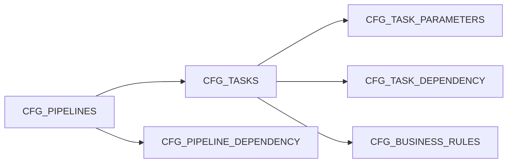

# Pipelines and tasks

A pipeline is rows in the Engine DB's `CFG_` tables. Your team keeps them in
[configuration files](configuration-files.md), one CSV file per table, and
`etl-craft config apply` merges them into the Engine DB; [configuration
migrations](configuration-migrations.md) write the same rows with SQL. Review the change like
code, then check the rows with [`validate`](validating.md). Plain SQL connections cannot edit
these rows; each change records its actor and before/after values. See also
[Engine DB setup and upgrades](../deploying/engine-db.md).



Every `CFG_` row has `ACTIVE_FLAG` (`Y` or `N`): setting it to `N` retires the row without
deleting it, and only active rows are read. Codes are unique among active rows, so a retired
pipeline's code can be used again. `CREATED_BY`, `CREATE_DATE`, `UPDATED_BY` and `UPDATED_DATE`
are kept by database triggers, with the actor as the creator and updater.

The demo's [`metadata/support_insights.sql`](https://github.com/venkatcg00/etl-craft/blob/main/examples/demo/metadata/support_insights.sql)
writes five pipelines this way, and runs as written on SQLite and PostgreSQL.

## `CFG_PIPELINES`

| Column | Holds |
|---|---|
| `PIPELINE_CODE` | the pipeline's code: one ASCII letter followed by letters, digits or `_`, at most 128 characters. It names the pipeline in every command and log folder |
| `PIPELINE_NAME` | a readable name |
| `DESCRIPTION` | what the pipeline is for; the [catalog](catalog.md) leads its page with it |
| `RUN_SCHEDULE` | a five-field cron expression or supported macro for the controller (see [Schedules](../deploying/controller.md#schedules-and-logical-dates)) |
| `SCHEDULE_TIMEZONE` | nullable IANA timezone; NULL uses `Orchestration.Timezone` (default `UTC`) |
| `SCHEDULE_START_DATE` | nullable local date to begin scheduling; NULL uses the creation timestamp |
| `CATCHUP` | controller: `Y` queues bounded missed ticks; `N` (default) queues only the latest |
| `MAX_CATCHUP_RUNS` | positive whole number, default 1; maximum retained ticks with catch-up enabled |
| `OVERLAP_POLICY` | controller: `SKIP` (default) records ticks skipped while work is pending; `QUEUE` retains them |
| `SLA_IN_HOURS` | how long a run may take; each run is marked `MET` or `BREACHED` (see [Running a pipeline](running-pipelines.md#sla)) |
| `REFRESH_TYPE` | `FULL` or `INCREMENTAL`; SQL tasks read it through [`$$pipeline_run_id_filter`](sql-tasks.md) |
| `PIPELINE_PARAMETERS` | a JSON object of pipeline tags and alert settings (below) |

`PIPELINE_PARAMETERS` accepts two keys, each a list of strings:

| Key | Value |
|---|---|
| `TAGS` | labels for the pipeline, such as `["sales", "daily"]` |
| `EMAIL_RECIPIENTS` | who receives the pipeline's alert and SLA emails, overriding `Orchestration.Email_recipients` |

Wrong types and unknown keys fail
`validate` and are refused by `config apply`; remove an unknown key or use an allowed one.
The pipeline's `CATCHUP` and `MAX_CATCHUP_RUNS` columns control schedule catch-up.

### Pipeline tag values

`PIPELINE_PARAMETERS.TAGS` is a JSON list of at most 20 unique strings. Each string has 1 to 64
lowercase ASCII letters, digits, `-`, `_` or `:`. For example,
`{"TAGS": ["team:sales", "tier:gold"]}`. Tags are never trimmed or case-folded: `Sales` fails.
`validate` names each invalid value, its rule and its remedy; `config apply` refuses the whole
change. Tags label pipelines and do not change their execution order or permissions.
See [tag filters](inspecting.md#filter-by-tags) and [group controls](run-control.md#pause-or-resume-a-tagged-group).

## `CFG_TASKS`

| Column | Holds |
|---|---|
| `PIPELINE_ID` | the pipeline the task belongs to |
| `TASK_CODE` | the task's code, unique in its pipeline: one ASCII letter followed by letters, digits or `_`, at most 128 characters |
| `TASK_TYPE` | `INGESTION` (it brings data in) or `ETL` (it works on data already in); shown by `steps` and the catalog |
| `HANDLER` | what runs the task (below) |
| `RUN_CONDITION`, `RUN_CONDITION_COUNT` | how many of its dependencies must be satisfied: `ALL` (the default, when `NULL`), `ANY`, or `N` with a count; see [Dependencies and run conditions](dependencies.md) |

| `HANDLER` | Runs | Guide |
|---|---|---|
| `SQL` | one read-only SELECT, wrapped by the engine in one of nine actions | [SQL tasks](sql-tasks.md) |
| `SQL_SCRIPT` | unmanaged SQL from `sql_scripts/` | [SQL scripts](sql-scripts.md) |
| `PYTHON` | Python code from `python_scripts/` | [Python scripts](python-scripts.md) |
| `BUSINESS_RULES` | the task's rows of `CFG_BUSINESS_RULES`, flagging the rows that break them | [Business rules](business-rules.md) |
| `EVENT_WAIT` | a durable file or warehouse-row condition without an agent slot | [Event waits](event-waits.md) |
| `EMAIL_ALERT` | an email about the run so far | [Email alerts](email-alerts.md) |
| `RUN_PIPELINE` | starts a child pipeline; controller-held WAIT or DETACH at QUEUED admission | [Pipeline triggers](pipeline-triggers.md) |

A task's optional `TARGET_TABLE_ID` references `CFG_TABLES`. `TARGET_ACTIVE_FLAG` defaults to `Y`;
`N` preserves the reference while disabling the derived `TARGET_OBJECT` setting. Config files
use separate `TARGET_CATALOG_NAME`, `TARGET_SCHEMA_NAME` and `TARGET_TABLE_NAME` fields.

## `CFG_TASK_PARAMETERS`

A task's settings are name and value rows, one per `PARAMETER_NAME` among its active rows. Each
handler's guide lists the ones it reads. Every task may also set:

| Parameter | Value |
|---|---|
| `TASK_TIMEOUT_SECONDS` | the task's time limit, overriding `Orchestration.Task_timeout_seconds`; `0` for none |
| `RETRY_ON` | `NONE`, `TRANSIENT` (default), `TRANSIENT_AND_UNKNOWN` or `ANY`; overrides `Orchestration.Retry_on` |
| `RETRIES` | additional local attempts; defaults to `Orchestration.Retries`, or `0` |
| `RETRY_DELAY_SECONDS` | first retry delay in seconds; default `60`, `0` for immediate |
| `RETRY_BACKOFF` | finite multiplier of at least `1`; default `2.0`, delay capped at `3600` seconds |
| `DOCUMENTATION` | what the task does; kept in versions by [`docs-version`](lineage.md) and shown in the catalog |

A parameter no handler reads is a `validate` warning, with the nearest names, except on `PYTHON`
tasks, whose scripts may read any.

## `CFG_TASK_DEPENDENCY` and `CFG_PIPELINE_DEPENDENCY`

The order of the work comes from these rows, never from code. A `CFG_TASK_DEPENDENCY` row makes
`TASK_ID` wait on `DEPENDS_ON_TASK_ID`, in its own pipeline or, with `DEPENDS_ON_PIPELINE_ID`,
in another; a `CFG_PIPELINE_DEPENDENCY` row makes a pipeline wait on another. Each has a
`DEPENDENCY_TYPE`: `SUCCESS`, `FAILURE`, `ALWAYS` or `HAS_DATA`. See
[Dependencies and run conditions](dependencies.md).

## An example

Put this SQL in a new project migration to load orders and then check them, on SQLite or
PostgreSQL. Apply it with `etl-craft migrate`:

```sql
INSERT INTO CFG_PIPELINES (PIPELINE_CODE, PIPELINE_NAME, DESCRIPTION, REFRESH_TYPE, RUN_SCHEDULE)
VALUES ('SALES_DAILY', 'Daily sales', 'Loads yesterday''s orders and checks them.', 'FULL',
        '0 6 * * *');

INSERT INTO CFG_TASKS (TASK_CODE, TASK_TYPE, PIPELINE_ID, HANDLER)
SELECT v.column1, v.column2, p.PIPELINE_ID, v.column3
FROM (VALUES ('load_orders', 'ETL', 'SQL'), ('check_orders', 'ETL', 'BUSINESS_RULES')) v
JOIN CFG_PIPELINES p ON p.PIPELINE_CODE = 'SALES_DAILY' AND p.ACTIVE_FLAG = 'Y';

INSERT INTO CFG_TABLES (SCHEMA_NAME,TABLE_NAME) VALUES ('sales','orders');
UPDATE CFG_TASKS SET TARGET_TABLE_ID=(SELECT TABLE_ID FROM CFG_TABLES
    WHERE CATALOG_NAME IS NULL AND SCHEMA_NAME='sales' AND TABLE_NAME='orders')
WHERE TASK_CODE='load_orders' AND PIPELINE_ID=(SELECT PIPELINE_ID FROM CFG_PIPELINES
    WHERE PIPELINE_CODE='SALES_DAILY');

INSERT INTO CFG_TASK_PARAMETERS (TASK_ID, PARAMETER_NAME, PARAMETER_VALUE)
SELECT t.TASK_ID, v.column1, v.column2
FROM (VALUES ('SQL_ACTION', 'OVERWRITE_TABLE'),
             ('SOURCE_SQL_FILE', 'sql_scripts/orders.sql')) v
JOIN CFG_PIPELINES p ON p.PIPELINE_CODE = 'SALES_DAILY' AND p.ACTIVE_FLAG = 'Y'
JOIN CFG_TASKS t ON t.PIPELINE_ID = p.PIPELINE_ID AND t.TASK_CODE = 'load_orders'
                AND t.ACTIVE_FLAG = 'Y';

INSERT INTO CFG_TASK_DEPENDENCY (PIPELINE_ID, TASK_ID, DEPENDS_ON_TASK_ID, DEPENDENCY_TYPE)
SELECT c.PIPELINE_ID, c.TASK_ID, l.TASK_ID, 'SUCCESS'
FROM CFG_PIPELINES p
JOIN CFG_TASKS c ON c.PIPELINE_ID = p.PIPELINE_ID AND c.TASK_CODE = 'check_orders'
JOIN CFG_TASKS l ON l.PIPELINE_ID = p.PIPELINE_ID AND l.TASK_CODE = 'load_orders'
WHERE p.PIPELINE_CODE = 'SALES_DAILY'
  AND p.ACTIVE_FLAG = 'Y' AND c.ACTIVE_FLAG = 'Y' AND l.ACTIVE_FLAG = 'Y';
```

`etl-craft graph --pipeline-code SALES_DAILY` shows its order. `etl-craft validate
--pipeline-code SALES_DAILY` says what is still missing before it can run:

```text
[FAIL] SALES_DAILY.check_orders: task check_orders has HANDLER=BUSINESS_RULES but no active row in CFG_BUSINESS_RULES
[FAIL] SALES_DAILY.load_orders: SOURCE_SQL_FILE='sql_scripts/orders.sql': no such file .../sql_scripts/orders.sql
checked 1 pipeline(s) and 2 task(s): 2 failed, 0 warning(s)
```

Add `sql_scripts/orders.sql` with the SELECT (see [SQL tasks](sql-tasks.md)) and a rule for
`check_orders` (see [Business rules](business-rules.md)), and `etl-craft run --pipeline-code
SALES_DAILY` runs it.

## Starting child pipelines

Use an ETL task with `HANDLER=RUN_PIPELINE` to launch another pipeline. `WAIT` frees the
agent while the controller waits for the child's ending; `DETACH` ends after admission.
See [Pipeline trigger tasks](pipeline-triggers.md) for parameters, rerun identities and controls.
